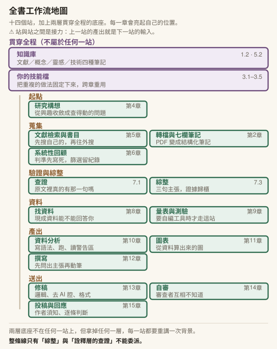

<div align="center">

# 把機械的事情交給 AI 研究助理

### 教育研究者的 Claude 學術工作流

一本書，也是一門十六週的研究所課程。
從你的第一份筆記，走到一篇通過自審、可以送出去的稿子。

[](LICENSE)


</div>

---

> ### 你手上有正在寫論文的學生？
>
> 有一頁是為這個處境寫的：**五個十分鐘內看得出來的徵象**，
> 讓你判斷眼前這份稿子背後有沒有發生學習——
> 而且要診斷的是「有沒有經過判斷」，不是「有沒有用 AI」。
>
> 同一頁還有：這本書不讓工具碰哪些事、鷹架與依賴怎麼分辨，
> 以及帶學生最常擔心的那幾件事各在哪一節被處理。
>
> →　**[帶學生的時候](docs/SUPERVISING.md)**

---

## 這本書在處理什麼

五件事，你大概都遇過：

> **文獻是個無底洞。** 第一天搜到四十篇，第五天發現有一整條你完全沒注意到的脈絡，下面又有八十篇。最後停下來的理由不是「讀夠了」，是「沒時間了」。
>
> **寫到一半失去方向。** 筆記做了三十份，每一份都很紮實。然後你打開空白文件，游標閃爍，寫不出第一句。
>
> **引用焦慮。** 改到第七稿，你已經記不清第三頁那筆引用是哪來的。要查的有六十幾筆，截止日在後天。
>
> **沒有人幫你審。** 你希望有人在送出去之前看一眼。但指導教授很忙，同儕在趕自己的稿，而你看這份稿子已經看到什麼都看不出來。
>
> **格式地獄。** 投稿前一晚你在改參考文獻的標點。這件事跟研究品質無關，但它會花掉你三個小時，而且下一篇還要再來一次。

這五件的共同點是流程太長、太碎、太孤獨。你在第八步已經忘記第二步做過什麼決定；每一段之間都有摩擦成本，而那些成本不會出現在任何一份研究計畫的時程表裡。

---

## 它不教「AI 有哪些功能」

整本書只有一個判準：**如果它做錯了，我看得出來嗎？**

十六章各用一種方式回答它。所以書裡花很多篇幅在講它會在哪裡出錯、以及一份看起來完整的產出可以錯得多安靜。第 2 章有一節要求你先讓它騙你一次，親手抓到那一筆之後才准往下讀。

---

## 這本書長什麼樣

| | |
|---|---|
| **正文** | 十六章。每章含概念、教育研究實例、本章建置、動手實作、常見迷思、責任落點 |
| **本章建置** | 每章一節，十六節接成同一套能跑的研究工作台：規則檔、技能、腳本、連接器、審查者、自動關卡。每一份附完整內容、放的位置與驗收動作，書中的腳本都用假資料實際跑過 |
| **附錄** | 12 份（A–L）。⚠️ 其中**附錄 J 貼出一份實際在跑的技能檔全文**，逐段拆解——那是全書唯一讓你看到成熟工具長什麼樣的地方 |
| **查閱頁** | 詞彙表 61 詞、症狀導航、踩坑清單 18 則、[帶學生的時候](docs/SUPERVISING.md)、出處頁 |
| **圖** | 48 張手繪 SVG，隨明暗色自動切換 |
| **可直接複製的東西** | 45 段。⚠️ 先讀〈[怎麼用這本書](docs/HOW_TO_USE.md)〉——它們長得像範本，其實是完整解答 |
| **課程版** | 十六週 × 3 小時，一週一章。正文裡標〔課堂〕的方框就是教案 |

---

## 十六章是一條工作流



後面的章會直接用前面章建好的東西。每章開頭有一欄「進來之前，你要能」，那是能力層的檢查，不是材料清單。

| | 章 | 你在這一章實際做出什麼 |
|---|---|---|
| 1 | [先把現場搭起來](chapters/01-setup.md) | 一個真的知識庫、一則決策日誌、工作台骨架與第一份規則檔 |
| 2 | [第一份文獻筆記，以及它騙了你](chapters/02-first-note.md) | 一份七欄筆記、你親手抓到的第一筆假引用、一支會報字數的轉檔腳本 |
| 3 | [把重複的做法固定下來](chapters/03-skills.md) | 你自己的第一個技能，加上一道擋住原始資料的關卡 |
| 4 | [研究構想：從興趣到問題](chapters/04-research-question.md) | 一句查得動的研究問題、一次選題訪談紀錄 |
| 5 | [文獻檢索與知識庫](chapters/05-literature-search.md) | 檢索紀錄、四種筆記、標好驗證層級的文獻，以及接上的書目庫 |
| 6 | [系統性回顧與綜整](chapters/06-systematic-review.md) | 寫死的納入排除判準、篩選紀錄與一致性、從紀錄算出來的 PRISMA 數字 |
| 7 | [查證與引用](chapters/07-verification.md) | 一句你敢寫進論文的引用、一份核實紀錄、從二十篇筆記長出的一個論點 |
| 8 | [找資料，以及期中匯報](chapters/08-finding-data.md) | 資料可行性表、變項對照表、題目與資料可行性的匯報 |
| 9 | [量表與測驗開發](chapters/09-scale-development.md) | 雙向細目表、題庫檔、核對過正解鍵的試題分析 |
| 10 | [統計分析協作](chapters/10-statistics.md) | 一段你講得出責任邊界的分析、一個依你選定的書回答的方法顧問 |
| 11 | [圖表與研究視覺化](chapters/11-figures.md) | 從資料算出來的 APA 黑白圖，圖上每個數值都回對過資料 |
| 12 | [寫作：先問出主張](chapters/12-writing.md) | 一段逐句指得出證據的初稿 |
| 13 | [修稿與去 AI 腔](chapters/13-revision.md) | 修稿三輪紀錄、改寫前後的數字與引用比對 |
| 14 | [投稿前自審與對抗審查](chapters/14-self-review.md) | 一份回報 N 項、處置 N 項的審查對帳表 |
| 15 | [投稿實務與回應審查](chapters/15-submission.md) | 作者須知核對表、投稿信、審查意見回應表 |
| 16 | [誠信框架、成果發表與期末匯報](chapters/16-integrity.md) | 可查驗的使用聲明、期末論文或研究計畫書、驗過一次的整套工作台 |

期末有兩種終點：找得到資料的人交一篇論文，找不到的人交一份研究計畫書，兩種用同一套檢核（第 16 章）。

---

## 目錄

**開始之前**
- [怎麼用這本書](docs/HOW_TO_USE.md) — 兩種讀法，差別比你想的大
- [前言](preface.md)

**十六章** — 見上表

**附錄**
- [A　安裝與設定](appendix/A-setup.md) — 驗收清單，不是逐步手冊
- [B–E　技能索引‧Prompt 範本‧使用聲明‧課堂政策](appendix/B-E-toolkit-policy.md)
- [F　一套技能庫怎麼運作](appendix/F-skill-library.md) — 十二個可移植設計
- [G　寫作聲紋：怎麼量出你自己的基線](appendix/G-writing-fingerprint.md)
- [H　中文學術稿的 AI 腔清單與台灣用語校正](appendix/H-chinese-ai-tone.md) — 含完整逐詞清單
- [I　投稿前自審的完整檢查表](appendix/I-self-review.md)
- [J　打開一份長大的技能檔](appendix/J-a-grown-skill.md) — 實際在跑的檔案全文
- [K　接上你的書目庫與知識庫](appendix/K-connectors.md) — 選配
- [L　拆解一篇論文的設計](appendix/L-reading-design.md) — 五個問題展開，讀出它為什麼那樣做

**查閱**
- [症狀導航](docs/SYMPTOM_INDEX.md) — 「我現在卡在這裡，該翻哪一節」
- [詞彙表](resources/glossary.md) — 61 詞
- [常見的坑](resources/pitfalls.md) — 18 則，每則附對應的設計模式

**其他**
- [十六週課綱](syllabus/sixteen-week-syllabus.md) — 給開課教師
- [出處](ATTRIBUTION.md) — 技能庫上游與授權對照

---

## 快速開始

| 你的狀況 | 從哪裡進去 |
|---|---|
| 只想試一下 | [第 1 章 1.1](chapters/01-setup.md)。五分鐘之內會有一個真的產出 |
| 打算認真走一遍 | 先讀 [怎麼用這本書](docs/HOW_TO_USE.md) |
| 手上已經卡住了 | [症狀導航](docs/SYMPTOM_INDEX.md)。找一句最像你現在處境的話 |
| 想先看成品長什麼樣 | [附錄 J](appendix/J-a-grown-skill.md)。一份用了幾個月的技能檔全文 |
| 讀了很多篇，還是不知道自己的研究該怎麼設計 | [第 5 章 5.4](chapters/05-literature-search.md) 與 [附錄 L](appendix/L-reading-design.md) |
| 要拿去開課 | [十六週課綱](syllabus/sixteen-week-syllabus.md) |

**這本書假設你**會用電腦但沒寫過程式，而且手上有一個正在進行的研究。第二條比較重要——每一章都要你拿自己的東西來做。

**它綁定 Obsidian。** 工具中立的寫法會讓這本書變得沒辦法用。原理適用於其他筆記工具，操作細節你要自己翻譯。

---

## ⚠️ 已知缺口

| 缺口 | 狀況 |
|---|---|
| **不寫介面按鈕** | 各章〈本章建置〉寫到檔案層級：內容、位置、驗收動作。按鈕位置會變，檔案位置變得慢 |
| **介面步驟會過期** | 書裡把原理與版本細節分開放，原理不過期 |
| **部分引用未經全文驗證** | 凡此類皆在該處標明驗證層級。⚠️ 這是本書的規矩，作者自己也受它管 |
| **在地規範層只寫「來源存在」** | 國科會與教育部的條文請自己開一次，那些會改 |
| **附錄 H 會過期** | 詞例層會，判準層不會。⚠️ 你照著掃卻掃不到東西，不代表稿子乾淨，代表清單該更新了 |

發現錯誤或過期內容，歡迎開 issue。

---

## 授權

**[CC BY-NC-SA 4.0](LICENSE)**：可以用（請註明出處）、不可商業使用、改編後散布須用同一授權。

書中部分方法源自公開專案，每一個上游的授權都開過該 repo 本身核實。完整血緣與逐節對照見 **[ATTRIBUTION.md](ATTRIBUTION.md)**，其中一筆是沒有授權宣告、但作者明確要求註明出處的來源。

---

## 引用本書

```
張仁誠（2026）。《把機械的事情交給 AI 研究助理：教育研究者的 Claude 學術工作流》。
```

---

<div align="center">
<sub>本 repo 由專案 markdown 正本以腳本生成。內容有變動請改正本、重跑腳本，不要手改這裡的檔案。</sub>
</div>
