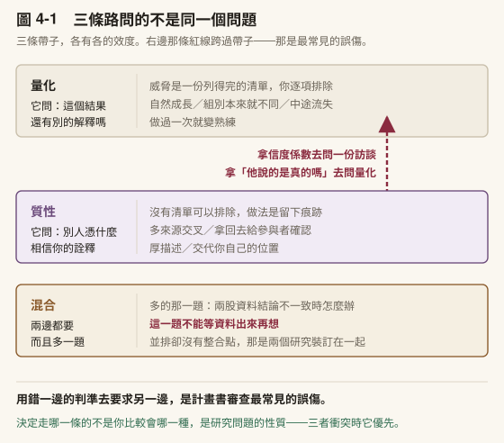
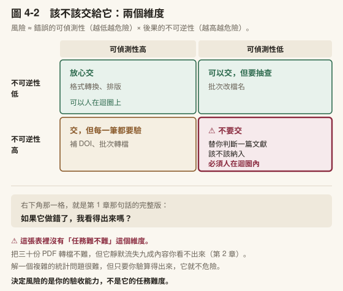
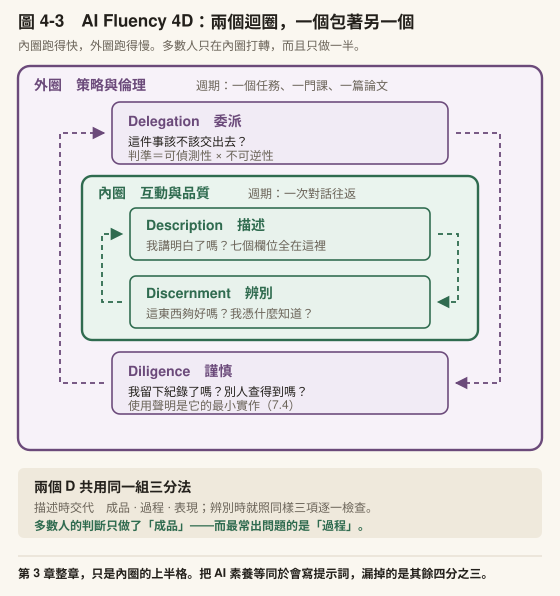
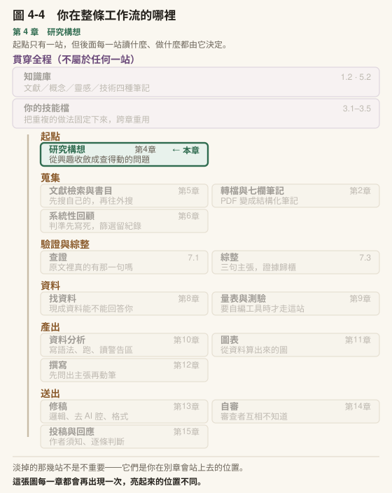

# 第 4 章　研究構想：從興趣到問題

> 書稿第 4 章＝課程第 4 週（3 小時）。2026-10-15 由原第 4 章拆出（原 4.1、4.2）＋新增 4.3 選題訪談。

---

## 本章導覽

**這一章回答四個問題**

1. 一個模糊的研究興趣，怎麼變成一個查得動的問題？
2. 量化、質性、混合方法怎麼選？為什麼三條路上的「效度」不是同一件事？
3. 哪些事可以交給它做，判準是什麼？
4. 連興趣都還說不出來的時候，從哪裡開始？

**讀完你能夠**

- **收斂**一個模糊的研究興趣成為可檢索、可判斷納入排除的研究問題
- **判斷**自己的研究問題落在哪一種取向，並說出該取向的效度要回答什麼
- **評估**一個研究構想的五個維度，並依分數帶決定下一步該推進、對抗還是補強
- **判斷**一件工作該不該交給它，並說出依據的是哪兩個維度
- **完成**一次選題訪談，產出三個候選問題與各自為什麼在乎
- **建好**一個在費工任務前先追問的技能

**需要多久**

自學閱讀約 60 分鐘｜課堂 3 小時（概念 80 分、實作 100 分）

**進來之前，你要能**

- 說出你那個技能檔在解決哪一個摩擦，而且**它已經有至少一條你事後加上去的規則**（[3.5](../chapters/03-skills.md#35-讓它長大)）
- 描述對話變鈍的症狀，並說出三個應對分別什麼時候用（[3.3](../chapters/03-skills.md#33-為什麼你的對話會愈用愈鈍)）

**開始前請準備**：一個你正在想或已經在做的研究題目。沒有題目的，帶三件你在教學現場或生活中看到、一直放不下的事，4.3 會用到。

---

## 章前導言

[第 3 章](../chapters/03-skills.md)你建了一個技能。從這一章起，它開始服務一個真的研究。

但在讀任何一篇文獻之前，有一件更前面的事得先處理，而多數人會跳過它：你到底要查什麼。

跳過的後果不會馬上出現。你會開始讀，讀得很勤，每一篇都覺得有點相關。三週之後你有四十篇筆記，然後你發現**你說不出這四十篇裡哪幾篇是必要的**，因為你從一開始就沒有一個標準可以判斷。

一個模糊的興趣沒辦法變成搜尋詞，也沒辦法讓你決定一篇論文該不該讀。它讓你讀得多，不讓你讀得準。

所以本章先把問題磨到查得動（4.1），再決定哪些事該交出去（4.2）。如果你現在連興趣都還說不出一句，先跳到 4.3：那一節讓它一次問你一題，從你在現場看到的事問起，問完你會有三個候選問題，再回到 4.1 磨。

蒐集文獻是[第 5 章](../chapters/05-literature-search.md)的事。本章結束時你手上有一句研究問題，[第 5 章](../chapters/05-literature-search.md)用它決定要讀什麼；[第 8 章](../chapters/08-finding-data.md)找資料的時候，這句問題多半還會再改一次，那是常態，不是失敗。

**本章的邊界。** 4.1 會教研究設計的取向（量化、質性、混合方法，以及它們各自的效度長什麼樣），因為那決定你接下來讀什麼；但它不教研究設計的執行。抽樣程序、倫理審查、檢定力估算，是方法論課程與專門教科書的事。4.1 的材料是你的：工具負責把你已經有的東西問清楚，不是替你生一個研究題目出來。

> **〔課堂〕開場 8 分鐘** 問全班一個問題，讓他們寫在紙上，不要說出來：**「用一句話寫下你的研究問題。」** 給九十秒。時間到之後不要收，也不要評論，只說一句：「等一下 4.1 結束我們再回來看這張紙。」多數人寫出來的是**題目**不是**問題**（例如「AI 與寫作教學」）。寫不出任何東西的人，請他們在紙上寫「4.3」，那一節是為他們準備的。

---

## 4.1 從模糊的興趣到一個查得動的問題

### 興趣、題目、研究問題是三件事

多數人以為自己有研究問題，其實手上只有題目。

| | 長什麼樣 | 能拿它做什麼 |
|---|---|---|
| **興趣** | 「我對 AI 在教學上的應用有興趣」 | 幾乎什麼都做不了 |
| **題目** | 「生成式 AI 與大學寫作教學」 | 可以聊天，不能檢索、不能判斷該讀什麼 |
| **研究問題** | 「同儕回饋的結構化程度，如何影響大學生後續寫作表現？」 | 有變項、有對象、有可查的關鍵詞、可判斷一篇論文該不該讀 |

差別不在寫得長不長，在它有沒有把你可能會錯的地方講出來。

「AI 與寫作教學」這種說法沒有辦法錯，所以它也沒有辦法對。而一個研究問題必須要有可能是錯的。這正是它能指引你讀什麼的原因：任何一篇論文，你都可以問它「這篇有沒有回答我這個問題」，然後得到一個明確的是或否。

### 為什麼不能跳過這一步

跳過的代價會延後出現，而且會偽裝成別的問題：

- **你會讀得很多但收不了尾。** 沒有問題就沒有納入排除的判準，於是每一篇都「有點相關」。四十篇筆記全部有點相關，等於沒有一篇特別相關
- **你的搜尋詞會一直不對。** 你打「AI 寫作教學」，得到的是一片汪洋。可查的關鍵詞來自變項，而變項來自問題
- **AI 會順著你的模糊講下去。** 你給它一個模糊的題目，它會產出一段讀起來很專業的文字。**那段文字的專業感是文體上的，不是內容上的**——它把模糊潤飾得更好看了，而不是變清楚了

第三項是[第 1 章](../chapters/01-setup.md)那件事在這裡的具體版本：**它做的是接話，接得像不像跟對不對是兩回事**。你把一個沒有邊界的問題丟給它，它不會告訴你這個問題沒有邊界，它會給你一段有邊界感的文字。

### AI 在這一步幫得上什麼

分清楚兩件事：

| 幫得上 | 幫不上 |
|---|---|
| 當**反方**：指出你的問題預設了什麼、哪個詞沒有定義 | 告訴你這個領域現在缺什麼（那要讀文獻，[第 5 章](../chapters/05-literature-search.md)才開始） |
| 產出**多個版本**讓你挑，比你自己在腦裡繞快 | 替你決定你在乎什麼 |
| 逼你把「結構化」「有效」這類詞說出操作定義 | 判斷這個問題值不值得做 |

**它最有用的用法是當反方，不是當顧問。** 顧問會給你答案，而你現在需要的不是答案，是有人指著你的句子問「這個詞你指的是什麼」。

下一節 4.2 的執行前追問就是這個動作的通用版。這一節是它落在研究問題上的專用版。

它還有第三次出場，在你真的動筆寫論文的時候——那次問的不是「這件事要怎麼做」，是「這一段你要主張什麼」。做法在[第 12 章](../chapters/12-writing.md)。

### 一段可以直接貼的提示詞

```text
我要把一個研究興趣收斂成可以查、可以做的研究問題。
請當反方，不要順著我講。

我的興趣：〔一句話寫下來，模糊沒關係〕
我的處境：〔學位階段／可取得的對象／可用的時間〕

請依序做四件事：

1. 指出我這句話裡**沒有定義的詞**，逐一列出並問我指的是什麼
2. 指出我這句話**預設了什麼**而我可能沒意識到
3. 給我三個不同方向的具體版本，每個都要含：
   對象、變項、關係、可檢索的英文關鍵詞 3–5 個
4. 針對每一個版本，直接說出它**最可能做不下去的地方**
   （取樣困難？變項難測？時間不夠？）

規則：
- 不要幫我美化措辭。我要的是問題變清楚，不是句子變好看
- 如果我的興趣根本還不足以收斂，就直接說，並告訴我還缺什麼
- 不要引用任何文獻。這一步不需要，而且你給的我還沒能力查證
```

最後兩條規則各自防一件事。

**「不要美化措辭」**防的就是上面說的：把模糊潤飾成好看的模糊。

**「不要引用任何文獻」**防的是一個很常見的順序錯誤。在你還沒有能力判斷真假的時候就收下一批書目。那些書目會跟著你進到下一步，而你會忘記它們是在你沒有判斷力的時候進來的。文獻要等到本章後半，用你自己驗證得了的方式進來。

〔動手一下〕**5 分鐘**。把上面那段貼進去跑一次，然後只做一件事：把它問你的「沒有定義的詞」抄下來。多數人會發現自己的問題裡有兩到三個詞，講了半年但從來沒定義過。

### 四個檢查：你的問題磨好了嗎

不是問句就算研究問題。四個檢查，缺一個就退回去改：

1. **查得動嗎？** 你能不能從它直接寫出三到五個英文檢索詞。寫不出來，代表變項還沒浮現
2. **判得斷嗎？** 隨手拿一篇論文，你能不能一分鐘內判斷它該不該進你的文獻回顧。判不斷，代表範圍還沒收
3. **測得到嗎？** 句子裡每一個關鍵詞，你說得出它怎麼被觀察或測量嗎（先不管你做不做得到，先問測不測得到）
4. **有人在乎嗎？** 假設你得到了明確的答案，那個答案會改變誰的什麼決定

第 4 個檢查最常被略過。一個查得動、判得斷、測得到但沒有人在乎的問題，是可以順利完成的研究，而那是最糟的一種結果。你會做完，然後發現沒有人需要它。

⚠️ **這四個檢查你自己做，不要交給 AI。** 前三個它可以幫你檢查，第四個它幫不上：它不知道你的領域現在在爭論什麼，它只知道過去的文字裡有什麼。第 4 個檢查的答案要等你讀完文獻才會真正清楚。所以這一節你會在本章後半跑完之後回來再做一次。

〔補充〕**變項定義是整個研究裡最貴的一個決策。** 兩個來自實際研究的教訓。第一個：某個專案裡有一個構念，AI 把它誤判為名字相近但理論根基完全不同的另一個變項。研究者順著那個誤判選了配套理論、跑完整套檢定，等到發現的時候，整條推導鏈全數作廢。第二個：資料裡有一個類別變項，AI 把它的標籤當成學術概念來詮釋——但那個標籤只是編碼時取的名字，跟它被解讀成的那個社會科學概念完全不是同一件事。等到結論寫出來才回頭核對，發現那個概念從來不存在於原始資料裡。兩個案例的共同教訓：**上游定義錯了，下游所有分析都是廢品，而且跑的時候不會報錯。** 這就是為什麼上面四個檢查的第 3 題（測得到嗎）不能跳過——它逼你說出每個詞怎麼被觀察，而說不出來的時候就是定義還沒定下來。

### 第一個岔路：你要走哪一種研究

問題磨清楚之後，馬上會撞到一個岔路，而且**它決定你接下來讀什麼、怎麼讀**。走錯這一步，後面的文獻工作全部要重來，所以它屬於動筆之前，不屬於方法課。

研究設計的標準分法是三條路：

| 取向 | 你想做的事 | 產出長什麼樣 |
|---|---|---|
| **量化** | 檢驗理論、比較組別、找變項之間的關係 | 「這個關係存不存在、有多強」 |
| **質性** | 探索意義、理解經驗、**建立**而不是檢驗理論 | 「這件事是怎麼發生的、對當事人是什麼」 |
| **混合方法** | 兩者都要，而且說得出為什麼兩者都要 | 一股資料解釋另一股，或兩股互相對照 |

決定走哪一條的**不是你比較會哪一種**。標準的判準有三個：研究問題的性質、你自己的訓練與經驗、你想說服的讀者。三者衝突時，第一個優先。你的問題問的是「有沒有影響」，那它就是量化的問題，不會因為你比較擅長訪談而改變。

〔補充〕混合方法有三種核心設計，別混著講。（一）**先量後質**：量化跑完，挑特定的人去訪談，用質性解釋量化為什麼長那樣。（二）先質後量：質性先探索，據此開發工具或假設，再用量化檢驗。量表開發常走這條。（三）同時並行：兩股同時蒐集，最後對照整合。這三種寫進計畫書時要附一張程序圖，圖上要標清楚兩股資料誰主誰次（慣例是主要的那股寫大寫 QUAN／QUAL，次要的寫小寫）以及整合點在哪裡。兩條線並排畫著卻沒有整合點，那不是混合方法，那是兩個研究裝訂在一起。

再往下一層，是你相信什麼算證據。

同一個教育現象，有人覺得要先有可測量的變項才談得上研究，有人覺得意義是參與者建構出來的、測量會把它壓扁。這一層通常叫世界觀，常見的分法有四種：

| 世界觀 | 大致主張 | 典型走向 |
|---|---|---|
| **後實證主義** | 有客觀規律，但我們只能逼近、不能確證 | 量化 |
| **建構主義** | 意義由參與者在情境中建構，研究者要去理解 | 質性 |
| **轉化型** | 研究要處理權力與不平等，帶行動議程 | 質性或混合，含弱勢群體 |
| **實用主義** | 什麼方法能回答問題就用什麼 | 混合方法 |

上面的三取向與這四種世界觀，出自 Creswell 與 Creswell《Research Design》第五版（2018）。那本書的核心命題是一條乘式：**研究取向＝世界觀 × 研究設計 × 研究方法**。你選的方法不是憑空來的，它掛在你對「什麼算證據」的假設上。

這裡要照本書自己的規矩交代一件事：我引用的是這個框架的**結構**，不是書裡的任何一段文字，而且我沒有逐頁讀過那本書。所以這一段撐得住的主張只到「這個分類是這麼分的」，撐不住「Creswell 在第幾頁怎麼論證」。要用到後者，請自己去讀那一章。這正是[第 5 章](../chapters/05-literature-search.md) [5.3](../chapters/05-literature-search.md#53-書目管理層讓機械工作歸機械) 要講的驗證層級，作者自己也一樣受它管。

你不必挑一個標籤貼在自己身上。這一層真正的用處是：當你的指導教授或審查者說「你這個研究不夠嚴謹」，他講的嚴謹，跟你想的可能不是同一件事。

最容易出事的是效度。三條路上的「效度」不是同一個東西。



〔圖 4-1〕三條帶子各有各的效度。**要看的是右邊那條跨過帶子的紅線**—— 它兩端都有箭頭，因為兩個方向的誤傷一樣常見。

- **量化端**問的是「這個結果還有沒有別的解釋」。威脅有名字：受試者在期間自然成長、組別本來就不同、中途流失的人剛好不是隨機的、測驗做過一次就變熟練。這些威脅是**列得完的清單**，你逐項排除
- **質性端**問的不是這個。它問「別人憑什麼相信你的詮釋」，做法是**留下痕跡**：多來源交叉比對、把詮釋拿回去給參與者確認、寫出足夠厚的描述讓讀者自己判斷、主動交代研究者自己的位置
- **混合方法兩邊都要**，而且要多回答一題：兩股資料結論不一致時你怎麼辦。**這一題不能等資料出來再想**

圖上那條紅線就是這件事：**用錯一邊的判準去要求另一邊**，兩個方向都會發生。

### 這個構想值不值得做：五個維度與三個對手

上一段決定你走哪條路，這一段決定你要不要走。

我自己在用的構想評估工具有五個維度，每個 1 到 5 分，滿分 25：

| 維度 | 它在問什麼 |
|---|---|
| **理論缺口清晰度** | 你說得出「現有研究到哪裡、你補哪一塊」，還是只說得出「這個題目很重要」 |
| **方法設計嚴謹度** | 你的設計真的回答得了你的問題嗎 |
| **樣本可行性** | 你拿得到那些人嗎、拿得到幾個、要多久 |
| **測量嚴謹度** | 你的關鍵構念用什麼測、那個工具的證據在哪 |
| **實務貢獻清晰度** | 答案出來會改變誰的什麼決定 |

分數本身沒那麼重要，**分數帶對應的動作才重要**：

| 總分 | 該做什麼 |
|---|---|
| 21–25 | 直接推進，沒有辯論的必要 |
| **15–20** | **這是模糊帶，評分在這一段沒有鑑別力**。要換一種方式重看 |
| 12–14 | 弱點明確而且有救，走補強 |
| 12 以下 | 補強救不了定位錯誤，回到缺口重新定位 |

15 到 20 分那一格是重點。分數落在這裡，代表**再打一次分數不會得到新資訊**。這時要換成對抗：

1. **樂觀方**：假設一切順利，這個構想最好可以走到哪裡。**先跑這個是刻意的**，否則你會在還沒看見上限之前就把它否決掉
2. **懷疑方**：專找致命傷，五類逐一過——構念站不住、設計答非所問、樣本拿不到、測量撐不起、貢獻說不清
3. **審查者**：扮演你目標期刊最難搞的那一位，寫出他會寫的意見

三個角色要**分開跑**，理由跟[第 2 章](../chapters/02-first-note.md)講的一樣：同一次對話裡，它記得自己剛才誇過這個構想，於是質疑會客氣。

兩條硬規則，缺一個這件事就會走偏：

**第一，這個工具不得宣告任何構想「不值得做」。** 低分只能說成「以這個框架衡量偏弱，弱在哪一項」。差別不是措辭客氣。框架本身有適用範圍，一個紮實的質性研究拿去套「測量嚴謹度」，分數必然難看，而那是框架的問題，不是研究的問題。

**第二，懷疑方與審查者的輸出是模擬意見，不是判決。** 它模擬的是「一個審查者可能會說什麼」，它沒有讀過你的領域今年吵什麼。

**評估跑完，要停下來讓你自己決定。** 我的版本在兩個位置強制停：評分出來之後停一次（要不要進對抗），對抗跑完再停一次（放棄、改進、還是照原樣推進）。停下來的時候它給推薦與理由，但要拿到你一句明確的回覆才往下走。

這兩個停點的位置不是隨便設的，判準就是[第 1 章](../chapters/01-setup.md)那一條：**做下去很難回頭的那一步之前**。放棄一個構想很難回頭，所以那裡要有一個關卡。

〔動手一下〕**10 分鐘**。拿你手上那個構想，只跑五維度評分，跑完先不要做任何事，只看最低的那一項。多數人會發現最低的是「實務貢獻清晰度」或「測量嚴謹度」，而這兩項恰好是四個檢查裡第 3、第 4 個檢查的延伸。

### 這一節的邊界

**這一節教研究設計的取向，不教研究設計的執行。** 取向、世界觀、效度的三種問法、構想評估。這些決定你接下來讀什麼、怎麼判斷該不該讀，所以它們在這本書裡。抽樣程序、倫理審查送件、量表選用與編製、統計檢定力估算，是方法論課程與專門教科書的內容，本書不取代它們。

**而且這一節的材料是你的。** 工具負責指出你哪裡含糊、幫你看見沒選的那幾條路，不負責替你決定你在乎什麼。如果你把它當成生成器，它會給你一個聽起來很像研究問題的東西，而你會拿著它走很遠，直到某一天有人問你「所以你的依變項是什麼」。

> **〔課堂〕4.1 講述 20 分鐘＋現場演練 20 分鐘** 建議節奏：三件事的區分（5 分）→ 為什麼不能跳過（5 分）→ 反方提示詞現場示範（10 分） → 學生自己跑一次（15 分）→ 取向岔路與三種效度（10 分）→ 五維度與對抗（5 分） → 學生跑一次五維度評分（5 分）。 **講述已由 35 分壓到 20 分**，讓出的 15 分給 [5.4](../chapters/05-literature-search.md#54-這篇論文為什麼這樣做)。壓法就是原本建議的那一條：取向那一段改為指定閱讀，課堂只講「三種效度不是同一件事」那一塊—— 修過方法課的學生本來就會。 **反方演練與五維度評分兩個動手段落不要砍**，它們是這一節唯一會留下產出的部分。 **現場示範務必用一個真的很模糊的興趣**，最好是當場跟學生要一個。用你自己準備好的漂亮例子，示範不出這一節最重要的東西。**模糊被潤飾的那一刻長什麼樣**。演練結束後，讓學生拿出開場寫的那張紙，比對前後。**那個對比就是這一節的驗收。** 會有學生說「它給的版本我都不喜歡」。那通常是好事，代表他心裡其實有方向，只是還沒說出來。請他說出「為什麼不喜歡」，那句話往往就是他真正的研究問題。

### 帶走這一節

- **興趣、題目、研究問題是三件事**，多數人手上的是題目
- 一個研究問題必須**有可能是錯的**，那正是它能指引你讀什麼的原因
- AI 在這一步最有用的角色是**反方**，不是顧問
- 最該防的失敗是**模糊被潤飾成好看的模糊**，它讀起來會像進步
- 四個檢查：查得動、判得斷、測得到、有人在乎。**第四個要等讀完文獻再回來做一次**
- 取向（量化／質性／混合）由**問題的性質**決定，不由你比較會哪一種決定
- **三條路上的「效度」不是同一個東西**：量化排除別的解釋，質性留下痕跡，混合要多回答「兩股不一致怎麼辦」
- 構想評估的五維度分數不重要，**分數帶對應的動作才重要**；15–20 分代表評分沒有鑑別力，要換成對抗
- 對抗的三個角色要**分開跑**，而且它產出的是模擬意見，不是判決
- 這一節教研究設計的**取向**，不教研究設計的**執行**

---

## 4.2 該不該交給它

上一節你磨出了一個問題、判斷了取向、評估了構想。接下來每一步都會遇到同一件事： **這一段，我自己做還是交出去？**

這一節給你三樣東西：一個判準、一個框架、一個習慣。

### 判準：兩個維度，跟難度無關

> **風險 ≈ 錯誤的可偵測性（越低越危險）× 後果的不可逆性（越高越危險）**

⚠️ **注意這個判準裡沒有「任務難不難」。** 難的任務不見得危險，簡單的任務也可能很危險。

| | 可偵測性高 | 可偵測性低 |
|---|---|---|
| **不可逆性低** | 放心交（格式轉換、排版） | 可以交，但要抽查（批次改檔名） |
| **不可逆性高** | 交，但每一筆都要驗（補 DOI） | ⚠️ **不要交**（替你判斷一篇文獻該不該納入） |



〔圖 4-2〕兩條軸，四格，而它們的處置方式完全不同。圖上多標了一個東西：左上角那格可以**人在迴圈上**（它自己跑，你監看），右下角那格必須**人在迴圈內**（每一步你都要在場）。這兩個術語在本節後面會再出現。

右下角那一格就是[第 1 章](../chapters/01-setup.md)那句話的完整版：

> **如果它做錯了，我看得出來嗎？**

〔補充〕**為什麼難度不在判準裡。** 「幫我把三十份 PDF 轉檔」很難嗎？不難，但它出錯（靜默流失 98% 的內容）你看不出來。[第 2 章](../chapters/02-first-note.md)講過那個實例。反過來，「幫我解一個複雜的統計問題」很難，但如果你有能力驗算，它就不危險。決定風險的是你的驗收能力，不是它的任務難度。

### 框架：四個 D

判準管單次決定。你還需要一個更上位的東西，因為**「會用 AI」不等於「會寫提示詞」**。

AI Fluency 框架把這件事拆成四個能力（Dakan 與 Feller 提出，與 Anthropic 合作發展）：

| 能力 | 一句話 | 在問什麼 |
|---|---|---|
| **Delegation**（委派） | 判斷什麼該交給 AI、什麼該自己做 | 這件事該不該交出去？ |
| **Description**（描述） | 把任務說清楚 | 我講明白了嗎？ |
| **Discernment**（辨別） | 用學科標準評估它的產出 | 這東西夠好嗎？我怎麼知道？ |
| **Diligence**（謹慎） | 揭露、查證、保護、承擔責任 | 我留下紀錄了嗎？該說的說了嗎？ |

**這四個中文詞是說明，不是定譯。** 該框架目前只有英文版，沒有官方中文翻譯；本書用的四個詞取自中文圈已在流通的說法，正式場合引述時寫英文原詞比較安全。

**[第 3 章](../chapters/03-skills.md)整章，只是 Description 這一個 D。**

### 兩個 D 共用的三分法

四個 D 各有子成分，而其中兩個 D **用的是同一組三分法**：

| | 三個子成分 |
|---|---|
| **Description** | 成品（Product）／過程（Process）／表現（Performance） |
| **Discernment** | 成品／過程／表現 |

[第 3 章](../chapters/03-skills.md)的七元素，後三個正是 Description 的這三個子成分。

而這個對稱給了你一個很實用的操作：

> **你描述時交代了成品、過程、表現，判斷時就照同樣三項逐一檢查。**

- **成品**：它給的東西，形狀對不對？（欄位齊嗎、長度對嗎、格式合規嗎）
- **過程**：它走的路對不對？（有沒有跳步驟、有沒有在該問我的時候沒問）
- **表現**：它的姿態對不對？（我要的是挑毛病，它卻在稱讚）

多數人的判斷只做了第一項。**而最常出問題的是第二項**—— 產出看起來沒問題，但它是用一條你不會接受的路徑得到的。



〔圖 4-3〕四個 D 分成兩個迴圈，各自的節奏不同。

**策略與倫理迴圈（Delegation ↔ Diligence）** 跑得慢，週期是一個任務、一門課、一篇論文。它在問「這件事該不該做、做了要不要說」。

**互動與品質迴圈（Description ↔ Discernment）** 跑得快，週期是一次對話往返。你描述、它產出、你辨別、你重新描述。

多數人只在裡面那一圈打轉，而且只做一半（只描述，不辨別）。外面那一圈根本沒有啟動。

### 這件事在文獻裡的位置

委派判斷不只是本書的提法，它有人在做系統性的研究。不過取向不同，值得知道差在哪。

有一支研究從系統理論切入，關心的是**人怎麼保持對 AI 系統的控制** （Te'eni et al., 2025）。它用了兩個既有的術語，本書直接沿用：

| 術語 | 意思 |
|---|---|
| **人在迴圈內**（human-in-the-loop） | 每一步都要你參與或確認 |
| **人在迴圈上**（human-on-the-loop） | 它自己跑，你監看，必要時介入 |

**它們不是誰比較好，是對應不同的情況。** 對照上面那張判準表：右下角那一格要人在迴圈內，左上角那一格可以人在迴圈上。

該研究另有一個提醒，角度與本書的判準不同：

> **你可以讓它自己跑，但如果你不能決定「什麼時候該停下來重新設定」，你就已經失去控制了。**

換句話說，除了「這一步該不該交」，還要問**「我還握著喊停的權力嗎」**。

〔補充〕**該研究的場景與本書不同，轉用時要節制。** 它處理的是關鍵決策系統與大量資料，談的是多層次的控制迴路怎麼設計。那一層不轉移到單一研究者身上，本書只取上面兩個術語與那一句提醒。（出處與驗證層級見〈延伸資源〉。）

### 習慣：開跑之前先追問

在任何比較費工的任務開始之前，加一句：

> 開始之前，先列出你需要我確認的關鍵決策，每一項附上你的建議答案。

少了「附上你的建議答案」這半句，你會收到一串開放式問題，還得自己一題題想。有了它，你多數時候只要回「二、三照你說的，第一項改成⋯⋯」就結束了。

這句話問出來的東西通常分三類：

1. **你以為已經講清楚的**（實際上沒有）
2. **你根本沒想過的**（這一類最有價值）
3. **你不在意的**（回一句「你決定」就好）

**判準**：這個任務做錯了，我要重做多久？超過十分鐘就值得先問。

同一個動作，在動筆的時候還要再用一次，但問的東西換了：那裡問的不是「你要我怎麼做」，是「你要主張什麼」。連上限也一樣適用——六到八輪就停（[第 12 章](../chapters/12-writing.md)）。

⚠️ 短任務不要用。問一個定義、改一句話、查一個格式，多問三題只是浪費。

〔補充〕**這個動作長大之後的樣子。** 它可以再多做三件事：（一）**分清楚是哪一種「不知道」**。你已經講過的不要再問；風格類的問不出來，要改成先做一個小樣本讓你看；**你不知道自己不知道的**，要換成「盲點掃描」，先讓它列出這個領域的關鍵概念、品質標準、新手常犯的錯，**以及你接下來該問什麼**。（二）**架構優先**：先問會改變整個做法的題，再問參數。（三）**追問要有上限**，六到八輪就停。關卡太密會被習慣性略過，那比沒有關卡更糟。

〔教你的 Claude 建這個〕**把追問變成預設。** 貼這段：「請把下面這條加進你的預設行為：**任何我交代的任務，若你估計做錯要重做超過十分鐘，就先列出你需要我確認的關鍵決策，每一項附上你的建議答案，等我回覆再開始。** 規則：（一）**不要問我已經在指令裡講過的事**；（二）最多問六題；（三）**如果我的前提本身有問題（樣本數不夠、方法配不上問題），在追問時就講，不要等做完才講。**」 ⚠️ 第三條最容易被略過，而它擋掉的是最貴的那一種浪費。

### 自評清單

一次協作結束後，四個問題。每一題都要求具體答案，答不出具體內容就等於沒做。

| D | 問自己 | 不合格的答案長這樣 |
|---|---|---|
| Delegation | 我交出去的是哪一段？我保留的判斷是什麼？為什麼是這樣切？ | 「就一起做啊」 |
| Description | 我提供了哪些它猜不到的條件？漏掉哪些？ | 「我講得很清楚了」 |
| Discernment | 我用什麼標準檢查？**成品、過程、表現各檢查了嗎？** | 「看起來沒問題」 |
| Diligence | 我留下什麼紀錄？該揭露的揭露了嗎？ | 「應該不用寫吧」 |

這張表**本書自行設計，未沿用官方版本**。它跟勾選式清單的差別在於：每一格都要你寫出具體內容，寫不出來就代表那一項沒做。

〔補充〕**這張表本身也是一份逐項判斷，所以它也會前後不一致。** 同一次協作，隔一週再自評一次，四格常常會給出不同的答案——而不同的原因通常不是你想通了什麼，是你這次剛好想到別的例子。要知道自己的自評穩不穩，做法跟 [第 14 章](../chapters/14-self-review.md)那一段一樣：把上次的答案蓋起來再答一次。

### 帶走這一節

- 判準只有兩個維度：**可偵測性 × 不可逆性**，**跟任務難度無關**
- 決定風險的是**你的驗收能力**，不是它的任務難度
- 4D 裡，**Description 與 Discernment 共用同一組三分法**（成品／過程／表現）
- **多數人的判斷只做了「成品」那一項**，而最常出問題的是「過程」
- **人在迴圈內／人在迴圈上**不是誰好，是對應不同格子
- 除了「這一步該不該交」，還要問**「我還握著喊停的權力嗎」**
- 開跑前追問的關鍵句：**每一項附上你的建議答案**

---
---

## 4.3 選題訪談：讓它一次問一題，問出你在乎什麼

4.1 那段反方提示詞的第一格是「我的興趣：一句話寫下來，模糊沒關係」。這一格對多數人不成問題，但每一屆總有幾位學生卡在這裡：不是興趣太模糊，是連一句都寫不出來。他們不缺能力，缺的是一個起點。

這一節給那個起點：一個選題訪談技能。它當訪談者，一次問一題，從你遇過的事問起，問到你自己講出你在乎什麼，再收成三個候選問題，交給 4.1 的四個檢查。

### 選題階段和寫作階段，卡住的東西不同

[第 12 章](../chapters/12-writing.md)〈倒不出來的時候：讓它問你〉已經有一套逐題訪談法。那套做法的第一題是：「如果全文只能放一句『我認為這個領域做錯了什麼』，你會寫哪一句？」

這一題在選題階段問不下去。它假設你已經知道自己在哪個領域、讀過那個領域的東西、對它有意見。剛進研究所的學生多半三件都還沒有。你問他「這個領域做錯了什麼」，他會反問「哪個領域？」

| | 寫作階段（[第 12 章](../chapters/12-writing.md)） | 選題階段（本節） |
|---|---|---|
| 你手上有什麼 | 一段寫不出來的稿子、讀過的文獻、分析結果 | 經驗、在現場看過的事、說不清楚的不滿 |
| 卡住的是什麼 | 還沒決定這一段要主張什麼 | 還不知道自己在乎的事能不能變成研究 |
| 第一題問什麼 | 這個領域做錯了什麼 | 你遇過的哪一件事，到現在還在想 |
| 它的推薦答案從哪裡來 | 你的稿子、你的筆記 | **沒有來源**，所以前段不給推薦 |
| 產出 | 一句主張 | 三個候選研究問題，各附「為什麼在乎」 |

第四列決定了這個技能和[第 12 章](../chapters/12-writing.md)那套最大的不同。寫作訪談要它附推薦答案，因為推薦是從你的稿子推出來的，你可以指著依據反駁。選題訪談沒有稿子，它這時給的推薦只能來自「一般研究生常做什麼題目」。照著點下去，你會拿到一個很像研究題目、但跟你的經驗沒有關係的東西。

### 技能怎麼跑：從開場到交棒

選題訪談技能（`topic-interview`）跑一次的流程如下。標「停」的地方，它要等到你的回覆才往下走。

| 步驟 | 它做什麼 | 停不停 | 產出 |
|---|---|---|---|
| 0　開場 | 說明這次約問幾題、會在哪裡停、最後產出什麼 | 不停 | 你知道要花多久 |
| 1　起手題 | 從五題起手題問第一題，附一句「為什麼問這題」 | **停**：等你答 | 你的一段回答 |
| 2　判斷回答 | 你的回答是意見、泛稱或未來式時，追問一次具體發生過的事 | **停**：等你答 | 一件具體的事 |
| 3　複述 | 用它的話把你的回答講一次，問你對不對 | **停**：等你確認或更正 | 一行經你確認的紀錄 |
| 4　中段回讀 | 問到第十題左右，把目前所有紀錄列一次給你看 | **停**：等你確認 | 修正過的紀錄 |
| 5　整理候選 | 五題問完，整理成三個候選問題的四欄表 | **停**：你逐列回覆採用、修改或劃掉 | 三個候選問題 |
| 6　交棒 | 問你下一步要跑 4.1 的反方提示詞，還是先停 | **停**：等你決定 | 下一步 |

步驟 1 到 3 是一個迴圈：問一題、需要時追問、複述、確認，再問下一題。五題起手題各跑一次這個迴圈。

步驟 4 的中段回讀防的是另一種偏移。每一次複述你都確認了，但十題下來，紀錄可能整體往某個方向傾斜，例如每一則都被寫得比你講的更像「研究題目」。逐題確認看不出整體的傾斜，要攤在一起看。

步驟 5 要你**逐列**回覆。它不能只問「這三個可以嗎」，你也不能只回一句「可以」。三個候選裡你可能只認同一個，整批同意會把另外兩個也一起帶進下一步。

步驟 6 不自動往下跑。三個候選問題出來之後，它可能很想直接幫你評估哪一個最好。那一步不在這個技能裡：哪一個值得做是你的判斷，評估工具最多告訴你「以這個框架衡量，弱在哪裡」，不能宣告哪一個不值得做。

### 起手題：從你遇過的事問起

| # | 起手題 | 它要問出什麼 |
|---|---|---|
| 1 | 過去一年，在教學現場或你待過的地方，有哪一件事讓你下班之後還在想？講那一次就好。 | 一個具體事件 |
| 2 | 你看過哪一種學生、老師或家長的做法，到現在還解釋不了他為什麼那樣做？ | 一個讓你困惑的現象 |
| 3 | 有沒有一件大家都在做、你覺得哪裡不對、但說不出為什麼的事？ | 一個隱含的判斷 |
| 4 | 如果你的研究做完，可以讓某一群人改掉一個做法，是誰、改什麼？ | 研究的對象與用途 |
| 5 | 前面你講到的幾件事裡，哪一件你願意花兩年？ | 收束 |

第 1、2 題問發生過的事，第 3 題問判斷，第 4 題問用途。一開始就問「你的研究想改變什麼」，得到的多半是「提升學生的 AI 素養」這種誰都講得出來的話；先講一件發生過的事，後面的判斷才有東西可以掛。

步驟 2 的追問依據是訪談技術裡常被引用的一條律令：**問故事不問意見，問過去不問假設。**（出自 Fitzpatrick 的 *The Mom Test*，本書只讀過書評與摘要，這裡引的是那條律令本身。）三種回答要追問：

| 你的回答長這樣 | 問題在哪 | 它該怎麼追問 |
|---|---|---|
| 「我覺得 AI 在教育上很重要」 | 意見，誰都同意 | 「你最近一次覺得它重要，是在什麼場合？」 |
| 「學生通常都會直接抄 AI 的答案」 | 泛稱，描述的是印象 | 「你親眼看過的是哪一次？那位學生做了什麼？」 |
| 「我想研究怎麼讓老師用好 AI」 | 未來式，還沒發生 | 「你上一次看到老師用得不好，是什麼情形？」 |

〔動手一下〕**5 分鐘。** 不要開 Claude。拿一張紙，只答第 1 題，寫三到五句。寫完回頭看：你寫的是一件事，還是一個看法？如果是看法（「現在的學生太依賴 AI」），把它改寫成你親眼看過的那一次。

### 規則，以及每一條擋的錯

上面的流程是由下面幾條規則撐起來的。建自己的版本時，規則可以改寫措辭，但每一條擋的那個錯要有東西擋。

| 規則 | 擋的錯 |
|---|---|
| **一次只問一題** | 一則問兩題，你會答比較好答的那一題，另一題就漏了 |
| **答完先複述，你確認才往下** | 它把「學生怎麼判斷 AI 的答案」聽成「學生的 AI 素養」，後面每一題都建在誤解上 |
| **前五題不給推薦答案、不提候選題目** | 你照著它的推薦點下去，拿到的是它認為研究生該做的題目 |
| **不引用文獻** | 你在還沒有能力查證的時候收下一批書目，它們跟著你進到下一步（4.1 提示詞的同一條規則） |
| **你答不出來就標〔待補〕** | 它替你補一句聽起來合理的「我在乎教育公平」，三個候選全建在別人的關懷上 |
| **總數不超過十五題** | 題數一多，後段的題目越來越像它的推論，不是在問你 |
| **每個候選都要指回你在哪一題講過哪一句** | 它自己想出一個好題目，混在你的候選裡 |
| **它不判定哪一個值得做** | 評估框架有適用範圍，被它打低分的題目可能只是不合那個框架 |

最後一條和第一欄「不替你想題目」是同一件事的兩端：開頭它不替你想，結尾它不替你選。中間它做的只有問、追問、複述、整理。

問到十五題還收不攏，停下來。這代表問題不在題數，在於你還沒有一件真的想做的事，去讀幾篇文獻或回現場看一陣子，比繼續答題有用。

### 產出：三個候選問題，每個附「為什麼在乎」

步驟 5 的四欄表格式固定：

| 候選問題 | 從哪一題、哪一句來 | 你為什麼在乎（你的原話） | 4.1 四個檢查裡最可能不過的那一個 |
|---|---|---|---|
| … | 第 2 題：「……」 | 「……」 | 測得到嗎？ |

第二欄讓你核對每個候選是不是從你的話長出來的；指不回去的那一個，劃掉。第三欄放你的原話，不是它的轉述：三個月後你懷疑自己為什麼要做這個題目，回來看的是這一欄。第四欄把這一節接回 4.1。訪談問出來的「為什麼在乎」只回答了一半的第四個檢查：它說明你在乎，不說明別人在乎。別人在不在乎，要等[第 5 章](../chapters/05-literature-search.md)開始讀文獻才看得出來。

#### 三個都不想做的時候

| 你的感覺 | 多半是 | 怎麼辦 |
|---|---|---|
| 三個都對，但都很無聊 | 整理時把你的話收斂得太安全，原話裡讓你不舒服的那部分被磨掉了 | 回去看第三欄，挑一句最尖的，要它只用那一句重寫一個候選 |
| 三個都不是我在乎的 | 起手題的答案還停在印象，沒有一件具體的事 | 回到第 1 題，換一件事重新講 |

4.1 的〔課堂〕提過：學生說「它給的版本我都不喜歡」，常常代表他心裡有方向。說得出「為什麼不喜歡」的那一句，記下來，它往往比三個候選都接近你要的題目。

#### 帶去給指導教授的是哪一份

帶去討論的不是三個候選問題本身，是那張四欄表。第二、三欄讓指導教授看得到題目是從你哪一段經驗長出來的，他能幫你判斷的事因此多了一件：這段經驗值不值得做成研究、有沒有人已經做過。只帶一句研究問題去，他只能就那一句給意見。

挑定一個之後，下一步是 4.1 那段反方提示詞。順序是：訪談問出你在乎什麼，反方指出你的問題哪裡沒定義，四個檢查決定它磨好了沒有。

### 一段示範

以下是示範情境，用本書的貫穿例子，不是真實紀錄。看的重點是步驟 2 的追問和步驟 3 的複述。

> **它**：第 1 題。過去一年，在教學現場或你待過的地方，有哪一件事讓你下班之後還在想？講那一次就好。為什麼問：選題要從一件發生過的事開始，比從「你對什麼有興趣」開始更容易講到你在乎的地方。 **你**：我在國小代課，五年級社會課，有個學生交的學習單寫說臺灣有三十個縣市。我問他哪裡查的，他說問 AI 的，AI 說的。 **它**：記下：你代課時遇到一位五年級學生，把 AI 給的錯誤數字寫進學習單，理由是「AI 說的」。這樣講對嗎？第 2 題之前先追問一次：那一刻讓你在意的是答案錯了，還是別的？ **你**：不是答案錯。是他完全沒有想過要懷疑。他查課本會懷疑，問 AI 就不會。 **它**：記下：讓你在意的不是錯誤本身，是這位學生對課本會懷疑、對 AI 不會。我複述對嗎？

「學生用 AI 會出錯」和「學生對兩種來源的懷疑程度不一樣」是兩個不同的研究問題。前者是常識，後者可以問出「國小高年級學生怎麼判斷 AI 給的答案可不可信」。那個轉折是你講出來的，它只是複述回來讓你看見。

### 回頭的箭頭：看過資料之後，題目要改是常態

上面的流程看起來是單向的：經驗、候選問題、四個檢查、研究問題。實際上不是。這門課裡，找資料和磨題目同時進行，[第 8 章](../chapters/08-finding-data.md)教你判斷有沒有現成資料能回答你的問題，而你通常在題目定下來之前就開始找了。**你會在題目定下來之前看到資料，看過之後題目要改是常態，不是意外。**

改題目的理由有兩種，要分開記：

| 理由 | 例子 | 做法 |
|---|---|---|
| **資料測不到** | 你要問學生「怎麼判斷」，資料裡只有「信不信」的勾選題 | 改題目，或改走計畫書路線 |
| **結果不撐原本的說法** | 你要「預測」，結果解釋量很小 | 改題目的措辭與範圍，不改成結果剛好撐得住的方向 |

⚠️ 看過結果之後改題目沒有問題，**把看過結果才想到的東西寫成你一開始就預期的**才是問題，而且這種稿子讀起來完全正常，只有你自己知道。擋它的做法是一條規則：改題目的當下，在決策日誌寫一行，原本的題目、改成什麼、因為看到了什麼。探索時才發現的關係，稿件裡寫成「進一步檢視」，不寫成事前假設。

這一行也是[第 16 章](../chapters/16-integrity.md)期末匯報要看的東西之一。題目改過幾次不是扣分的理由，說不出為什麼改才是。

### 建你自己的版本

#### 第 1 步　寫技能檔

〔教你的 Claude 建這個〕把下面這段貼給 Claude，請它建 `.claude/skills/topic-interview/SKILL.md`：

```text
請幫我建一個技能檔，名稱 topic-interview。
用途：我還沒有研究題目時，用訪談幫我問出我在乎什麼。
我平常會說：「幫我想題目」「我不知道要研究什麼」「選題訪談」。

步驟：
0. 開場說明約問幾題、會在哪裡停、最後產出什麼
1. 依序問五題起手題（附在下面），一次只問一題，附一句「為什麼問這題」
2. 我的回答是意見、泛稱或未來式時，追問一次具體發生過的事
3. 我答完，先用你的話複述，我確認或更正後才往下
4. 問到第十題左右，把目前所有紀錄列一次給我確認
5. 五題問完，整理成三個候選研究問題，用四欄表：
   候選問題／從哪一題哪一句來／我的原話／最可能不過的檢查
   每一列都要等我回覆採用、修改或劃掉
6. 問我下一步要做什麼，不要自己往下跑

不要做什麼：
- 前五題不給推薦答案、不提候選題目、不引用文獻
- 我答不出來的地方標〔待補〕，不替我補
- 不判定哪一個候選值得做
- 總共不超過十五題

起手五題：
（把本節〈起手題〉表格的五題貼在這裡）
```

第一版就這樣，不要多。這份檔案和[第 12 章](../chapters/12-writing.md)的 `interview-first` 是兩個技能，一個用在沒有稿子的時候，一個用在有稿子的時候，不要合併。

#### 第 2 步　試跑兩題，對著驗收表看

建好之後，只跑第 1、2 題，含追問，然後停。對照下表：

| 驗收項目 | 做對了會看到 |
|---|---|
| 一次一題 | 每一則訊息裡只有一個問號是在問你 |
| 附理由 | 每一題下面有一句「為什麼問這題」 |
| 追問 | 你故意回一句看法（「我覺得 AI 很重要」），它沒有往下走，而是問你哪一次 |
| 複述 | 每一題答完，下一則開頭是「記下：……」，並問你對不對 |
| 不推薦 | 前兩題它沒有提任何題目方向，也沒有說「很多研究生會研究……」 |

〔動手一下〕**10 分鐘。** 照上面跑兩題。跑完數兩個數字：它複述了幾次、你更正了幾次。一次都沒更正，回頭看它的複述是不是只把你的話換了順序；如果是，在步驟 3 加一句「複述時要說出你認為我在乎的是什麼」。

#### 第 3 步　出事的時候

| 你看到的 | 多半是 | 怎麼辦 |
|---|---|---|
| 它一次丟三題 | 「一次只問一題」寫在很後面，或寫成建議語氣 | 移到步驟最前面，寫成「只問一題，等我回覆」 |
| 第 2 題它就開始建議題目 | 「不提候選題目」沒寫，或只寫了「不給推薦答案」 | 兩條分開寫，各一行 |
| 候選表裡有一列你不記得自己講過 | 第二欄沒有強制要求原句 | 規定第二欄要逐字引用你的回答，引不出來就不列 |
| 整理完它接著幫你打分數 | 沒寫步驟 6 | 加上步驟 6 和「不判定哪一個值得做」 |

#### 第 4 步　什麼時候加條

用過一兩次之後，你會發現自己每次都要多交代同一件事，例如「追問時不要用『為什麼』開頭，我會開始辯護」。交代到第二次就寫進檔案。檔案怎麼隨著使用長大，見[第 3 章](../chapters/03-skills.md)。

> **〔課堂〕選題訪談 30 分鐘** 建議節奏：兩個階段的差別（5 分）→ 六步流程與三種要追問的回答（5 分）→ 兩人一組互訪，**不用 Claude**，一人問第 1、2 題含追問（10 分）→ 換用自己建的技能跑同樣兩題，對驗收表（10 分）。先讓學生互訪是刻意的：人當訪談者時，追問的時機、聽到哪一句該停下來，學生自己體會過，回頭才看得出技能的追問哪裡太早或太晚。學生最常卡的點是第 1 題答成一段看法。現場挑一位學生，把他的看法當場拉回一件事，全班看一次就會。有學生會說「我沒有教學經驗」。第 1 題的「你待過的地方」包含當學生的經驗，請他講自己當學生時的那一次。

### 帶走這一節

- [第 12 章](../chapters/12-writing.md)的訪談第一題在選題階段問不下去；選題要另一組起手題，**從你遇過的事問起**
- 技能從開場到交棒：問、追問、複述、中段回讀、逐列確認候選、交棒；從第 1 步起，每一步都要等你的回覆才往下
- 規則的兩端：**開頭它不替你想題目，結尾它不替你選題目**；前五題不給推薦，候選要指回你的原話
- 看過資料之後改題目是常態；改的當下在決策日誌寫一行**原題、新題、看到了什麼**
- 建自己的版本先跑兩題、對驗收表看，交代第二次的事才寫進檔案

---

---

## 4.4 教育研究實例

### 實例一：三個月後的那則日誌

一位研究生在分析中途決定排除一批樣本。當下的理由很清楚：那批受試者的作答時間短到不可能認真讀題。他排除了，繼續往下做。

三個月後投稿，審查者問：為什麼排除這批？

他記得排除過，但想不起來當初的判準是「短於幾秒」，也想不起來排除之後樣本數變成多少。他花了兩天重建那個決定，過程中還發現自己當初用的門檻其實有兩個版本。

**如果他當時寫了一行：**

> `2026-03-14｜排除作答時間 < 180 秒者（n=47）｜該時長不足以讀完題本，另 12 人全選同一選項一併排除`

兩天變成兩分鐘。

那一行的**理由欄**才是關鍵。日期和決定他其實記得住，忘掉的永遠是理由。而審查者問的、未來的你要推翻的，也永遠是理由。

研究問題也一樣。4.1 磨出來的那一句，你這學期會改好幾次；每改一次，決策日誌就該多一行，寫下為什麼改。[第 8 章](../chapters/08-finding-data.md)看過資料之後的那一次改動，理由欄通常最長。

---

## 本章建置：開跑之前先追問，以及把研究問題寫進工作台

這一節做兩件事。把 4.2 那句「開始之前，先列出你需要我確認的關鍵決策」變成一個技能，讓它在費工的事情之前自己先問；再把 4.1 與 4.3 磨出來的研究問題寫進工作台，讓之後每一章的建置都讀得到同一句。

〔課堂〕約 30 分鐘。第 1 步 20 分鐘，第 2 步 10 分鐘。學生最常卡在第 1 步的驗收：它列完問題就自己開始做。讓全班一起看一次這個失效，比口頭提醒有用。

### 這一節完成之後，工作台多了什麼

```text
研究工作台/
├── 專案_我的論文/CLAUDE.md           ← 研究問題那一行改成本章定下的版本
├── 專案_我的論文/docs/決策日誌.md    ← 多一則
└── .claude/skills/
    └── ask-before-run/SKILL.md       ← 新增：第二個技能
```

### 第 1 步　開跑前追問的技能

建 `.claude/skills/ask-before-run/SKILL.md`：

```text
---
name: ask-before-run
description: 動手做之前先列出需要我確認的關鍵決策。我交代的任務若做錯要重做超過十分鐘（跑分析、批次處理文獻、改一整節稿子、設計研究），開始之前一律先用這個技能。
---

# 開跑之前先追問

## 步驟
1. 讀我的指令，列出你需要我確認的關鍵決策，最多六題。
2. 每一題附上你的建議答案，和一句理由。
3. 先問會改變整個做法的題，再問參數。
4. 列完就停，等我回覆。我回覆之前不要開始做。

## 不要做什麼
- 不要問我在指令裡已經講過的事。
- 不要問格式、檔名這種你自己能決定的事。自己決定，做完告訴我用了什麼。
- 我的前提本身有問題（樣本數不夠、方法配不上問題）時，在追問裡就講，不要等做完才講。

## 什麼時候不用
問一個定義、改一句話、查一個格式。這種任務直接做。
```

這份檔案是 4.2〈習慣：開跑之前先追問〉與它後面那則〔教你的 Claude 建這個〕合在一起。跟[第 3 章](../chapters/03-skills.md)的技能比，它少了〈使用者背景〉與〈輸出格式〉：它不產出任何東西，它的產出是一張問題清單。

`description` 寫的是**任務的大小**而不是某一句話。這個技能要在很多種任務前面出現，你說的話每次都不一樣，能抓住它們的共同點只有「做錯要重做很久」。

〈步驟〉第 4 條「列完就停」最容易失效。它列完問題，順手就開始做了，等你回覆的時候，做法已經按它的建議答案定下來。第一次跑的時候特別看這一條。

### 第 2 步　把研究問題寫回工作台

打開 `專案_我的論文/CLAUDE.md`，把「研究問題」那一行換成你在 4.1 磨過、通過四個檢查的那一句。4.1 的四個檢查還有沒過的，在後面加一行：

```text
- 研究問題目前未通過的檢查：〔第幾項，以及為什麼還過不了〕
```

這一行是寫給它看的：之後它幫你找文獻、找資料時，會知道這句問題哪裡還鬆。

然後在決策日誌追加一則，理由欄寫你為什麼選這一句、而不是 4.3 訪談裡另外兩個候選：

```text
| 2026-10-15 | 研究問題定為「……」 | 三個候選裡只有這一個我說得出要蒐集什麼才答得動；另外兩個留著，第 8 章找資料時再看 |
```

### 驗收

**驗收一：它會先問再做。** 對它說「幫我把 `01_文獻筆記/` 裡所有筆記的第 6 欄改成 APA 第 7 版」。做對了，它先列出問題（例如中文文獻怎麼處理、改完要不要先給你看一筆），然後停下來。它直接開始改，回去看 `description`。

**驗收二：小事它不問。** 問它「APA 第 7 版的 et al. 從幾位作者開始用」。做對了，它直接回答，沒有先列一串問題。這一項測的是〈什麼時候不用〉那一段有沒有被讀到。

**驗收三：研究問題讀得到。** 開新對話，在 `專案_我的論文/` 裡問它「這個專案的研究問題是什麼，哪一項檢查還沒過」。做對了，它逐字說得出你剛寫的那兩行。

### 出事的時候

| 你看到的 | 多半是 | 怎麼辦 |
|---|---|---|
| 追問技能列完問題就自己開始做 | 〈步驟〉第 4 條被略過 | 在那一條後面補一句「這一條比其他條都重要」，並在規則檔加一條同樣的話 |
| 每一件小事都先問六題 | `description` 寫得太寬 | 把「做錯要重做超過十分鐘」放在 `description` 第一句 |
| 它問的都是你指令裡講過的 | 指令太長，關鍵句埋在中間 | 把關鍵決定寫在指令第一行 |

### 這一步留給下一章的

工作台現在有一句研究問題，也會在費工的事情之前停下來問你。[第 5 章](../chapters/05-literature-search.md)的建置把它接上你的書目軟體，從這一句問題出發去蒐集文獻。

### 帶走這一節

- 追問技能的 `description` 寫任務的大小；**「列完就停」那一條最容易失效**
- 研究問題寫進專案規則檔，**連同還沒過的檢查一起寫**
- 每改一次研究問題，決策日誌就多一行理由

---

## 4.5 動手實作

### 實作一：建立專案說明檔與決策日誌（20 分鐘）

這是 4.1 的延伸。用你自己的研究題目。

兩份產出：
1. 一份專案說明檔骨架（研究問題、方法、進度）
2. 至少一則決策日誌

20 分鐘不多，但起步比完美重要。你之後每做一個決定都可以加一則。

### 實作二：回頭修第 5 欄（15 分鐘）

**這一項不是重跑流程。** 那條流程在[第 2 章](../chapters/02-first-note.md) [2.1](../chapters/02-first-note.md#21-把一篇-pdf-變成一份筆記) 教過，你也在[第 2 章](../chapters/02-first-note.md)的實作一跑過一次了。

這一次要修的是那次跑出來的東西。

[第 2 章](../chapters/02-first-note.md)你跑那一篇的時候，手上還沒有一個明確的研究問題，所以第 5 欄「與我研究的關聯」只能寫得很泛，多半是「本研究與該主題相關」這一類。**今天 4.1 把問題收斂完了**，那一欄現在可以重寫。

1. 打開你在[第 2 章](../chapters/02-first-note.md)建的那則文獻筆記
2. 用 4.1 收斂後的研究問題當標準，重寫第 5 欄
3. 做一次糾正迴圈：告訴它你的研究重點，要它明確指出這篇的哪一個發現支持或不支持你的切入點，**並給它一條說「沒有」的退路**

**驗收不是那一欄變長，是它變得具體到可以直接用在你的論文裡。** 如果重寫之後你發現這篇其實跟你的問題關係不大，那不是失敗，那是 4.1 那個問題真的收斂了。

### 實作三：選題訪談（35 分鐘）

照 4.3 的起手題跑一次，一次一題，答完它複述、你確認才往下。

1. 跑訪談，最多六題（20 分鐘）
2. 拿訪談產出的三個候選問題，各自過一次 4.1 的四個檢查（10 分鐘）
3. 選一個，寫進決策日誌，理由欄寫為什麼不是另外兩個（5 分鐘）

已經有題目的人也做：用你現在的題目回答起手題，看答案跟你的題目是不是同一件事。

### 技能要點

| 實作 | 關鍵動作 | 做對了長什麼樣 | 常見卡點 |
|---|---|---|---|
| 一 · 說明檔 | 決策日誌一定要寫**理由**欄 | 三個月後的你看得懂為什麼那樣決定 | 只寫「決定用 X 方法」 |
| 二 · 修第 5 欄 | 拿 4.1 收斂後的問題當標準重寫，再下一句修正 | 第 5 欄具體到可以直接用在你的論文裡 | 以為要重跑一次流程。**流程在[第 2 章](../chapters/02-first-note.md)跑過了**，這裡只修一欄 |
| 三 · 選題訪談 | 一次一題，**它複述錯了就更正** | 三個候選問題每一個你都說得出為什麼在乎 | 照它的建議答案一路點下去，最後拿到的是它的題目 |

### 當週小task

繳交三樣：

1. 你收斂後的研究問題一句話，附四個檢查的自評（哪一項還沒過）
2. 一份專案說明檔骨架與至少一則決策日誌（含理由欄）
3. 選題訪談的紀錄：起手題的答案、三個候選問題、選定的理由

第 1 項若四個檢查有沒過的，**照實寫哪一項沒過**，不要硬湊。沒過的那一項就是你這學期真正要處理的東西。

---

## 4.6 常見迷思

**迷思一：「我記得住，不需要寫決策日誌。」**

*為什麼錯*：三個月前你為什麼排除那批資料，你現在真的還記得嗎？如果記得，記得的是決定還是理由？多數人記得決定，記不清理由。而你之所以可能推翻一個決定，正是因為理由不成立了。

*正確版本*：決策日誌要記的是理由。理由比決定重要，也比決定更容易忘。

**迷思二：「等我的工作流穩定下來，再來建這些。」**

*為什麼錯*：工作流不會自己穩定下來。它之所以一直很亂，有一部分正是因為你每次都在重做同樣的決定。而且「穩定之後再建」意味著你要在建的時候一次補回過去三個月的所有理由，那時你已經忘了大半。

*正確版本*：**現在就開始，而且開得很小。** 一段〈使用者背景〉、一則決策日誌，就夠了。它們的價值是累積出來的，不是設計出來的。

**迷思三：「題目定了就不能改。」**

*為什麼錯*：4.1 的第四個檢查要等讀完文獻才答得出來，[第 8 章](../chapters/08-finding-data.md)看過資料之後題目多半還要再動一次。把題目當成不能動，你會硬拗資料去配題目。

*正確版本*：題目可以改，**每一次改都要在決策日誌留理由**。改了三次而每一次理由都寫得出來，那是研究在前進；改了三次而說不出為什麼，才是問題。

---

> ### 〈責任落點〉 - 研究問題長什麼樣：**你**。它可以指出你哪裡含糊，不能替你決定你在乎什麼 - 選題訪談裡每一題的答案：**只有你**。它的建議答案是讓你改的，不是讓你挑的 - 一件事該不該交給它：**你**，依 4.2 的兩個維度 - 決策日誌的**理由**欄：**只有你** - 工具負責的是：追問你含糊的地方、複述你的答案、列出你沒想到的決策點

---

## 4.7 章末整理

### 三句話帶走

1. **先有問題，才知道要讀什麼。** 沒有問題的閱讀讓你讀得多，不讓你讀得準。
2. 判斷一件事能不能交出去，看兩個維度，**不看它難不難**。
3. 研究問題會改，**每一次改都要寫得出理由**。

### 回到開場

開場要你在紙上寫一句研究問題。

如果你在 4.1 之後把那句話改過了，這一章最重要的動作你已經完成了。寫的是「4.3」的人，現在手上應該有三個候選問題，其中一個進了決策日誌。

如果你發現自己改不動那句話，那多半不是你不會改，是**你還沒讀夠**。四個檢查裡的第四項本來就要等讀完文獻才答得出來。所以 4.1 這一節你這學期會回來好幾次。



〔圖 4-4〕亮起來的是這一章教的位置，淡掉的是你在別章會站上去的地方。

### 拿去跟人討論

找一個同學、同事或指導教授，挑一題聊十分鐘。

1. 各自念出你現在那句研究問題，讓對方問「這句話要蒐集什麼才答得動」。答不出來的地方在哪？
2. 拿同一件事（例如「讓它幫忙初篩文獻」）套 4.2 那兩個軸，你們判在同一格嗎？不一樣的話，是領域差異還是經驗差異？
3. 交換選題訪談的起手題答案。對方的答案裡，有沒有一句你覺得比他選的題目更值得做？

### 下章預告

你現在有一句研究問題。[第 5 章](../chapters/05-literature-search.md)用它去蒐集：先搜自己手上的，再往外搜；把一篇論文拆成四種筆記；讓書目軟體做機械的事；以及讀一篇論文的時候，除了它發現什麼，還要讀出它為什麼這樣設計。

---

## 延伸資源

**外部資源**

- **4.1 三取向與四世界觀的出處**：Creswell, J. W., & Creswell, J. D. (2018). *Research design: Qualitative, quantitative, and mixed methods approaches* (5th ed.). SAGE. 本書只引用其框架結構（世界觀 × 設計 × 方法），未引用任何文字。驗證層級：僅框架，未讀全文。**任何涉及「Creswell 怎麼論證」的主張都不能靠本書這一段**，請直接讀原書[第 1 章](../chapters/01-setup.md)。
- **University of Illinois Urbana-Champaign — Introduction to Generative AI**：[https://guides.library.illinois.edu/generativeAI](https://guides.library.illinois.edu/generativeAI)
- **University of Southern California — Using Generative AI in Research**：[https://libguides.usc.edu/generative-AI](https://libguides.usc.edu/generative-AI)

這幾份都以英文學術環境為預設。它們是參照，不是規範；**你所屬機構的規定優先**。

**本書其他章節**

- **[第 3 章](../chapters/03-skills.md)**：技能檔。4.2 的追問習慣值得寫進去
- **[第 5 章](../chapters/05-literature-search.md)**：文獻檢索與知識庫。本章定下的問題，下一章用來決定讀什麼
- **[第 8 章](../chapters/08-finding-data.md)**：找資料。題目在那裡會再改一次
- **[第 12 章](../chapters/12-writing.md)**：寫作時的訪談。4.3 的選題訪談是它在選題階段的版本

---
