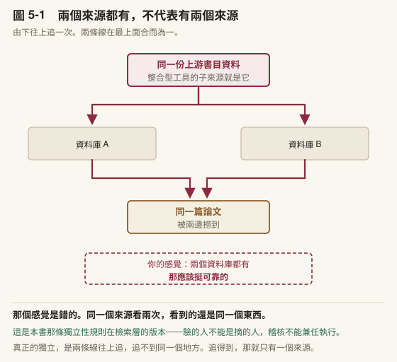
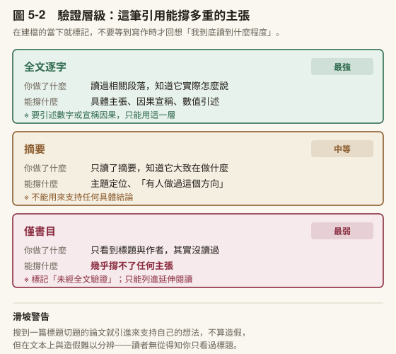
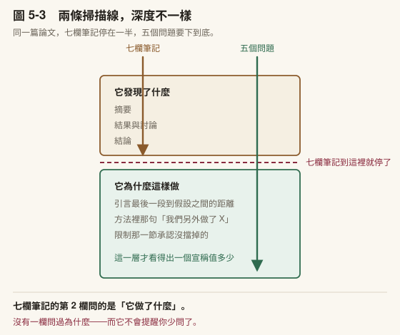
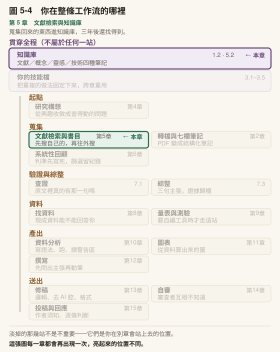

# 第 5 章　文獻檢索與知識庫

> 書稿第 5 章＝課程第 5 週（3 小時）。2026-10-15 由原[第 4 章](../chapters/04-research-question.md)拆出（原 [4.3](../chapters/04-research-question.md#43-選題訪談讓它一次問一題問出你在乎什麼)–[4.6](../chapters/04-research-question.md#46-常見迷思)）。

---

## 本章導覽

**這一章回答四個問題**

1. 文獻工作真正的瓶頸在哪裡？哪些 AI 能解，哪些不能？
2. 一篇論文可能觸發四種不同的筆記，怎麼分？
3. 書目軟體該做哪些事，驗證層級怎麼標？
4. 跟我設計最像的那幾篇論文，除了它們發現什麼，我還該讀出什麼？

**讀完你能夠**

- **安排**檢索的順序：先搜自己的、再往外搜，並留下可重現的檢索紀錄
- **區分**四種筆記的功能與時機
- **標定**一筆文獻的驗證層級，並據以判斷它能撐多重的主張
- **拆解**一篇論文的研究設計：說出它的假設從哪裡推出來、它擋掉了哪一個替代解釋，以及它自己承認做不到什麼
- **接上**書目庫，讓它讀得到你的 Zotero

**需要多久**

自學閱讀約 75 分鐘｜課堂 3 小時（概念 90 分、實作 90 分）

**進來之前，你要能**

- 說出你現在的研究問題，以及 [4.1](../chapters/04-research-question.md#41-從模糊的興趣到一個查得動的問題) 四個檢查裡哪一項還沒過（[第 4 章](../chapters/04-research-question.md)）
- 拿出[第 2 章](../chapters/02-first-note.md)建的一份七欄文獻筆記

**開始前請準備**：一篇你近期在讀的論文 PDF；**一篇跟你的研究設計最像的論文**（可以是同一篇）；如果你用 Zotero，先開著它。

---

## 章前導言

[第 4 章](../chapters/04-research-question.md)結束時，你手上有一句研究問題。這一章用它去蒐集。

蒐集最常見的失敗不是找不到，是找太多。一個寬的問題配上一個會一次給你二十筆的工具，三週之後你有四十篇筆記，卻說不出哪幾篇是必要的。所以這一章的每一節都在做同一件事：讓蒐集回來的東西，三年後的你還找得到、用得上，而且知道它能撐多重的主張。

5.1 處理檢索：先搜自己的，再往外搜，而檢索本身是一個有規矩的工序。5.2 把一篇論文可能觸發的筆記分成四種。5.3 讓書目軟體做機械的事，並把每一筆文獻標上驗證層級。5.4 換一個讀法：讀一篇跟你設計最像的論文，讀的不是它發現了什麼，是它為什麼這樣做。

> **〔課堂〕開場 5 分鐘** 請學生打開自己的知識庫或下載資料夾，數一數：裡面有幾篇論文，其中幾篇你說得出「它在我的論文裡要撐哪一句」。不要收數字。兩個數字差多少，就是這一章要處理的量。

---

## 5.1 文獻工作的三個瓶頸

在給任何工具之前，先把問題拆開。不然這一章會變成工具介紹，而工具介紹是全世界最容易過期的東西。

文獻工作卡住的地方其實有三個，它們常常被混為一談：

| 瓶頸 | 症狀 | AI 幫得上嗎 |
|---|---|---|
| **量**：讀不完 | 該讀的永遠比讀得完的多 | **幫得上**：篩選、轉檔、摘要 |
| **存取**：記不住、找不到 | 三個月前讀過的論文，要用時得整篇重讀 | **幫得上**，但前提是筆記結構化（承 [4.2](../chapters/04-research-question.md#42-該不該交給它) 的知識記憶） |
| **收斂**：寫不出論點 | 筆記四十篇，論證零句 | **幫不上** |

多數人把這三件事當成同一個問題，於是期待一個工具解決全部，然後失望。

**本章解前兩個。**

第三個要講清楚：它不是勤奮問題，也不是工具問題。你讀得再多、筆記再整齊，都不會自動長出一個論點，因為筆記的組織單位是「一篇論文」，而論證的組織單位是「一個主張」。這是兩種不同的切分方式。[第 7 章](../chapters/07-verification.md) [7.3](../chapters/07-verification.md#73-從二十篇筆記到一個論點) 就處理它。

先把這件事說在前面，是為了避免一種常見的挫折：學會了本章的所有東西，文獻管理變得很順，然後發現自己還是寫不出來，於是以為是自己的問題。**不是。那是[第 7 章](../chapters/07-verification.md)的問題。**

### 先搜自己的，再往外搜

檢索有一個順序問題，而多數人直接跳過它：你手上已經有的東西，先搜過了嗎？

順序是這樣：

1. **你自己的筆記，以及已經下載下來的全文**
2. **你的書目庫**
3. ——以上兩層涵蓋不足，才往外部資料庫走——

「涵蓋不足」不是感覺，它有判準。下面任何一條成立就可以往外：

- 本機命中 0 筆
- 命中了，但那幾筆**全部標著「未經全文驗證」**（5.3 的驗證層級）
- 命中了，但年份、樣本脈絡或子主題**明顯不覆蓋**你現在這個問題

這個順序不是為了省時間。真正的理由是：本機那些你讀過，外部那些你沒有。一份把兩者混在一起、又沒有分開標記的清單，你三天後會分不出哪幾筆是自己確認過的，於是只好整份重查一遍。那才是真的浪費時間。

〔補充〕**如果你讓它代跑這一段，加一條規則：往外搜之前先跟我講，並且把檢索式寫出來。** 這一條的價值不在管住它，在於檢索式寫出來，你才看得到它把你的問題翻譯成了什麼。那句翻譯常常跟你想的不一樣，而你不看就永遠不會知道。

**三種工具，性質完全不同，不要混用**

| 性質 | 它能做什麼 | 它不能做什麼 |
|---|---|---|
| **檢索** | 用關鍵字找出有哪些文獻 | — |
| **取件** | 把**已知的**識別碼換成全文檔案 | **不能拿來找文獻**，它根本沒有檢索能力 |
| **加值** | 對**已經在手上的**文獻補判斷資訊（被引情況、有沒有被撤稿） | 同上，它只處理你給它的那一批 |

⚠️ 最常見的誤用是**把取件工具當搜尋工具**。你丟一個主題進去，它回你空白—— 那不是「沒有這個主題的文獻」，那是**你用錯工具了**。這是下面第五條的一個特例，而且是最容易發生的那一種。

### 檢索是一個工序，它有自己的規矩

「量」這個瓶頸的第一步是**找得到**。這一步看起來很單純——打關鍵詞、看結果—— 但它有幾條規矩，不知道的話你會得到一份看起來很豐富、實際上撐不住的清單。

第一，取用有硬界線，而且是誠信層的界線。

三條，沒有例外：

1. **只取合法免費的全文**：完全開放取用的期刊、作者放在機構典藏的版本、預印本，或你自己透過學校訂閱與圖書館合法取得的檔案
2. **不繞過付費牆、不用侵權的下載管道**。付費牆的文章**只記書目引用資訊**供你人工查證，不建檔案
3. **不大量自動抓取受著作權保護的全文**

⚠️ 這三條是界線不是偏好。它們跟[第 16 章](../chapters/16-integrity.md)的誠信框架是同一件事：你的參考文獻清單怎麼來的，也是研究誠信的一部分。

第二，「拿不到」有兩種，意思完全不同。

這是本節最容易搞錯的一件事。

| 標記 | 它真正的意思 | 它**不**是什麼意思 |
|---|---|---|
| **付費牆** | **一般大眾**無法免費取得 | 不代表**你**拿不到——你有機構訂閱 |
| **工具抓不到** | 這次沒抓成 | **不代表這篇沒有全文** |

第二列尤其要小心。取件工具失敗最常見的原因是**你不在學校的網路裡**（要連 VPN），那跟「這篇沒有全文」是完全不同的兩件事。**把工具失敗回報成「沒有全文」，會讓你錯過一篇其實讀得到的論文。**

這是[第 1 章](../chapters/01-setup.md)那條線索的又一個版本：工具的限制，很容易偽裝成資料不存在。

第三，一份合格的檢索結果清單，每一筆都要標三件事。

| 欄位 | 為什麼要有 |
|---|---|
| **來源** | 這一筆是從哪個資料庫來的。沒有這一欄，你三天後就分不出哪些是你原本就有的 |
| **DOI** | 沒有 DOI 的要標出來並降權——**沒有持久識別碼的東西，不該進正式的參考文獻** |
| **本機狀態** | 新的？你的書目庫已經有了？⚠️ 已經有的**仍然要列出來並標記**，不要靜默剔除 |

最後那一條的理由不明顯：**你可能想知道外部有沒有更新的版本**—— 你庫裡那筆是預印本，而它已經正式出版了。靜默剔除會讓你永遠不知道。

第四，也是最重要的一條：重複命中不是獨立佐證。

跨多個資料庫搜尋的時候，同一篇被兩邊撈到是常態。



〔圖 5-1〕**由下往上追一次。** 兩條看起來獨立的線，在最上面合而為一。

機制很具體：多數整合型檢索工具的子來源**本來就包含**那幾個大型書目資料庫，而其中一個的書目**又源自**另一個。（這條獨立性規則前面已經出現三次：[第 7 章](../chapters/07-verification.md)的驗的人不能是摘的人、[第 14 章](../chapters/14-self-review.md)的五角色分開跑、稽核不能兼任執行。）

〔補充〕**被引數不能跨資料庫比。** 不同資料庫的被引數計算基礎不同—— 收錄哪些期刊、算不算會議論文、算不算預印本，各家規則不一樣。所以同一份清單只用同一個來源的被引數；真的要混用，**每一筆都要標出處**。還有一種常見狀況：某些資料庫**根本不提供被引數**，那一欄要寫「不適用」，不可以從別的地方猜一個填進去。

第五條：「查了沒找到」跟「查不到」是兩件事。

這一條要用在你自己身上，也要用在工具給你的回報上。

| 說法 | 意思 |
|---|---|
| **查了沒找到** | 工具正常運作，這個東西**確實不在那個資料庫裡** |
| **查不到** | 工具壞了、金鑰過期、額度用完、你不在校網 —— **這個東西在不在，你根本還不知道** |

這兩句對你的下一步影響完全相反。前者代表你可以往下走（也許改個關鍵詞、也許這就是個研究缺口）；後者代表**你什麼都還沒查**。

而它們最麻煩的地方是：壞掉的工具通常回傳空白，而空白看起來就像「沒有」。

所以有一條規矩值得寫在你的流程裡：**任何一次搜尋結果為空，先懷疑工具，再懷疑資料不存在。** 換一個工具、換一種查法複驗過，才可以下「文獻庫裡沒有這個主題」這種**負向斷言**。

負向斷言在研究裡的份量比你以為的重。「這個領域沒有人做過」是很多論文的立論起點。如果它其實是一次失敗的搜尋，你整篇的缺口論證就是空的。

〔補充〕**一個真實案例，說明「空白」多會騙人。** 有一類書目工具在查不到東西的時候，會自動改用別的方式再查一次。而這種退回有兩種，意思剛好相反，開頭的訊息卻一模一樣：一種是退回全文檢索，回給你的是**真實的題名**。工具正常，你要找的那筆確實不在庫裡；另一種是退回語意檢索，回給你的是**一批沒有標題、沒有作者的空項目**—— 那代表索引壞了，**你其實什麼都還沒查到**。

有人沒分辨這兩種，把一批「早就在庫裡」的文獻整批標成「尚未收錄」，照著清單逐筆匯入，結果造出一整批重複條目。教訓不是「那個工具不好」，而是： **當一個工具用同一句話講兩件相反的事，你就不能只看它的結論，必須看它回傳的內容。**

〔動手一下〕**5 分鐘**。拿你最近一次做的文獻檢索結果，只問一件事： **你分得出哪幾筆是同一篇被不同來源重複撈到的嗎？** 分不出來的話，你那份清單的「數量」是虛的。

### 帶走這一節

- 文獻工作有三個瓶頸：**量、存取、收斂**
- AI 幫得上前兩個，**第三個幫不上**
- 收斂不是勤奮問題，是筆記與論證的組織單位根本不同（[第 7 章](../chapters/07-verification.md) [7.3](../chapters/07-verification.md#73-從二十篇筆記到一個論點)）
- **順序：先搜自己的筆記與書目庫，涵蓋不足才往外**——理由是本機那些你讀過，外部那些你沒有
- **檢索、取件、加值是三種不同性質的工具**；⚠️ 把取件工具當搜尋工具，回你的空白會被誤讀成「沒有這個主題」
- 取用有三條硬界線：**只取合法免費全文、不繞過付費牆、不大量自動抓取**
- **「付費牆」不等於你拿不到；「工具抓不到」不等於這篇沒有全文**
- **重複命中不是獨立佐證**——多數整合型工具的子來源本來就重疊
- **「查了沒找到」≠「查不到」**。搜尋結果為空，先懷疑工具，再懷疑資料不存在——尤其在你要寫「這個領域沒有人做過」之前

〔補充〕還有兩種情境不走這一節的流程。（一）**系統性回顧或範疇回顧**：它的要求不是「讀得快」，是檢索過程可重現。你得留下檢索式、資料庫、日期、去重規則與納入排除的每一筆判定。工具能幫的是跨庫檢索、去重與整理成可篩選的清單，幫不了的是納入排除判準，那必須你自己訂並且事先寫死。（二）要啃一整本英文專書：逐段中英對照比全文翻譯可靠得多，因為你隨時看得到原文那一句長什麼樣；全文翻譯會讓你在不知不覺中接受譯者的詮釋。兩種情境都不是「更進階的版本」，它們是不同的工作，用這一節的流程去做只會做壞。

---
---

## 5.2 四種筆記：一篇論文可能觸發什麼

讀一篇論文不只會產生一種需求。同一篇東西，可能讓你想記下它說了什麼、想通一個概念、冒出一個研究點子，或學到一個以後想重現的做法。這四件事應該存成四種不同的筆記。

| 筆記類型 | 核心問題 | 什麼時候寫 |
|---|---|---|
| **文獻筆記** | 這篇論文說了什麼？ | 讀完每一篇之後 |
| **概念筆記** | 這個概念，**我**的理解是什麼？ | 想通一件事之後 |
| **靈感筆記** | 這觸發了什麼研究想法？ | 讀到一半冒出念頭時 |
| **技術筆記** | 這個方法我以後怎麼重現？ | 學到新做法之後 |

**判準一句話：問題不同，筆記就不同。** 這四種不是四個資料夾，是四個問題。

### 為什麼一定要分

最常見的失敗是全部寫成文獻筆記。

那樣做的結果是：知識庫變成一堆摘要。而摘要是**別人的話**。三年後你翻出四十篇摘要，還是得重新想一次「所以這些東西合起來說明了什麼」，因為當初你從來沒有想過那一步，你只是把論文濃縮了。

**概念筆記之所以關鍵，是因為它逼你用自己的話講一次。** 而「用自己的話講一次」正好是判斷自己懂不懂的唯一可靠測試。你能複製貼上一句話，不代表你懂它；你能不看原文把它重講一遍，才代表你懂。

這也是它跟 AI 的分工線。AI 可以幫你產出很好的文獻筆記，因為那是**濃縮**；它產不出你的概念筆記，因為那是你的理解。它可以陪你把想法問清楚，但那句話必須由你寫下來。

回頭看圖 4-2 那兩條軸：**文獻筆記做錯了你看得出來**（對照原文就知道），而概念筆記做錯了沒有人看得出來——因為只有你知道你原本想講什麼。四種筆記裡只有這一種落在那張圖的右上格。

一個有名字的失敗模式：把想法寫進來源筆記裡

四種筆記最常見的崩壞方式，不是少寫哪一種，是**把它們寫成同一種**：你讀到一篇論文，冒出一個很好的想法，於是順手寫在那篇的文獻筆記底下。

**那個想法從此只屬於那一篇。** 它不會出現在別的地方，因為你的想法通常橫跨好幾篇—— 但你把它綁在其中一篇的檔案裡，日後你只有在重讀那一篇的時候才會遇到它。

判準很簡單：

> **這句話是「那篇論文說的」，還是「我想到的」？**

前者留在文獻筆記，後者**另開一則概念筆記，再連回來**。多花的成本是三十秒；省下的是「一個想法被埋在某篇筆記的第四段」。

### 概念筆記為什麼最難外包

四種筆記裡，文獻筆記可以大量委派（流程就是在做這件事），概念筆記幾乎不行。差別在一句話：

> **概念筆記的價值，在於它是用你自己的話寫的。**

一份抄錄原文的概念筆記，功能上等於文獻筆記的副本。你三個月後回去看，看到的還是作者的措辭，而不是**你當時想通了什麼**。

所以我自己那個產概念筆記的工具，模板第一欄的指示不是「摘要這個概念」，是「用自己的話解釋，三到五句，體現個人理解而非抄錄原文」。而且欄位順序是刻意的：先寫定義，再寫「為什麼重要、跟哪些概念有關」，最後才寫來源。**來源放最後**，因為一旦先貼原文，後面那兩欄就會被原文的語言帶著走。

判斷一則概念筆記合不合格，有一個很快的測法：**把來源那一欄遮起來，這則筆記還讀得懂嗎？** 讀不懂，代表你寫的是摘要不是理解。


**靈感筆記**處理的是一種特定的損失：讀到一半冒出來的念頭，如果沒有當場記，十分鐘後就沒了，而且你不會知道自己失去過它。它的重點不是寫得完整，是寫下觸發情境（我當時在讀什麼、想到什麼）加上第一步行動。沒有第一步行動的靈感筆記，日後翻到只會困惑。

**技術筆記**處理的是重現問題。你花三小時搞懂一個分析步驟，三個月後要再做一次，如果沒記，三小時要再花一次。它的重點是可執行：照著做能跑出來，而不是「大概是這樣做」。

這兩種在課堂上比較不容易練，因為它們依賴真實情境的觸發。但書要寫完整，因為你日後一定會遇到。

### 有一件事可以交出去：找回關聯

上一節說概念筆記不能外包。這一節講它的**例外邊界**，因為有一種做法值得知道。

做法是這樣：**把你的全文檔案放進一個資料夾當原料**，配一份說明你要什麼結構的指示檔，然後讓它把整批讀過一遍，自動生出一批概念頁，並且在文件之間拉出連結。

它真的解決了一個問題，而且是你自己解決不了的那種：

> **你讀過的東西之間有什麼關聯，你記不住。**

三十篇之後，某兩篇其實在講同一件事，而你當初讀的時候隔了四個月。你不會想起來。機械比對在這件事上勝過你，沒有懸念。

**但分界要畫清楚：**

| 當成什麼用 | 可以嗎 |
|---|---|
| **檢索層**：幫你找回「哪幾篇談過同一件事」 | ✅ 可以。那是機械比對，而且它做得比你好 |
| **理解層**：那些概念頁就當成你的概念筆記 | ❌ 不行。你沒有經過「用自己的話講一次」那一步 |

差別不在品質。它產出的概念頁可能寫得比你順。差別在**那份理解沒有發生在你身上**。三個月後你用得到的是你腦子裡的那一版，不是檔案裡的那一版。

所以最實際的用法是把它當入口，不當結論：

> 讓它拉出來的連結當**線索**。你順著線索回去讀那幾篇，然後**自己寫**那則概念筆記。

判準還是同一句：如果它把兩篇錯誤地連在一起，我看得出來嗎？你讀過那兩篇，就看得出來；沒讀過，你會把一個假的關聯當成發現，而且找不出它是哪裡來的。

### 跟第 1 章兩種記憶的關係

這四種筆記全部屬於[第 1 章](../chapters/01-setup.md) [1.2](../chapters/01-setup.md#12-你剛才那段對話明天就不見了) 講的**知識記憶**：它們跨專案、長期累積，寫給未來的你。

與之相對的是**專案記憶**（專案說明檔與決策日誌），那些綁在單一研究上，做完就凍結。兩者不要混在一起：把研究決策寫進概念筆記，日後會找不到；把概念理解寫進專案日誌，換個專案就用不到了。

> **〔動手一下〕10 分鐘** 挑一篇你讀過的論文，寫一則概念筆記。 **規則只有一條：不准複製論文裡的任何句子。** 寫不下去的地方，就是你其實還沒懂的地方。這個練習的價值全在那些卡住的位置。

> **〔課堂〕四種都講，但只實作兩種** 三小時的課要跑完流程、核實與概念筆記已經很滿。建議：文獻筆記與概念筆記**動手做**，靈感筆記與技術筆記**投影示範各一則**（各 3 分鐘）。示範時強調它們各自防的損失：靈感筆記防「想過但忘了」，技術筆記防「做過但要重做」。課本四種都有完整說明，可請學生課後自行補做。

### 帶走這一節

- 四種筆記不是四個資料夾，是**四個問題**
- 只寫文獻筆記的知識庫是死的，因為摘要是**別人的話**
- **概念筆記是唯一 AI 產不出來的一種**，因為它要的是你的理解
- 靈感筆記防「想過但忘了」，技術筆記防「做過但要重做」
- 四種都屬知識記憶，別跟專案記憶混在一起（[4.2](../chapters/04-research-question.md#42-該不該交給它)）

---
---

## 5.3 書目管理層：讓機械工作歸機械

### 它是什麼，不是什麼

書目管理工具（Zotero 這一類）在整條工作流裡的定位很明確：**它是書目的唯一真相來源**。DOI、卷期、作者名單、格式匯出，這些機械工作歸它。

它**不是**主題探索工具。

> 找文獻的第一站永遠是自己的筆記庫，不是書目庫。

這是原則，不是工具偏好。筆記庫裡存的是**你理解過的東西**，書目庫裡存的是你收過的東西。這兩件事的差距，任何有下載癖的研究者都懂。從自己理解過的東西出發，你才知道新找到的文獻擺在哪裡；從收藏清單出發，你只會得到一堆待讀。

### 讓兩邊同構

一個很小但省很多事的做法：讓書目庫的收藏夾與知識庫的資料夾結構對齊。

好處是歸類時不必重做判斷。一篇文獻該放哪個收藏夾？答案是「跟它的筆記放同一個地方」。不同構的話，你等於要維護兩套分類邏輯，而兩套邏輯一定會慢慢漂移，最後你會有兩個都不太準的分類系統。

### 引用作業七步

這是一套可以直接照做的順序：

1. **補 DOI 與新增條目**：用工具批次補，不要手動查。手動查幾十筆 DOI 不只慢，而且會抄錯。新增條目則用 DOI 加書目軟體的瀏覽器外掛建，不要叫它從 PDF 反推書目資料（原因見附錄 K-3 第五條）
2. **撤稿查證**：投稿前掃一次整份清單。撤稿是紅線，不是比例問題
3. **查重三步**：先用 DOI 自動找出重複組 → 人工決定保留哪一筆（判準：有 PDF ＞ 詮釋資料完整 ＞ 建檔最早）→ 逐組合併
4. **匯出書目**：按目標期刊的格式匯
5. **收尾驗證**：確認重複歸零，並對照內文找**孤兒引用**（清單裡有、內文沒引到的）
6. **進庫即歸夾**：新增條目的同一個動作裡就指定收藏夾，不留未分類
7. **定期對齊健檢**：比對書目庫與知識庫的差異，趁漂移還小的時候處理

第 6 步值得單獨講。「之後再整理」是一個不會發生的未來。未分類的條目會累積，而累積到一定數量之後，就再也沒有人會回頭處理它了，因為那時候整理的成本已經高到不值得。唯一有效的時機是進庫的那一刻。

### 被引數之外：它是被拿來支持，還是被拿來反駁

七步的第 2 步是撤稿查證，那是紅線。這裡要講一個比紅線更常用、也更常被略過的東西。

**「被引 200 次」這句話本身沒有方向。** 有些加值工具會把「引用了這篇的文獻」再分成三類：支持它的結論、與它的結論相反的、只是順帶提到的。

這個分類的價值在於：一篇被引 200 次的論文，如果其中相當一部分落在「相反」那一類，它就不是領域共識，它是一個被拿來當靶子的論點。你把它當共識引用，懂這個領域的審查者一眼就看得出來。

而這件事**看被引總數是看不出來的**。總數把支持與反駁加在同一個數字裡。

⚠️ **但這裡有一個陷阱，它跟 5.1 講過的是同一型。** 這類自動查核（撤稿、更正啟事、被引極性）幾乎都是靠持久識別碼去解析的。 **你清單裡沒有識別碼的那幾筆，會被靜默略過**。不報錯，也不會出現在結果裡。

於是「掃完了，沒有問題」這句話有兩種意思，而它們在畫面上長得一模一樣：

| 它可能的意思 | 你要做的事 |
|---|---|
| 全部查過了，都沒問題 | 可以往下走 |
| 有幾筆**根本沒被查**（因為沒有識別碼） | 那幾筆要你自己查 |

所以掃完之後要多做一個動作：**對數字。** 清單幾筆、回報幾筆、差幾筆。差的那幾筆就是你要動手的那幾筆。

⚠️ 這也是 5.3 第一段那條「沒有持久識別碼的東西不該進正式參考文獻」的實際後果—— 它不只是格式問題，**它決定了這一筆能不能被自動查核保護到。**

### 批次補筆記：先建索引，再開跑

累積到某個程度，你會想「一次把沒筆記的都補齊」。這件事可以自動化，但有一個前置動作不能省。

我自己的批次工具第一步不是去書目庫抓條目，是**先掃一遍知識庫、建一份索引**，並且列出「檔名裡沒有第一作者姓氏與年份」的那幾份。

為什麼要這樣？因為批次的核心動作是**比對**。哪些文獻已經有筆記、哪些沒有。而比對是靠檔名解析的。一份檔名壞掉的筆記，解析不出來，就會被判定成「沒有筆記」，於是同一篇被重建一次。

⚠️ 這個錯誤的討厭之處在於它**只在批次時才發作**。你手動一篇一篇建的時候，永遠不會遇到；等你累積了四百篇、決定一次補齊，它才一口氣出現。

這裡有一個可以帶走的通則，[第 3 章](../chapters/03-skills.md)的〈延伸資源〉也會再遇到：

> **凡是要批次處理的事，先花五分鐘盤點你手上到底有什麼，再開跑。**

盤點的成本是固定的，而跳過盤點的成本會隨著你的資料量成正比放大。


當你從外部找到一篇庫裡沒有的文獻，別只把連結貼在對話紀錄裡。對話會消失，而三個月後你只記得「好像有找到一篇很適合的」。

每一筆記五欄：

1. 完整 DOI 網址
2. APA 書目
3. 卷期頁
4. 取得管道（有沒有免費全文？付費牆？）
5. **驗證層級**

第五欄是本節的重點。

### 驗證層級：這筆引用能撐多重的主張



| 層級 | 你實際做了什麼 | 這筆引用能撐什麼 |
|---|---|---|
| **全文逐字** | 讀過相關段落 | 具體主張、因果宣稱、數值引述 |
| **摘要** | 只讀了摘要 | 主題定位、「有人做過這個方向」 |
| **僅書目** | 只看到標題與作者 | **幾乎撐不了任何主張**，只能列延伸閱讀 |

配套的規矩只有一條：**只有書目的條目，明確標記「未經全文驗證」，不得用來撐因果主張。**

這條紀律解決的是一個很普遍的滑坡。你搜到一篇標題很切題的論文，順手引進來支持一句話。那句話你其實是自己想的，你只是找了一個看起來會同意你的來源。這不算造假，但它是一個沒有依據的宣稱，而且**它跟造假在文本上長得一模一樣**，讀者分不出來。

標記驗證層級，等於逼自己在引用的當下就回答：**我到底讀到什麼程度？**

> **〔補充〕批次處理的三條紀律** 當你要一次處理幾十筆條目時，有三條經驗值得先知道： **不要並行送**（同時發多個請求容易整批失敗）、**一批做小**（八筆左右）、 **設計成可續跑**（重跑不會重複處理已完成的）。理由是同一個：大批次中途斷掉時，前面做完的不該白做。這條原則在[第 10 章](../chapters/10-statistics.md)的統計工作流會再出現一次，它其實是同一件事。

> **〔補充〕三種容易出事的情況** 建檔時主動標示這三種，日後省很多麻煩： **同作者同年多篇**（APA 需要分 a／b，而且你得記得自己引的是哪一篇）、 **同一工具的長短版或原版與修訂版**（引用時要對應正確的那一個）、 **有更正啟事或撤稿**（這是紅線，一併記錄）。

> **〔課堂〕5.3 講述約 15 分鐘** 這一節內容偏操作，講太細會悶。建議只深講兩個點： **「第一站是筆記庫不是書目庫」**（觀念）與**驗證層級三層**（紀律），七步流程留給學生課後照做，課堂只點出第 6 步「進庫即歸夾」為什麼重要。 **可以問全班一個問題**：「你的書目軟體裡現在有幾筆未分類？」通常會有人報出一個難堪的數字，那比任何說明都有效。

### 帶走這一節

- 書目工具是**書目的真相來源**，不是主題探索工具
- **找文獻的第一站永遠是自己的筆記庫**
- 兩邊分類同構，可以免掉維護兩套邏輯的漂移
- **進庫即歸夾**：「之後再整理」是不會發生的未來
- **驗證層級**決定一筆引用能撐多重的主張；只有書目的條目撐不了因果宣稱
- 被引總數沒有方向；**支持與反駁被加在同一個數字裡**，被大量反駁的論文不是共識
- ⚠️ 自動查核靠識別碼解析，**沒有識別碼的會被靜默略過**——掃完要對數字，差的那幾筆自己查

---
---

## 5.4 這篇論文為什麼這樣做

### 摘要告訴你結論，方法告訴你這個結論值多少

到這裡為止，這一章教的每一件事都在處理同一個目標：**把文獻變成你用得上的證據**。七欄筆記的欄位是照這個目標設計的，書目管理層的七步是，驗證層級要回答的也是「這一筆能撐多重的主張」。

那個目標沒有錯，但它只是文獻的一半用途。

另一半是這樣的：一篇通過審查的期刊論文，除了告訴你它發現了什麼，還告訴你**這個領域認為一個問題該怎麼問、一個宣稱該用什麼撐、一個明顯的反駁該在設計階段怎麼擋掉**。這些東西不在摘要裡，不在結論裡，也不在你的七欄筆記裡。它們在方法那一節，而且多半是以「我們另外做了 X」這種不起眼的句子出現。

⚠️ **這是七欄筆記結構性的盲點，而且它不會提醒你。** 第 2 欄要的是「設計、樣本、分析方法」，那是**它做了什麼**。這一節要問的是**它為什麼這樣做**，而那一欄從來沒有問過這個問題。



〔圖 5-3〕看兩條探針停在哪裡。淺的那條停在虛線上，而**虛線底下才是「這個宣稱值多少」**。

一份完整的文獻筆記，配上一個還不知道研究該怎麼做的腦袋，是可以同時存在的。

> **〔補充〕為什麼這一節放在這裡。** [4.1](../chapters/04-research-question.md#41-從模糊的興趣到一個查得動的問題) 講過本書「教研究設計的取向，不教研究設計的執行」，那條邊界現在還在。這一節不教你怎麼設計研究，那是方法論課程與專門教科書的事。它教的是**怎麼從別人已經做完的設計裡讀出理由**。讀得出理由，你在修方法課的時候會知道那些規則在防什麼；讀不出來，方法課會變成一串要背的步驟。

### 哪些論文該這樣讀

不是每一篇。[2.1](../chapters/02-first-note.md#21-把一篇-pdf-變成一份筆記) 第 0 步把論文分成細讀、只記書目引用資訊、不留三類，這一節處理的是細讀那一類裡面更小的一撮：

> **跟你的研究設計最像的那三到五篇。**

不是主題最像，是**設計最像**。同樣要處理介入前後的變化、同樣要面對自己選擇要不要參加的受試者、同樣要用問卷測一個看不見的構念。你的方法章遲早要回答的那些問題，它們已經回答過一次，而且是在審查者面前回答的。

三到五篇是下限不是上限。找不到三篇，通常代表兩件事之一：你的設計在這個領域確實少見，或者你還沒找到正確的檢索詞（5.1 講過這兩者分不出來的處境）。

### 五個問題

拆解一篇論文的設計，問這五個。順序不要換，後面的問題要用前面的答案。

**一、這個假設是從哪裡推出來的？**

翻到引言最後一段與假設之間。那個距離就是這篇論文的推導。距離短到看不見（「因此，本研究假設 A 與 B 有關」），代表假設沒有推導，只有宣告。距離長而且每一步都掛著文獻，你就拿到一個可以直接學的樣板：**別人用了幾步、掛哪些文獻、從哪一個既有發現走到自己的假設**。

答不出來的時候，代表這篇的假設可能是資料跑完之後才補上去的。那不必然是壞論文，但你不該拿它當推導的範本。

**二、如果結論反過來也說得通，它靠什麼擋住？**

每一個宣稱都有一個聽起來同樣合理的替代解釋。它說「給回饋提升了寫作表現」，替代解釋是「本來就寫得好的人比較願意給回饋」。找出這篇論文擋掉那個替代解釋的**那一個動作**：可能是隨機分派、可能是把前測成績放進模型、可能是只在同一批人身上比前後，也可能是它在限制那一節承認自己沒擋掉。

這是五題裡最有價值的一題。它就是研究設計本身，而且它會在你自己的稿子送審時，以幾乎一樣的形式回來找你。

**三、為什麼是這個樣本、這個時間點？**

樣本數怎麼來的、為什麼是這個學制這個年級、為什麼測兩次不是三次。多數論文不會直說理由，你要從限制那一節反推。你會反覆看到同一件事：**設計是在理想與可行之間妥協出來的**，而好論文的做法是把妥協寫出來，不是藏起來。

**四、這個分析回答的是「有沒有關係」還是「誰造成誰」？**

先看它用的分析方法，再看它在討論那一節用的動詞。兩者對不上的時候，問題幾乎都出在動詞。相關分析配上「導致」「促進」「提升」，是這個領域最常見的過度宣稱，而它經常出現在摘要裡。摘要要寫得好看，而好看的句子通常比資料強。

你不需要現在就懂那個分析方法怎麼跑。你需要的是知道去哪裡查它能回答什麼問題，以及記得回頭核對動詞。

**五、它自己說了哪些做不到？**

限制那一節多數人跳過，而那是全篇最誠實的地方。讀完它，你會拿到兩樣東西：這個領域承認的共同弱點（於是你知道自己那篇也會被問到），以及**別人留下來還沒做的事**（於是你可能找到自己的題目）。

有一種限制節要特別留意：每一條都寫得很滿、每一條都接「未來研究可以⋯⋯」，但沒有一條說明這個限制**對本研究的結論有什麼影響**。那種寫法是在防守，不是在交代。

> **〔動手一下〕15 分鐘** 拿一篇你已經讀過、而且跟你的設計最像的論文，**只做第二題**。找出它擋住替代解釋的那一個動作，用一句話寫下來。找不到也要寫下來——「這篇沒有處理 X」同樣是發現，而那個 X 剛好是你在自己的研究裡要處理的東西。

### 這件事不能交出去

前面幾節，AI 幫得上的地方都很明確：轉檔、填欄位、補 DOI、查重複條目。到這一節，分工線要移動。

它可以做的：

- 告訴你方法段落在第幾節，樣本與分析寫在哪幾段
- 針對第二題，列出它想得到的替代解釋，**讓你拿去對照論文有沒有處理**
- 你寫完拆解之後，當反方問你「你確定它擋掉的是這一個嗎」

它不能做的：**替你回答那五個問題。**

理由跟 5.2 概念筆記那條線一樣。它給你的拆解會很流暢、看起來也完整，而你拿到的是**一份你沒有經歷過的理解**。下次你自己的稿子被問到「你怎麼排除這個替代解釋」，你手上沒有可以調用的東西，因為那個判斷從來沒有發生在你身上。

判準還是[第 1 章](../chapters/01-setup.md)那一句：如果它做錯了，我看得出來嗎？在這一節，答案幾乎必然是不行。你正在拆的這篇論文，之所以要拆，就是因為你還不知道這種設計該長什麼樣子。⚠️ **在你不知道正確答案的地方要它給你答案，是全書風險最高的一種用法**——它的錯誤在這裡沒有任何對照組。

〔教你的 Claude 建這個〕**把「定位」跟「反方」固定成一個檔案，把「回答」擋在外面。** 貼這段：

> 「我要建一個〈論文設計拆解助手〉技能檔。我會貼給你一篇論文。你的工作只有兩件：（一）指出方法、樣本、分析、限制各寫在第幾節；（二）針對這篇的主要宣稱，列出三個可能的替代解釋。 ⛔ 不要替我判斷這篇論文有沒有處理那些替代解釋，也不要總結它的研究設計。我會自己讀完之後把我的判斷貼給你，那時候你再挑毛病。每次回答的最後固定加一句：上面哪些是你從文本讀到的，哪些是你推測的。」

那個 ⛔ 行是這個檔案的全部價值。拿掉它，你會得到一份完整的設計分析，然後你會照抄它，而這一節從頭到尾都在防這件事。

完整的拆解清單、以及三種常見設計各該問什麼，見**[附錄 L](../appendix/L-reading-design.md)**。

### 技術筆記，長大之後

5.2 給過你四種筆記，其中技術筆記的核心問題是「這個方法我以後怎麼重現」。那一欄當時只有一行，現在可以填滿了。

一則長大的技術筆記，記的不是步驟，是**決定**：

| 記什麼 | 例子 |
|---|---|
| 這個設計要擋的是哪一個替代解釋 | 加前測是為了擋掉「本來就比較強」 |
| 它付出的代價 | 多一次施測，流失率上升 |
| 什麼情況下不適用 | 前測本身會影響後測時，這一招會反過來製造問題 |
| 我在哪一篇看到的 | 連回那則文獻筆記 |

第三列最重要，也最少人寫。**一個做法什麼時候不能用，通常比它怎麼用更難學到**，而它多半藏在別人的限制那一節裡。

> **〔課堂〕5.4 講述約 15 分鐘，重點只放第二題** 其餘四題請學生課後自行對照課本操作。現場示範務必用一篇**學生也讀過**的論文，最好是上週的指定閱讀—— 示範的價值在於讓全班看到同一篇論文可以被問出他們沒想過的問題。最容易失控的地方是學生會開始討論那篇論文的**主題**。開場先講死：今天不談它發現了什麼，只談它為什麼這樣做。

### 帶走這一節

- 文獻有兩種用途：**當證據**（前面幾節）與**當設計範本**（這一節）。七欄筆記只處理前者
- 該這樣讀的是**跟你設計最像的三到五篇**，不是主題最像的
- 五個問題：假設從哪推出來／怎麼擋替代解釋／為什麼是這個樣本／回答的是關聯還是因果／它承認做不到什麼
- **第二題就是研究設計本身**，也是你日後送審時會被問到的同一題
- 這一節**不能委派**：在你還不知道正確答案的地方要它給答案，錯誤沒有對照組
- AI 的位置是**定位與反方**，不是拆解者
- 技術筆記真正該記的是**決定與代價**，不是步驟

---
---

## 5.5 教育研究實例

### 實例一：從一個你不熟的領域開始

一位研究生要寫一個他只上過一門課的次領域的文獻回顧。

[第 1 章](../chapters/01-setup.md)講過這裡有個惡性循環：你越不熟的領域，越想找 AI 幫忙，也越沒有能力查出它的錯。

錯誤的做法是打開對話框說「給我這個主題的二十篇重要文獻」。你會得到二十筆，其中若干是拼裝的，而你沒有能力分辨，因為分辨的前提是你認得那個領域的人與期刊，而你正是因為不認得才來問的。

可行的做法是**用錨點外擴**：

1. 先找到三篇你**確定是真的、而且讀過**的論文（從課程指定閱讀、從指導教授給的、從一篇你信任的回顧文章的參考文獻）
2. 把這三篇餵給 AI，請它說明這三篇在該領域的位置與彼此的關係
3. 請它指出**這三篇共同引用**的更早文獻，以及**引用這三篇**的後續發展
4. 每一筆都走四步核實（[第 7 章](../chapters/07-verification.md)）才收進來
5. 收進來的成為新的錨點，重複

差別在哪：第一種做法要 AI **生成**一份清單，第二種做法要它解釋你已經驗證過的東西之間的關係。後者的錯誤可偵測性高得多，因為你手上有真的材料可以對照。

> 一個可以帶著走的原則：**讓 AI 從你的已知往外推，不要讓它從零替你生成。**

---

## 本章建置：接上書目庫

這一節把工作台接上你的書目軟體（以 Zotero 為例），讓它讀得到你的書目庫；再在規則檔加兩條，把 5.1 的檢索順序與 5.3 的書目分工寫成它每次都要遵守的事。

連接器不是必修（[3.4](../chapters/03-skills.md#34-提示詞技能代理)）。你的文獻還不到三十篇，或你不用 Zotero，可以跳過第 1 步，直接做第 2 步。

〔課堂〕約 35 分鐘。第 1 步最常卡在學生的 Zotero 沒開，或沒打開本機存取的設定；請大家先開 Zotero 再開始。卡住超過十分鐘的，直接跳第 2 步，課後再補。

### 這一節完成之後，工作台多了什麼

```text
研究工作台/
└── .mcp.json                         ← 新增：連接器設定
```

規則檔多兩條。

### 第 1 步　接上 Zotero

需要三樣東西：Zotero 桌面程式、一支讓 Claude 讀得到 Zotero 的小程式（叫 zotero-mcp，是開源的連接器）、一行登記指令。

**一、讓 Zotero 允許本機程式讀它。** 在 Zotero 的設定裡找到「允許此電腦上的其他應用程式與 Zotero 通訊」這一類選項，打開。選項的確切位置會隨版本改，找不到的時候搜尋官方說明的「local API」。這個設定只開放給同一台電腦上的程式，不對外。

**二、安裝連接器程式。** 作者用的安裝方式是 `uv`，一個 Python 工具管理程式：

```bash
uv tool install zotero-mcp-server
```

裝好之後，電腦上會多一個叫 `zotero-mcp` 的指令。沒有 `uv` 的話，請 Code 入口「幫我裝 uv，再用它裝 zotero-mcp-server」。

**三、登記給 Claude。** 在工作台最上層跑：

```bash
claude mcp add --scope project zotero -e ZOTERO_LOCAL=true -- zotero-mcp
```

逐段看：`zotero` 是你給這個連接器取的名字；`-e ZOTERO_LOCAL=true` 是告訴它讀本機的 Zotero，不走網路；`--` 後面是要執行的那支程式；`--scope project` 是把設定寫進工作台裡的 `.mcp.json`，讓它跟著工作台走。

跑完打開 `.mcp.json`，應該長這樣：

```json
{
  "mcpServers": {
    "zotero": {
      "type": "stdio",
      "command": "zotero-mcp",
      "args": [],
      "env": {
        "ZOTERO_LOCAL": "true"
      }
    }
  }
}
```

這份設定裡沒有金鑰，所以可以進版本紀錄。哪天你改用需要金鑰的連接器，金鑰不要寫進 `.mcp.json`，也不要寫進技能檔（[3.4](../chapters/03-skills.md#34-提示詞技能代理)）。

然後把程式完全關掉再開。連接器只在程式啟動時載入，開新對話不夠。第一次在這個工作台使用時，它會問你要不要啟用工作台裡的連接器，選啟用。

〔補充〕作者第一次在已經登記過 Zotero 的電腦上再登記一次，`claude mcp list` 回報同一個名字「在多個範圍裡有不同的設定」。同一個連接器只登記一次。你已經在別處登記過，就不要再加 `--scope project` 這一份。

### 第 2 步　規則檔加兩條

在最上層的 `CLAUDE.md` 加：

```text
7. 找文獻時，先搜 `01_文獻筆記/` 和 Zotero，搜不到才往外找；往外找之前先問我。
   為什麼：我手上的東西我讀過、判斷過，外面的沒有（5.1）。
8. 不要透過 Zotero 連接器新增書目條目。要新增的，給我完整的 DOI 網址，我自己用瀏覽器外掛加。
   為什麼：連接器建的條目常常沒有全文、缺作者，而它回報建好了（5.3）。
```

第 8 條是作者的實際經驗：用連接器從檔案建條目，四次回報「已附加檔案」，打開看附件數是 0；有一次建出來的條目沒有作者、沒有 DOI。瀏覽器外掛從期刊頁面建的條目會自動帶全文，比它建的完整。**讀，交給連接器；寫進書目庫，你自己來。**

### 驗收

**驗收一：連接器真的接通了。** [3.4](../chapters/03-skills.md#34-提示詞技能代理) 說它有回應不代表接通了。所以這一項要做兩次：

1. Zotero **開著**，問它「列出我 Zotero 最近加入的五筆，只給題名」。做對了，五個題名你都認得。
2. 把 Zotero **關掉**，問同一句。做對了，它回報連不上（作者的電腦上是一段含 `10061` 的錯誤訊息）。

第二次它如果照樣給你五個題名，那五個題名不是從 Zotero 來的。

**驗收二：檢索順序有被遵守。** 問它「幫我找三篇跟我研究問題有關的文獻」。做對了，它先回報在 `01_文獻筆記/` 和 Zotero 找到了什麼，再問你要不要往外找。

### 出事的時候

| 你看到的 | 多半是 | 怎麼辦 |
|---|---|---|
| 它說沒有 Zotero 這個工具 | 登記完沒有完全重開程式 | 結束整個程式再開，不是開新對話 |
| `10061` 或「連線被拒」 | Zotero 沒開，或本機存取的設定沒打開 | 先開 Zotero；仍然失敗就回第 1 步之一 |
| `claude` 不是內部或外部命令 | 終端機找不到 Claude 的命令列程式 | 請 Code 入口代跑那一行登記指令 |
| 它直接上網找，沒先搜你的 | 規則檔第 7 條沒被讀到 | 開新對話；仍然如此，把那一條移到規則檔最前面 |

### 這一步留給下一章的

它現在讀得到你的書目庫，找文獻時也會先搜你手上的。[第 6 章](../chapters/06-systematic-review.md)把這套檢索放大成系統性回顧；[第 7 章](../chapters/07-verification.md)處理下一個缺口：它說「原文是這樣寫的」的時候，你怎麼不必自己翻 PDF 就知道它有沒有說錯。

### 帶走這一節

- 連接器用 `claude mcp add` 登記，`--scope project` 讓設定跟著工作台走；**登記完要完全重開程式**
- 驗接通要做兩次：**開著問一次，關掉再問一次**
- 讀書目庫交給連接器，**新增條目自己用 DOI 加**


---

## 5.6 動手實作

### 實作一：寫一則概念筆記（30 分鐘）

從今天讀的論文裡挑一個概念，寫成概念筆記。

**唯一規則：不准複製論文裡的任何句子。**

寫不下去的地方，標起來。那些卡住的位置就是你還沒懂的地方，而這正是這個練習的全部價值。
### 實作二：找出它擋掉的那個替代解釋（20 分鐘）

用你課前帶來那篇**設計最像**的論文（不是主題最像），只做 5.4 的第二題。

1. 把它的主要宣稱寫成一句話，用你自己的話（3 分）
2. **先不要翻論文**，自己想出至少兩個替代解釋（5 分）
3. 回論文裡找：它擋掉哪一個、用什麼動作擋的（7 分）
4. 寫下**還剩哪一個沒擋**（5 分）

第 2 步的順序不能顛倒。先翻論文，你只會找到它已經處理過的那些。

**課後補完**：第一題（假設從哪裡推出來）與一則技術筆記，格式見[附錄 L](../appendix/L-reading-design.md) 的 L-4。完整的五題與三種設計各自的追加問題也在[附錄 L](../appendix/L-reading-design.md)。**產出併入期末的文獻工作包**，不另計分。

> **〔課堂〕這一項不示範完整答案，但要收集答案** 開場只用 3 分鐘講清楚「設計最像」跟「主題最像」的差別，那是學生唯一會選錯的地方。真的示範了完整拆解，收回來的會是同一篇論文的十五份雷同答案。 **第 2 步結束後請幾個人念出自己想到的替代解釋**—— 全班會聽到同一篇論文可以有很不一樣的攻擊角度，那是課後自己做拿不到的東西。這也是為什麼這一項留在課堂，而第一題與技術筆記放課後。

### 技能要點

| 實作 | 關鍵動作 | 做對了長什麼樣 | 常見卡點 |
|---|---|---|---|
| 一 · 概念筆記 | 不准複製論文裡的任何句子 | 你寫得出來，而且寫的是**你的理解**不是它的摘要 | 卡住就回去抄。**卡住的位置正是這個練習的全部價值** |
| 二 · 拆解設計 | 先自己想出替代解釋，**再**回論文裡找它擋掉哪一個 | 你說得出這篇還剩哪一個替代解釋沒擋 | 順序顛倒：先看論文怎麼說，於是只找得到它已經處理的那些 |

文獻筆記是**濃縮**，AI 做得很好；概念筆記是**你的理解**，AI 產不出來。實作二又是另一種東西：它產出的是**你對別人怎麼做研究的判斷**，是這一章唯一連定位輔助之外都不能交出去的（5.4 講了理由）。

### 當週小task

繳交三樣：

1. 一份檢索紀錄：你搜了哪裡、用什麼詞、得到幾筆、收了幾筆（5.1）
2. 一則概念筆記（不含任何複製自論文的句子）
3. 一則技術筆記：一篇設計最像的論文，它擋掉哪個替代解釋、還剩哪一個沒擋

---

## 5.7 常見迷思

**迷思一：「筆記做越多越好。」**

*為什麼錯*：只有文獻筆記的知識庫是一堆摘要，而摘要是別人的話。四十篇摘要不會自動長出理解，三年後你還是得重想一次。

*正確版本*：**概念筆記的數量比文獻筆記的數量更能反映你的進展。** 前者是你的理解，後者只是你的閱讀紀錄。

**迷思二：「它說找不到相關文獻，代表這個題目沒人做過。」**

*為什麼錯*：搜尋結果是空的，最常見的原因是搜法錯了：用詞跟該領域的慣用詞不同、只搜了中文、或資料庫沒涵蓋那一類期刊。把「我沒搜到」寫成「沒有人做過」，審查者通常一個搜尋就能推翻。

*正確版本*：負面結論要換三種查法都是空的才寫，並且寫出你搜了哪裡、用了什麼詞。

---

> ### 〈責任落點〉 - 決定讀什麼、不讀什麼：**你**，判準是[第 4 章](../chapters/04-research-question.md)那一句研究問題 - 文獻筆記第 5 欄「與我研究的關聯」：**它給草稿，你給定稿** - 概念筆記：**只有你**。那是你的理解，AI 產不出來 - 標定驗證層級並據此節制主張強度：**你** - 判斷一篇論文擋掉了哪個替代解釋：**你** - 工具負責的是機械工作：轉檔、比對、查重、格式、批次補資料、從你的錨點往外找候選

---

## 5.8 章末整理

### 三句話帶走

1. **讓 AI 從你的已知往外推，不要讓它從零替你生成。**
2. 筆記的價值在未來找得到、用得上，所以**結構比篇幅重要**。
3. 一筆文獻能撐多重的主張，取決於你讀到哪一層：**全文、摘要，還是只有書目**。

### 回到開場

開場要你數兩個數字：資料夾裡有幾篇，其中幾篇你說得出要撐哪一句。

讀完這一章，第二個數字不一定變大，但每一篇都應該有了位置：它在哪一種筆記裡、驗證層級是哪一層、在書目庫裡找得到。說不出要撐哪一句的那些，現在至少知道它們為什麼還留著。



〔圖 5-4〕亮起來的是這一章教的位置，淡掉的是你在別章會站上去的地方。

### 拿去跟人討論

找一個同學、同事或指導教授，挑一題聊十分鐘。

1. 「這個題目沒有人做過」這句話，你們各自要查到什麼程度才敢寫進論文？兩邊的門檻一樣嗎？
2. 交換一則概念筆記。對方的那一則，有沒有哪一句其實是論文原句的改寫？
3. 拿同一篇論文各自做 5.4 的第二題。你們想到的替代解釋有幾個重疊？

### 下章預告

這一章的蒐集是為了你自己的論文。[第 6 章](../chapters/06-systematic-review.md)把同一件事放大：當文獻回顧本身就是研究，搜尋、篩選、萃取都要寫成別人可以重做的程序，而 AI 在其中的每一步都要被驗過。

---

## 延伸資源

**外部資源**

- **記憶機制官方文件**：[https://code.claude.com/docs/en/memory](https://code.claude.com/docs/en/memory) 它區分**你寫的說明檔**與它自己累積的筆記。本章的知識庫是「**你自己的**」記憶，兩者接得起來：你的專案記憶正是要寫進它讀得到的地方。
- **Obsidian 官方入門文件**：[https://help.obsidian.md/](https://help.obsidian.md/) 雙向連結、標籤、搜尋的基本操作。
- **Purdue University Libraries — Artificial Intelligence**：[https://guides.lib.purdue.edu/ai](https://guides.lib.purdue.edu/ai)

**本書其他章節**

- **[第 2 章](../chapters/02-first-note.md) [2.1](../chapters/02-first-note.md#21-把一篇-pdf-變成一份筆記)**：七欄筆記流程。本章的四種筆記從它開始
- **[第 6 章](../chapters/06-systematic-review.md)**：系統性回顧。本章的檢索紀錄在那裡變成可重做的程序
- **[第 7 章](../chapters/07-verification.md)**：查證與引用。本章蒐集回來的東西，在那裡驗
- **[附錄 K](../appendix/K-connectors.md)**：接上你的書目庫與知識庫
- **[附錄 L](../appendix/L-reading-design.md)**：拆解一篇論文的設計，完整清單

---
