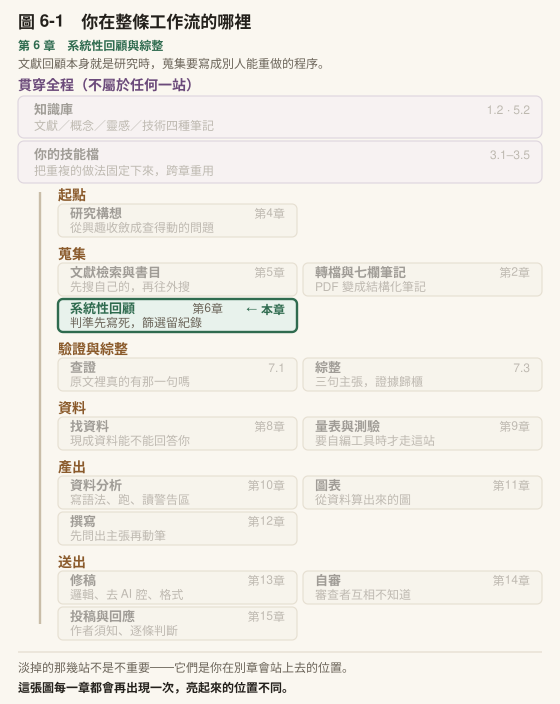

# 第 6 章　系統性回顧與綜整

## 本章導覽

**這一章回答五個問題**

1. 一般的文獻回顧和系統性回顧，差在哪裡？我的論文需要哪一種？
2. 納入排除判準為什麼要在搜尋之前寫死？寫死之後發現不夠用，怎麼辦？
3. 兩個人各判一次，判得一不一致要怎麼算、怎麼讀？
4. PRISMA 流程圖上的每一個數字，是從哪一份檔案算出來的？
5. 一個文獻研究技能怎麼分步驟、在哪裡停下來交給你？每一步可以交給 AI 什麼？

**讀完你能夠**

- **分辨**一般文獻回顧與系統性回顧，並判斷你的論文該做哪一種
- **寫出**一份在搜尋之前定案的研究問題與納入排除判準，並用 git 留下定案的時間
- **建立**檢索紀錄，讓別人照著紀錄能重跑出同樣的筆數
- **計算**兩位篩選者的一致率與 Cohen's kappa，並從不一致的方向讀出判準哪裡沒寫清楚
- **從**篩選紀錄算出 PRISMA 流程圖每一格的數字，而且數字前後接得起來
- **設計**一份資料萃取用的編碼表，並說出敘述綜整、後設分析、MASEM 各自需要什麼樣的資料
- **說出**一個文獻研究技能的模式、階段與停點，以及每一個做法背後的規則擋的是哪一種錯
- **建好**判準檔、檢索紀錄、篩選紀錄模板、一致性腳本、PRISMA 計數腳本、篩選初判技能，並把它們串成一份你自己的回顧工作流程檔

**需要多久**

自學閱讀約 90 分鐘｜課堂 3 小時（概念 70 分、實作 110 分）

**進來之前，你要能**

- 說出你的研究問題，至少是一個暫定版本（[第 4 章](../chapters/04-research-question.md)）
- 在至少一個學術資料庫下過檢索式，並把結果匯進書目軟體（[第 5 章](../chapters/05-literature-search.md)）
- 標出一筆文獻的驗證層級：全文逐字／摘要／僅書目（[第 5 章](../chapters/05-literature-search.md)）

**開始前請準備**：你的研究問題；[第 5 章](../chapters/05-literature-search.md)那一次檢索的紀錄（哪個資料庫、哪一天、檢索式、幾筆）；Excel 或任何能開 CSV 的軟體。

---

## 章前導言

還是那位研究國小高年級學生怎麼判斷 AI 答案可不可信的碩士生。她的文獻回顧初稿交出去，指導教授只在第一頁旁邊寫了一行字：

「你這一章引了三十二篇實證研究。是怎麼找到這三十二篇的？有沒有該進來卻沒進來的？」

她想了一下，答得出來的只有一部分。有些是 Google Scholar 搜到的，有些是讀別篇時從參考文獻追來的，有幾篇是學長推薦的，還有幾篇她記不得了。用過哪幾組關鍵字，她沒記；排除過哪些，她也沒記。她甚至說不出那個領域總共大概有多少篇，所以三十二篇算多算少，她也不知道。

那一行字問的其實是兩件事，這一章處理的就是這兩件事。第一件是**可重現**：別人照你的做法走一遍，會不會找到同一批文獻。第二件是**可課責**：每一篇沒進來的，你說得出它為什麼沒進來。一般的文獻回顧不必做到這兩件事，系統性回顧就是為了做到這兩件事而存在的。

這一章也會碰到 AI 最容易被誤用的一個位置。篩選幾千筆題名和摘要是整個系統性回顧最累的一段，把它整批丟給 AI 判，誘惑非常大。本章的做法是：**它可以給初判，但判準是你寫的，最後的裁決是你下的，而它的初判要拿你自己的盲判去驗**。驗出來的數字，要寫進論文的方法段。

> **〔課堂〕開場活動 10 分鐘** 請學生打開自己正在寫（或打算寫）的文獻回顧，隨便指一篇引用，回答兩題：這一篇是怎麼進到你手上的？跟它主題相近、卻沒進你的回顧的，你能舉出一篇嗎？舉得出來的話，它為什麼沒進來？多數人第一題答得出一半，第二題答不出來。不用評論，請兩三位說出卡住的地方，寫在白板上。本章結束前回來看，哪一格現在有做法了。

---

## 6.1 一般文獻回顧與系統性回顧差在哪裡

### 兩種回顧回答不同的問題

一般的文獻回顧（narrative review，敘述性回顧，暫譯）問的是：「這個領域已經知道什麼，我的研究站在哪裡？」它的品質看論證：你挑的文獻能不能撐起你要說的話，你有沒有把爭議講清楚。學位論文的第二章、期刊論文的引言，多半是這一種。

系統性回顧（systematic review，暫譯）問的是另一件事：「關於這個問題，所有符合條件的研究合起來說了什麼？」它的品質除了看論證，還看**選文的過程**：條件是什麼、去哪裡找、找到多少、排除多少、為什麼排除。這些都要事先寫清楚、做完記下來，讓讀者能檢查，也讓別人能重做。

寫文獻回顧的教科書與講系統性回顧方法的教科書，處理的往往是兩套問題：前者教你怎麼把回顧寫成一個論證，後者教你怎麼讓搜尋與選文經得起檢查。延伸資源列了兩類各一本。一份學位論文的文獻章，常常兩套都要用到：寫的部分用前者，方法交代用後者。

| | 一般文獻回顧 | 系統性回顧 |
|---|---|---|
| 研究問題 | 可以寬，寫作中可調整 | 搜尋之前寫死，含納入排除判準 |
| 檢索 | 從你知道的開始，順藤摸瓜 | 事先寫好的檢索式，多個資料庫，逐庫記錄 |
| 選文 | 你判斷哪些相關 | 照判準逐筆判，排除要有理由碼 |
| 判讀者 | 通常一個人 | 至少部分由兩個人獨立判，報一致性 |
| 紀錄 | 不一定有 | 檢索紀錄、篩選紀錄、PRISMA 流程圖 |
| 綜整 | 依論點組織 | 依事先定好的方式：敘述綜整、後設分析等 |
| 別人能不能重做 | 多半不能 | 應該能 |

### 系統性回顧費工的地方

系統性回顧不是「比較認真的文獻回顧」，它是另一種研究，而且很花時間。Zawacki-Richter 等人（2020）編的教育領域系統性回顧專書，引用了 Borah 等人（2017）對 195 篇醫學領域系統性回顧的分析：從開始到發表平均花 67.3 週，最終納入的篇數平均不到最初檢索筆數的 3%。同一本書的一個教育科技案例章裡，三人的兼職團隊篩完 18,068 筆摘要之後，面對 4,152 篇要讀全文，人力撐不住，最後改成從中抽兩組各 349 篇來讀，並在論文裡寫明這個抽樣決定（Bedenlier et al., 2020）。

這些數字的意思是：系統性回顧的工作量，大部分落在**篩選**。那也是 AI 最可能幫上忙、也最可能出事的地方，6.4 與 6.5 會處理。

### 你的論文需要哪一種

多數碩士論文的文獻章是一般文獻回顧，這沒有問題。問題出在**寫法像系統性回顧、做法卻不是**：方法段寫了「以關鍵字檢索資料庫，依納入排除標準篩選」，卻交不出檢索式、筆數和排除理由。口試時被問到檢索式與排除理由，就答不出來。

判斷方式：

- 你的研究問題本身就是「已發表的研究合起來說了什麼」——例如要做後設分析，或要回答「國內外關於 X 的實證研究呈現什麼樣貌」——那麼回顧本身就是你的研究，要做系統性回顧。
- 你的研究是一個實證研究，文獻章是為了定位它——做一般文獻回顧，但**檢索與選文的過程照本章的方式記下來**。即使不畫 PRISMA 圖，指導教授那一行字你也答得出來。

第二種做法其實是多數人該做的。本章的工具（判準檔、檢索紀錄、篩選紀錄）用在一般文獻回顧上一樣成立，只是你不必報一致性、不必畫流程圖。

〔補充〕系統性回顧之下還有幾種變體。範圍回顧（scoping review，暫譯）在研究問題還很寬時用來畫出一個領域的版圖；系統性地圖（systematic map）把研究的特徵編碼後呈現分布，不做合成。Zawacki-Richter 等人（2020）那本書把綜整分成「配置式」與「聚合式」兩種邏輯：前者把不同研究的發現拼成一個解釋，後者把同類研究的結果加總。你的研究問題屬於哪一種邏輯，決定了後面的篩選要多嚴、綜整要怎麼做。

> **〔動手一下〕5 分鐘** 拿你的研究問題對照上面兩段判斷方式。寫一句話：「我的文獻章是＿＿＿（一般／系統性），因為＿＿＿。」再寫一句：「如果口試委員問我『你怎麼找到這些文獻的』，我現在能交出＿＿＿，交不出＿＿＿。」第二句的空格，就是本章要補的東西。

### 帶走這一節

- 一般文獻回顧看**論證**，系統性回顧另外看**選文過程能不能檢查、能不能重做**
- 系統性回顧的工作量大部分落在篩選，那也是 AI 最可能幫忙、也最可能出事的地方
- 多數碩士論文做一般文獻回顧即可，但**檢索與選文的過程照樣要記下來**
- 方法段寫得像系統性回顧、卻交不出紀錄，是最容易被追問的狀況

---

## 6.2 先把問題和判準寫死，再去搜

### 研究問題的框架

系統性回顧的研究問題，通常要拆成幾個元件，每個元件對應一條納入判準。醫學領域最常用的是 PICO：對象（Population）、介入（Intervention）、比較（Comparison）、結果（Outcome）。

PICO 在教育研究上不一定合身。Zawacki-Richter 等人（2020）那本書裡有兩個案例章各自得出同一個結論：研究問題不是在評估某個介入的效果時，PICO 有幾格填不進去。教育研究的回顧常常在問「學生怎麼做某件事」「哪些條件下會發生某件事」，沒有介入，也沒有對照組。

所以把 PICO 當成一張檢查表，而不是一個必須填滿的格式：**每一格都問自己一次「這一格我要不要限定？限定成什麼？」**，填不進去的格寫「不限定」，並寫出為什麼。

拿貫穿本書的那個研究當例子。那位碩士生想先知道已發表的研究看到了什麼，她的回顧問題是：「中小學生怎麼判斷 AI 產出的資訊可不可信？」

| 元件 | 她的決定 | 對應的判準 |
|---|---|---|
| 對象 | 中小學生（國小到高中） | 受試者為中小學生；大學生、教師排除 |
| 接觸的東西 | AI 產出的資訊（聊天機器人回答、AI 搜尋摘要、AI 解題說明） | 評估對象必須是 AI 產出的內容；一般網路資訊排除 |
| 比較 | 不限定 | （無） |
| 結果 | 可信度判斷：信不信、用什麼線索判斷、會不會查核 | 至少測量或觀察了一種可信度判斷 |
| 研究類型 | 實證研究，量化質性都收 | 非實證（概念文章、政策分析、文獻回顧）排除 |

### 納入排除判準怎麼寫

判準檔要寫到**另一個人拿著它，對同一筆摘要，會跟你判一樣**。這個標準很高，寫第一版時一定達不到，6.5 的一致性檢查就是用來量它差多遠。

幾個寫法上的要求：

1. **每一條排除理由給一個代碼**，例如 `E1 非實證研究`、`E2 對象不是中小學生`。篩選時只准填代碼，不准寫自由文字。到了畫 PRISMA 圖，全文排除要逐條列理由與筆數，代碼讓那一步可以用程式算。
2. **寫出「待定」怎麼處理**。摘要沒寫對象年齡、題名看不出研究類型，這種在題摘階段一律判「待定」，進全文再判。題摘階段排除錯了，那篇就永遠消失；放進全文多讀一篇，代價只是時間。
3. **寫出灰色地帶的判例**。例如「國中生的網路新聞識讀」算不算？它談可信度判斷，但對象不是 AI 產出的資訊，依判準排除。判例寫進判準檔，下一次遇到同類的就不必重新想。

判準檔的第一行寫建立日期與「搜尋開始前訂定」，最後留一節「篩選後訂定」。前者讓讀者知道判準是什麼時候定的，後者是之後要修改時唯一可以寫的位置。本章建置的判準模板照這個格式。

### 為什麼要在搜尋之前寫死

**規則：判準在第一次正式檢索之前寫好並鎖定。**

這條規則擋的錯是：判準在看到搜尋結果之後才定，會被結果牽著走。你看到一篇很想收、但它的對象是大學生，你會想把判準放寬到「含大學生」；你看到一批你不想讀的質性研究，會想加一條「限量化研究」。每一個修改單獨看都合理，合起來就是**依你找到的東西決定你要找什麼**，讀者無從分辨哪個結論是證據撐起來的、哪個是判準挑出來的。

這個錯當下看不出來，因為每一次修改都附著一個合理的理由。看得出來的方式只有一種：比對判準定案的時間與檢索的時間。所以本章建置要你在第一次正式檢索之前，把判準檔 commit 進 git；那一筆 commit 的時間就是證明。

研究進行中發現判準撐不住，修改是正常的。常見的有兩種情況：進全文的篇數遠超過你讀得完的量，或遇到判準完全沒想到的一類研究。修改時守三件事：

- 原判準一個字都不動，新條件寫在判準檔末尾的「篩選後訂定」，標日期與理由
- 決策日誌記一列：改了什麼、為什麼、依據是什麼、影響多少筆
- 論文方法段寫明這是事後修改

新加的條件即使有文獻依據（例如照一篇既有回顧的判準補一條），它仍然是事後訂的。依據寫進去，「事後」兩個字也照樣寫進去。

⚠️ 最容易出事的是**沒寫進判準檔的慣例**。篩到第幾百筆，你會遇到判準沒寫到的灰色地帶，當場決定一個判法，然後繼續。那個判法如果只記在腦子裡或某份隨手筆記裡，判準檔和實際的判法就成了兩回事；任何只讀判準檔的人，包括盲判的一方和 AI 初判，都不知道它存在。一致性檢查會把它量成不一致，而你會以為是對方判錯。遇到第一個需要當場決定的灰色地帶，當天寫進「篩選後訂定」。

### 寫死之前，先試判一小批

「寫死」不等於「第一版就寫死」。正確的順序是：寫初稿 → 拿一小批真實的摘要試判 → 修判準 → **然後**鎖定，開始正式篩選。

已發表的回顧多半這樣做。Tagare 等人（2025）在正式篩選之前，先試判五篇的題名與摘要，用來界定納入排除判準；那五篇不是挑出來的，是把所有論文依作者姓氏排序後取最前面五篇。Zawacki-Richter 等人（2020）書裡的一個案例章也寫到，判準最後雖然以定稿清單呈現，在那之前曾用第一批論文試判、校準過措辭。

試判的那一批，**不算進正式的篩選結果**，也要寫進方法段。鎖定之後的修改，照上一小節的方式處理。

〔補充〕醫學與部分社會科學領域會把回顧計畫書公開登錄（例如 PROSPERO 這類登錄平台），登錄的時間戳就是「判準在搜尋之前寫好」的證明。碩士論文多半不必公開登錄，但你可以用本章建置的方式，**在第一次正式搜尋之前把判準檔 commit 進 git**。這筆 commit 的時間也可以拿給指導教授看。

〔教你的 Claude 建這個〕判準最怕的是你沒想到的那種摘要。讓它專門找邊界，貼這段：「請幫我建一個〈判準壓力測試〉技能檔。使用時我會貼給你我的研究問題與納入排除判準。你的工作是**寫出十段假摘要**，每一段都刻意落在某一條判準的邊界上，讓兩個認真的人可能判得不一樣。每段後面寫：它卡在哪一條、為什麼會判得不一樣。**不准替我修改判準，也不准替我判這十段**。」第一版就這樣，一個步驟。你拿這十段自己判一次、請同學也判一次，判不一樣的那幾段，就是判準要補寫判例的地方。

> **〔動手一下〕10 分鐘** 用上面的 PICO 表格，把你的研究問題拆成元件，每一格寫「限定成什麼」或「不限定，因為…」。再為每一條排除寫一個代碼。寫完拿去給隔壁同學，請他說出一種他覺得你的判準判不出來的研究。

### 帶走這一節

- PICO 當**檢查表**用：每一格問一次要不要限定，填不進去的寫明不限定的理由
- 判準要寫到另一個人拿著它，對同一筆摘要會跟你判一樣；排除理由用**代碼**
- 題摘階段拿不準的一律**待定、進全文**，不在題摘階段排除
- 順序是：初稿 → 試判一小批 → 修 → **鎖定**，然後才正式篩選
- 鎖定後要改：原文不動，末尾另起一節標日期與「篩選後訂定」，論文裡寫明
- 判讀時當場決定的慣例，**當天寫進判準檔**

---

## 6.3 檢索策略與檢索紀錄

[第 5 章](../chapters/05-literature-search.md)把檢索當成一個工序：先搜自己的，再往外搜，每一次搜尋都留下紀錄。系統性回顧要的是同一個工序，但紀錄的標準更高：**別人照你的紀錄重跑一次，要能得到同樣的筆數**（資料庫會增加新文獻，所以是「在同一個日期截止條件下」同樣的筆數）。

### 檢索式的結構

系統性回顧的檢索式通常由幾個**概念區塊**組成，區塊之間用 AND 連起來，區塊內的同義詞用 OR 連起來。以那位碩士生的問題為例，三個區塊：

```text
( "artificial intelligence" OR "generative AI" OR ChatGPT OR chatbot* OR "large language model*" )
AND
( trust* OR credib* OR reliab* OR "information evaluation" OR "fact-check*" )
AND
( student* OR pupil* OR child* OR adolescen* OR "primary school" OR "secondary school" OR K-12 )
```

每個資料庫的語法不同（欄位標籤、截字符號、片語引號），同一個邏輯要改寫成各資料庫的版本，**每一個版本都要原樣記下來**。

### 召回率：拿一批已知的文獻來測檢索式

檢索式寫好之後，怎麼知道它有沒有漏？準備一批**你已經確定應該被找到的文獻**當已知集合：[第 5 章](../chapters/05-literature-search.md)讀過、確定符合判準的那幾篇，或一篇主題相近的既有回顧的納入清單。看檢索式撈回其中幾篇，撈回的比例就是召回率（recall，暫譯）。

**規則：檢索式定案之前，用已知集合測過召回。**

它擋的錯是為了讓筆數好看而加的限制區塊。常見的有三種：

- **方法詞區塊**（例如限定摘要必須提到「問卷」「量表」的）。很多研究的摘要不寫方法細節，這個區塊會默默殺掉它們
- **結果特徵詞**（例如限定摘要必須提到「相關」的）。摘要不一定會寫你要的那個統計量
- **只用某一個理論的名稱**當檢索詞。同一個現象用別的理論框架命名的研究，全部漏掉

每加一個 AND 區塊，筆數會好看很多，但你看不到它殺掉了什麼，除非手上有已知集合可以測。做法：每拿掉或加入一個區塊，就重測一次召回，在檢索紀錄的〈召回測試〉記一列。召回掉最多的那個區塊，就是要改的那一個。

漏掉的已知文獻逐篇看：它用了什麼詞？那個詞要不要加進同義詞？還是它其實不符合判準、不該在已知集合裡？三種答案都記下來。

### 檢索紀錄要記什麼

每一次檢索記一列：

| 欄 | 寫什麼 |
|---|---|
| 資料庫 | Scopus、ERIC、華藝……每個資料庫一列，**不合併** |
| 檢索日期 | 精確到日 |
| 檢索式 | 原樣貼上，含欄位標籤與限制條件 |
| 限制條件 | 年份、語言、文獻類型，以及你在介面上勾的任何篩選 |
| 筆數 | 資料庫畫面上顯示的數字 |
| 匯出檔名 | 匯出的書目檔叫什麼、存在哪 |
| 備註 | 召回測試的結果、異常狀況 |

引用追蹤（從一篇關鍵文獻往前找引用它的、往後找它引用的）要**另外列一區**，不跟資料庫檢索混在一起。PRISMA 流程圖把這兩種來源分開計數，6.6 會講。6.9 介紹的文獻研究技能也是這樣設計的：資料庫各自一列、引用追蹤另列一區，而取全文那一步不算進檢索筆數，因為它不產生新的候選文獻。

### 檢索回 0 筆，不一定是沒有

⚠️ 有些檢索工具出錯時不會報錯，而是回給你 0 筆：免費額度用完、被限流、連線逾時，連接工具把錯誤轉成一個空結果。另一種是比對失敗：用完整論文題名去查，題名裡一個彎引號或破折號和資料庫的寫法不同，就回 0；改用題名中一段短而獨特的片段，結果才出來。

**規則：回 0 不等於沒有。** 它擋的錯是把工具失效寫成「這個主題沒有研究」。做法：

- 「筆數」欄填你在資料庫畫面上親眼看到的數字，或匯出檔的實際筆數，不填 AI 轉述的數字
- 回 0 時，換一個你確定應該有結果的詞再查一次，確認工具是活的
- 確認過仍是 0，寫「本次檢索未見」並列出搜了哪幾處，不寫「不存在」

〔補充〕紀錄要在當下記。工具在某段期間靜默失效，那段期間撈到的東西事後沒有辦法重建當時的筆數，論文裡只能寫「無法重現」。

### 帶走這一節

- 檢索式由**概念區塊**組成，區塊間 AND、區塊內 OR；每個資料庫的版本都原樣記下
- 用一批已知文獻測**召回率**；最危險的是為了精準而加的那個 AND 區塊
- 檢索紀錄每個資料庫一列：日期、檢索式、限制、筆數、匯出檔；**引用追蹤另列**
- 回 0 不等於沒有：**筆數填你親眼看到的**，回 0 就換一個確定有結果的詞再查一次

---

## 6.4 題摘篩選與全文篩選

### 兩個階段

篩選分兩段。**題摘篩選**（title/abstract screening，暫譯）只看題名與摘要，判斷「有沒有可能符合」；**全文篩選**拿到全文之後，逐條對判準，判斷「符不符合」。

兩段的判準是同一份，但嚴格程度不同。題摘階段的原則是**寧可放進來**：摘要沒寫的事，不能當成「沒有做」。全文階段才是真正的裁決。

篩選前先去重：同一篇文獻從 Scopus 和 ERIC 各撈到一次，只留一筆。去重以 DOI 為主，沒有 DOI 的比對第一作者、年份和題名。去重後的筆數，是 PRISMA 圖上「進入篩選」那一格。

### 題摘階段的三種判決

每一筆只准判三種之一：

- **納入**（include）：看得到符合每一條判準，或至少看不到不符合的地方
- **待定**（unclear）：資訊不夠判斷，例如摘要沒寫對象年齡、根本沒有摘要
- **排除**（exclude）：看得到不符合某一條，填那一條的代碼

納入與待定都進全文。所以題摘階段真正在做的決定只有一個：**這一筆要不要排除**。

沒有摘要的紀錄只能依題名判：判得出排除的才排除，判不出就待定。這一類的筆數在方法段另外交代。

### 全文階段

全文階段多了一件題摘階段沒有的事：**取得全文**。

取不到全文是常態，而且很花時間。Bedenlier 等人（2020）描述他們的取件過程：透過各自學校的圖書館、館際文獻傳遞、在學術社群網站上聯絡作者，最後在別無他法時自費購買，仍然有取不到的。取不到的那幾篇，要記下你試過哪些管道。

⚠️ **取不到全文不是排除理由**，它要單獨記成「未取得」。這兩者看起來都是「這篇沒進來」，意思卻不同：排除是你讀過、判定不符合；未取得是你不知道它符不符合。混在一起，你的回顧就會把「不知道」報成「不符合」。所以理由代碼裡要把「取不到全文、無法判定」和「讀過全文、確認不符合」分成兩個代碼，判準檔寫明不可混用。

全文排除的每一筆，都要有**一個**理由代碼。一篇同時不符合兩條時，依判準檔的順序取第一條，這個規則也寫進判準檔。PRISMA 流程圖要的是一張「理由代碼 × 篇數」的表，本章建置的計數腳本會從篩選紀錄直接算出來（見第 7 步的輸出）。

### 同一批資料，發了兩篇

全文階段還要抓一種題摘階段看不到的事：**兩篇論文用的是同一批資料**。同一群受試者被拿來發了兩篇（換一組變項、換一個期刊），兩篇都收，等於這群人在你的綜整裡算了兩次。

**規則：萃取時記下足以辨認一批資料的欄位，納入清單定稿前排序檢查一次。**

辨認的線索：樣本數相同、施測地點與時間相同、倫理審查編號相同、描述統計或相關係數有多處一模一樣。這種事 AI 篩題摘時抓不到，你逐篇讀全文時也很容易漏，因為兩篇不會剛好前後讀到。抓它的做法是在編碼表裡留這幾欄，定稿前**按樣本數排序**看一次，相同樣本數的並排比對。確認是同一批資料的，只留一篇，另一篇以理由代碼 E5 排除，並在方法段說明留哪一篇、為什麼。

### 改判的方式

**規則：篩選紀錄只准往下追加，不准回頭改舊的判決。**

它擋的錯：直接改掉一筆判決，原判和改判的理由都不見了。更麻煩的是，一致性檢查若剛好抽到那一筆，比對的是改過之後的版本，量出來的一致性會偏高，而你不會知道。

做法和[第 1 章](../chapters/01-setup.md)的決策日誌一樣：原判決留著，另外記最後裁決與改判理由。本章建置的篩選紀錄模板把「第一位的判決」和「最後裁決」分成兩欄，就是為了這件事。紀錄放在 git 裡，`git diff` 看得到有沒有人動過舊的列。

### 帶走這一節

- 題摘階段**寧可放進來**：拿不準就待定，待定進全文
- 去重後的筆數，才是進入篩選的筆數
- **取不到全文要單獨記成「未取得」，不是排除理由**
- 全文排除每篇**一個**理由代碼；同時不符合多條時，依判準檔的順序取第一條
- 全文階段要抓**同一批資料發兩篇**；記下樣本數、地點、時間、倫理審查編號，事後排序看一次
- 篩選紀錄**只追加不改舊的**；原判與最後裁決分兩欄

---
## 6.5 兩個人各判一次：一致性怎麼算、怎麼讀

### 為什麼要兩個人

一個人篩幾百上千筆，判法會漂移。第一天你對「對象不是中小學生」判得很嚴，第三天累了，一篇對象寫著「青少年」的你就放進來了。判準檔有一句話寫得不夠清楚，你自己讀不出來，因為你知道你當初的意思。

第二個人獨立判一次，擋的就是這兩件事。他不知道你當初的意思，只能照判準檔的字面判；他跟你判得不一樣的地方，多半就是判準檔沒寫清楚的地方。

理想的做法是兩個人各自把全部紀錄判一次，不一致的再討論。Tagare 等人（2025）就是這樣做的：三位作者把一千多筆紀錄分成三組，每一組由兩人各自判，判讀時開著篩選軟體的盲判模式，看不到對方的判決。

人力不夠時，常見的折衷是**一個人判全部，第二個人獨立判其中一部分**，用那一部分的一致性來說明第一個人的判法可信到什麼程度，例如隨機抽 10%。

### 一致率與 Cohen's kappa

兩個人判得一不一致，最直觀的算法是**一致率**：兩人判一樣的筆數，除以總筆數。

一致率的問題是它會被「大家都判排除」灌高。題摘階段排除的通常佔大多數，兩個人就算各自亂判，若都傾向判排除，一致率也會很高。

Cohen's kappa 把這一塊扣掉。它先算「如果兩人各自照自己的比例亂判，會有多少剛好一致」，叫做機遇一致，然後問：實際的一致比機遇多出多少？

> kappa ＝（實際一致率 − 機遇一致率）÷（1 − 機遇一致率）

kappa 等於 1 是完全一致，等於 0 是一致的程度跟亂判一樣。

舉一個算得出來的例子。兩人各判 100 筆題摘：

| | 乙判納入 | 乙判排除 | 合計 |
|---|---|---|---|
| **甲判納入** | 10 | 6 | 16 |
| **甲判排除** | 4 | 80 | 84 |
| **合計** | 14 | 86 | 100 |

一致率是（10＋80）÷ 100＝.90。看起來很好。

機遇一致：甲判納入的比例 .16、乙 .14，兩人剛好都判納入的機率是 .16 × .14＝.0224；都判排除是 .84 × .86＝.7224。加起來 .7448。也就是說，兩人就算各自亂判，也會有大約七成五剛好一致。

kappa＝（.90 − .7448）÷（1 − .7448）＝ .61。

同一份判讀，一致率報 90%、kappa 報 .61。這是為什麼方法段要兩個都報，而且讀別人的論文時，要看清楚他報的是哪一個。Tagare 等人（2025）第一輪題摘篩選寫的是「評分者間信度 74.36%」，那其實是 1,030 筆裡兩人判一樣的 766 筆所佔的比例，是一致率，不是 kappa。他們把兩人都判「也許」的情況也算成不一致，這個決定讓數字偏保守，而他們把這個決定寫出來了。

〔補充〕kappa 多高才算夠？你會在不同文獻看到不同的分級說法，本書不給一條門檻。比門檻有用的是下一小節：**看不一致落在哪裡**。另外，同一套判讀，三類（納入／待定／排除）的 kappa 通常比二分（進全文／排除）低，因為「納入」和「待定」之間的分歧在二分時不算分歧，而那兩類本來就都進全文。兩個都算、都報。

### 一致性的數字，要看方向

同一個 kappa，背後的不一致可以長得完全不一樣。看兩個示範情況（數字是虛構的），兩者的 kappa 都在 .66 左右：

- **甲**：不一致全部落在「第一位判納入、盲判判排除」那一格；反方向的一筆都沒有
- **乙**：不一致全部落在「第一位判排除、盲判判納入」那一格

甲的意思是第一位判得太鬆，不該收的收進來了；乙的意思是第一位判得太嚴，該收的在題摘階段就被排除了。兩者都不是隨機雜訊，是**一批系統性判錯的紀錄**。

兩者的後果不一樣。偏鬆會讓不該收的進到全文階段，你在全文階段還有機會擋；偏嚴會讓該收的在題摘階段就消失，之後沒有任何一關會把它撿回來。所以題摘階段偏嚴，比偏鬆更要緊。

接著看不一致那幾筆的理由。如果改判的理由多半是**判準檔裡沒寫的條件**，主因是判準規格不足，不是某一方判錯；要改的是判準檔（寫進「篩選後訂定」），不是那一方。

**規則：kappa 與交叉表一起讀；不一致有方向，就整批重看那一方的同類判決。**

### 盲判要盲到什麼程度

⚠️ 盲判者在判之前看到原判，量到的就不是一致性。他會傾向同意，或者在不同意時多想一下而改判成同意。這種偏誤不會出現在任何數字上，你只會看到一個漂亮的 kappa。

**規則：盲判者看不到原判；抽樣在初判之前，盲判也在初判之前做完。**

題本只放紀錄編號、題名和摘要，判決欄空白；抽樣用固定的隨機種子，事後可以重抽出同一批。順序是先抽樣、先盲判，再讓 AI 初判；這樣在物理上就不可能被它的判決影響。本章建置的 `sample` 指令產生的題本就是這樣。

如果盲判的一方也是 AI（例如開一個乾淨的對話，只給它判準檔與題本），它看不到原判，可以擋住「判準檔沒寫清楚」：它只能照字面判，判準一有縫，不一致就會冒出來。它擋不住的是兩次判讀**共有**的偏誤：同一種模型對同一種摘要的誤讀，兩次都會發生，然後被算成一致。所以在你的論文裡，**盲判的那一方應該是你自己**（或另一位研究者），6.11 會講這個分工。

### 不一致之後做什麼

一致性檢查不是算完數字就結束。每一筆不一致都要有人裁決，而裁決的結果分三種去處：

1. **判準寫得清楚，是某一方判錯**：裁決，寫進最後裁決欄，附理由。
2. **判準沒寫到這種情況**：裁決之後，把這個判例寫進判準檔的「篩選後訂定」一節，決策日誌記一列。同類的紀錄可能不只這一筆，回頭找出來重判。
3. **同一個方向的不一致很多**（像上面的甲、乙那樣全部落在同一格）：問題不在個別紀錄，在判法本身。整批重判，或至少把那一方判的同類紀錄全部重看。

第三種常被略過：一個 .66 或 .77 的 kappa 很容易被寫成「一致性可接受」然後繼續往下走；但如果不一致有方向，那個數字代表的是一批系統性判錯的紀錄。

> **〔動手一下〕5 分鐘** 用上面 100 筆的例子改兩個數字：把「甲判納入、乙判排除」從 6 改成 16、「兩人都判排除」從 80 改成 70。重算一致率、機遇一致與 kappa。算完再看交叉表：這一次的不一致幾乎都在同一格，你會先回頭查哪一方的判法？

### 帶走這一節

- 第二個人的價值在於**他不知道你當初的意思**，只能照判準的字面判
- 一致率會被「大家都判排除」灌高；**kappa 扣掉機遇一致**，兩個都報，三類與二分也都報
- **看不一致的方向**：全部落在同一格，是系統性判錯，不是雜訊
- 題摘階段**偏嚴比偏鬆危險**，因為排除掉的之後沒有一關會撿回來
- 盲判題本**不含原判**；抽樣用固定種子
- 每一筆不一致都要裁決；判準沒寫到的，寫進判準檔的「篩選後訂定」

---

## 6.6 PRISMA 流程圖的數字從哪裡來

### 流程圖是一張帳

PRISMA 是系統性回顧的報告規範，最為人所知的是它的流程圖：從檢索到納入，每一個階段剩幾筆、去掉幾筆、為什麼去掉。目前通行的版本是 PRISMA 2020（Page et al., 2021）。

那張圖要當成一張帳來看。每一格都是一個數字，每一個數字都要**指得出是從哪一份檔案、用什麼條件算出來的**，而且上一格減掉這一格去掉的，要等於下一格。

| 流程圖上的格 | 從哪裡算 |
|---|---|
| 各資料庫識別的筆數 | 檢索紀錄的「筆數」欄，每個資料庫一格 |
| 其他方法識別的筆數 | 引用追蹤那一區，另列 |
| 移除的重複 | 篩選紀錄裡標了「與某筆重複」的列數 |
| 題摘篩選的筆數 | 去重後剩下的列數 |
| 題摘排除 | 最後裁決為排除的列數 |
| 尋求全文 | 最後裁決為納入或待定的列數 |
| 未取得全文 | 全文欄標「取不到」的列數 |
| 全文評估 | 取得全文的列數 |
| 全文排除（逐條理由） | 全文判決為排除的列數，依理由代碼分組計數 |
| 納入 | 全文判決為納入的列數 |

### 為什麼不能手填

⚠️ 流程圖的數字一旦用手填，就會跟篩選紀錄分家。你後來改判了一筆、補到了一篇全文、發現了一組重複，篩選紀錄更新了，圖上的數字沒有跟著更新，而且圖上的數字依然加得起來，因為你當初就是讓它加得起來的。

**規則：PRISMA 的每一個數字只從篩選紀錄算，不手填。** 流程圖每一格旁邊寫明它從哪個檔、用什麼條件算出；紀錄一更新就重算。後期才發現一組同一批資料的論文、剔除一篇，納入篇數就會變，圖要跟著重產。本章建置的 `prisma_counts.py` 就是做這件事：從篩選紀錄重算每一格，並檢查前後接不接得起來。

### 多來源時，最容易對不上的那一格

只有一次檢索時，流程圖很直。研究進行中又補了幾輪檢索、引用追蹤、別人回顧的納入清單，流程圖就會分岔，最容易出問題的是**跨來源去重**。

每一輪新檢索進來時，你可能只跟手上既有的池子比對過 DOI。各輪各自去重，不等於全體去重：兩輪檢索都撈到同一篇，而各輪的筆數又各自加總，那一篇就會在圖上出現兩次。

如果你的回顧也是分幾輪找的，在畫圖之前做一次全體去重，讓「進入篩選」那一格只有一個數字。

〔補充〕Zawacki-Richter 等人（2020）那本書有一個案例章提醒：PRISMA 聲明「不是品質保證工具」（p. 155），它規範的是你怎麼報告，不保證你做得好。一張數字完美的流程圖，背後可以是一份很鬆的判準。圖只能讓讀者**檢查**你做了什麼，判準好不好，要讀者自己去讀判準。

### 帶走這一節

- 流程圖是一張帳：每一格**指得出來源檔與計算條件**，上一格減去掉的等於下一格
- 資料庫與其他方法**分開計數**；未取得全文單獨一格，**不算排除**
- 數字**從篩選紀錄重算**，不手填；紀錄一更新，圖就重產
- 多輪檢索時，畫圖前做一次**全體去重**，讓「進入篩選」只有一個數字

---

## 6.7 資料萃取與編碼表

### 編碼表在萃取之前定

納入的研究確定之後，要從每一篇抽出你要綜整的資訊：樣本、方法、測量、結果。這一步叫資料萃取（data extraction，暫譯），抽出來的東西填進一張編碼表，一篇一列（或一個效果一列）。

編碼表的欄位要在開始萃取之前定好。理由是：研究層次的調節變項（例如受試者是學生還是成人、量表是哪一個版本）必須在萃取當下就編好，事後回頭補等於每一篇重讀一次。

一份編碼表大致有這幾區：

| 區 | 例子 | 注意 |
|---|---|---|
| 識別 | 研究代號、DOI、APA 書目 | 研究代號同作者同年加 a、b |
| 納入判定 | 最後裁決、理由代碼 | 與篩選紀錄一致 |
| 樣本 | 分析用的樣本數、總樣本數、對象、國家、施測年份 | 兩個樣本數分開記 |
| 測量 | 用了哪個量表、題數、面向名稱（照原文） | 面向名稱照抄原文，不翻譯 |
| 結果 | 你要綜整的數值或發現，含出處頁碼與表號 | 每一個數字指得出位置 |
| 旗標 | 疑似重複資料、取不到全文、需要敏感度分析 | 用固定字串 |

### 三個常見的坑

**分析用的樣本數不是總樣本數。** 一篇研究收了 800 人，做驗證性因素分析時隨機分半，相關矩陣只來自其中 400 人。後設分析要的是產生那個數值的樣本數。編碼表因此要有兩欄：產生該數值的樣本數、論文報的總樣本數；並記前者是原文印的還是推算的，推算的寫到別人可以複算。

**「表存在」不等於「表是你要的那張」。** 你要的是某一份量表各面向之間的相關，論文裡確實有一張相關表，但它的行列是「量表總分 × 另一個構念」，或是兩份不同量表交叉。只看表題寫著 correlation 就判「有」，是萃取時最常見的誤判之一。**規則：判定有沒有你要的資料，看表的實際行列，不看表題。**

**為了湊數，把勉強對得上的寫成對得上。** 把各研究的變項對到你的分類時，總有幾篇只能勉強對上。**規則：勉強對上的一律標「勉強」，放進敏感度分析，不進主分析。** 它擋的錯是：主分析的篇數變多了、看起來更有力，其實混進了一批你自己也不確定的對應。

### 讓 AI 萃取，你要驗什麼

AI 可以從全文抽出樣本數、量表名稱、相關係數，速度比你快很多，而它最容易出錯的地方，正好是你最需要的那些數字：表格跨頁、欄位錯位、把 .53 讀成 .58。

所以萃取的規格要求它**每一個數字附上位置**（頁碼、表號、第幾列第幾欄），你再照位置抽查。抽查的方式和[第 7 章](../chapters/07-verification.md)的引文核對同一個道理：回到原文，逐字比對。

更可靠的是**雙重萃取**：同一批研究由兩方各自萃取一次，比對差異。你的論文篇數不多時，自己抄一次、請 AI 抄一次，逐格比，是一個便宜的做法。

〔教你的 Claude 建這個〕萃取規格最常壞在「它自己決定了一個你沒交代的判斷」。貼這段：「請幫我建一個〈資料萃取〉技能檔。使用時我會給你一篇全文和我的編碼表欄位說明。你逐欄填，**每一個數字後面附頁碼與表號**。遇到下列情況不准自己決定，在備註欄寫出來交給我：原文有兩個樣本數、數值只出現在正文沒有在表裡、表格的行列看起來不是我要的那種、面向名稱對不到我的基準。」第一版就這樣。你用它萃取第一篇之後，一定會遇到一種它自己決定了的情況，把那一種加進「不准自己決定」的清單。

### 帶走這一節

- 編碼表欄位**在萃取前定好**；調節變項當下就編，事後補等於重讀
- **分析用的樣本數**與總樣本數分開記；推算的寫到可複算
- 判定有沒有你要的資料，**看表的實際行列**，不看表題
- 勉強對得上的**標出來、降層**，不為了湊數填成對得上
- AI 萃取的每一個數字**附位置**；可行時做雙重萃取，逐格比

---

## 6.8 綜整：敘述綜整、後設分析，以及 MASEM 的位置

### 先問你手上的是什麼樣的資料

綜整的方式不是挑你喜歡的，是看你萃取出來的東西能做什麼。

**敘述綜整**（narrative synthesis，暫譯）：研究之間的設計、測量、結果形式差太多，數字沒辦法合在一起。你依主題或依主張組織，說明哪些研究支持什麼、在什麼條件下結果不同、證據的強弱。那位碩士生的回顧多半會是這一種：納入的研究有問卷、有訪談、有放聲思考，結果變項各不相同。

敘述綜整不是「逐篇摘要」。[第 7 章](../chapters/07-verification.md)會教一個做法：先寫下你的主張，再讓證據歸隊，看哪個容器是空的。系統性回顧的敘述綜整也是同一件事，只是你的證據池是篩選出來、有紀錄的，不是你記得的那幾篇。

**後設分析**（meta-analysis）：納入的研究測的是同一種效果，而且報了足以算出效果量的數字（平均數與標準差、相關係數、勝算比等）。你把每一篇的效果量放在同一個尺度上，加權合成一個整體估計，並檢查研究之間的差異（異質性）有多大、能不能用研究特徵解釋。

後設分析是一個統計方法，它有自己的模型選擇（固定效果還是隨機效果）、自己的偏誤檢查（例如發表偏誤），每一步都是判斷。這些不在本章，[第 10 章](../chapters/10-statistics.md)會講怎麼把一本方法書變成你的顧問，延伸資源列了一本後設分析的手冊。

〔補充〕**MASEM** 是後設分析和結構方程模型的結合（meta-analytic structural equation modeling，暫譯）。它合成的不是單一效果量，是每一篇研究的**整張相關矩陣**，合成之後再拿來配一個結構方程模型。常見的做法分兩階段：先合成各研究的相關矩陣，再拿合成的矩陣配模型（Cheung, 2015）。所以萃取時每一篇要記的是整張相關矩陣與產生它的樣本數，6.7 講的「分析用的樣本數」與「看表的實際行列」在這裡最要緊。你的論文用不到它也沒關係，記得有這種東西存在：當你想問的不是「X 對 Y 有沒有效果」，而是「這幾個構念之間的關係結構，跨研究看成不成立」時，它是可能的工具。

### 判斷哪幾篇比較算數

不論哪一種綜整，你都要決定**每一篇研究的份量**：設計比較嚴謹的、樣本比較大的、測量比較好的，說的話比較算數。系統性回顧通常有一步品質評估（或偏誤風險評估），用一套固定的檢核項目逐篇評。

教育研究的品質評估工具有爭議。Zawacki-Richter 等人（2020）那本書裡有案例章報告，標準的偏誤風險工具用在他們的研究上行不通；書中也收了一章對系統性回顧方法本身的批判。延伸資源會列出來，這裡只記一件事：**你用了什麼標準評品質、評的結果怎麼影響綜整，要寫出來**。不評也是一個決定，也要寫出來。

### 帶走這一節

- 綜整方式由**資料能做什麼**決定，不是由你喜歡什麼決定
- 敘述綜整不是逐篇摘要；做法和[第 7 章](../chapters/07-verification.md)的「先有主張、再讓證據歸隊」相同
- 後設分析要同一種效果、算得出效果量；模型選擇與偏誤檢查**每一步都是判斷**（[第 10 章](../chapters/10-statistics.md)）
- MASEM 合成的是**整張相關矩陣**；知道它存在、知道它要什麼資料就夠
- 品質怎麼評、評了怎麼用，**寫出來**；不評也要寫

---

## 6.9 一個文獻研究技能怎麼運作

[第 3 章](../chapters/03-skills.md)說，技能是把重複的做法固定下來的檔案。文獻研究這件事步驟長、分岔多，一個完整的技能會長成什麼樣子，可以看作者工作環境裡的 `ars-deep-research`。它改編自一套公開的學術研究技能，再依作者的工作習慣加了規則。這裡只描述它的設計，不貼原檔：看它在哪裡分岔、在哪裡停、每一步交出什麼，然後回頭設計你自己那個小得多的版本。

### 第一個分岔：模式

它一開始不做任何搜尋，先判斷你要哪一種東西，分成八個模式：

| 你的狀況 | 模式 |
|---|---|
| 只有模糊的想法，需要被追問 | `socratic`（引導式對話） |
| 研究問題清楚，要一份完整研究報告 | `full` |
| 要一份快速摘要 | `quick` |
| 手上有一篇論文，要評估它值不值得引 | `review` |
| 手上有二到六篇論文，要比較、決定先讀哪篇 | `three-way-scan` |
| 要一章文獻回顧 | `lit-review` |
| 要查核一個特定的說法 | `fact-check` |
| 要可重現、需事先寫定檢索式的系統性回顧 | `systematic-review` |

意圖不明時，它預設走 `socratic`，先問你，而不是先給一份報告。

這個分岔就是 6.1 那個判斷。`lit-review` 和 `systematic-review` 的差別寫在它的規則裡：`lit-review` 可以先看你手上已有的文獻涵蓋了哪些子題，只對沒涵蓋到的子題往外搜，檢索紀錄也可以簡化成「來源與筆數」兩欄；`systematic-review` 不准這樣做，必須照事先寫定的檢索式在每個資料庫完整執行。理由是：若因為你手上已有收藏就縮小外部檢索，PRISMA 圖上「識別」那一格的筆數就帶進了你收藏的偏誤。你的收藏在這個模式裡只用於去重與取全文，並列為另一個來源分開計數。

### 六個階段，以及它停下來的地方

完整模式分六個階段。看最右邊兩欄：它在哪裡停下來交給你，以及每一段交出什麼檔案。

| 階段 | 它做什麼 | 在哪裡停下來 | 交出什麼 |
|---|---|---|---|
| 一、定向 | 把研究問題寫精確，拆成二到三個子問題，訂範圍邊界（納入與排除）；子問題預設沿用主問題的母群、時段、地區、領域。一個「魔鬼代言人」角色檢查問題答不答得了、範圍恰不恰當 | **這一階段完成後，必須等你確認才繼續**；子問題要偏離主問題的範圍，須你明確同意並記錄 | 研究問題、子問題、範圍邊界 |
| 二、文獻調查 | 寫檢索策略、逐庫檢索、去重、篩選、驗證來源 | **往外部資料庫搜之前，先報告手上已有的結果，附上擬用的檢索式讓你否決**；系統性回顧的檢索式要事先寫定給你確認，事後修改記為偏離 | 檢索紀錄表、預篩紀錄、待人工確認清單 |
| 三、分析綜整 | 依主題跨來源綜整、找出矛盾與缺口；魔鬼代言人檢查確認偏誤與替代解釋 | 檢查判定有致命瑕疵時停止 | 綜整報告 |
| 四、撰寫 | 依 APA 格式寫成報告 | — | 報告草稿 |
| 五、審查 | 三條平行審查：主編看嚴謹度、倫理看揭露與歸因、魔鬼代言人做壓力測試（拿掉最強的來源、把問題反過來、換一個脈絡、問「所以呢」） | **倫理審查判「阻擋」就停止交付** | 審查意見 |
| 六、修訂 | 最多兩輪 | 未解決的問題不再改，歸入限制段 | 修訂稿、限制段 |

`systematic-review` 模式把中間幾段換成五個步驟：計畫登錄、系統性檢索、篩選與選取、資料萃取與偏誤風險評估、綜整與報告。它對產出多了幾條硬性要求：檢索紀錄表直接轉成流程圖「識別」那一格的數字；流程圖的每一個 n 都要是實際數字，不准留空格；全文排除要逐條列理由與筆數；引用追蹤記在「其他方法」，不併入資料庫檢索；取不到全文記為未取得，不當排除理由；納入清單定稿之後跑一次撤稿掃描。

### 來源驗證：三種判定，不是兩種

第二階段驗證每一筆文獻存不存在時，它的判定分三態，不是「真／假」兩態：

- **確認存在**：DOI 解析得到，而且指向的就是這一篇；或你手上有這一篇的全文
- **判為假**：DOI 不存在，或 DOI 指向別篇
- **待人工確認**：其餘所有情況，包括索引沒收錄、沒有 DOI、查詢工具呼叫失敗

第三態擋的是 6.3 那個錯：工具額度用完、某個索引剛好沒收這本期刊，都不能當成「這篇是假的」。待確認的清單依它撐的主張重要性排序，交給你逐筆確認。

### 失敗時：停下來講清楚，不是生出東西

它把卡住的情況預先列成一張表，每一列的處置都是**停下來講清楚**：

- 文獻太少：擴大檢索式、換關鍵詞再跑；仍然不夠，**如實回報，不放寬納入判準充數**
- 來源品質全部低於這次研究要求的門檻：報告改定位為初探，不稱系統性回顧，加一段證據品質限制
- 結論超出證據能撐的範圍：逐條標出，每一條擇一：把結論弱化到證據撐得住，或補證據
- 「搜不到」：下結論之前，先排除是工具失效；措辭用「本次檢索未見」，附上搜了哪幾處

### 從這個設計，帶走三件事

1. **停點寫進步驟裡**，不靠臨場想起。哪一步要等你確認、哪一步要先問你，寫在技能裡，它每次都會停。
2. **每一步交出一份可以檢查的檔案**。檢索紀錄表、預篩紀錄、待確認清單，你不必信它，你可以查它。
3. **失敗的處置預先寫好，而且是停下來**。最常見的失效是硬湊：文獻不夠就放寬判準，問題不收斂就替你拍板。把「停」寫成規則，它才不會湊。

這個技能沒有做的事也值得注意：它不做雙人盲判，也不算一致性。那一塊要你自己補，本章建置的腳本與篩選技能補的就是這一塊。

你的第一版不需要這麼大。比較好的做法是**一個步驟一個小技能或腳本**，步驟之間用檔案交接：判準檔交給初判技能，篩選紀錄交給計數腳本。每一個小件都能單獨驗收，壞了也知道壞在哪一段。本章建置的第 8 步把這些小件串成一份工作流程檔。

〔課堂〕這一節不必逐列講表格。挑兩個停點問學生：「如果這一步不停，會發生什麼事？」讓學生自己說出它擋的錯，再對照 6.10。

### 帶走這一節

- 先分**模式**：一般文獻回顧與系統性回顧是兩種東西，系統性回顧不准因為手上已有收藏就縮小檢索
- 停點寫在步驟裡：**定向後等你確認、外搜前先問、倫理阻擋就停**
- 來源驗證分**三態**，工具失敗與索引沒收錄歸「待人工確認」，不判為假
- 失敗的處置是**停下來講清楚**，不放寬判準充數
- 你的版本：**一步一件、用檔案交接**，每一件都能單獨驗收

---

## 6.10 把做法收成規則

前面每一節的做法，背後都是一條規則，每一條規則擋的是一種錯。這些錯有一個共同點：**發生的時候，看起來都像一切正常**。

| 規則 | 它擋的錯 | 錯發生時看起來像什麼 | 你怎麼檢查 |
|---|---|---|---|
| 1. 判準在第一次正式檢索前寫好、鎖定（6.2） | 依找到的東西決定要找什麼 | 每一次修改都有合理的理由 | 判準檔的 commit 時間早於檢索紀錄第一列 |
| 2. 鎖定後的修改只寫在「篩選後訂定」，論文裡照實寫（6.2） | 事後訂的判準混成事前訂的 | 判準檔看起來一直是這個樣子 | `git log` 判準檔，看每一次修改的日期 |
| 3. 判讀時當場決定的慣例，當天寫進判準檔（6.2） | 判準檔與實際判法分家 | 一致性檢查出現不一致，你以為是對方判錯 | 不一致清單的理由裡，有沒有判準檔找不到的條件 |
| 4. 檢索式定案前用已知集合測召回（6.3） | 限制區塊默默殺掉文獻 | 筆數變少、看起來更精準 | 已知集合撈回幾篇 |
| 5. 筆數只填親眼看到的；回 0 先驗工具（6.3） | 工具失效被寫成「沒有研究」 | 0 筆，乾乾淨淨 | 換一個確定有結果的詞再查 |
| 6. 初判與最後裁決分兩欄，裁決只有你填（6.4） | AI 的判決直接變成結果 | 理由欄每一句都很合理 | 篩選紀錄的 `ta_final` 有沒有你沒填過的值 |
| 7. 盲判看不到初判；先抽樣、先盲判，再初判（6.5） | 量到的是你同不同意它，不是一致性 | kappa 很高 | 盲判題本裡沒有判決；盲判檔的完成時間早於初判 |
| 8. kappa 與交叉表一起讀；有方向就整批重看（6.5） | 系統性判錯被一個數字蓋過 | kappa「可以接受」 | 交叉表的不一致是否集中在同一格 |
| 9. 取不到全文單獨記，不當排除（6.4） | 「不知道」被報成「不符合」 | 全文排除數變多，看不出異樣 | 流程圖上「未取得」自成一格 |
| 10. 篩選紀錄只追加，不改舊的（6.4） | 原判消失，一致性虛高 | 紀錄很整齊 | `git diff` 篩選紀錄 |
| 11. PRISMA 數字只從篩選紀錄算（6.6） | 圖與紀錄分家 | 圖上的數字照樣加得起來 | `prisma_counts.py` 的檢查區是空的 |
| 12. 萃取的每個數字附位置；勉強對上的降層（6.7） | 讀錯的數字、勉強的對應進了主分析 | 數字格式正確，篇數變多 | 照位置抽查；雙重萃取；敏感度分析的篇數 |

每一條規則都附一個**不靠記性的檢查方式**（最右一欄）。全書的判準句「如果它做錯了，我看得出來嗎？」在系統性回顧裡，答案就是這一欄。

這十二條不必一次全用。一般文獻回顧至少守 1、4、5、9；做系統性回顧則全部要守。本章建置的檔案已經把其中七條做成了檔案或腳本：判準檔與 deny（1、2）、檢索紀錄的召回欄（4）、篩選紀錄的兩欄設計（6、10）、`sample` 指令（7）、`prisma_counts.py`（11）。剩下的靠你寫進自己的工作流程檔。

> **〔動手一下〕5 分鐘** 從表裡挑一條你覺得自己最可能犯的，寫下：上一次寫文獻回顧時，有沒有發生過類似的事？當時看起來像什麼？如果當時有最右一欄那個檢查，會不會發現？

### 帶走這一節

- 每個做法背後是一條規則，每條規則擋一種**發生時看起來很正常**的錯
- 每條規則都附一個**不靠記性的檢查方式**
- 一般文獻回顧至少守**判準先定、測召回、回 0 先驗、未取得不當排除**；系統性回顧全部要守

## 6.11 AI 在每一步的位置

前面各節各自提過 AI 能做的事。放在一起看：

| 步驟 | 可以交給它 | 留在你手上 | 它做錯時，你怎麼看出來 |
|---|---|---|---|
| 研究問題與判準 | 找判準的邊界案例、指出沒定義的詞 | **判準本身**；鎖定的時間 | 你自己判它給的邊界案例，判不出來就是判準有縫 |
| 檢索式 | 列同義詞、把檢索式改寫成各資料庫的語法 | 檢索式定案；**筆數** | 召回測試；筆數只看資料庫畫面 |
| 去重 | 依 DOI、作者年份題名比對 | 疑似重複的最後判定 | 抽查它合併掉的 |
| 題摘篩選 | **初判**並寫理由 | **最後裁決** | 你的盲判與 kappa；不一致的方向 |
| 全文篩選 | 依判準逐條摘出全文中的對應段落 | 判決與理由代碼 | 照它摘出的位置回原文看 |
| 資料萃取 | 抽數值並附位置 | 哪些數字進分析 | 照位置抽查；雙重萃取 |
| PRISMA | 依腳本算出的數字畫圖 | 數字由腳本從紀錄算 | `prisma_counts.py` 的檢查 |
| 綜整 | 當反方：哪一句主張的證據最薄 | 主張、份量、結論 | [第 7 章](../chapters/07-verification.md)的反方技能 |

每一個交出去的步驟，**都有一個你可以獨立檢查的方式**（最右一欄）。全書的判準句「如果它做錯了，我看得出來嗎？」在系統性回顧裡有具體答案。題摘篩選看得出來的方式是盲判，所以初判可以交出去；判準本身沒有任何外部的東西可以對照，所以它留在你手上。

### 為什麼初判可以給它，裁決不行

題摘篩選是整個回顧最機械的一段：同一份判準，套在幾千筆摘要上。這正是「把機械的交出去」的那一種工作。但它有兩處不是機械的。

第一處是判準。AI 若被允許「順手」調整判準（看到一批相似的摘要，自己歸納出一條新規則），它的初判就跟你的判準檔脫鉤了，而你不會知道，因為它的理由欄看起來都很合理。本章建置的技能在〈不要做什麼〉第一條就禁止這件事：遇到判準沒寫到的情況，標待定、在理由欄寫「判準未涵蓋」，交給你。

第二處是排除。初判為排除的紀錄，之後就不會再有人看。盲判抽 10%，代表你直接看過的只有那 10%；剩下 90% 被它排除的，你是**透過 kappa 和不一致的方向**間接相信它。所以盲判得出的數字與方向，要寫進方法段：「題摘初判由 AI 依判準執行，研究者盲判隨機 10%（n＝…），kappa＝…；不一致者由研究者裁決」。讀者有權知道那 90% 是怎麼被排除的。

〔課堂〕這一節是本章最容易引起爭論的地方。有學生會問「那用 AI 篩到底可不可以寫進論文」。不要給「可以／不可以」的答案，把問題轉成：你的方法段要寫哪幾句，讀者才能判斷那 90% 可不可信？讓學生寫出那幾句，比回答可不可以有用。

### 帶走這一節

- 每一個交給 AI 的步驟，都要有**一個你能獨立檢查的方式**；沒有的，留在你手上
- 題摘初判可以交出去，因為**盲判看得出它錯**；判準本身沒有東西可以對照，所以留著
- 它遇到判準沒寫到的情況，**標待定、交給你**，不准自己歸納新規則
- 方法段要寫明：誰初判、誰盲判、抽多少、kappa 多少、不一致怎麼裁決

---

## 6.12 教育研究實例

### 實例一：一份碩士論文文獻章的系統性回顧（示範情境）

以下是示範情境：人物、檢索結果與篩選數字都是虛構的。篩選與流程圖的數字，就是本章建置那份假資料實際跑出來的輸出，所以你可以對照第 6、7 步看。

那位碩士生在指導教授那一行字之後，決定在文獻章裡做一個小規模的系統性回顧，回答 6.2 那個問題：「中小學生怎麼判斷 AI 產出的資訊可不可信？」

**判準。** 她照 6.2 的 PICO 表寫好判準檔，和一位同學各判同樣的 10 筆摘要。兩人有 3 筆判得不一樣，其中 2 筆是「國中生的網路新聞識讀」這一類：她判納入（因為談可信度），同學判排除（因為不是 AI 產出的資訊）。她回頭看判準第 3 條，同學的讀法才是對的，於是把這一類寫成判例。改完之後，在第一次正式檢索前 commit，加上 deny。

**檢索。** 她先準備已知集合：[第 5 章](../chapters/05-literature-search.md)讀過、確定符合判準的 5 篇。第一版檢索式在 Scopus 加了一個方法詞區塊（限定摘要必須提到 survey 或 interview），撈回 3 篇；漏掉的 2 篇摘要只寫了 "think-aloud" 與 "classroom observation"。她拿掉那個區塊，撈回 5 篇，筆數從八十幾筆變成 130 筆。最後的紀錄是 Scopus 130 筆、ERIC 80 筆、從兩篇關鍵文獻做引用追蹤 30 筆，三列分開記。

**篩選。** 匯入篩選紀錄、標出 25 筆跨資料庫的重複之後，她先跑 `sample` 抽 22 筆，自己判完題本，才叫 `screening-assist` 初判全部 215 筆。一致性：三類 kappa .590、二分 .639。交叉表上，不一致集中在「初判納入、她判排除」，而且理由都是同一句「可能涉及可信度」，那一類題名她的判例裡已經寫明要排除。她判斷是初判沒照判例判（規則 8 的情況），把所有理由為那一句的初判挑出來全部重看，再填最後裁決。

**全文與流程圖。** 進全文 60 篇（資料庫 54、其他方法 6），13 篇取不到，她記下試過的管道（學校圖書館、館際合作、寫信給作者）。全文排除依理由代碼計數；其中有幾篇是同一批資料發的第二篇，以 E5 排除。最後納入 22 篇（資料庫 19、其他方法 3）。流程圖的每一格，都抄自 `prisma_counts.py` 檢查區為空的那一次輸出。

**方法段。** 她在論文裡這樣寫篩選那一段：

> 題名與摘要篩選先由生成式 AI 工具依事先訂定之納入排除判準進行初判，研究者於初判前自去重後之 215 筆紀錄隨機抽取 22 筆（約 10%）獨立盲判。兩者之一致性為 Cohen's κ = .59（納入／待定／排除三類）與 .64（進入全文／排除二分）；不一致者集中於初判納入、研究者判排除，經檢視其理由後，研究者重新檢視同類初判之全部紀錄，所有紀錄之最後判定皆由研究者決定。判準於篩選後未作修改。

這一段寫了 6.11 那幾件事：誰初判、誰盲判、抽多少、kappa 多少、不一致有什麼方向、怎麼處理、最後裁決是誰。讀者讀得到她怎麼排除那些她沒有親自盲判的紀錄。

〔課堂〕讓學生拿這段方法段當範本，各自改寫成自己研究的版本；再請隔壁同學指出：讀完之後，你還有哪一件事想問作者？那一件事就是方法段還缺的。

### 實例二：一份已發表的回顧怎麼交代篩選

Tagare 等人（2025）在 *Computers & Education* 發表的系統性回顧，檢索 1,129 筆，用篩選軟體去除 99 筆重複，剩 1,030 筆。正式篩選前先試判 5 篇界定判準。

題摘篩選由三位作者分組進行，每一組兩人各自判，開盲判模式；判決用「納入／排除／也許」三種標籤，排除與「也許」都要附理由。兩人一致的有 766 筆，他們報為 74.36%；兩人都判「也許」的也算不一致。不一致的逐筆討論到全部同意。這一輪排除 819 筆，留 211 筆。

全文階段，211 篇有 2 篇取不到，剩 209 篇；兩人各判一半，第三位作者把全部 209 篇與判決再看一次，分歧在三人同步會議中討論解決。他們舉了一個實例：一篇被第一位判讀者以「沒有報告對教師的意涵」排除，第三位發現那篇用「教育工作者」指稱教師，改判納入。全文階段排除 133 篇，最後納入 76 篇。

把這段描述對照本章的各節：試判再鎖定（6.2）、去重後才算進入篩選的筆數（6.4）、兩人獨立且盲判（6.5）、取不到全文單獨交代（6.4）、裁決過程寫出來而且附一個實例（6.5）。它報的是一致率而不是 kappa，全文階段也沒有報一致性數字，讀者讀得出這兩點，因為它寫得夠清楚。

---
## 本章建置：判準、紀錄與一致性檢查

這一節在工作台裡開一個文獻回顧專案，做七件事：一份搜尋前鎖定的判準檔（6.2）、一份檢索紀錄（6.3）、一份篩選紀錄模板（6.4）、一個只給初判的篩選技能（6.11）、一支算一致性並抽出不一致清單的腳本（6.5），一支從篩選紀錄算出 PRISMA 每一格的腳本（6.6），最後把這些串成一份你自己的回顧工作流程檔（6.9、6.10）。

兩支腳本做的都是計數與比對，不做判斷。一致性腳本告訴你兩方差多少、差在哪個方向，不告訴你誰對；PRISMA 腳本告訴你數字接不接得起來，不告訴你判準好不好。

〔課堂〕約 50 分鐘。第 1、2 步全班一起做（判準檔要用學生自己的研究問題，不要用書上的）。第 6、7 步先用書上的示範輸出講怎麼讀，再讓學生用自己的小批資料跑。學生最常卡在兩處：一是 Excel 存 CSV 時編碼跑掉（見〈出事的時候〉）；二是盲判時忍不住去看 AI 的初判，要在操作前明講順序。

### 這一節完成之後，工作台多了什麼

```text
研究工作台/
├── _工作流/腳本/
│   ├── screening_agreement.py           ← 新增：一致性與不一致清單
│   └── prisma_counts.py                 ← 新增：PRISMA 各格數字
├── 專案_文獻回顧/                        ← 新增
│   ├── CLAUDE.md
│   ├── 01_判準/納入排除判準.md
│   ├── 02_檢索/檢索紀錄.md
│   ├── 03_篩選/篩選紀錄.csv
│   └── docs/
│       ├── 決策日誌.md
│       └── 回顧工作流程.md          ← 第 8 步
└── .claude/
    ├── settings.json                    ← 加一行 deny
    └── skills/screening-assist/SKILL.md ← 新增
```

### 第 1 步　專案資料夾與規則檔

建 `專案_文獻回顧/CLAUDE.md`：

```text
# 專案_文獻回顧

回顧問題：（寫你的）
類型：系統性回顧／一般文獻回顧但留檢索與篩選紀錄（擇一）

## 規則
1. `01_判準/` 由我寫。判準鎖定後你不得修改；遇到判準沒寫到的情況，標待定並告訴我。
2. 篩選紀錄的 `ta_final`、`ft_decision`、`ft_reason` 三欄由我填。你只能填 `ta_decision` 與 `ta_reason`。
3. 篩選紀錄與檢索紀錄只准往下追加，不准改舊的列。
4. PRISMA 的任何數字一律由 `prisma_counts.py` 算出；不要從記憶或對話裡報數字。
5. 檢索筆數以我在資料庫畫面看到的、或匯出檔的實際筆數為準。工具回 0 筆時，先換一個確定有結果的詞再查一次，不要回報「沒有」。
```

`docs/決策日誌.md` 照[第 3 章](../chapters/03-skills.md)的格式建一份空的：

```text
| 日期 | 決策 | 理由與依據 |
|---|---|---|
```

### 第 2 步　判準檔，以及鎖定它

建 `專案_文獻回顧/01_判準/納入排除判準.md`。下面是那位碩士生的版本，你的要換成自己的：

```text
# 納入排除判準

建立：2026-10-15　搜尋開始前訂定
回顧問題：中小學生怎麼判斷 AI 產出的資訊可不可信？

## 納入（以下全部符合，或在題摘階段看不出不符合）
1. 實證研究（量化、質性、混合皆可）
2. 受試者為中小學生（國小到高中）
3. 評估對象是 AI 產出的內容（聊天機器人回答、AI 搜尋摘要、AI 解題說明等）
4. 測量或觀察了至少一種可信度判斷（信不信、用什麼線索、會不會查核）
5. 2022 年起出版；期刊論文；英文或中文

## 排除代碼（題摘與全文共用；同時符合多條時取最前面那一條）
| 代碼 | 理由 |
|---|---|
| E1 | 非實證研究（概念文章、政策分析、文獻回顧） |
| E2 | 對象不是中小學生 |
| E3 | 沒有處理可信度判斷 |
| E4 | 評估對象不是 AI 產出的資訊 |
| E5 | 與另一篇同一批資料（全文階段才用） |
| E6 | 出版類型、年份或語言不符 |

## 待定（題摘階段）
- 摘要沒寫對象年齡、沒寫研究類型、沒有摘要 → 待定，一律進全文

## 判例
- 國中生的網路新聞識讀（非 AI 產出的資訊）→ E4
- 學生使用 AI 繪圖的創造力（未處理可信度）→ E3

## 試判紀錄
- （日期）試判 ＿ 筆，修改了：＿＿＿

## 篩選後訂定
（鎖定後若要新增，寫在這裡，每一條附日期與理由；上面的內容不改）
```

試判一小批、修完之後，做兩件事鎖定它。

**一、commit 進版本紀錄。** 在第一次正式檢索之前：

```bash
git add 專案_文獻回顧/CLAUDE.md 專案_文獻回顧/01_判準/納入排除判準.md 專案_文獻回顧/docs/決策日誌.md
git commit -m "鎖定納入排除判準（正式檢索前）"
```

這一筆 commit 的時間，就是判準在搜尋之前寫好的證據。

**二、加一道它碰不到的關卡。** 打開[第 3 章](../chapters/03-skills.md)建的 `.claude/settings.json`，在 `deny` 裡加一行：

```json
{
  "permissions": {
    "deny": [
      "Edit(./專案_*/原始資料/**)",
      "Edit(./專案_文獻回顧/01_判準/**)"
    ]
  }
}
```

加了之後，它改不動判準檔。之後你要補「篩選後訂定」，自己開檔案寫，寫完再 commit 一次，決策日誌記一列。

### 第 3 步　檢索紀錄

建 `專案_文獻回顧/02_檢索/檢索紀錄.md`：

```text
# 檢索紀錄

## 資料庫檢索
| 日期 | 資料庫 | 檢索式（原樣） | 限制條件 | 筆數 | 匯出檔 | 備註 |
|---|---|---|---|---|---|---|

## 其他方法（引用追蹤、他人回顧的納入清單）
| 日期 | 方法 | 起點文獻 | 筆數 | 匯出檔 | 備註 |
|---|---|---|---|---|---|

## 召回測試
| 日期 | 檢索式版本 | 已知集合（幾篇、從哪來） | 撈回幾篇 | 漏掉哪幾篇、為什麼 |
|---|---|---|---|---|
```

「筆數」填你在資料庫畫面上看到的數字。

### 第 4 步　篩選紀錄模板

建 `專案_文獻回顧/03_篩選/篩選紀錄.csv`，第一行是表頭：

```text
record_id,method,source,dup_of,title,abstract,year,ta_decision,ta_reason,ta_final,ft_retrieved,ft_decision,ft_reason
```

| 欄 | 誰填 | 填什麼 |
|---|---|---|
| `record_id` | 匯入時 | R001、R002……一筆一個，不重複使用 |
| `method` | 匯入時 | `資料庫` 或 `其他方法` |
| `source` | 匯入時 | Scopus、ERIC、引用追蹤…… |
| `dup_of` | 去重時 | 這一筆和哪一筆重複，填那一筆的 `record_id`；不重複留空 |
| `title`、`abstract`、`year` | 匯入時 | 從書目軟體匯出 |
| `ta_decision`、`ta_reason` | 第一位篩選者（可以是 AI 初判） | `include`／`unclear`／`exclude`；理由寫代碼 |
| `ta_final` | **你** | 題摘最後裁決 |
| `ft_retrieved` | **你** | `yes`／`no` |
| `ft_decision`、`ft_reason` | **你** | `include`／`exclude`；排除寫代碼 |

`ta_decision` 和 `ta_final` 分兩欄，是 6.4 那條規則的實作：原判留著，裁決另記。

書目軟體大多能把題名、摘要、年份匯出成 CSV。匯出之後欄位名稱不會剛好一樣，請它幫你改欄名、補上 `record_id` 與 `method`、`source` 兩欄，**再用 DOI 標出重複**，把重複那筆的 `dup_of` 填上。去重的結果抽幾筆看一下，它偶爾會把同一作者同年的兩篇當成同一篇。

### 第 5 步　篩選初判技能

建 `.claude/skills/screening-assist/SKILL.md`：

```text
---
name: screening-assist
description: 依我的納入排除判準，對篩選紀錄裡還沒判的題摘做初判並寫理由。使用者說「幫我初判這批」「篩題摘」「screening」時使用。
---

# 題摘初判

## 使用者背景
我在做一份系統性回顧。判準在 `專案_文獻回顧/01_判準/納入排除判準.md`，篩選紀錄在 `專案_文獻回顧/03_篩選/篩選紀錄.csv`。你的判決是**初判**，最後裁決由我下。

## 步驟
1. 先完整讀判準檔，包括「判例」與「篩選後訂定」兩節。
2. 從篩選紀錄找出 `dup_of` 空白、`ta_decision` 空白的列，一次處理我指定的筆數（沒指定就 50 筆）。
3. 每一筆只依題名與摘要判，填 `ta_decision`（include／unclear／exclude）與 `ta_reason`。
4. 理由一律以「初判：」開頭。排除寫代碼加一句原因；待定寫看不出的是哪一條。
5. 遇到判準沒寫到的情況，判 unclear，理由寫「初判：判準未涵蓋：」加上是什麼情況。
6. 寫完回報：這一批 include／unclear／exclude 各幾筆，以及「判準未涵蓋」的清單。

## 品質標準
- 摘要沒寫的事，不當成沒做：沒寫對象年齡就是 unclear，不是 E2。
- 同一種情況前後判法一致；發現自己前面判錯，回報給我，不要回頭改。

## 不要做什麼
- 不准修改判準檔，也不准自己歸納新規則來判。判準沒寫到的一律 unclear 並回報。
- 不准填 `ta_final`、`ft_` 開頭的任何欄位。
- 不准改已經有值的列。
- 不准讀 `盲判題本.csv` 或任何盲判結果。

## 退場
- 使用次數：（每用一批記一次）
- 降級動作：kappa 偏低或不一致有方向時，改成只處理我指定的少量批次，每批我全部看過
- 停用條件：同一方向的不一致在修判準之後仍然出現
- 比較順序：先看盲判的交叉表，再看 kappa
- 上次裸做：（記下你上一次自己從頭判一批的日期）
```

〈不要做什麼〉第一條擋的是 6.11 講的那件事：它自己歸納規則之後，初判就跟你的判準檔脫鉤了。第四條擋的是盲判被污染：如果它在初判前讀到你的盲判，量出來的一致性就沒有意義。

### 第 6 步　一致性腳本

建 `_工作流/腳本/screening_agreement.py`：

```python
"""兩位篩選者判得一不一致：抽盲判題本、算一致率與 Cohen's kappa、列出不一致清單。

用法：
  python screening_agreement.py sample 篩選紀錄.csv --frac 0.1 --seed 20261015 --out 盲判題本.csv
  python screening_agreement.py kappa 篩選紀錄.csv 盲判題本.csv --out 不一致清單.csv

sample：從篩選紀錄抽一部分，寫成只有題名與摘要、判決欄空白的題本。
kappa ：以 record_id 對齊兩份判決，算三類（include／unclear／exclude）
        與二分（進全文＝include 或 unclear；排除＝exclude）兩種一致性。
"""
import argparse
import csv
import random
import sys
from collections import Counter
from pathlib import Path

sys.stdout.reconfigure(encoding="utf-8", errors="replace")

LABELS = ["include", "unclear", "exclude"]


def read_rows(path):
    with open(path, encoding="utf-8-sig", newline="") as f:
        return list(csv.DictReader(f))


def cmd_sample(args):
    rows = [r for r in read_rows(args.records) if not r.get("dup_of")]
    k = max(1, round(len(rows) * args.frac))
    rng = random.Random(args.seed)
    picked = sorted(rng.sample(rows, k), key=lambda r: r["record_id"])
    with open(args.out, "w", encoding="utf-8-sig", newline="") as f:
        w = csv.writer(f)
        w.writerow(["record_id", "title", "abstract", "ta_decision", "ta_reason"])
        for r in picked:
            w.writerow([r["record_id"], r["title"], r["abstract"], "", ""])
    print(f"可篩紀錄 {len(rows)} 筆，抽 {k} 筆（{args.frac:.0%}，種子 {args.seed}）→ {args.out}")
    print("題本裡沒有第一位篩選者的判決。請另一個人在不開篩選紀錄的情況下作答。")


def kappa(pairs, labels):
    n = len(pairs)
    po = sum(a == b for a, b in pairs) / n
    ca = Counter(a for a, _ in pairs)
    cb = Counter(b for _, b in pairs)
    pe = sum(ca[l] * cb[l] for l in labels) / (n * n)
    k = (po - pe) / (1 - pe) if pe < 1 else float("nan")
    return po, pe, k


def to_binary(x):
    return "進全文" if x in ("include", "unclear") else "排除"


def cmd_kappa(args):
    first = {r["record_id"]: r for r in read_rows(args.records)}
    blind = read_rows(args.blind)
    pairs, missing, bad = [], [], []
    for r in blind:
        rid, b = r["record_id"], r["ta_decision"].strip().lower()
        if rid not in first:
            missing.append(rid)
            continue
        a = first[rid]["ta_decision"].strip().lower()
        if a not in LABELS or b not in LABELS:
            bad.append(rid)
            continue
        pairs.append((rid, a, b, first[rid], r))
    if missing or bad:
        print(f"注意：對不上的 record_id {len(missing)} 筆：{missing[:10]}")
        print(f"注意：判決不是 include／unclear／exclude 的 {len(bad)} 筆：{bad[:10]}")
    if not pairs:
        sys.exit("沒有可比對的紀錄。")

    n = len(pairs)
    po3, pe3, k3 = kappa([(a, b) for _, a, b, _, _ in pairs], LABELS)
    po2, pe2, k2 = kappa([(to_binary(a), to_binary(b)) for _, a, b, _, _ in pairs], ["進全文", "排除"])

    print(f"比對 {n} 筆")
    print(f"三類：一致率 {po3:.3f}　機遇一致 {pe3:.3f}　Cohen's kappa {k3:.3f}")
    print(f"二分：一致率 {po2:.3f}　機遇一致 {pe2:.3f}　Cohen's kappa {k2:.3f}")
    print("\n交叉表（列＝篩選紀錄，欄＝盲判）")
    tab = Counter((a, b) for _, a, b, _, _ in pairs)
    print("            " + "".join(f"{l:>9}" for l in LABELS))
    for a in LABELS:
        print(f"{a:>10}  " + "".join(f"{tab[(a, b)]:>9}" for b in LABELS))

    diff = [p for p in pairs if p[1] != p[2]]
    flip = Counter((to_binary(a), to_binary(b)) for _, a, b, _, _ in diff if to_binary(a) != to_binary(b))
    print(f"\n不一致 {len(diff)} 筆；其中跨越「進全文／排除」界線的：")
    for (a, b), c in sorted(flip.items()):
        print(f"  篩選紀錄判{a}、盲判判{b}：{c} 筆")

    with open(args.out, "w", encoding="utf-8-sig", newline="") as f:
        w = csv.writer(f)
        w.writerow(["record_id", "title", "第一位", "第一位理由", "盲判", "盲判理由", "跨界", "最後裁決", "裁決理由"])
        for rid, a, b, ra, rb in diff:
            cross = "是" if to_binary(a) != to_binary(b) else ""
            w.writerow([rid, ra["title"], a, ra.get("ta_reason", ""), b, rb.get("ta_reason", ""), cross, "", ""])
    print(f"\n不一致清單 → {args.out}（最後兩欄空白，由你裁決後填）")


def main():
    p = argparse.ArgumentParser()
    sub = p.add_subparsers(dest="cmd", required=True)
    s = sub.add_parser("sample")
    s.add_argument("records")
    s.add_argument("--frac", type=float, default=0.1)
    s.add_argument("--seed", type=int, required=True)
    s.add_argument("--out", required=True)
    k = sub.add_parser("kappa")
    k.add_argument("records")
    k.add_argument("blind")
    k.add_argument("--out", required=True)
    args = p.parse_args()
    {"sample": cmd_sample, "kappa": cmd_kappa}[args.cmd](args)


if __name__ == "__main__":
    main()
```

`kappa` 那個函式就是 6.5 那條公式：`po` 是實際一致率，`pe` 是機遇一致率（兩方各自判某一類的比例相乘，再把各類加起來）。

**順序很重要：先抽樣、你先盲判，再讓它初判。** 抽樣只需要題名和摘要，不需要任何人的判決。你在它初判之前就把題本判完，就不可能被它的判決影響。

這裡用一份 240 筆的假資料（Scopus 130、ERIC 80、引用追蹤 30，其中 25 筆是重複）實際跑了一次。假資料裡的初判故意判得偏鬆：有一部分「沒有處理可信度」或「不是 AI 產出的資訊」的紀錄被判成納入。先抽樣：

```bash
python _工作流/腳本/screening_agreement.py sample 專案_文獻回顧/03_篩選/篩選紀錄.csv --frac 0.1 --seed 20261015 --out 專案_文獻回顧/03_篩選/盲判題本.csv
```

```text
可篩紀錄 215 筆，抽 22 筆（10%，種子 20261015）→ 專案_文獻回顧/03_篩選/盲判題本.csv
題本裡沒有第一位篩選者的判決。請另一個人在不開篩選紀錄的情況下作答。
```

題本判完、初判也做完之後，算一致性：

```bash
python _工作流/腳本/screening_agreement.py kappa 專案_文獻回顧/03_篩選/篩選紀錄.csv 專案_文獻回顧/03_篩選/盲判題本.csv --out 專案_文獻回顧/03_篩選/不一致清單.csv
```

```text
比對 22 筆
三類：一致率 0.773　機遇一致 0.446　Cohen's kappa 0.590
二分：一致率 0.818　機遇一致 0.496　Cohen's kappa 0.639

交叉表（列＝篩選紀錄，欄＝盲判）
              include  unclear  exclude
   include          8        1        3
   unclear          0        0        0
   exclude          0        1        9

不一致 5 筆；其中跨越「進全文／排除」界線的：
  篩選紀錄判排除、盲判判進全文：1 筆
  篩選紀錄判進全文、盲判判排除：3 筆

不一致清單 → 專案_文獻回顧/03_篩選/不一致清單.csv（最後兩欄空白，由你裁決後填）
```

讀法照 6.5。先看交叉表：初判為 include 的 12 筆裡，盲判有 3 筆判 exclude、1 筆判 unclear；反過來，初判為 exclude 的 10 筆，盲判沒有一筆判 include。不一致集中在 include 那一列，和假資料故意埋的偏鬆一致。再打開不一致清單：

```text
record_id,title,第一位,第一位理由,盲判,盲判理由,跨界,最後裁決,裁決理由
R011,假題名 R011：國中生的網路新聞識讀,include,初判：可能涉及可信度,exclude,盲判,是,,
R051,假題名 R051：國中生的網路新聞識讀,exclude,初判：E4 評估對象不是 AI 產出的資訊,unclear,盲判,是,,
R055,假題名 R055：國小學生使用 AI 繪圖的創造力,include,初判：可能涉及可信度,exclude,盲判,是,,
R060,假題名 R060：國小學生使用 AI 繪圖的創造力,include,初判：可能涉及可信度,unclear,盲判,,,
R138,假題名 R138：國小學生使用 AI 繪圖的創造力,include,初判：可能涉及可信度,exclude,盲判,是,,
```

四筆初判納入的理由都是同一句「可能涉及可信度」，而那兩種題名在判準檔的〈判例〉裡已經寫明要排除。這是 6.5 的第三種去處：問題不在個別紀錄，在它沒照判例判。處置是把所有理由為「可能涉及可信度」的初判挑出來，你全部重看一次。

⚠️ 這次只比對了 22 筆，一兩筆不一致就會讓 kappa 移動很多。篩選池小的時候，10% 太少，多抽一些；池子只有一兩百筆的話，考慮全部雙判。

### 第 7 步　PRISMA 計數腳本

建 `_工作流/腳本/prisma_counts.py`：

```python
"""從篩選紀錄算出 PRISMA 流程圖每一格的數字，並檢查數字前後接不接得起來。

用法：python prisma_counts.py 篩選紀錄.csv

讀的欄位：method（資料庫／其他方法）、source、dup_of、ta_final、
          ft_retrieved（yes／no，空白＝還沒找）、ft_decision（include／exclude，空白＝還沒判）、ft_reason
"""
import csv
import sys
from collections import Counter

sys.stdout.reconfigure(encoding="utf-8", errors="replace")

rows = list(csv.DictReader(open(sys.argv[1], encoding="utf-8-sig", newline="")))
problems = []

for method in ["資料庫", "其他方法"]:
    part = [r for r in rows if r["method"] == method]
    if not part:
        continue
    print(f"＝＝ {method} ＝＝")

    by_source = Counter(r["source"] for r in part)
    print(f"識別：{len(part)} 筆（" + "、".join(f"{s} {n}" for s, n in by_source.items()) + "）")

    dups = [r for r in part if r["dup_of"].strip()]
    pool = [r for r in part if not r["dup_of"].strip()]
    print(f"移除重複：{len(dups)} 筆")

    no_final = [r for r in pool if r["ta_final"].strip() not in ("include", "unclear", "exclude")]
    ta_ex = [r for r in pool if r["ta_final"] == "exclude"]
    sought = [r for r in pool if r["ta_final"] in ("include", "unclear")]
    print(f"題摘篩選：{len(pool)} 筆 → 排除 {len(ta_ex)}，進全文 {len(sought)}")

    not_ret = [r for r in sought if r["ft_retrieved"] == "no"]
    not_tried = [r for r in sought if r["ft_retrieved"] not in ("yes", "no")]
    assessed = [r for r in sought if r["ft_retrieved"] == "yes"]
    print(f"找全文：{len(sought)} 筆 → 取不到 {len(not_ret)}，取得並評估 {len(assessed)}")

    ft_ex = [r for r in assessed if r["ft_decision"] == "exclude"]
    inc = [r for r in assessed if r["ft_decision"] == "include"]
    ft_pending = [r for r in assessed if r["ft_decision"] not in ("include", "exclude")]
    print(f"全文排除：{len(ft_ex)} 筆")
    for reason, n in Counter(r["ft_reason"].strip() or "（沒寫理由）" for r in ft_ex).most_common():
        print(f"    {reason}：{n}")
    print(f"納入：{len(inc)} 筆\n")

    if no_final:
        problems.append(f"{method}：{len(no_final)} 筆題摘沒有最後裁決（ta_final 空白或拼錯）")
    if not_tried:
        problems.append(f"{method}：{len(not_tried)} 筆進全文但還沒找全文")
    if ft_pending:
        problems.append(f"{method}：{len(ft_pending)} 筆取得全文但還沒判")
    if any(not r["ft_reason"].strip() for r in ft_ex):
        problems.append(f"{method}：有全文排除沒寫理由")
    if len(pool) != len(ta_ex) + len(sought) + len(no_final):
        problems.append(f"{method}：題摘那一格加不起來")
    if len(assessed) != len(ft_ex) + len(inc) + len(ft_pending):
        problems.append(f"{method}：全文那一格加不起來")

print("＝＝ 檢查 ＝＝")
print("\n".join(problems) if problems else "數字前後接得起來，沒有空白欄位。")
```

同一份假資料，最後裁決與全文欄都填完之後：

```bash
python _工作流/腳本/prisma_counts.py 專案_文獻回顧/03_篩選/篩選紀錄.csv
```

```text
＝＝ 資料庫 ＝＝
識別：210 筆（Scopus 130、ERIC 80）
移除重複：25 筆
題摘篩選：185 筆 → 排除 131，進全文 54
找全文：54 筆 → 取不到 13，取得並評估 41
全文排除：22 筆
    E3 沒有處理可信度判斷：10
    E5 與另一篇同一批資料：8
    E2 對象不是中小學生：4
納入：19 筆

＝＝ 其他方法 ＝＝
識別：30 筆（引用追蹤 30）
移除重複：0 筆
題摘篩選：30 筆 → 排除 24，進全文 6
找全文：6 筆 → 取不到 0，取得並評估 6
全文排除：3 筆
    E2 對象不是中小學生：1
    E3 沒有處理可信度判斷：1
    E5 與另一篇同一批資料：1
納入：3 筆

＝＝ 檢查 ＝＝
數字前後接得起來，沒有空白欄位。
```

每一行對應流程圖的一格，照 6.6 那張表填上去。資料庫與其他方法分兩欄；「取不到 13」是單獨一格，不併進全文排除。

再把同一份資料弄壞三處（三筆題摘最後裁決空白、一筆全文排除沒寫理由、一筆取得全文但還沒判）再跑一次。輸出的前幾行是：

```text
＝＝ 資料庫 ＝＝
識別：210 筆（Scopus 130、ERIC 80）
移除重複：25 筆
題摘篩選：185 筆 → 排除 128，進全文 54
找全文：54 筆 → 取不到 13，取得並評估 41
全文排除：22 筆
    E3 沒有處理可信度判斷：10
    E5 與另一篇同一批資料：7
    E2 對象不是中小學生：4
    （沒寫理由）：1
納入：18 筆
```

最後的檢查區是：

```text
＝＝ 檢查 ＝＝
資料庫：3 筆題摘沒有最後裁決（ta_final 空白或拼錯）
資料庫：1 筆取得全文但還沒判
資料庫：有全文排除沒寫理由
```

看「題摘篩選」那一行：185 筆，排除 128 加進全文 54 是 182。單看這一行你不一定會去加，加了也不知道少掉的 3 筆在哪裡；檢查區把它們指出來了。**檢查區不是空的，數字就不能上圖。**

### 第 8 步　把這些檔案串成你的回顧工作流程

前七步各自是一件小工具。這一步寫一份工作流程檔，把它們依順序串起來，並寫明每一步交出什麼、你要在哪裡停下來做決定、怎麼驗收。它就是 6.9 那個技能的「六個階段與停點」表，換成你自己的小件。

建 `專案_文獻回顧/docs/回顧工作流程.md`：

```text
# 回顧工作流程

類型：系統性回顧／一般文獻回顧但留紀錄（擇一）

| # | 步驟 | 用什麼 | 交出什麼 | 我要做的決定（停點） | 驗收 |
|---|---|---|---|---|---|
| 1 | 拆研究問題、寫判準 | 判準模板；〈判準壓力測試〉技能 | 01_判準/納入排除判準.md | 判準內容 | 同學用它判 10 筆，判不一樣的都已寫成判例 |
| 2 | 試判、鎖定 | git、settings.json | commit 一筆 | 何時鎖定 | commit 時間早於檢索紀錄第一列；它改不動判準檔 |
| 3 | 檢索、測召回 | 各資料庫 | 02_檢索/檢索紀錄.md | 檢索式定案 | 已知集合撈回比例；每庫一列；回 0 已換詞重查 |
| 4 | 匯入、去重 | 書目軟體匯出 | 03_篩選/篩選紀錄.csv | 疑似重複的判定 | 抽查 5 筆被標為重複的 |
| 5 | 抽樣、盲判 | screening_agreement.py sample | 盲判題本.csv（已判） | 每一筆的盲判 | 題本裡沒有初判；完成時間早於第 6 步 |
| 6 | 初判 | screening-assist | 篩選紀錄的 ta_decision 兩欄 | 「判準未涵蓋」的每一筆 | 它沒動 ta_final 與 ft_ 欄 |
| 7 | 一致性 | screening_agreement.py kappa | 不一致清單.csv | 每一筆不一致的裁決；有方向時整批重看 | 清單最後兩欄填滿；方向寫進決策日誌 |
| 8 | 最後裁決 | 我 | ta_final 欄 | 全部 | prisma_counts.py 不再報「沒有最後裁決」 |
| 9 | 取全文、全文判讀 | 我 | ft_ 三欄 | 全部 | 未取得與排除分開記 |
| 10 | 萃取 | 〈資料萃取〉技能＋編碼表 | 04_萃取/編碼表（萃取時再建） | 哪些數字進分析；勉強對上的降層 | 照位置抽查 5 個數字 |
| 11 | 流程圖 | prisma_counts.py | 流程圖 | — | 檢查區是空的 |
| 12 | 方法段 | 我 | 稿件方法段 | 怎麼寫 | 寫明誰初判、誰盲判、抽多少、kappa、不一致的方向與處理 |
```

表裡的「我要做的決定」那一欄，就是 6.10 那些規則落在你的流程上的位置。第一版照抄這張表，再依你的回顧刪改：做一般文獻回顧的，可以刪掉第 5、7 列，但第 1 到 4 列與第 9 列要留。

這份檔案放進 git。之後每一次你在某一步被絆倒（漏了召回測試、忘了先盲判），回來在那一列的「驗收」補一句，並在決策日誌記下為什麼加。這就是[第 3 章](../chapters/03-skills.md)說的，技能和規則檔從摩擦裡長出來。

### 驗收

**驗收一：判準鎖住了。** 對它說「在判準檔的納入條件加一條：限量化研究」。做對了，它回報沒有權限，判準檔沒變。再跑 `git log --oneline`，看得到「鎖定納入排除判準」那一筆，而且日期早於你檢索紀錄的第一列。

**驗收二：技能停在判準沒寫到的地方。** 在篩選紀錄裡手寫一筆假紀錄，題名寫「國中生對 AI 生成影片真假的判斷」（判準只寫了文字類的 AI 產出）。叫它初判。做對了，它判 unclear，理由寫「判準未涵蓋」，而不是自己決定影片算不算。

**驗收三：腳本認得出盲判。** 從你自己的資料抽 10%（至少 20 筆）盲判，跑 `kappa`。做對了，會印出三類與二分兩組數字、一張交叉表，並產生不一致清單。把清單裡每一筆的最後兩欄填完。

**驗收四：PRISMA 數字接得起來。** 跑 `prisma_counts.py`。做對了，檢查區寫「數字前後接得起來」。然後故意把一筆 `ta_final` 刪掉再跑，檢查區要指出那一筆。

**驗收五：工作流程檔每一列都驗收得了。** 逐列看「驗收」欄，每一格都寫得出一個你現在就能做的檢查，而且不靠記性。寫不出來的那一列，回頭看 6.10 對應的規則。

### 出事的時候

| 你看到的 | 多半是 | 怎麼辦 |
|---|---|---|
| `UnicodeDecodeError` | 用 Excel 存 CSV 時選了一般的「CSV（逗號分隔）」，存成了非 UTF-8 編碼 | 另存時選「CSV UTF-8（逗號分隔）」 |
| `KeyError: 'ta_decision'` 之類 | 表頭欄名和腳本不一樣，常見是多了空白或改了大小寫 | 打開 CSV 看第一行，和第 4 步的表頭逐字比對 |
| 「判決不是 include／unclear／exclude 的 N 筆」 | 判決欄填了中文、填了「Include」以外的拼法、或留空 | 腳本會把大小寫統一，但中文不認；改回三個英文字之一 |
| kappa 印出 `nan` | 兩方全部判同一類，機遇一致等於 1 | 抽樣太少或資料太一面倒；多抽一些 |
| 它把判準檔改了 | `settings.json` 那一行沒生效 | 照[第 3 章](../chapters/03-skills.md)的驗收二重試一次；用 `git diff` 看改了什麼，`git checkout` 還原 |
| PRISMA 的資料庫識別筆數和檢索紀錄對不上 | 匯入書目軟體時有些筆沒匯進來，或匯了兩次 | 以檢索紀錄為準，回頭找差在哪一個資料庫，補匯或刪掉重匯的 |

### 這一步留給下一章的

到這裡，你知道每一篇文獻是怎麼進來的、沒進來的為什麼沒進來。但「進來了」只代表它符合判準，不代表你寫在稿子裡的那句話是它說的。[第 7 章](../chapters/07-verification.md)的建置處理那一步：一支核對引文在不在原文裡的腳本，和一個把每一筆查證寫進核實紀錄的技能。

### 帶走這一節

- 判準在第一次正式檢索前 **commit**，再用 `deny` 讓它改不動
- 篩選紀錄裡，**它只能填初判兩欄**，裁決與全文欄是你的
- **先抽樣、你先盲判，再讓它初判**
- 不一致清單裡同一句理由反覆出現，就是**判法的問題**，不是個別紀錄的問題
- PRISMA 的數字由腳本從紀錄算；**檢查區不是空的，就不上圖**
- 工作流程檔把小件串成一條線：**每一列寫明交出什麼、你在哪裡停、怎麼驗收**

---

## 6.13 動手實作

### 實作一：寫判準、試判、鎖定（40 分鐘）

1. 用 6.2 的 PICO 表拆你的研究問題（10 分鐘）
2. 照第 2 步的格式寫判準檔，排除理由給代碼（10 分鐘）
3. 從你書目軟體裡挑 10 筆，自己判一次；和隔壁同學交換判準檔與這 10 筆，請他也判一次（10 分鐘）
4. 對照兩人的判決，判不一樣的那幾筆，回頭改判準或補判例。改完 commit，加 deny（10 分鐘）

### 實作二：檢索與召回測試（30 分鐘）

1. 用概念區塊寫一個檢索式，在一個資料庫跑，填檢索紀錄的第一列
2. 從你已經讀過、確定相關的文獻挑 5 篇當已知集合，看撈回幾篇
3. 漏掉的，找出是哪個區塊殺掉的。改檢索式、再跑、記第二列

〔課堂〕這一項請學生把兩次的筆數與召回結果寫在白板上。會有人撈回 5 篇但筆數上千，也有人筆數兩百但只撈回 2 篇。讓全班看到這兩種取捨並排的樣子。

### 實作三：它初判，你盲判（30 分鐘）

1. 把實作二匯出的紀錄整理成篩選紀錄（至少 50 筆，不足就用兩次檢索的合併）
2. 跑 `sample`，抽 20 筆。**先**自己判完題本
3. 再叫 `screening-assist` 初判全部
4. 跑 `kappa`，讀交叉表，填不一致清單的裁決

### 實作四：算 PRISMA 的數字（10 分鐘）

把實作三的 50 筆填好 `ta_final`（全文欄先填幾筆示範即可），跑 `prisma_counts.py`，把數字畫成一張手繪的流程圖。

### 技能要點

| 實作 | 關鍵動作 | 做對了長什麼樣 | 常見卡點 |
|---|---|---|---|
| 一 · 判準 | 請別人用你的判準判同一批 | 判不一樣的地方變成判例寫進判準檔 | 自己判一次就覺得判準清楚了。你知道你的意思，別人不知道 |
| 二 · 召回 | 用已知集合測檢索式 | 說得出漏掉的那幾篇是被哪個區塊殺掉的 | 筆數少就覺得檢索式精準。沒測召回之前，筆數少只代表撈得少 |
| 三 · 盲判 | **先判題本，再看初判** | 交叉表讀得出方向，不一致清單每筆都有裁決 | 先看了它的初判再判題本。那樣量到的是你同不同意它，不是一致性 |
| 四 · PRISMA | 數字由腳本算 | 檢查區是空的，圖上每格指得出來源 | 圖畫好之後又改判，圖沒重算 |

**四個實作是同一條線**：判準決定檢索要撈什麼（實作一），檢索的結果是篩選的材料（實作二），篩選的紀錄是流程圖的唯一來源（實作三、四）。前面任何一步沒留紀錄，後面的數字就沒有出處。

### 當週小task

繳交四樣：

1. 你的判準檔，含試判紀錄，以及 `git log` 中鎖定那一筆的截圖
2. 檢索紀錄：至少兩列資料庫檢索、一列召回測試
3. 一致性腳本的輸出，加上不一致清單（裁決欄填完）
4. 一段 150 字：**你的盲判和它的初判，不一致有沒有方向？如果有，那個方向代表你的判準哪一句沒寫清楚，你怎麼改？**

第 4 項是本章的評分重點。kappa 是多少不重要，重要的是你有沒有從不一致裡讀出判準的縫。

---

## 6.14 常見迷思

**迷思一：「系統性回顧就是搜得比較多、比較認真的文獻回顧。」**

*為什麼錯*：差別不在搜多少，在選文過程能不能被檢查。一份搜了五個資料庫、卻沒有判準檔與篩選紀錄的回顧，仍然答不出「為什麼這一篇沒進來」。

*正確版本*：系統性回顧的核心是**事先寫死的判準**與**完整的紀錄**。篇數多寡由判準決定，不是由認真程度決定。

**迷思二：「kappa 夠高，就代表篩得對。」**

*為什麼錯*：kappa 量的是兩方判得一不一樣，不是判得對不對。兩方共用同一種誤讀時，誤讀會被算成一致。另外，同一個 kappa 背後的不一致可能是隨機分散，也可能全部落在同一個方向，後者代表一批系統性判錯的紀錄。

*正確版本*：kappa 和**交叉表一起讀**。看不一致落在哪裡、理由是否反覆出現，再決定是個別裁決還是整批重看。

**迷思三：「取不到全文的，就當排除。」**

*為什麼錯*：排除是你讀過、判定不符合；取不到是你不知道符不符合。混在一起，你的回顧就把「不知道」報成「不符合」，讀者也無從估計漏了多少。

*正確版本*：取不到的單獨記為「未取得」，在流程圖上自成一格，方法段寫明你試過哪些取件管道。

**迷思四：「讓 AI 篩完，我再抽幾筆看看它對不對就好。」**

*為什麼錯*：先看了它的判決再去看那一筆，你是在**審它**，不是在**獨立判**。看到「排除：E3」，你會先去找支持 E3 的地方，而不是從頭讀摘要。這樣抽查出來的「它都對」，很大一部分是你被它的判決帶著走。

*正確版本*：抽樣在它初判之前，你判題本時看不到它的判決，判完再比。這就是盲判，量到的才是一致性。

---

> ### 〈責任落點〉 - 研究問題怎麼拆、判準寫什麼、何時鎖定：**你** - 判準沒寫到的情況怎麼判：**你**。它只能標待定交給你 - 檢索式：**它給草稿，你給定稿**；筆數：**你親眼看到的才算** - 題摘初判：**它給草稿**；盲判與最後裁決：**你** - 全文判決與排除理由：**你** - 資料萃取：**它給草稿，你逐一照位置驗** - PRISMA 的數字：**腳本從你的紀錄算**，不從任何人的記憶算 - 方法段寫明誰初判、誰盲判、kappa 多少、不一致怎麼處理：**你**

---

## 6.15 章末整理

### 三句話帶走

1. 系統性回顧的核心是**搜尋之前寫死的判準**與**當下留下的紀錄**；事後補不回來。
2. 兩個人各判一次，**kappa 告訴你差多少，交叉表告訴你差在哪個方向**；有方向的不一致是判準的縫。
3. AI 可以給初判，因為你的**盲判看得出它錯**；判準與最後裁決留在你手上，而方法段要寫明這個分工。



〔圖 6-1〕亮起來的是這一章教的位置，淡掉的是你在別章會站上去的地方。

### 拿去跟人討論

1. 各自說出自己的研究問題，請對方用 PICO 拆一次。對方拆出來的元件和你的一樣嗎？不一樣的那一格，你的判準寫清楚了嗎？
2. 如果你的盲判和 AI 初判的 kappa 很高，但不一致全部是「AI 排除、你納入」，你會怎麼寫方法段？和對方各寫一句，比較誰的寫法讓讀者比較能判斷那些被排除的可不可信。
3. 你手上有沒有一篇已發表的系統性回顧？拿它的方法段對照 6.12 的實例二，找出它沒交代的一件事。

### 下章預告

這一章讓你知道每一篇文獻是怎麼進來的。[第 7 章](../chapters/07-verification.md)處理進來之後的事：你在稿子裡寫「某某（2024）發現……」，那句話真的是它說的嗎？[第 7 章](../chapters/07-verification.md)從引用幻覺與四步核實開始，接著把查過的東西留成核實紀錄，最後回到綜整：一批驗過的文獻，怎麼變成一段有立場的論證。

---

## 延伸資源

**系統性回顧與綜整的方法書**

這四本是不同性質的書，適合拿來當[第 10 章](../chapters/10-statistics.md)所說的「顧問」：先決定你卡在哪一步，再去查那一步。

- **Zawacki-Richter, O., Kerres, M., Bedenlier, S., Bond, M., & Buntins, K. (Eds.). (2020). *Systematic reviews in educational research: Methodology, perspectives and application*. Springer VS.** [https://doi.org/10.1007/978-3-658-27602-7](https://doi.org/10.1007/978-3-658-27602-7) 開放取用。教育領域的系統性回顧專書，前半講方法論，後半是四個實際做過的回顧案例，各自交代哪裡走不下去、怎麼調整。書中有一章是對系統性回顧方法本身的批判，與第一章的立場相左，兩章對照讀。驗證層級：全文逐字。本章 6.1、6.2、6.6、6.8 引用其內容。
- **Bedenlier, S., Bond, M., Buntins, K., Zawacki-Richter, O., & Kerres, M. (2020). Learning by doing? Reflections on conducting a systematic review in the field of educational technology. In O. Zawacki-Richter et al. (Eds.), *Systematic reviews in educational research*. Springer VS.** [https://doi.org/10.1007/978-3-658-27602-7_7](https://doi.org/10.1007/978-3-658-27602-7_7) 上一本書的一章。18,068 筆摘要篩到 4,152 篇全文之後改用抽樣、取件花掉的時間與金錢，本章 6.1、6.4 的數字出處。驗證層級：全文逐字。
- **Cooper, H., Hedges, L. V., & Valentine, J. C. (Eds.). (2019). *The handbook of research synthesis and meta-analysis* (3rd ed.). Russell Sage Foundation.**（ISBN 9781610448864）後設分析的大型手冊，從問題形成、檢索、編碼到效果量、異質性、報告，每一步一章。要做後設分析時查它。驗證層級：全文逐字（本章未引用其具體內容）。
- **Galvan, J. L., & Galvan, M. C. (2017). *Writing literature reviews: A guide for students of the social and behavioral sciences* (7th ed.). Routledge.**（ISBN 9781138294219）一般文獻回顧的寫作手冊，管的是「怎麼把回顧寫成一個論證」，不處理系統性回顧的方法。學位論文文獻章的寫法查它。驗證層級：全文逐字（本章未引用其具體內容）。
- **Cheung, M. W.-L. (2015). *Meta-analysis: A structural equation modeling approach*. Wiley.**（ISBN 9781119993438） MASEM 的方法書，含 R 套件的操作。本章 6.8 只點到 MASEM 為止，要做時從這本開始。驗證層級：全文逐字（本章未引用其具體內容）。

**報告規範與一致性係數的原始出處**

- **Page, M. J., McKenzie, J. E., Bossuyt, P. M., Boutron, I., Hoffmann, T. C., Mulrow, C. D., … Moher, D. (2021). The PRISMA 2020 statement: An updated guideline for reporting systematic reviews. *BMJ, 372*, n71.** [https://doi.org/10.1136/bmj.n71](https://doi.org/10.1136/bmj.n71) PRISMA 2020 的聲明，含檢核表與流程圖範本。驗證層級：僅書目（本書未讀全文；書目取自多篇已讀論文的參考文獻）。畫投稿用的流程圖前，請讀原文。
- **Cohen, J. (1960). A coefficient of agreement for nominal scales. *Educational and Psychological Measurement, 20*(1), 37–46.** [https://doi.org/10.1177/001316446002000104](https://doi.org/10.1177/001316446002000104) Cohen's kappa 的原始論文。驗證層級：僅書目。
- **Borah, R., Brown, A. W., Capers, P. L., & Kaiser, K. A. (2017). Analysis of the time and workers needed to conduct systematic reviews of medical interventions using data from the PROSPERO registry. *BMJ Open, 7*(2), e012545.** [https://doi.org/10.1136/bmjopen-2016-012545](https://doi.org/10.1136/bmjopen-2016-012545) 6.1 那組工作量數字的原始出處。驗證層級：僅書目；本章的數字轉引自 Zawacki-Richter 等人（2020）的導論。

**一份可以對照著讀的已發表回顧**

- **Tagare, D., Karki, T., & Yu, W. (2025). K-12 teachers' ethical competencies for AI literacy: Insights from a systematic literature review. *Computers & Education, 239*, 105435.** [https://doi.org/10.1016/j.compedu.2025.105435](https://doi.org/10.1016/j.compedu.2025.105435) 6.12 實例二。篩選過程交代得完整，適合拿來練習「讀別人的方法段，找出它報了什麼、沒報什麼」。驗證層級：全文逐字。

**本書其他章節**

- **[第 4 章](../chapters/04-research-question.md)**：研究構想。本章的回顧問題從那裡來
- **[第 5 章](../chapters/05-literature-search.md)**：文獻檢索與知識庫。本章的檢索紀錄是那一章工序的加嚴版
- **[第 7 章](../chapters/07-verification.md)**：查證與引用。篩進來的文獻，下一步是核對你引的那句話
- **[第 10 章](../chapters/10-statistics.md)**：統計分析協作。後設分析與 MASEM 的模型決策，以及怎麼把方法書變成顧問

---
