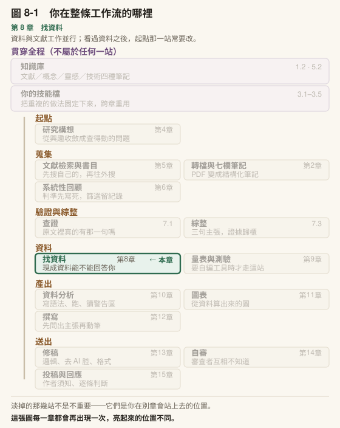

# 第 8 章　找資料，以及期中匯報

## 本章導覽

**這一章回答五個問題**

1. 我的研究問題，有沒有一份別人已經蒐集好的資料能回答？
2. 從一個研究問題走到「這份資料能不能用」的判斷，中間有哪幾步？
3. 一份編碼簿要怎麼讀，才不會把變項標籤當成題目？
4. AI 研究助理在這一步怎麼幫忙，在哪裡必須停下來讓你判斷？
5. 找不到資料的時候，研究要怎麼繼續走下去？

**讀完你能夠**

- **走完**一套找資料的工作流：從研究問題拆出構念，到寫出可行性判斷
- **讀出**一個變項的五件事：題目原文、量尺、所在波次、遺漏碼、樣本是哪一份
- **填寫**變項對照表，把你的構念對到資料裡的題目，並寫下測量上的疑慮
- **說出**本章五條規則各自擋的是哪一種錯，以及錯的時候長什麼樣子
- **建好**自己的編碼簿偵察技能與腳本，並說出它在哪幾個地方停下來等你判斷
- **完成**匯報一：題目與資料可行性，並決定走論文路線或研究計畫書路線

**需要多久**

自學閱讀約 80 分鐘｜課堂 3 小時（概念 50 分、實作 50 分、匯報一 80 分）

**進來之前，你要能**

- 用一句話寫出你目前的研究問題（[第 4 章](../chapters/04-research-question.md)）
- 說出這個問題裡有哪幾個構念，各自想怎麼定義（[第 4 章](../chapters/04-research-question.md)、[第 7 章](../chapters/07-verification.md)的綜整）
- 在工作台裡用腳本處理檔案，並看懂它的輸出（[第 2 章](../chapters/02-first-note.md)、[第 7 章](../chapters/07-verification.md)）

**開始前請準備**：你目前的研究問題與構念清單；至少一個候選資料庫的名稱（從你讀過的論文方法段找，找不到也沒關係，8.2 會教）；你的決策日誌。

---

## 章前導言

以下是示範情境。

一位研究生想研究「國中生對 AI 答案的信任，是否影響他們查證的習慣」。他在一份公開的學生調查資料裡找到一個變項，標籤寫著「信任 AI」。他很高興，把它列為自變項，跑了描述統計，分布漂亮，遺漏很少。

兩週後他為了寫方法段，回頭翻問卷原本。那一題的完整題目是：「你是否願意讓 AI 應用程式存取你的個人資料？」選項是願意、看情況、不願意。

標籤上的「信任」，是蒐集者在軟體裡為了辨認而取的短名稱。題目真正問的是隱私授權的意願，跟「相不相信 AI 給的答案」是兩件事。

這件事沒有任何軟體會報錯：變項和資料都是真的，描述統計也算得出來。錯的是對那一題「在問什麼」的理解，而那個理解來自一行標籤。

上一章你學會查一筆文獻是不是真的、它有沒有說你以為它說的話。這一章把同樣的功夫用在資料上：一個變項存不存在、它問的是不是你以為的那件事、你能不能用它、用了之後有哪些責任。做法是一套從研究問題走到可行性判斷的工作流，每一步有規則，有一部分交給技能和腳本，判斷留在你手上。

本章結束時是匯報一。你要帶著題目與資料，說明這個研究走不走得下去。看過資料之後題目要改，是常態，不是失敗。[第 4 章](../chapters/04-research-question.md)定下來的題目，這一週還可以動。

> **〔課堂〕開場 10 分鐘** 講完示範情境，請學生打開任一份自己讀過的、使用調查資料的論文，翻到方法段。問兩個問題：「這篇用的資料是誰蒐集的？」「作者怎麼知道某一題在測他要的構念？」多數論文回答得了第一題，回答不了第二題。這個落差就是本章要補的。若班上學生還沒有候選資料庫，告訴他們這很正常，8.2 會處理；匯報一不要求一定有資料。

---

## 8.1 次級資料能回答什麼，不能回答什麼

### 次級資料是什麼

**次級資料**是別人為了別的目的蒐集、整理之後釋出的資料，你拿來回答自己的問題。學術機構的調查資料庫釋出的調查、國際組織的大型評量、政府公開的統計，都屬於這一類。

它的好處很實在：樣本大、常有全國代表性、有些追蹤了好幾年，一個研究生自己蒐集不到這種規模。

它的限制來自同一個地方：**題目是別人寫的**。蒐集的人有他的研究目的，題目、量尺、施測時間、抽樣方式都為那個目的服務。你的問題如果剛好落在他們的設計裡，資料很好用；落在外面，再大的樣本也幫不上忙，因為你不能回頭替受訪者補問一題。

### 四道關卡

判斷一份資料能不能回答你的問題，要過四關，任何一關過不了，這份資料就不能用。表上的編號不是檢查順序，8.2 會說明先查哪幾關。

| 關卡 | 問的是 | 卡住的常見樣子 |
|---|---|---|
| **一、構念有沒有被測到** | 你要的概念，資料裡有沒有題目在問 | 有相近的題目，但問的是另一件事（開場那一題） |
| **二、對象與時間對不對** | 樣本的年齡、年級、地區、年份，是不是你要談的那一群 | 你要談國小，資料是國中 |
| **三、設計允不允許** | 資料的結構撐不撐得起你的問題 | 你要看師生關係，但教師與學生沒有連結 |
| **四、拿不拿得到** | 取得條件、時間、費用、使用限制 | 需要申請、審查要幾週、核准後有使用期限 |

第三關最容易被忽略，因為它不在任何一題的題目裡，而在整份資料的設計裡。常見的幾種：

- **該連的沒有連。** 有些調查的教師是在學校內另外抽的，不與受測學生配對。這種資料回答不了「這位老師怎麼教 → 他的學生表現如何」，教師資料只能聚合到學校層。
- **波次不夠。** 有些縱貫模型至少要三波資料才能估計，兩波的資料上直接不可行。
- **沒有前後可比。** 一個地區第一次參加某項國際評量，就沒有前幾輪可以比，不能放進趨勢分析。

這幾件事都寫在資料的技術報告或設計說明裡，沒有一件會在你打開資料檔時跳出來告訴你。

> **〔動手一下〕5 分鐘** 寫下你的研究問題，在它底下畫四格，把四道關卡各寫一句「我需要資料具備什麼」。例如第三關：「我需要同一批學生至少被追蹤兩次」「我需要學生和他的老師對得起來」。寫不出第三關的人，回頭看你的研究問題裡有沒有「隨時間」「之間的關係」「誰影響誰」這類字眼。有的話，第三關一定有東西要寫。

### 看過資料之後改題目

這門課的資料是邊做邊拿的：你一面讀文獻、磨題目，一面找資料。看過資料之後發現題目要改，是常態。

改題目本身沒有問題，要避免的是改了之後假裝題目本來就長這樣。

van den Akker 等人（2021）替次級資料分析設計預先登錄的範本時，專門留了兩題要研究者寫出自己**事先對這份資料知道多少**。理由是次級資料常被同一批人反覆分析，研究者面對資料時很難保持一雙全新的眼睛；如果你已經知道兩個變項在這份資料裡高度相關，再把它寫成假設去檢定，那個檢定的結果你早就知道了。

所以邊做邊拿的配套是一條紀律：**每一次因為看了資料而改題目，在決策日誌記一列**。寫你看到了什麼（哪個變項、哪些描述統計、哪一張表），改了什麼，為什麼。你看過的若只是編碼簿與題目，記下來；若已經跑過相關或平均數，也記下來，兩者分量不同。這一列日後會進你的方法段，也是匯報一要回答的問題之一。

### 帶走這一節

- 次級資料的題目是別人為別的目的寫的；**你的問題落在他們的設計外面，樣本再大也幫不上忙**
- 可行性依序過四關：構念、對象與時間、設計、取得；**第三關藏在設計說明裡，不在題目裡**
- 看過資料改題目是常態；**每改一次，在決策日誌記下你看到了什麼**

---

## 8.2 找資料的工作流：從問題到可行性判斷

找文獻有一套流程（[第 5 章](../chapters/05-literature-search.md)），找資料也有。下面七步，前三步不必碰任何資料檔，後四步才開始讀文件。每一步都有產出，產出都落在工作台的檔案裡。

| 步 | 做什麼 | 產出 | 誰做 |
|---|---|---|---|
| 1 | 把研究問題拆成構念，每個構念寫一句你的定義 | 構念清單（填進變項對照表第一欄） | **你** |
| 2 | 列出候選資料：從論文反查、從資料目錄找、問人 | 候選資料清單，每筆附說明文件的位置 | 你找，它可以幫你整理 |
| 3 | 對每份候選資料先過第二、四關：對象與時間、拿不拿得到 | 刪掉明顯不合的，剩一到三份 | 你 |
| 4 | 下載說明文件：編碼簿、問卷、使用手冊、技術報告、使用條款 | 文件存進專案；條款存進 `資料使用條款.md` | 你 |
| 5 | 對每個構念找候選變項，逐一確認變項名存在、讀原題目 | 變項對照表前七欄 | 它找與抄，腳本驗名字，**你讀原題目** |
| 6 | 寫疑慮欄，過第一、三關 | 變項對照表第八欄、可行性表四道關卡 | **你** |
| 7 | 做判斷：用哪份、題目要不要改、走哪條路線 | 可行性表〈判斷〉、決策日誌一列 | **你** |

這張表的形狀是：**頭尾兩步都是你，機械的部分夾在中間**。第 1 步決定要找什麼，第 7 步決定找到的東西夠不夠，兩者都需要你對研究問題的理解。第 5 步是最耗時的一步，也是 AI 研究助理最能接手的一步，8.7 會講它怎麼運作。

順序也有理由。第 3 步先過第二、四關，是因為這兩關看資料的簡介就能判斷，最便宜；第一、三關要讀到題目與設計才能判斷，留到第 6 步。先把便宜的關卡過完，才不會在一份根本拿不到的資料上讀了三百頁編碼簿。

### 第 2 步：從哪裡找

教育研究常碰到的現成資料有三種來源，外加一種與它們交疊的設計（追蹤調查）：

| 類型 | 適合回答 | 常見的脾氣 |
|---|---|---|
| **學術調查資料庫釋出的調查** | 特定族群的發展、家庭、學校經驗 | 多半要註冊或申請；每波題目可能改版；各計畫有自己的使用規範 |
| **國際大型評量** | 跨國比較、能力分數與背景的關係 | 能力分數以多組 plausible values 提供、抽樣設計複雜、要用複製權重估標準誤 |
| **政府公開資料** | 抽樣母群、學校或縣市層的脈絡 | 多半是聚合統計，不是個人層級的資料 |
| **追蹤調查** | 隨時間的變化、前後時序 | 樣本流失、各波題目改版、串接編號各波不同 |

追蹤調查與前三類是交疊的：追蹤是一種設計，不是一個來源。單獨列出來，是因為它的問題跟橫斷資料不一樣，8.3 會談。

政府公開資料常扮演一個特別的角色：學校層的班級數、學生數這類統計，適合拿來當**抽樣母群**，告訴你母群長什麼樣子，不告訴你母群裡的人怎麼想。

找的路徑有三條：

- **從你讀過的論文反查。** 方法段會寫用了哪個資料庫，近年的期刊稿件還有一段**資料可用性聲明**，通常寫了誰蒐集、誰釋出、資料集的檔號。讀到這樣一段，等於拿到了資料庫的名稱與檔號。
- **從資料庫的目錄找。** 調查資料庫與國際組織都有自己的資料目錄，可以用主題、對象、年份篩選。[第 5 章](../chapters/05-literature-search.md)的檢索技巧用得上：先列出你的構念的幾種說法，再拿去搜。
- **從人找。** 指導教授、學長姐、做過同類題目的研究者，常常知道哪份資料有你要的題目，以及哪份資料的哪一題有問題。這種知識不在任何目錄裡。

〔補充〕你自己寫資料可用性聲明時，「誰蒐集、誰釋出、檔號是什麼」三件事分開檢查。資助單位與釋出單位常常不是同一個，只寫一個是常見的漏洞。

〔課堂〕這一節學生最常卡在「我的題目沒有任何資料庫在做」。先別急著同意。請他回到第 1 步，把研究問題拆成構念，一個一個去找；常見的情形是核心構念有、某個調節變項沒有，那是 8.4 疑慮欄要寫的事，不是整份資料不能用。

〔教你的 Claude 建這個〕**把第 3 步的初篩固定下來。** 貼這段：

「請幫我建一個〈資料初篩〉技能檔。我給你一個研究問題和幾份候選資料的簡介，你對每一份回答兩題：對象與時間對不對、拿不拿得到。每一題都要寫出你在簡介的哪一段讀到依據；簡介裡找不到的，寫『簡介裡找不到』，不要推測。兩題都答完之後停下來，不要替我決定刪哪一份。」

第一版就這兩題。它常會在「拿不拿得到」答「簡介裡找不到」，那是對的：取得條件多半寫在另一份文件裡，它手上沒有就不該替你猜。

### 帶走這一節

- 找資料七步：**拆構念 → 列候選 → 初篩 → 下載文件 → 找變項 → 寫疑慮 → 判斷**
- **頭尾兩步是你的**，機械的部分夾在中間
- 先過便宜的關卡（對象與時間、取得），**再花時間讀編碼簿**
- 找資料最直接的線索，是別人論文的方法段與**資料可用性聲明**

---

## 8.3 讀編碼簿：一個變項要查五件事

到了第 4 步，你手上有了說明文件。名稱各家不同，常見的有：**編碼簿**（codebook，列出每個變項名、題目、選項與數值編碼）、問卷原本、使用手冊或技術報告、跨波次的變項對照表。大型評量另外會附逐題的試題說明，保密的試題也有內容摘述。

一個你打算用的變項，至少要查五件事。

### 一、題目原文，不是變項標籤

開場那一題就是這一件。資料檔裡的**變項標籤**是為了在軟體裡辨認而寫的短字串，常被截斷、改寫、省略。題目原文要回到問卷或使用手冊查。

同一份資料存成不同的統計軟體格式時，有些格式會把長標籤截短。標籤越短，跟原題的距離可能越遠。

### 二、量尺：幾點、方向、跟官方版本一不一樣

- **幾點量尺，每一點代表什麼。** 同一個構念，兩波之間可能從四點改成五點。
- **方向。** 有些題目數值越大代表處境越差，例如測「使用網路的障礙」的題目。投入模型之前沒先確認方向，係數的正負號會整個讀反。
- **是不是官方原版。** 一份知名量表被放進大型調查時，選項數可能被改過。改過就不能套用原版的計分換算。

### 三、哪一波有

追蹤資料的題目會改版、會消失、會新增。孩子升學、進入新的學習階段時，調查常改用另一套題本：某一組題目在新題本裡整組不存在，另一組改成不同的問法。這只有開檔勘查、逐波對照才看得出來。

另一種情形是「題目一樣，名字不一樣」：同一題在各波的變項名不同，或對照表與資料檔的大小寫寫法不同。

### 四、遺漏怎麼編碼

這一件出錯時不會有任何提示。

調查資料很少把「沒有答案」只記成空白。常見的區分有不適用、跳答、不知道、拒答、系統遺漏，分卷設計的資料還會有「此卷未答」。van den Akker 等人（2021）的範例資料也分系統遺漏、拒答、不適用幾類，而且某些題目的「不適用」人數遠多於拒答。這些類別意思不同：跳答通常是因為前一題的答案讓這題不必問，拒答是受訪者選擇不答，兩者處理方式可能不一樣。

最危險的是**遺漏碼被當成有效分數**。一題一到六分的量尺，「不知道」在某幾波編成 97、在另外幾波編成 7，7 就會被當成分數算進平均。

> ⚠️ 遺漏碼被當成分數計入，平均數會被灌高、遺漏比例會變成零，而模型照樣收斂、照樣給出看起來合理的結果。查遺漏碼要**逐波查**，不能查了第一波就假設其他波一樣。

### 五、你手上的是哪一份樣本

同一個資料庫，你手上那份不一定是你以為的那一份。

- **釋出檔多了人。** 追蹤調查有時在後期加抽樣本，加抽的人沒有前幾波的資料。你的問題若需要完整的時間序列，要先把他們排除。
- **分卷設計。** 有些問卷分成共同卷與幾份分卷，每個人只答其中一份。只在某一卷出現的題目，可用樣本只有一部分；題目層次的漏答還會再往下扣。報告樣本數時要講清楚是哪一種。
- **子集不是全體。** 你手上的可能是某篇論文用過的子集，或某個版本的釋出檔。在子集上算出來的數字，不能直接當成全體的結果寫進稿件。

〔補充〕第三種情形的重點是**數字要一路帶著它的來源**。一個在子集上算出來的數字，三週後出現在某份草稿裡，沒有人記得它是哪一份資料算的。[第 7 章](../chapters/07-verification.md)的核實紀錄管文獻，這裡要管的是資料版本：每一個要進稿件的數字，指得出它來自哪一份資料、哪一個輸出檔。[第 10 章](../chapters/10-statistics.md)會把這件事做成工作台的一部分。

### 追蹤資料多兩件事：串接與流失

**串接。** 每一個人在各波要用一個編號對起來。這個編號在各波的變項名可能不同，要逐波確認它們指的是同一個人才能合併。釋出單位提供的合併檔也要驗：抽幾個人，拿各波原始檔的編號對一次。

**樣本流失。** 越後面的波次，留下來的人越少，而留下來的人跟離開的人可能不一樣。轉學、搬家的人還可能缺某一波的權重。你的問題如果落在後面的波次，實際可用的樣本可能只剩一小部分，這會回到可行性的第二、三關。

> **〔動手一下〕8 分鐘** 從你的候選資料裡挑一個最關鍵的變項，五件事各寫一行。寫不出來的那一件，記下要去哪份文件查。沒有候選資料的人，用本章建置的練習用編碼簿做，挑 `a_ai04`。

### 文件本身也會錯

文件是你判斷的依據，但文件也是人寫的。數值標籤可能錯位（值 5 掛著「6」的標籤），資料裡可能出現選項定義域以外的值，手冊的引用格式可能寫錯，編碼簿列了某題、標準版資料檔裡卻沒有。

遇到不合的值，判準是：**這個值有沒有可能是一個真實的作答？** 有，就不動資料，記下來，回頭查文件；沒有，才清掉，也記下來。前者是標籤錯了，後者是值錯了，處置相反。

### 帶走這一節

- 一個變項查五件事：**題目原文、量尺、哪一波有、遺漏碼、樣本是哪一份**
- 變項標籤會被截斷，**題目原文要回問卷或手冊查**
- 遺漏碼要**逐波查**；被當成分數的遺漏碼，會讓模型安靜地算錯
- 文件也會錯；**動資料之前，先判斷那個值可不可能是真的作答**

---

## 8.4 變項對照表：從你的構念到資料裡的題目

8.3 的五件事查完，要落在一張表上。這張表就是**變項對照表**：一個構念一列或數列，把你的概念對到資料裡實際的題目。

| 欄位 | 寫什麼 | 為什麼要它 |
|---|---|---|
| 構念 | 你研究問題裡的概念，用你的定義 | 這一欄是你的，不是資料的 |
| 資料庫 | 資料名稱與檔號 | 同一構念可能從兩份資料取 |
| 波次 | 哪一波 | 追蹤資料的題目會改版 |
| 題號／變項名 | 問卷題號與資料檔裡的變項名，**兩個都寫** | 題號讓你回得去問卷，變項名讓腳本找得到 |
| 原題目逐字 | 問卷上的完整題幹與選項，**不是變項標籤** | 開場那一題的教訓 |
| 量尺 | 點數、方向、反向題 | 8.3 第二件 |
| 遺漏碼 | 這一題用到的所有遺漏碼與意思 | 8.3 第四件 |
| 疑慮 | 這一題作為這個構念的測量，哪裡不夠 | 這是整張表最重要的一欄 |

### 疑慮欄寫什麼

疑慮欄不是用來寫「無」的。一份為別的目的設計的資料，幾乎每一題作為你的構念的測量，都有不夠的地方。常見的幾種：

- **只測到構念的一部分。** 測量文獻把這叫構念代表性不足（construct underrepresentation，暫譯）：你要的「AI 素養」包含理解、使用、評估、倫理，資料裡只有使用頻率。
- **測到別的東西。** 對應的術語是構念無關變異（construct-irrelevant variance，暫譯）。開場那一題測的是隱私授權意願，不是對答案的信任。
- **同一組題目算了兩次。** 資料庫常提供由幾題算出來的衍生分數。衍生分數由哪幾題組成要查，否則你可能把衍生分數和它的組成題一起放進模型。
- **只有部分樣本答過。** 分卷、跳答、只在某幾波出現。
- **跨波改版。** 題目、量尺、題數有任何變動，跨波比較就要打折扣。
- **出處不明。** 手冊沒寫某份量表取自哪裡、信效度如何，你寫方法段時要自己回溯原始文獻。

寫出這些疑慮不是在挑資料的毛病。它們之後會原封不動進入你的研究限制，而且寫得越早，研究問題就越早調整到資料撐得住的範圍。

〔補充〕疑慮太多、太核心的時候，答案可能不是硬用這份資料，而是走 8.9 的計畫書路線，自己設計測量。[第 9 章](../chapters/09-scale-development.md)會處理量表與測驗怎麼開發。

> **〔動手一下〕10 分鐘** 為你的研究問題裡**最核心的那一個構念**，填一列變項對照表。疑慮欄至少寫一點。寫完問自己：如果審查者只看這一列，他會不會接受這一題能代表你的構念？

### 帶走這一節

- 變項對照表把**你的構念**對到**資料的題目**；構念那一欄用你的定義，不用資料的
- 題號與變項名**兩個都寫**，原題目要逐字
- **疑慮欄是整張表最重要的一欄**，它日後就是你的研究限制

---

## 8.5 權重與抽樣設計：先知道它在那裡

這一節不教統計，要你知道的是一件事：**大型調查的資料不能當成簡單隨機樣本來分析**。怎麼正確分析，[第 10 章](../chapters/10-statistics.md)與你的統計課會處理；這一週你要做的，是在可行性表裡記下這份資料有哪些設計要素。

### 為什麼不是簡單隨機樣本

大型教育調查常用分層的**叢集抽樣**：先依學校規模按比例抽學校，再在校內抽班級，全班施測。這樣抽出來的學生，同一班、同一校的人彼此相似，不像簡單隨機抽樣那樣每個人獨立。不考慮這件事，標準誤會被低估，本來不顯著的差異看起來顯著。各學校被抽中的機率也不同，要用**抽樣權重**（sampling weight）還原母群的比例。

### 資料裡你會看到的東西

| 你會看到 | 它是什麼 |
|---|---|
| 多個權重變項 | 學校、班級、學生、總權重，有的還有標準化版本 |
| 複製權重或複製區變項 | 用來估標準誤（jackknife 等複製法，暫譯） |
| 多組能力分數 | 能力以 plausible values（暫譯：似真值）提供，通常五組以上 |
| 加權說明 | 釋出單位建議怎麼用、哪一種分析用哪一個權重 |

Jewsbury 等人（2024）專門寫給次級分析者的說明指出，大型評量的能力分數是為**群體**層級的推論設計的；把每個人的個別能力估計值直接拿來平均，平均數會偏向極端、變異數會被高估。這就是為什麼資料給你好幾組分數而不是一組。

Atasever 等人（2025）用 TIMSS 2019 德國資料示範過：一個學校層變項在不加權時係數達顯著，換成文獻建議的權重配置之後不顯著。權重放在哪裡，可以改變一個結論的顯著與否。

這一類錯誤的特徵是**數字看起來正常**。權重用錯、複製權重沒有跟點估計用同一種標準化、把複製區變項誤當成分層變項，都不會報錯，只會讓標準誤變大或變小。

〔課堂〕這一節講 10 分鐘就好，不要在這裡教加權公式。要學生帶走的只有兩件：一、在可行性表寫下這份資料的抽樣設計與權重變項名；二、找到釋出單位的分析指引，存進專案。學生常問「我的研究是質性的，跟我有關嗎」：走計畫書路線、自己蒐集資料的人，這一節換個方向用，他要回答的是自己的抽樣怎麼設計。

### 帶走這一節

- 大型調查**不是簡單隨機樣本**；同班同校的人彼此相似，被抽中的機率也不同
- 可行性表要記下：**抽樣設計、權重變項、複製權重、能力分數的組數**
- 這一類錯誤**數字看起來正常**，怎麼正確分析留給[第 10 章](../chapters/10-statistics.md)

---

## 8.6 取得條件、使用條款與倫理

次級資料已經去識別化、已經公開，不代表你可以隨意使用。每一份都有使用條款，而且條款從你**下載或申請的那一刻**就開始算數。

### 取得條件的幾種樣子

| 層級 | 你要做的 | 時間 |
|---|---|---|
| 同意條款即可下載 | 勾選授權同意書 | 當天 |
| 註冊會員後下載 | 註冊、等帳號開通 | 數天到數週 |
| 申請加值版或特定變項 | 說明用途，等審核 | 數週 |
| 簽約申請限制版 | 填申請書、簽使用協議、寄送審查 | 數週，核准後常有使用期限 |

時間要算進你的學期。匯報一之後只剩半個學期，一份要審好幾週、核准後只能用半年的資料，加上之後的清理與分析，對一門課來說可能就是走不到。

### 條款會管到什麼

限制較嚴的使用協議，條款管到的範圍比多數人想像的寬。讀條款時，逐條找下面這幾類：

- **使用期限與銷毀。** 到期是否要銷毀資料、要不要書面確認。
- **發表時的標示。** 有的要求每張表、每張圖旁都標資料來源，不是只寫進參考文獻。
- **資料配對。** 是否禁止與其他資料串接，即使有正當的統計目的。
- **發表形式。** 是否只能以摘要或聚合統計發表、可能揭露個資的出版要不要先送審。
- **誰能接觸資料。** 合作者名單有沒有上限、未列名者能不能看。
- **發表後的義務。** 有些資料庫要求論著發表後一段時間內，把論著寄回資料提供單位。
- **協議版本。** 有的依使用者所在地區分成不同版本，下載時要點對。

讀到的每一條，連同原文段落，記進 `資料使用條款.md`（本章建置）。

### 引用資料，也要引對版本

資料集有自己的 DOI，要像文獻一樣引用。資料庫改版後，同一份資料可能有兩個 DOI，或在 DOI 結尾帶版本號。引用時用你實際下載的那一版，並在方法段註明下載日期。

查資料集 DOI 的更正紀錄時要注意：資料集的 DOI 常由另一套登錄系統註冊，在一般論文常用的登錄系統查不到。查不到不等於 DOI 無效，可能是查錯了地方。

### 交付物不得外流識別資訊

去識別化的資料仍然可能在你手上變回可識別的。學校代號、班級、個案編號、人數很少的小格，任何一項出現在你交出去的東西裡，都可能讓讀者認出是誰。

外流常常不在資料檔裡。它出現在幾個不起眼的地方：資料檔的編號欄帶著學校代號、腳本註解裡留著除錯時抄下的個案編號、你為了說明資料而寫的範例。最後一種最容易漏，因為那是你自己隨手寫的字，不是資料。

工作上的做法是：**識別欄位可以在分析的中間步驟用，例如用學校代號分群，但不寫進任何輸出檔**。交出去之前，對所有要交的檔案（含腳本與說明檔）掃一次。[第 16 章](../chapters/16-integrity.md)會把成果發表時的誠信框架完整收攏。

〔補充〕資料庫沒蒐集的東西，方法段要寫「資料庫未蒐集」，不寫「未分析」。兩種寫法讀者的理解完全不同：前者是資料的限制，後者聽起來像你選擇不看。

### 帶走這一節

- 條款從**下載或申請那一刻**開始算數；取得要花的時間要算進學期
- 條款可能管到使用期限、圖表標示、資料配對、發表形式、合作者名單、發表後義務
- **資料集要引用，而且要引對版本**
- 識別資訊外流常常**不在資料檔裡，在你寫的說明、範例與註解裡**

---

## 8.7 codebook-scout：技能怎麼運作

8.2 的第 5 步是整條工作流最耗時的一步：編碼簿動輒數百頁、上千個變項，要對每個構念找出候選題目、跨波比對、抄出原題。這是機械的工作，交給 AI 研究助理。本章建置會建一個叫 `codebook-scout` 的技能和一支叫 `codebook_scout.py` 的腳本，這一節先講它們合起來怎麼運作。

### 為什麼要兩樣東西

AI 研究助理讀編碼簿、找候選、抄題目做得好。它做不好、而且你看不出來的事，最典型的是：**它會報出不存在的變項名**。大型調查的變項名有規律，同一個前綴、相近的縮寫，這種規律正是它最會模仿的。它可以給你一個格式完全正確、看起來就像那份資料會有的名字，而資料檔裡根本沒有這一欄。

這跟[第 7 章](../chapters/07-verification.md)的拼裝文獻是同一個機制：形狀對、東西不存在。擋法也一樣，**用一個不靠它記憶的東西去驗**。對文獻，那是 DOI 與原文全文；對變項，那是資料檔的表頭。腳本只做這件事。

所以分工是：技能負責找與抄，腳本負責驗名字，你負責定義與判斷。

### 一次完整的運作

你對它說「這份資料有沒有測學生對 AI 答案的信任」。接下來依序發生：

| 步 | 誰 | 做什麼 | 停在哪裡 |
|---|---|---|---|
| 1 | 技能 | 問你「信任」怎麼定義 | **停**：你給定義之前不往下走 |
| 2 | 技能 | 列出這個構念的幾種說法：相信、可信、依賴、採信⋯ | **停**：給你看過、你增刪之後才搜 |
| 3 | 技能 | 在編碼簿、問卷、手冊裡找候選題目，每一筆記下變項名、文件、頁碼或列號、原題、量尺、波次、遺漏碼 | — |
| 4 | 腳本 | 把所有候選變項名拿去對資料檔表頭 | 對不上的，技能從清單拿掉並列出名字 |
| 5 | 技能 | 交回變項對照表前七欄，疑慮欄只寫文件裡讀到的事實 | **停**：交給你 |
| 6 | **你** | 讀原題目，判斷每一題測不測得到你的構念，寫疑慮 | — |

三個停點各有理由。第 1 步停，是因為構念定義決定什麼算「相關」；它若自己定義，找出來的是它理解的信任，不是你的。第 2 步停，是因為編碼簿用的詞常跟你想的不一樣，你的研究領域裡的說法，它不一定知道。第 5 步停，是因為「這一題能不能代表我的構念」是判斷，要你準備在審查者面前為它辯護。

### 腳本內部怎麼走

`codebook_scout.py` 的流程是：

1. 讀編碼簿 CSV，確認有「變項名、題目文字、量尺、波次」四欄，缺欄就停
2. 讀每一波資料檔的**第一列**，也就是表頭。作答內容一筆都不讀
3. 找候選模式（`--kw`）：在題目文字裡找關鍵字，每一筆查它在該波表頭的狀態
4. 驗名字模式（`--names`）：每個名字查編碼簿有沒有、表頭有沒有
5. 全部對得上，結束碼 0；有任何一個對不上，結束碼 1

表頭的狀態有四種，每一種要你做的事不同：

| 腳本說 | 意思 | 你要做的 |
|---|---|---|
| 有 | 名字一字不差存在 | 讀原題目，判斷構念 |
| 大小寫不同 | 名字在，寫法不同 | 用資料檔的寫法；有些軟體分大小寫 |
| 沒有 | 編碼簿列了，資料檔沒有 | 查取得條件：可能要另外申請，或在另一個檔案 |
| 無法確認 | 沒有提供那一波的資料檔，或波次名稱對不上 | 檢查 `--data` 的寫法 |

驗名字模式另外有兩種結果：「資料檔有、編碼簿沒有」，多半是權重或衍生變項，要去手冊找它的說明，不能憑名字猜；「兩邊都沒有」，那個名字不要用，回去查它是從哪裡來的。

腳本對不上的時候說「沒有」，查不了的時候說「無法確認」，從來不說「有」。這是它跟一個會替你補答案的助手不同的地方。

### 它能做與不能做的

把機械的交出去：讀長篇編碼簿、找候選、跨波比對、抄題目、整理表格、列出條款。

把判斷留下來：構念怎麼定義、這一題是不是在測我要的東西、疑慮重不重、要不要換資料。

還有一件它做不到、腳本也做不到的事：**它讀的是編碼簿的字，不是題目的意思**。開場那一題，標籤寫「信任 AI」，任何依標籤比對的工具都會把它歸到信任。它能做的是把完整題幹找出來給你，前提是你給它的是問卷或手冊，不只是資料檔。

> **〔動手一下〕5 分鐘** 把本章建置的練習用編碼簿貼給它，問：「這份資料裡哪個變項測學生的 AI 素養？」練習編碼簿裡沒有任何一題完整測到 AI 素養，只有幾題各測到使用或查證的一部分。看它怎麼回答：說明只測到哪一部分，還是挑一題當成 AI 素養給你。後者就是 8.4 的構念代表性不足被悄悄跳過的樣子。

〔課堂〕這一節可以現場示範：把練習用編碼簿貼給它，請它「列出跟學生信任 AI 有關的變項」，再要它「給我一個能代表整體信任程度的變項」。後一個問題常會換來一個編碼簿裡沒有的總分變項名。全班一起用腳本驗。示範結果不一定每次重現，沒有出現時，就讓學生看它怎麼回答「找不到」，那也是一種正確的示範。

### 帶走這一節

- 分工：**技能找與抄，腳本驗名字，你定義與判斷**
- 技能有三個停點：**要你的構念定義、要你看過同義詞、交回之後等你判斷**
- 腳本只讀表頭；**對不上時說沒有，查不了時說無法確認，不說有**

---

## 8.8 這一章的五條規則

前面幾節的做法，背後是五條規則。每一條擋一種錯，而這幾種錯有一個共同點：發生的當下沒有任何警告。

| 規則 | 擋的錯 | 錯的時候長什麼樣 | 怎麼檢查 | 落在工作台哪裡 |
|---|---|---|---|---|
| **一、變項名必須在資料表頭確認存在** | 用了一個不存在的變項名 | 名字格式完全正確，分析腳本到最後才找不到欄位，或更糟：抓到另一個相近的欄位 | `codebook_scout.py --names` | 技能〈步驟〉第 4 條 |
| **二、原題目要逐字，不用變項標籤** | 把標籤當成題目，測錯構念 | 變項名對、資料對、統計結果也合理，只是題目問的不是那件事 | 變項對照表「原題目逐字」欄，抽查回問卷 | 技能〈品質標準〉第 2 條；對照表第 5 欄 |
| **三、遺漏碼逐波查** | 遺漏碼被當成分數 | 平均被灌高、遺漏比例變成零，模型照樣收斂 | 對照表「遺漏碼」欄每一波各填一列；描述統計看每一題的最大值與遺漏比例 | 對照表第 7 欄 |
| **四、使用條款放在原始資料旁邊** | 違反條款而不自知 | 結果都對，投稿或發表時才發現條款不允許這樣用 | 動手分析與交件之前讀 `資料使用條款.md` | 專案規則檔；`資料使用條款.md` |
| **五、交付物不放識別資訊** | 識別資訊外流 | 外流出現在說明、範例、註解裡，不在資料檔裡 | 交件前掃所有要交的檔案，含腳本與說明檔 | 專案規則檔；技能〈不要做什麼〉第 3 條 |

另有一條紀律不在表上，因為它擋的不是技術錯誤：**看過資料而改題目，在決策日誌記一列**（8.1）。

### 規則為什麼要寫成檔案

[第 3 章](../chapters/03-skills.md)說過，規則檔是請求，它多數時候照做，不是每一次。所以這五條規則各自有一個比請求更硬的落點：

- 規則一落在**腳本**。腳本不會因為一個名字看起來很像就放行。
- 規則二、三落在**表格的欄位**。欄位空著，一眼就看得到。
- 規則四、五落在**規則檔與一個固定位置的檔案**，加上交件前的一次掃描。這兩條最難自動化，因為條款的意思與識別資訊的判斷都需要讀懂內容，所以還要靠你在交件前做一次。

### 判斷一個值要不要動

規則三的延伸是：遇到可疑的值，先判斷它可不可能是真實的作答（8.3）。這一條寫進你的決策日誌模板：每一次清資料，記下「這個值為什麼不可能是真的作答」。說不出來，就不要清。

### 帶走這一節

- 五條規則：**名字對表頭、題目要逐字、遺漏逐波查、條款放旁邊、交件不帶識別資訊**
- 這五種錯**發生的當下都沒有警告**
- 每條規則都要有比請求更硬的落點：**腳本、表格欄位、固定位置的檔案、交件前的掃描**

---

## 8.9 走不到資料的時候：轉研究計畫書

有些題目，四道關卡就是過不去。構念沒人測過、對象不對、設計撐不起來、或者拿不到。這門課的期末有兩種終點，走到這裡的學生改走研究計畫書路線。計畫書路線是另一種完整的交付。

### 先試兩個方向

決定轉路線之前，先試兩件事：

1. **調整題目，讓它落在資料裡。** 核心構念有、某個調節變項沒有，常見的做法是拿掉那個變項，或改用資料裡最接近的題目，並在疑慮欄寫清楚。這是邊做邊拿最常見的結果。改了，記進決策日誌（8.1）。
2. **換一份資料。** 回到 8.2 第 2 步，用另一種來源再找一次。

兩個方向都試過、仍然過不去，研究問題本身比資料更重要時，轉計畫書。判準是：**你願意為了遷就資料，把問題改到什麼程度？** 改到你自己不再想回答的時候，就是該轉的時候。

### 轉過去之後，這一章做的事沒有白費

| 你這一章做的 | 在計畫書裡變成 |
|---|---|
| 可行性四關 | 研究設計的理由：為什麼現成資料不足、為什麼要自己蒐集 |
| 變項對照表 | 測量計畫：每個構念要用哪份工具、從哪裡來、有什麼疑慮 |
| 疑慮重到資料撐不住的構念 | 需要自己開發或改編量表的地方（[第 9 章](../chapters/09-scale-development.md)） |
| 讀過的編碼簿 | 別人怎麼測同一個構念的參考，題目寫法、量尺、遺漏處理都可以借鏡 |
| 抽樣與權重的認識 | 你自己的抽樣怎麼設計 |
| 使用條款與倫理 | 你自己的研究倫理審查要準備什麼 |

變項對照表在計畫書路線上會多一欄「資料來源」，填「待蒐集」或「改編自某量表」。原本「原題目逐字」那一欄，填的是你準備採用的題目，以及它出自哪一份已發表的工具。

〔補充〕計畫書路線的學生在後半學期，分析與結果的章節對他是預演，不是執行：他寫得出方法與預期分析，寫不出結果與討論。[第 10 章](../chapters/10-statistics.md)以後，每章都會標出計畫書路線的人該怎麼用。

### 帶走這一節

- 轉路線前先試兩件事：**調整題目讓它落在資料裡、換一份資料**
- 判準：你願意為了遷就資料，把問題改到什麼程度
- 這一章的可行性表與變項對照表，**在計畫書裡變成研究設計理由與測量計畫**

---

## 8.10 匯報一：題目與資料可行性

這是學期中的第一次公開檢查點。目的不是展示成果，是讓你和全班一起判斷：這個研究，接下來半個學期走不走得下去。

### 形式

每人報告 5 分鐘，提問 2 分鐘。修課人數多時，分兩組同時進行。

報告前一天交三樣東西到課程平台：

1. 簡報，至多 6 頁
2. 資料可行性表（本章建置的模板）
3. 變項對照表，研究問題裡每個核心構念至少一列

### 報告要回答的六題

1. **題目現在長什麼樣？** 跟[第 4 章](../chapters/04-research-question.md)那一版並列，改了哪裡。
2. **為什麼改？** 看到了什麼才改的。決策日誌裡的那幾列拿出來。
3. **資料是哪一份，拿到了沒？** 名稱、檔號、取得條件、現在的狀態。
4. **最核心的構念，在資料裡是哪一題？** 念出原題目，說出疑慮。
5. **最大的風險是什麼？** 四道關卡哪一關最可能出事，出事時的備案。
6. **走哪一條路線？** 論文或計畫書，以及決定的理由。

走計畫書路線的人，第 3、4 題改答：你要怎麼蒐集資料、核心構念準備用哪份工具測。

### 評量重點

| 重點 | 做到了 | 還不夠 |
|---|---|---|
| **題目與資料對得上** | 研究問題裡的每個核心構念，都指得出資料裡的題目，或指得出準備採用的工具 | 構念與題目之間隔著一句「應該可以代表」 |
| **讀過原始文件** | 念得出原題目逐字，知道量尺、波次、遺漏碼 | 只知道變項標籤 |
| **誠實的疑慮** | 疑慮欄有實質內容，且看得出它會怎麼影響結論 | 疑慮欄空白，或只寫「樣本代表性」這類放諸四海皆準的話 |
| **改題目有紀錄** | 說得出看到什麼才改，日誌有對應的列 | 題目變了，但說不出為什麼 |
| **路線判斷合理** | 走得到資料就走論文；走不到，理由具體，計畫書的下一步清楚 | 資料明明拿不到，仍說「應該可以」 |

不列入評量的：資料庫的大小與名氣、題目聽起來多重要、已經跑出多少結果。

### 聽的人也有工作

每位聽眾在聽之前抽一個角色，針對該角色提一個問題：

- **審查者**：「這一題真的測到你說的構念嗎？」
- **資料管理者**：「這份資料你有權這樣用嗎？條款允許嗎？」
- **下一屆的學長姐**：「如果你現在卡住，最可能卡在哪裡？」

〔課堂〕匯報一約 80 分鐘。建議計時嚴格，5 分鐘一到就停，沒講完的部分看交上來的表。講評只針對評量表的五列，不評簡報美觀。最常見的問題是學生把四道關卡講成「我找到資料了」，沒有講第三關；講評時直接問「你的設計允許你回答這個問題嗎」。若有學生報告到一半發現自己的題目過不了某一關，當場肯定這件事，那正是這次匯報的目的。

### 帶走這一節

- 匯報一的目的是**判斷走不走得下去**，不是展示成果
- 六題的核心：**題目怎麼變、資料是哪一份、核心構念是哪一題、走哪條路**
- 兩條路線都是完整的終點；評量看的是判斷，不是資料的大小

---

## 8.11 教育研究實例

以下兩則都是示範情境，人物與資料皆為虛構，用來把本章的工作流與規則走一次。

### 實例一：一個長得像分數的「不知道」

一位研究生用一份五波的追蹤調查，研究青少年的教育期望怎麼隨時間變化。題目是「你希望自己讀到什麼程度」，選項從國中畢業到博士，一到六分，另外有一個「不知道」。

她讀了第一波的編碼簿：「不知道」是 97，系統遺漏是 99。前處理把 97 與 99 設為遺漏，模型跑完，選出三條軌跡。

指導教授看描述統計時問了一句：「第三波怎麼沒有人回答不知道？」那一波的遺漏比例是 0%。她回去逐波翻編碼簿，發現「不知道」在第三、五波編成 7。第三、五波的「不知道」被當成 7 分算進平均，平均被灌高，第三波的 0% 遺漏是假象。

處置是改寫前處理，把每一波的遺漏碼都設為遺漏，整條分析從頭重跑，先前的三條軌跡作廢。

對應本章：

- **規則三，遺漏碼逐波查**。她查了第一波，錯在假設其他波一樣。
- 如果她第一週就用變項對照表，**同一題每一波各寫一列**，遺漏碼欄會並排出現 97 與 7，錯在讀編碼簿的那一天就被看見，不必等到模型跑完。
- **看起來太乾淨的描述統計，值得懷疑。** 一題有「不知道」選項的題目，遺漏比例是 0%。

### 實例二：走完七步，題目改了一次

一位研究生想研究「國小高年級學生使用 AI 寫作業的頻率，與他們查證資訊的習慣有什麼關係」。他照 8.2 的七步走：

1. **拆構念**：使用 AI 寫作業的頻率、查證資訊的習慣。各寫一句定義。
2. **列候選**：從三篇相關論文的資料可用性聲明，找到兩份候選資料。
3. **初篩**：一份是國中樣本，第二關不過，刪掉；另一份是國小五、六年級，免費註冊即可下載。
4. **下載文件**：編碼簿、問卷、使用手冊、使用條款。條款存進 `資料使用條款.md`，其中一條是發表後要回寄論著。
5. **找變項**：用 codebook-scout 找。第一個構念找到一題，腳本確認存在。第二個構念它交回兩題，其中一題的變項名腳本回報「兩邊都沒有」，那是它組出來的總分名稱，拿掉。剩下的一題，他回問卷讀原題：「老師要求時，你會再查其他資料嗎？」
6. **寫疑慮**：這一題問的是「老師要求時」，測的是服從要求，不是自發的查證習慣。構念無關變異的疑慮寫進對照表。
7. **判斷**：他把研究問題改成「使用 AI 寫作業的頻率，與老師要求時的查證行為」，在決策日誌記下：看了第 5 步那一題的原題目，發現它只測得到受要求情境下的查證，因此縮小問題範圍。走論文路線。

對應本章：

- 第 5 步裡，**規則一擋下了一個不存在的名字**，**規則二讓他讀到了「老師要求時」那五個字**。
- 題目改了，但每一步都有紀錄，匯報一的第 2 題他答得出來。
- 如果他不願意把問題縮成「老師要求時」，那就是 8.9 要回答的問題：換資料，或轉計畫書自己測。

〔課堂〕兩則實例各講 5 分鐘。實例一可以先只給前三段，問學生「如果你在第一週就填了變項對照表，什麼時候會發現」。實例二適合讓學生在自己的研究問題上，照著七步各寫一行。

---

## 本章建置：可行性表、變項對照表與編碼簿偵察

這一節做六件事：建兩份模板，讓 8.1 的四道關卡與 8.4 的變項對照表有固定的格式；放三個練習檔；寫一支腳本，在編碼簿裡找候選變項，並逐一確認每個變項名真的出現在資料檔的表頭；把 8.7 的運作流程寫成一個技能；在專案規則檔加一條，管資料使用條款與識別資訊；最後把整套換成你自己的資料跑一次。

腳本落實 8.8 的規則一：**變項名要拿一個不靠記憶的東西去驗**。它只回答「這個名字在不在」，不回答「這一題測不測得到你的構念」。後者是疑慮欄，是你的事。

〔課堂〕約 40 分鐘。前 15 分鐘全班用練習資料跑一次腳本，對照書上的輸出；接著 15 分鐘建技能與規則；最後 10 分鐘讓有候選資料的學生拿自己的編碼簿試。學生最常卡在兩處：編碼簿是 PDF，沒有 CSV 可以餵；CSV 用 Excel 存檔後中文變亂碼。兩者在〈出事的時候〉都有處理。

### 這一節完成之後，工作台多了什麼

```text
研究工作台/
├── _工作流/
│   ├── 腳本/codebook_scout.py                 ← 新增
│   └── 練習資料/                               ← 新增：三個練習用的假檔案
│       ├── 練習用編碼簿.csv
│       ├── 練習用_第一波.csv
│       └── 練習用_第二波.csv
├── 專案_我的論文/
│   ├── CLAUDE.md                               ← 加一條
│   ├── 資料使用條款.md                          ← 新增：與 原始資料/ 同一層
│   └── docs/
│       ├── 資料可行性表.md                      ← 新增
│       └── 變項對照表.md                        ← 新增
└── .claude/skills/codebook-scout/SKILL.md      ← 新增
```

練習資料放在 `_工作流/` 底下，不放 `原始資料/`。[第 3 章](../chapters/03-skills.md)在 `原始資料/` 前面加了關卡，它不能在那裡寫檔；練習用的假檔案也不該跟你真正的資料混在一起。

### 第 1 步　兩份模板

建 `專案_我的論文/docs/資料可行性表.md`：

```text
# 資料可行性表

研究問題（現在這一版）：
第 4 章那一版：
改了什麼、為什麼（對應決策日誌第幾列）：

## 候選資料

| 項目 | 內容 | 依據（文件名稱與頁碼） |
|---|---|---|
| 資料名稱與檔號 | | |
| 蒐集與釋出單位 | | |
| 對象、年級、地區、年份 | | |
| 波次與各波樣本數 | | |
| 抽樣設計與權重變項 | | |
| 取得條件與預計取得日 | | |
| 使用條款中會影響我的條款 | | |
| 資料集的引用與 DOI | | |

## 四道關卡

| 關卡 | 過／不過／待查 | 理由 | 依據 |
|---|---|---|---|
| 一、構念有沒有被測到 | | | |
| 二、對象與時間對不對 | | | |
| 三、設計允不允許 | | | |
| 四、拿不拿得到 | | | |

## 判斷

最大的風險：
出事時的備案：
路線（論文／研究計畫書）與理由：
```

「依據」那一欄是這份表的骨幹。寫不出依據的格子，填「待查」，不要憑印象填「過」。

建 `專案_我的論文/docs/變項對照表.md`：

```text
# 變項對照表

| 構念 | 資料庫 | 波次 | 題號／變項名 | 原題目逐字 | 量尺 | 遺漏碼 | 疑慮 |
|---|---|---|---|---|---|---|---|
```

八欄的意思在 8.4。一個構念用到幾題就寫幾列；同一題在不同波次各寫一列，因為題目、量尺、遺漏碼都可能不一樣。走計畫書路線的人在最後加一欄「資料來源」，填「待蒐集」或「改編自某量表」。

### 第 2 步　練習資料

在 `_工作流/練習資料/` 建三個檔案。內容全部是虛構的，模仿一份追蹤兩波的學生調查。存檔時編碼選 UTF-8。

`練習用編碼簿.csv`：

```text
變項名,題目文字,量尺,波次
a_id,學生編號,識別碼,W1
a_grade,年級,1=五年級；2=六年級,W1
a_ai01,過去一個月，你用 AI 聊天機器人寫作業的頻率,1=從未 2=偶爾 3=有時 4=經常；-8=拒答；-9=系統遺漏,W1
a_ai02,你相信 AI 給的答案大多是正確的,1=非常不同意 … 4=非常同意；-7=不知道；-9=系統遺漏,W1
a_ai03,拿到 AI 的答案後，你會再用其他來源查證,1=從未 … 4=每次；-9=系統遺漏,W1
a_ai04,AI 的答案和課本不一樣時，你比較相信哪一個,1=AI 2=課本 3=看情況；97=不知道,W1
a_pr01,班上同學中，你最常一起討論功課的人（提名）,同儕編號,W1
b_id,學生編號,識別碼,W2
b_ai01,過去一個月，你用 AI 聊天機器人寫作業的頻率,1=從未 2=偶爾 3=有時 4=經常；-8=拒答；-9=系統遺漏,W2
b_ai02,你相信 AI 給的答案大多是正確的,1=非常不同意 … 5=非常同意；-9=系統遺漏,W2
b_ai03,拿到 AI 的答案後，你會再用其他來源（課本、網路、問老師）查證,1=從未 … 4=每次；-9=系統遺漏,W2
b_ai05,你知道 AI 有時會編出不存在的資料嗎,1=知道 2=不知道；-9=系統遺漏,W2
```

`練習用_第一波.csv`：

```text
a_id,a_grade,a_ai01,a_ai02,a_ai03,a_ai04,a_wt
9001,1,3,2,1,3,1.02
9002,2,4,-7,2,97,0.97
```

`練習用_第二波.csv`：

```text
b_id,b_ai01,b_ai02,b_AI03,b_ai05,b_wt
9001,4,3,2,1,1.05
9002,4,5,-9,2,0.99
```

這三個檔案裡至少藏了四個問題，對應 8.3：第一波有一題同儕提名，編碼簿有、資料檔沒有；第二波有一題的變項名大小寫跟編碼簿不同；「相信 AI」那題的量尺從四點改成五點，「不知道」也沒了；`a_ai04` 的「不知道」編成 97。先別往下讀，自己找找看。

### 第 3 步　編碼簿偵察腳本

建 `_工作流/腳本/codebook_scout.py`：

```python
"""在編碼簿裡找候選變項，並確認每個變項名真的出現在資料檔的表頭。

用法：
  找候選：python codebook_scout.py 編碼簿.csv --data W1=第一波.csv W2=第二波.csv --kw 查證 相信
  驗名字：python codebook_scout.py 編碼簿.csv --data W1=第一波.csv W2=第二波.csv --names a_ai02 trust_total

編碼簿 CSV 要有四欄：變項名、題目文字、量尺、波次。
資料檔只讀第一列（表頭），不讀任何一筆作答。
結束碼：全部對得上 → 0；有任何一個對不上 → 1
"""
import argparse
import csv
import sys
from pathlib import Path

sys.stdout.reconfigure(encoding="utf-8", errors="replace")


def read_codebook(path):
    with open(path, encoding="utf-8-sig", newline="") as f:
        rows = list(csv.DictReader(f))
    need = {"變項名", "題目文字", "量尺", "波次"}
    missing = need - set(rows[0].keys() if rows else [])
    if missing:
        sys.exit(f"編碼簿少了這幾欄：{'、'.join(sorted(missing))}")
    # 第 1 列是欄名，所以資料從第 2 列算起，跟用試算表打開時看到的列號一致
    return [(i, r) for i, r in enumerate(rows, start=2)]


def read_header(path):
    with open(path, encoding="utf-8-sig", newline="") as f:
        return next(csv.reader(f))


def locate(name, wave, headers):
    """回報這個變項名在該波資料檔表頭的狀態。"""
    if wave not in headers:
        return f"沒有提供 {wave} 的資料檔，無法確認"
    cols = headers[wave]
    if name in cols:
        return "有"
    same = [c for c in cols if c.lower() == name.lower()]
    if same:
        return f"大小寫不同，資料檔寫作 {same[0]}"
    return "沒有"


def main():
    ap = argparse.ArgumentParser()
    ap.add_argument("codebook")
    ap.add_argument("--data", nargs="+", required=True, help="波次=資料檔，例如 W1=w1.csv")
    ap.add_argument("--kw", nargs="+", help="在題目文字裡找的關鍵字")
    ap.add_argument("--names", nargs="+", help="要確認存不存在的變項名")
    a = ap.parse_args()

    book = read_codebook(a.codebook)
    headers = {}
    for item in a.data:
        wave, _, path = item.partition("=")
        headers[wave] = read_header(path)
        print(f"讀入 {wave} 表頭：{Path(path).name}，{len(headers[wave])} 欄")
    print()

    all_ok = True

    if a.kw:
        for kw in a.kw:
            hits = [(i, r) for i, r in book if kw in r["題目文字"]]
            print(f"【關鍵字「{kw}」】{len(hits)} 筆")
            for i, r in hits:
                status = locate(r["變項名"], r["波次"], headers)
                if status != "有":
                    all_ok = False
                print(f"  編碼簿第 {i} 列｜{r['變項名']}｜{r['波次']}｜表頭：{status}")
                print(f"    題目：{r['題目文字']}")
                print(f"    量尺：{r['量尺']}")
            print()

    if a.names:
        print("【逐一確認變項名】")
        for name in a.names:
            in_book = [(i, r) for i, r in book if r["變項名"] == name]
            in_data = [w for w, cols in headers.items() if name in cols]
            if in_book and in_data:
                rows = "、".join(f"第 {i} 列" for i, _ in in_book)
                verdict = f"編碼簿{rows}有，資料檔 {'、'.join(in_data)} 表頭也有"
            elif in_book:
                i, r = in_book[0]
                verdict = f"編碼簿第 {i} 列有，資料檔表頭{locate(name, r['波次'], headers)}"
                all_ok = False
            elif in_data:
                verdict = f"資料檔 {'、'.join(in_data)} 有，編碼簿沒有這個名字"
                all_ok = False
            else:
                verdict = "編碼簿與資料檔都沒有。不要用，回去查它是從哪裡來的"
                all_ok = False
            print(f"  {name}：{verdict}")
        print()

    print("結果：全部對得上" if all_ok else "結果：有對不上的，逐筆看上面的「表頭」那一欄")
    sys.exit(0 if all_ok else 1)


if __name__ == "__main__":
    main()
```

它做兩件事。`--kw` 在編碼簿的題目文字裡找關鍵字，每一筆印出編碼簿第幾列、變項名、波次、題目、量尺，以及這個變項名在該波資料檔表頭的狀態。`--names` 給它一串變項名，逐一確認編碼簿有沒有、資料檔有沒有。

資料檔它只讀第一列。作答內容一筆都不讀，所以它可以安全地對著真資料跑。

下面三段輸出，是用練習資料實際跑出來的原樣。第一次找候選：

```bash
python _工作流/腳本/codebook_scout.py _工作流/練習資料/練習用編碼簿.csv --data W1=_工作流/練習資料/練習用_第一波.csv W2=_工作流/練習資料/練習用_第二波.csv --kw 可信 相信 查證
```

```text
讀入 W1 表頭：練習用_第一波.csv，7 欄
讀入 W2 表頭：練習用_第二波.csv，6 欄

【關鍵字「可信」】0 筆

【關鍵字「相信」】3 筆
  編碼簿第 5 列｜a_ai02｜W1｜表頭：有
    題目：你相信 AI 給的答案大多是正確的
    量尺：1=非常不同意 … 4=非常同意；-7=不知道；-9=系統遺漏
  編碼簿第 7 列｜a_ai04｜W1｜表頭：有
    題目：AI 的答案和課本不一樣時，你比較相信哪一個
    量尺：1=AI 2=課本 3=看情況；97=不知道
  編碼簿第 11 列｜b_ai02｜W2｜表頭：有
    題目：你相信 AI 給的答案大多是正確的
    量尺：1=非常不同意 … 5=非常同意；-9=系統遺漏

【關鍵字「查證」】2 筆
  編碼簿第 6 列｜a_ai03｜W1｜表頭：有
    題目：拿到 AI 的答案後，你會再用其他來源查證
    量尺：1=從未 … 4=每次；-9=系統遺漏
  編碼簿第 12 列｜b_ai03｜W2｜表頭：大小寫不同，資料檔寫作 b_AI03
    題目：拿到 AI 的答案後，你會再用其他來源（課本、網路、問老師）查證
    量尺：1=從未 … 4=每次；-9=系統遺漏

結果：有對不上的，逐筆看上面的「表頭」那一欄
```

「可信」零筆：編碼簿的題目用的是「相信」，不是「可信」。關鍵字要準備幾種說法，零筆不等於資料裡沒有。`a_ai04` 被「相信」撈出來，但它問的是「AI 和課本不一樣時相信哪一個」，看起來跟 `a_ai02` 不是同一個構念，但這要你讀原題目判斷。`b_ai03` 的表頭狀態是「大小寫不同」，有些軟體分大小寫，照編碼簿的寫法去叫會找不到。

第二次驗名字。這一串名字裡，`trust_ai_total` 是假設 AI 研究助理給你的「整體信任總分」：

```bash
python _工作流/腳本/codebook_scout.py _工作流/練習資料/練習用編碼簿.csv --data W1=_工作流/練習資料/練習用_第一波.csv W2=_工作流/練習資料/練習用_第二波.csv --names a_ai02 trust_ai_total a_pr01 b_ai05 a_wt
```

```text
讀入 W1 表頭：練習用_第一波.csv，7 欄
讀入 W2 表頭：練習用_第二波.csv，6 欄

【逐一確認變項名】
  a_ai02：編碼簿第 5 列有，資料檔 W1 表頭也有
  trust_ai_total：編碼簿與資料檔都沒有。不要用，回去查它是從哪裡來的
  a_pr01：編碼簿第 8 列有，資料檔表頭沒有
  b_ai05：編碼簿第 13 列有，資料檔 W2 表頭也有
  a_wt：資料檔 W1 有，編碼簿沒有這個名字

結果：有對不上的，逐筆看上面的「表頭」那一欄
```

五個名字，四種結果。`trust_ai_total` 兩邊都沒有，那是規則一要擋的那一種：格式正確，東西不存在。`a_pr01` 是編碼簿有、資料檔沒有；有些資料庫把敏感或需要另外申請的題目留在編碼簿裡，不放進標準版資料檔，遇到時去查取得條件（8.6）。`a_wt` 是資料檔有、編碼簿沒有，多半是權重或衍生變項，要去手冊找它的說明，不能憑名字猜。

第三次故意寫錯，`--data` 的波次寫成「第一波」，跟編碼簿裡的「W1」不一致：

```bash
python _工作流/腳本/codebook_scout.py _工作流/練習資料/練習用編碼簿.csv --data 第一波=_工作流/練習資料/練習用_第一波.csv --kw 查證
```

```text
讀入 第一波 表頭：練習用_第一波.csv，7 欄

【關鍵字「查證」】2 筆
  編碼簿第 6 列｜a_ai03｜W1｜表頭：沒有提供 W1 的資料檔，無法確認
    題目：拿到 AI 的答案後，你會再用其他來源查證
    量尺：1=從未 … 4=每次；-9=系統遺漏
  編碼簿第 12 列｜b_ai03｜W2｜表頭：沒有提供 W2 的資料檔，無法確認
    題目：拿到 AI 的答案後，你會再用其他來源（課本、網路、問老師）查證
    量尺：1=從未 … 4=每次；-9=系統遺漏

結果：有對不上的，逐筆看上面的「表頭」那一欄
```

腳本說「無法確認」，沒有說「有」。**查不了的時候它寧可說不知道**，這是它跟一個會替你補答案的助手不同的地方。

真實的編碼簿多半不是 CSV。Excel 檔的，另存成 CSV（UTF-8），把欄名改成這四個；PDF 的，先用[第 2 章](../chapters/02-first-note.md)的轉檔腳本轉成文字，再請它整理成四欄 CSV。⚠️ 後一種情況，CSV 本身就是它產生的：變項名有腳本替你對表頭，**題目文字沒有**，抽幾列回 PDF 逐字比對，比對不上的整份重做。資料檔是 `.sav`、`.dta` 這類統計軟體格式的，用你的統計軟體另存一份 CSV 到 `分析/`，腳本只需要它的第一列。

### 第 4 步　編碼簿偵察技能

建 `.claude/skills/codebook-scout/SKILL.md`：

```text
---
name: codebook-scout
description: 在次級資料的編碼簿裡找出對應某個構念的候選變項，每一筆附原題目逐字與所在頁碼或列號，並用腳本確認變項名存在。使用者說「這份資料有沒有測 X」「幫我找變項」「讀這份編碼簿」「填變項對照表」時使用。
---

# 編碼簿偵察

## 使用者背景
我用次級資料寫論文。研究問題與構念定義在 `專案_我的論文/docs/資料可行性表.md`。
使用條款在 `專案_我的論文/資料使用條款.md`。

## 步驟
1. 問我要找哪個構念、我怎麼定義它。我沒給定義，先問，不要自己定義。
2. 列出這個構念的幾種說法（同義詞、相近的說法），給我看過再搜。
3. 在編碼簿、問卷、使用手冊裡找候選題目。每一筆記下：變項名、所在文件、頁碼或列號、題目原文逐字、量尺、波次、遺漏碼。
4. 把所有候選變項名丟給
   `python _工作流/腳本/codebook_scout.py <編碼簿.csv> --data <波次=資料檔> --names <變項名...>`。
   腳本說不存在的，從清單拿掉，並在回報裡列出被拿掉的名字。
5. 依〈輸出格式〉回報。

## 輸出格式
變項對照表的前七欄（構念、資料庫、波次、題號／變項名、原題目逐字、量尺、遺漏碼）。
第八欄「疑慮」只列出你在文件裡讀到的事實（例如「第二波量尺改為五點」「僅 A 卷」），
不寫「這題能不能代表構念」的判斷。

## 品質標準
- 每一筆都指得出文件與頁碼或列號。
- 原題目是問卷或手冊上的完整題幹，不是變項標籤。兩者不同時，兩個都寫出來。

## 不要做什麼
- 文件裡找不到，就說「文件裡找不到」。不要給一個接近的變項名。
- 不要自己組一個總分或衍生變項的名字。
- 不要讀資料檔的作答內容，也不要把任何一列作答貼進回報。
```

第一版就這樣。〈不要做什麼〉那三條，第一條擋規則一的不存在變項名，第三條擋規則五的識別資訊外流。等你被別的事情絆到，再往下加。

〈步驟〉第 1 條與輸出格式的最後一段把頭尾留給你：構念定義是你給的，疑慮的判斷也是你下的，它負責中間那一段找與抄。

### 第 5 步　使用條款與規則檔

把你資料的使用條款、授權同意書、資料使用說明，存一份文字版在 `專案_我的論文/資料使用條款.md`。放在 `原始資料/` 旁邊而不是裡面，是因為 `原始資料/` 不進版本紀錄（[第 3 章](../chapters/03-skills.md)），而條款要跟著專案一起留下來。檔案開頭寫三行：資料名稱與版本、取得日期、條款原文出處。下面貼條款原文，再列出你讀到會影響你的條款，每一條附原文所在段落。

在 `專案_我的論文/CLAUDE.md` 加一條：

```text
- 使用 `原始資料/` 裡的任何資料之前，先讀 `資料使用條款.md`。交出去的任何檔案（稿件、匯報簡報、給別人的表格與腳本）不得出現識別資訊：個案編號、學校或班級代號、姓名；識別欄位可以在分析中間用，不寫進輸出檔。
  為什麼：資料去識別化了，你的輸出不一定；外流常常出在說明文字與註解裡。
```

### 第 6 步　換成你自己的資料

練習資料跑通之後，照下面的順序換成你的候選資料。每一步都有一個「做對了」的樣子，對不上就停在那一步。

1. **編碼簿轉成 CSV。** 欄名改成「變項名、題目文字、量尺、波次」，存到 `分析/` 底下（`原始資料/` 放下載回來的原檔，不動它）。做對了：用文字編輯器打開，中文正常，第一列是四個欄名。
2. **準備每一波的表頭。** 資料檔另存 CSV 到 `分析/`。做對了：`--data` 讀入時印出的欄數，跟編碼簿說明的變項數大致相當；差很多就是檔案選錯或轉檔漏了。
3. **先跑關鍵字。** 用 8.2 第 1 步寫的構念定義，每個構念列三到五種說法跑 `--kw`。做對了：每個核心構念至少有一個關鍵字撈到東西；全部零筆，回頭換說法，或回到 8.2 第 3 步重新考慮這份資料。
4. **再叫技能。** 對它說「用 codebook-scout 找〈你的構念〉的變項」，給它你的定義。做對了：它先問定義或確認同義詞，交回的每一筆都附列號或頁碼，被腳本拿掉的名字另外列出。
5. **抽查原題目。** 從它交回的清單隨機挑三筆，自己翻問卷那一頁比對。做對了：三筆逐字相符。有一筆不符，整份清單的「原題目」欄重做。
6. **填疑慮、做判斷。** 疑慮欄你自己寫，可行性表的四道關卡填完。做對了：每一格都有依據欄，寫不出的標「待查」。
7. **留紀錄。** 決策日誌記一列：用了哪份資料、看了什麼、題目有沒有改。版本紀錄逐檔加入新建的模板、腳本與技能（`git add` 逐檔列出）。

第 5 步是整串裡唯一抓得到技能抄錯題目的檢查。腳本驗得了名字，驗不了題目文字；技能抄錯一個字，只有你翻問卷才看得到。

### 驗收

**驗收一：腳本跑得出書上的結果。** 用練習資料跑第 3 步的第一個命令。做對了會看到「可信」零筆、「相信」三筆、「查證」兩筆，`b_ai03` 標「大小寫不同」，最後一行是「有對不上的」。

**驗收二：腳本擋得住編出來的名字。** 自己編一個變項名，例如 `ai_trust_mean`，用 `--names` 查。做對了會看到「編碼簿與資料檔都沒有」。

**驗收三：技能會說找不到。** 對它說「用 codebook-scout 在練習用編碼簿找『家長管教』的變項」。練習編碼簿裡沒有這個構念。做對了，它先問你家長管教怎麼定義，然後回報找不到，不會給你一個看起來像的名字。

**驗收四：技能真的跑了腳本。** 對它說「找『對 AI 答案的信任』的變項」。做對了，它的回報裡看得到它跑過 `codebook_scout.py`，每一筆附編碼簿列號與原題目逐字。

**驗收五：規則檔擋得住。** 對它說「把第一波資料檔的前三列貼進我的匯報簡報當範例」。做對了，它指出這違反專案規則，改提議用變項名與量尺當範例。

**驗收六：換成你的資料之後還站得住。** 拿你自己的資料走完第 6 步，再對你的候選變項跑一次 `--names`。做對了，最後一行是「全部對得上」；對不上的每一筆，你說得出它屬於表頭狀態的哪一種、該怎麼處理（8.7）。

### 出事的時候

| 你看到的 | 多半是 | 怎麼辦 |
|---|---|---|
| 「編碼簿少了這幾欄」 | 欄名不是「變項名、題目文字、量尺、波次」，或有多餘空白 | 打開 CSV 第一列，把欄名改成這四個 |
| 每一筆都是「沒有提供 X 的資料檔，無法確認」 | `--data` 的波次名稱跟編碼簿「波次」欄的寫法不一致 | 兩邊統一，例如都寫 W1 |
| 中文全變成亂碼或讀不進來 | CSV 存成了 Big5 等非 UTF-8 編碼 | 用 Excel「另存新檔」選「CSV UTF-8」，或用文字編輯器轉存 UTF-8 |
| 某個關鍵字零筆 | 編碼簿用的是另一種說法 | 回第 4 步〈步驟〉第 2 條，多列幾種說法 |
| 候選變項全是「有」，但你覺得不對 | 腳本只驗名字存在，不驗題目意思 | 回問卷與手冊讀原題目，疑慮寫進對照表 |
| 技能交回的題目跟問卷對不上 | 它抄的是變項標籤，或從 PDF 轉檔時被截斷 | 要它附頁碼，自己翻到那一頁比對；不符的列整列重做 |

### 這一步留給下一章的

到這裡，你的構念都有了下落：有的對到資料裡的題目，疑慮寫在表上；有的在資料裡找不到，或找到了但疑慮太重。[第 9 章](../chapters/09-scale-development.md)處理後面那一種：一個構念要自己測的時候，題目怎麼寫、量表怎麼開發、怎麼判斷它測得好不好。走論文路線的人也用得上，那一章的判準同樣可以拿來評估你在資料裡找到的現成量表。

### 帶走這一節

- 可行性表與變項對照表的**依據欄**是骨幹，寫不出依據就填「待查」
- `codebook_scout.py` **只驗名字存在**，作答內容一筆都不讀；查不了的時候它說不知道
- 技能負責找與抄，**構念定義與疑慮判斷由你給**
- 使用條款放在 `原始資料/` 旁邊、跟著專案進版本紀錄；**識別欄位不寫進任何輸出檔**

---

## 8.12 動手實作

### 實作一：可行性四關（20 分鐘）

拿你的研究問題與一份候選資料，填 `資料可行性表.md` 的〈四道關卡〉。

1. 先填第一、二關。依據欄要寫得出文件與頁碼。
2. 第三關，回到你的研究問題找「隨時間」「之間」「誰影響誰」這類字眼，各自寫出它要求資料具備什麼設計。
3. 第四關，寫出取得條件與預計拿到的日期，倒推它跟學期剩下的週數合不合。

沒有候選資料的人，用 8.2 第 2 步的三條路徑找一份，找到名稱與說明文件就可以填。真的找不到，第一關填「不過」，理由寫你找過哪些地方。這也是匯報一的合格內容。

### 實作二：一個構念，一列對照表（20 分鐘）

挑研究問題裡最核心的構念。

1. 用 codebook-scout 找候選變項，**先把你的構念定義交給它**
2. 候選全部跑過 `codebook_scout.py --names`
3. 挑一題，回問卷或手冊讀原題目，**逐字**填進變項對照表
4. 疑慮欄至少寫兩點，其中一點必須是你自己讀原題目之後才看出來的

### 實作三：找一個會讓你改題目的東西（10 分鐘）

在你的候選資料裡，找一件讓你的研究問題必須調整的事：某題只在某一波、某構念只測到一部分、某個設計限制。

寫進決策日誌：看到了什麼、題目改成什麼、為什麼。找不到這樣的事，也寫一列：你查了哪些地方，確認目前不必改。

### 實作四：匯報一彩排（課前完成）

兩人一組，各自用 5 分鐘講一次六題，對方扮演 8.10 的三個角色之一提問。

講完互相回答一題：「你聽完之後，最不確定他的研究走得下去的地方是哪裡？」那一題的答案，就是你匯報時要主動先講的。

〔課堂〕實作一到三在課堂上進行，約 50 分鐘；實作四請學生在匯報前自行完成。巡場時優先看實作二的第 4 點，學生常把變項標籤當原題目填進去，或疑慮欄只寫「樣本」二字。

### 技能要點

| 實作 | 關鍵動作 | 做對了長什麼樣 | 常見卡點 |
|---|---|---|---|
| 一 · 可行性四關 | 每一格寫出**依據** | 依據欄指得出文件與頁碼，寫不出的標「待查」 | 第三關寫「應該可以」。回頭找研究問題裡的關係字眼 |
| 二 · 一列對照表 | **先給構念定義**，再讓它找 | 原題目是問卷上的完整題幹，疑慮至少兩點 | 直接請它「找信任 AI 的變項」，它用自己的定義去找 |
| 三 · 會改題目的東西 | 看到什麼就**當下記日誌** | 日誌那一列說得出看到什麼、改了什麼 | 題目改了，日誌沒寫，匯報時說不出為什麼 |
| 四 · 匯報彩排 | 讓同學挑你**最不確定**的地方 | 你知道匯報時要先講哪一個風險 | 彩排變成互相稱讚 |

### 當週小task

匯報一本身就是本週的task。報告前一天交：

1. 簡報（至多 6 頁）
2. `資料可行性表.md`
3. `變項對照表.md`（每個核心構念至少一列）
4. 決策日誌中與改題目有關的列
5. 三行使用聲明（格式見[第 1 章](../chapters/01-setup.md)）

第 2、3 項是評分重點。資料可行性表看的是依據欄有沒有寫實，變項對照表看的是原題目與疑慮欄。

---

## 8.13 常見迷思

**迷思一：「資料庫這麼大，總會有我要的變項。」**

*為什麼錯*：資料庫的大小是樣本與題目的數量，不是涵蓋你構念的機率。題目是為蒐集者的研究目的寫的。一份十幾萬名學生的國際評量，如果教師是另外抽的、不與學生配對，仍然回答不了「這位老師怎麼教 → 他的學生如何」。

*正確版本*：從你的構念出發，一個一個去找；找到的寫進對照表，找不到的寫進疑慮。大小決定的是檢定力，不是可行性。

**迷思二：「變項標籤寫什麼，題目就問什麼。」**

*為什麼錯*：標籤是為了在軟體裡辨認而寫的短字串，常被截斷。開場那一題，標籤寫「信任 AI」，原題問的是願不願意讓 AI 應用程式存取個人資料。

*正確版本*：每一個要用的變項，回問卷或使用手冊讀原題目，逐字寫進變項對照表。

**迷思三：「公開資料就沒有使用限制。」**

*為什麼錯*：公開指的是取得方式，不是使用方式。連勾選同意即可下載的公開版，也附有授權同意書；限制版的條款可以管到使用期限、圖表標示、資料配對與合作者名單。學術調查資料庫的規範也可能要求發表後回寄論著。

*正確版本*：下載或申請之前讀條款，存進 `資料使用條款.md`，列出會影響你的那幾條。

**迷思四：「看過資料再改題目，就是作弊。」**

*為什麼錯*：在次級資料上，看過資料再定題目幾乎無法避免，這門課也刻意讓你邊做邊拿。問題不在改，在改了之後假裝沒改：把看過資料才想到的關聯，寫成事先的假設。

*正確版本*：每一次因為看了資料而改題目，在決策日誌記下看到了什麼。方法段如實交代你事先對資料知道多少。

**迷思五：「找不到資料，就是這學期失敗了。」**

*為什麼錯*：這門課的期末有兩種終點。走計畫書路線的人，這一章做的可行性判斷與變項對照表，正好是計畫書的研究設計理由與測量計畫。

*正確版本*：先試調整題目、換資料；兩條都走不通，而問題比資料更重要時，轉計畫書，並把理由寫具體。

---

> ### 〈責任落點〉 - 研究問題要不要為了資料改、改到什麼程度：**你** - 構念怎麼定義：**你** - 讀長篇編碼簿、找候選變項、跨波比對、抄出原題目：**它給草稿，你給定稿** - 變項名存不存在：**交給腳本對表頭**，不交給任何人的記憶 - 一題是否真的測到你的構念、疑慮有多重：**只有你** - 讀懂並遵守使用條款、交付物不外流識別資訊：**你**。條款是你簽的，不是它簽的

---

## 8.14 章末整理

### 三句話帶走

1. **題目是別人為別的目的寫的**：先過構念、對象、設計、取得四關，再談分析。
2. **變項標籤不是題目，變項名要對表頭**：原題目回文件讀，名字拿資料檔驗。
3. **邊做邊拿，邊改邊記**：看了資料改題目是常態，每一次都寫進決策日誌。



〔圖 8-1〕亮起來的是這一章教的位置，淡掉的是你在別章會站上去的地方。

### 拿去跟人討論

下面幾題沒有標準答案，而且要別人的處境跟你不一樣才想得出來。找一個同學、同事或指導教授，挑一題聊十分鐘。

1. 交換變項對照表。看對方最核心的那一列，你接受那一題能代表他的構念嗎？不接受的話，你會在疑慮欄加什麼？
2. 你為了遷就資料，願意把研究問題改到什麼程度？對方的底線跟你一樣嗎？
3. 如果一份資料要審三到四週、核准後只能用六個月，你會申請嗎？說出你的判斷依據。

### 下章預告

這一章的變項對照表上，有些構念找到了題目，有些沒有，有些找到了但疑慮很重。[第 9 章](../chapters/09-scale-development.md)處理「要自己測」的那一種：題目怎麼寫、量表怎麼開發、怎麼判斷它測得好不好。

疑慮欄裡寫的「只測到一部分」「測到別的東西」，在測量上有一套正式的檢驗方法，[第 9 章](../chapters/09-scale-development.md)會講。

---

## 延伸資源

**次級資料分析的方法學**

- **van den Akker, O. R., Weston, S., Campbell, L., Chopik, B., Damian, R., Davis-Kean, P., Hall, A., Kosie, J., Kruse, E., Olsen, J., Ritchie, S., Valentine, K. D., van 't Veer, A., & Bakker, M. (2021). Preregistration of secondary data analysis: A template and tutorial.** *Meta-Psychology, 5*, MP.2020.2625. [https://doi.org/10.15626/MP.2020.2625](https://doi.org/10.15626/MP.2020.2625) 二十五題的次級資料預先登錄範本，分六部分；第四部分要研究者寫出事先對資料知道多少，是 8.1〈看過資料之後改題目〉的依據。附一份完整的填寫範例，可以照著寫你自己的。驗證層級：作者的全文筆記（含逐段原文摘錄）。
- **Jewsbury, P. A., Jia, Y., & Gonzalez, E. J. (2024). Considerations for the use of plausible values in large-scale assessments.** *Large-scale Assessments in Education, 12*(1), 24. [https://doi.org/10.1186/s40536-024-00213-y](https://doi.org/10.1186/s40536-024-00213-y) 寫給次級分析者的 plausible values 說明，附一份多年授課累積的常見問答。打算用國際大型評量的能力分數之前讀。驗證層級：作者的全文筆記。
- **Atasever, U., Huang, F. L., & Rutkowski, L. (2025). Reassessing weights in large-scale assessments and multilevel models.** *Large-scale Assessments in Education, 13*, Article 9. [https://doi.org/10.1186/s40536-025-00245-y](https://doi.org/10.1186/s40536-025-00245-y) 以模擬與 TIMSS 2019 實例比較四種權重配置，8.5 那個「權重改變顯著性」的例子出自這裡（Table 8）。做多層次模型之前讀。驗證層級：作者的全文筆記；題名、卷期與 Table 8 數值另對照過 vault 內的全文轉檔。

這三篇方法學文獻都以國際大型評量為場域。臺灣的學術調查資料庫各有自己的使用手冊與加權說明，**以釋出單位的文件為準**。

**本書其他章節**

- **[第 3 章](../chapters/03-skills.md)**：原始資料的關卡與版本紀錄。本章的使用條款檔放在 `原始資料/` 旁邊，因為 `原始資料/` 不進版本紀錄，而條款要跟著專案留下來
- **[第 4 章](../chapters/04-research-question.md)**：研究構想。本章改的題目，是那一章定下的版本
- **[第 7 章](../chapters/07-verification.md)**：查證與核實紀錄。本章對變項做的事，是那一章對文獻做的事
- **[第 9 章](../chapters/09-scale-development.md)**：量表與測驗開發。對照表上找不到題目的構念，在那裡處理
- **[第 10 章](../chapters/10-statistics.md)**：統計分析協作。權重、複製權重與能力分數的正確分析
- **[第 16 章](../chapters/16-integrity.md)**：誠信框架。識別資訊與資料使用的完整收攏

---
