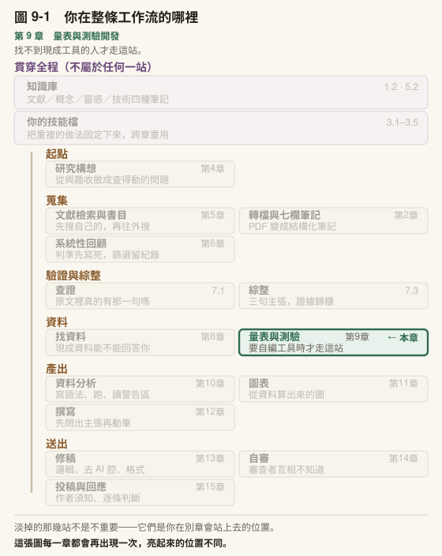

# 第 9 章　量表與測驗開發

## 本章導覽

**這一章回答五個問題**

1. 自己編一份量表或測驗，整條工作流分哪幾段？每一段在哪裡要停下來由人判斷？
2. Likert 量表題和選擇題，各自最常錯在哪裡？
3. AI 寫題目寫得又快又通順，哪幾件事它替你判斷不了？
4. 預試資料回來之後，難度、鑑別度、信度各在回答什麼問題？IRT 什麼時候才需要？
5. 正解登錄錯了會一路錯到哪裡？怎麼在計分前攔下來？

**讀完你能夠**

- **畫出**量表與測驗開發的工作流：各階段做什麼、產出什麼、在哪裡停下來判斷
- **寫出**一份構念定義與雙向細目表，讓每一題都指得出它測的是哪一格
- **辨認** Likert 題與選擇題的常見命題錯誤，並說出各自違反哪一條原則
- **區分** AI 命題時可以交出去的工作與一定要自己判斷的工作，並用盲解檢查它的正解
- **讀懂**古典測驗理論的試題分析輸出，不把統計標記直接當成刪題決定
- **建好**自己的一套量表工作流：模板、題庫、計分前核對正解的分析腳本、只挑問題不改題目的審題技能

**需要多久**

自學閱讀約 80 分鐘｜課堂 3 小時（概念 90 分、實作 90 分）

**進來之前，你要能**

- 說出你的研究要測的那個東西叫什麼，以及[第 8 章](../chapters/08-finding-data.md)找現成工具時為什麼沒有一份合用（[第 8 章](../chapters/08-finding-data.md)）
- 標出一筆文獻的驗證層級（[第 7 章](../chapters/07-verification.md)）
- 在工作台用技能檔與規則檔，並用 `git add` 逐檔提交（[第 3 章](../chapters/03-skills.md)）

**開始前請準備**：你的研究問題；一兩篇與你構念相近的量表發展論文（[第 8 章](../chapters/08-finding-data.md)找到但不合用的那幾份正好）；能找到兩位同學或學生當試答者的時間。

---

## 章前導言

設想一位研究生。[第 8 章](../chapters/08-finding-data.md)找了一輪，找不到一份給國小高年級、測「判斷 AI 答案可不可信」的現成工具，只好自己編。他打開 Claude，貼上研究問題，請它寫二十題選擇題。十分鐘後拿到二十題，題幹通順、四個選項排得整齊，每一題後面附了正解和一段設計理由。

他照著正解讀了一遍，每一題都說得通。

這份題目接下來要經過預試、試題分析、正式施測，分數會進他的論文，也可能被拿去回饋給學校。這一路上，有幾個地方是 AI 給的東西看起來完整、你卻看不出它錯了的：題目到底測不測得到他要的那個能力、標的正解是不是唯一的正解、誘答選項對五年級學生有沒有吸引力、試題分析說「刪掉這題信度會上升」時該不該刪。照著它給的正解讀題，正解錯了是讀不出來的。

這一章把整條量表與測驗開發的工作流拆成幾段，每一段講三件事：這一段做什麼（以及一套設計好的技能怎麼做）、背後的規則是什麼、它擋的是哪一種錯，以及你自己建一個版本時怎麼做、怎麼驗收。讀完，你的工作台裡會有一套自己的量表工作流。

> **〔課堂〕開場 10 分鐘** 發一張四題的小測驗與一份「正解」，其中一題的正解故意填錯（填成最多人會選的那個錯誤答案）。請學生兩兩互改對方的答案卷，改完收回，問：**「有誰發現正解有問題？」** 多數班級沒有人發現，因為改卷的動作是對照正解，不是重新解題。這個活動要讓學生自己經歷一次「照著正解改，就看不見正解錯」。9.4 與 9.7 都會回到這件事。

---

## 9.1 工作流全貌：一套量表開發技能怎麼分段

本節描述作者工作環境裡兩個技能的設計：一個負責整條流程的編排（`scale-development`），一個負責命題（`item-writing-assistant`）。描述它們，是為了讓你看清楚這條工作流有哪些段落、每一段的產出與關卡；你要建的是自己的第一版，在〈本章建置〉。

### 第一步是分流，不是命題

編排技能的第一個動作是判斷路徑：**你要測的東西有沒有標準答案？**

有標準答案的是測驗，例如學生懂不懂 AI 會在哪些情況出錯，題目通常是選擇題，答對得分、答錯不得分。沒有標準答案的是量表，例如學生使用 AI 時會不會去查證，題目通常是 Likert 式的等級題，沒有對錯，只有程度。

兩條路從命題到驗證全程不同：量表題的驗證主力是因素分析，測驗題的驗證主力是試題反應理論（item response theory，IRT）。同一份研究工具裡兩種都有也很常見，那就拆開，各走各的路。

技能在這裡設了第一道關卡：判斷完要**停下來，輸出一張決策卡，等人確認才往下做**。決策卡寫的是「我判定走哪條路、理由是什麼、這代表後面用什麼方法、不用什麼方法」，並一併說明**從哪一階段接手**。後者是技能修訂時特別補上的：已經有題目或已經有資料的人，不必回頭從構念定義重跑，判定路徑之後直接跳到對應階段。路徑與起始階段是兩件事，關卡管的是前者。

### 八個階段

分流之後，整條流程分成共用的前段與分岔的後段：

| 階段 | 做什麼 | 產出 |
|---|---|---|
| S1 構念定義 | 概念型定義與出處、向度、操作型定義、測量取向 | 構念藍圖（向度 × 操作型定義 × 預計題數） |
| S2 命題 | 轉交命題技能；先寫目標題數的 [1.5](../chapters/01-setup.md#15-在你往下走之前三件必須先知道的事) 到 2 倍 | 題庫初稿 |
| S3 專家審查 | 專家逐題評定，計算內容效度指標 | 保留／修改／刪除決策表，刪題理由入紀錄 |
| S4 預試與資料整備 | 反向題重新計分、缺失型態、樣本數檢核 | 可分析的資料檔 |
| S5 古典測驗理論試題分析 | 難度、校正後題目總分相關、刪題後 α、誘答分析 | 候刪清單（附理由） |
| S6A／S7A（量表） | 探索性因素分析，再驗證性因素分析與信效度 | 因素結構、適配指標 |
| S8B（測驗） | IRT／Rasch：參數、適配、Wright map、差異試題功能 | 試題參數、難度地圖 |
| 彙整 | 依路徑組裝開發報告 | 方法節草稿的材料 |

前五段兩條路共用，差別從驗證才開始。這張表也是一張定位圖：使用者說「專家評完了」，就是在 S3；說「哪些題要刪」，就是在 S5。技能用一張「語句線索 → 階段」對照表做這件事，讓中途進來的請求不必從頭跑。

### 四道關卡

除了分流，流程中途還有三道關卡，都設在**資料跑出來之後才知道要往哪走、而且選了不容易回頭**的地方：

| 關卡 | 位置 | 要人決定什麼 |
|---|---|---|
| G1 路徑分流 | 第一步 | 量表或測驗；混合工具怎麼拆；從哪一階段接手 |
| G2 因素數 | 探索性因素分析 | 幾種判斷方法建議的因素數不一致時，採哪一個 |
| G3 刪題 | 試題分析、因素分析、IRT 之後 | 刪哪幾題；刪了之後每個向度剩幾題；內容涵蓋會不會缺一塊 |
| G4 模型修正 | 驗證性因素分析適配不佳 | 要不要依修正指標加路徑；每一條有沒有理論依據 |

每一道關卡輸出同一種格式的決策卡：現況（實際跑出來的數字）、選項與各自的後果、推薦與理由、不可逆性（選了之後哪些步驟要跟著改）。

技能另外寫了三條防繞過的規定：使用者說「你決定就好」，仍要輸出決策卡、取得一次明確同意；使用者說「快速版」，後三道關卡可以縮成一行說明，但**第一道不能簡化**；連續遇到幾道關卡時逐道過，不一次丟出四張卡。

刪題那一道關卡的決策卡多了一個必填項：**刪除後這個向度剩幾題，以及被刪的題是不是某個次面向唯一的代表**。統計上該刪、內容上不能刪的題，技能要把這個張力講明，交給人裁決，不得自動刪題後重跑。

### 題目修訂迴圈

試題分析找出問題題目之後，編排技能進入一個「評估—修訂迴圈」，分兩層：

- **刪題—重跑**：刪掉問題題目，用現有資料重新分析，看剩下的題目有沒有改善、有沒有連帶變差、每個向度是否還有至少 3 題。最多 2 輪。
- **改題—桌面審查**：需要修訂的題目，帶著結構化的診斷（哪個指標、為什麼、往哪個方向改、對應哪個向度）轉給命題技能改寫。改完做五項檢核：仍只測一件事、仍對應原向度、確實解決了診斷指出的問題、語言掃描通過、沒有引入新問題。最多 2 輪。

這個迴圈只有一種模式：每一輪都要經過刪題關卡的人工裁決，**沒有自動模式**，理由寫在技能裡：刪題與改題影響內容涵蓋。改過的題目不直接併回題庫，而是列入「待下輪施測驗證」的清單，因為改過的題目沒有資料。

### 命題技能怎麼運作

命題技能接手 S2，同樣先分流：模式 A 寫量表題，模式 B 寫選擇題或是非題。資訊不足時一次只追問一題：要測什麼、給誰作答、需要幾題。

模式 A 的流程是：確認規格（構念、向度、量表類型、目標族群、每向度題數）→ 依撰寫原則出題 → 每個向度輸出一個區塊（向度名稱、操作型定義、量尺說明、題目、計分說明）→ 品質檢核清單 → 語言掃描。模式 B 多了兩項規格：認知層次的分配與難度分布，每一題輸出時附認知層次、難度預估、正解、**每個誘答選項的設計依據**、對應的學習目標。

它的語言掃描有兩張詞表，分量表題與選擇題，掃兩類問題：讓題目讀起來像機器寫的詞，以及讓作答者無法判斷題目在問什麼的詞（見 9.4）。

它還有一個接收端：修訂迴圈送來結構化診斷時，它改寫題幹或選項，**產出兩個替代版本供人選擇**，並受三條限制：仍對應原向度的操作型定義、不引入第二個概念、維持原本的計分方向。

技能最後的完成判準有一條特別寫明是它最容易破功的地方：**未經討論，不改變既有題目的語意或語序**。

### 這套設計可以帶走的三件事

1. **流程分段，每段有產出。** 每一段的產出是下一段的輸入，也是日後寫方法節時的紀錄。
2. **關卡設在「它選錯了你看不出來」的地方。** 分流、因素數、刪題、模型修正，交給機器都會得到一個看起來合理的答案；刪掉一題後 α 上升是好看的結果，但如果那一題是某個向度唯一的代表，構念就少了一塊，數字上看不出來。
3. **修訂是迴圈，而且有上限。** 每一輪都有人裁決，改過的題目要重新施測。

### 帶走這一節

- 第一步是**分流**：量表（無對錯）走因素分析，測驗（有對錯）走 IRT；分流之後才決定從哪一階段接手
- 八個階段各有產出；**前五段共用**，差別從驗證開始
- 四道關卡：**路徑、因素數、刪題、模型修正**，到了就停下來輸出決策卡
- 修訂迴圈分**刪題重跑**與**改題審查**兩層，各有輪數上限，沒有自動模式

---

## 9.2 構念定義與雙向細目表

### 規則：構念定義先於命題

**先寫下要測什麼，才寫題目。** 這條規則擋的錯是：題目寫完之後才回頭標「這題測哪個向度」，標出來的結果只是在描述你寫了什麼，不是在檢驗你寫的對不對。很多分析需要「每一題對應哪些屬性」的資訊；事後補標的對應表，通常每題只標一個面向，那些分析所需的資訊根本不存在。這個缺口在命題之後補不回來。

### 構念定義：一句概念型定義，加上看得到的操作型定義

構念（construct）是你想測、但無法直接看見的東西，例如「判斷 AI 答案是否可信的能力」。構念定義分兩層：

- **概念型定義**：一句話說它是什麼，附出處。出處可以是理論框架、課綱、前人的定義。
- **操作型定義**：學生做了什麼、答了什麼，你會判定他有這個能力。這一層要寫到看得見的行為。

操作型定義寫不出來，通常代表構念還太大。「判斷 AI 答案是否可信」可以拆成三個向度：知道 AI 在哪些情況容易出錯、知道怎麼查證、會判斷來源可不可靠。每個向度各寫一句操作型定義，再寫一句**不包括什麼**。最後這一欄最常被省略，卻最能擋住題目慢慢偏離構念：寫下「不包括學生對 AI 的喜好」，之後有人提議加一題「你喜歡用 AI 查資料嗎」，你就有依據說它不屬於這份工具。

### 雙向細目表：每一題都要指得出它在哪一格

雙向細目表（table of specifications，暫譯）是一張兩個維度交叉的表：一邊是內容向度，一邊是認知層次（記憶、理解、應用），每一格寫預計題數。以本章示範用的 12 題為例：

| 向度＼認知層次 | 記憶 | 理解 | 應用 | 小計 |
|---|---|---|---|---|
| 甲　知道 AI 會錯在哪 | 1 | 2 | 1 | 4 |
| 乙　查證的做法 | 1 | 1 | 2 | 4 |
| 丙　判斷來源 | 0 | 2 | 2 | 4 |
| 小計 | 2 | 5 | 5 | 12 |

它在三個時間點各用一次：

1. **命題時**，告訴你每一格還缺幾題，避免題目全擠在最好寫的那一格（通常是「記憶」）。
2. **專家審查時**，是評分依據：專家要判斷的是「這題屬不屬於它標的那一格」。
3. **刪題時**，是對照：刪掉一題之前，你要看得出這一刪會不會讓某一格變空。

量表的雙向細目表把認知層次換成別的維度，常見的是正向題與反向題。

### 表上每一欄都要寫出是誰、根據什麼填的

細目表或題目資訊表裡常見一欄「難度」或「重要性」。這一欄如果是從另一欄推出來的（例如依認知層次自動標成難、中、易），它就不是獨立的判斷，不能拿去檢驗它自己的來源：用「記憶題標為易」去檢驗「記憶題是否比較容易」，結論一定成立。每一欄寫清楚填的人、時間與依據，日後才分得出哪些欄位能當證據。

### 做法：自己建一份

1. 用〈本章建置〉第 1 步的模板，先勾量表或測驗，寫一句理由。
2. 寫概念型定義，出處寫到頁碼。
3. 每個向度寫操作型定義與「不包括什麼」。
4. 填細目表的預計題數。命題時多寫一些，預留刪題的空間。
5. 最下方的修改紀錄只准往下加。

**驗收**：請一位同學只看你的操作型定義，說出一個「屬於」與一個「不屬於」這個構念的行為。他說得出來，定義才寫到了看得見的程度。

> **〔動手一下〕5 分鐘** 寫下你的構念的概念型定義（一句）與出處，再寫兩個向度的操作型定義，各附一句「不包括什麼」。寫不出「不包括什麼」的那個向度，通常就是之後題目會漂走的地方。

〔教你的 Claude 建這個〕**請它替你數格子，不要請它替你填格子。** 貼這段：

「請幫我建一個〈細目表點名〉技能檔。它只做一件事：讀 `專案_我的論文/量表/構念定義與雙向細目表.md` 和 `題庫.csv`，依題庫的『構念面向』『認知層次』兩欄數出每一格實際有幾題，跟細目表上的預計題數並排，標出差額。**不要建議補什麼題，也不要替我改任何一題的標記。** 先問我：我的認知層次分幾級？量表有沒有正反向這一欄？」

第一版的標準是數得對。命題進行到一半時跑一次，你會看到題目往哪一格擠。

### 帶走這一節

- **構念定義先於命題**；事後補標的對應關係補不回分析需要的資訊
- 操作型定義要寫到**看得見的行為**，並寫一句**不包括什麼**
- 雙向細目表在**命題、審查、刪題**三個時間點各用一次
- 每一欄寫清楚是誰、根據什麼填的；推導出來的欄位不能當獨立證據

---

## 9.3 命題原則：Likert 題與選擇題各自常錯的地方

本節的規則主要依據 Haladyna 與 Rodriguez（2013）的《Developing and Validating Test Items》[第 6 章](../chapters/06-systematic-review.md)（選擇題）與第 9 章（調查題目），以及更早一篇整理命題準則的回顧（Haladyna et al., 2002）。後者比對了 27 本教育測驗教科書與 27 篇研究，整理出 31 條選擇題準則；教科書共識最高的兩條，一條是不要給答案線索，一條是每個誘答選項都要合理。以下不逐條列，只講最常出錯、而且出錯時不容易自己發現的那幾種。

### Likert 題常見的五種錯

**一題兩個概念。**「我會查證 AI 的答案，也會提醒同學查證」。學生只做了前半，要怎麼填？這種題目的回答無法解讀，因為你不知道他在回應哪一半。中文裡的「和」「並且」「也」「不僅……更……」都是警訊。

**量尺跟題目對不上。**「我用 AI 查資料後，會再找另一個來源對照」，配「非常不同意」到「非常同意」，學生要先把頻率翻譯成同意程度。問頻率就用頻率量尺，問看法才用同意量尺。Haladyna 與 Rodriguez（2013，第 9 章）主張選項標籤直接寫出要測的那個性質，不要每一題都套同意量尺。

**絕對詞。**「AI 的答案總是不可信」、量尺端點寫「從不」「總是」。這類詞很少人選，選項之間的心理距離也被拉歪。

**題幹暗示答案。**「你同意查證 AI 答案是負責任的做法嗎？」題幹已經說了哪個答案比較好。

**反向題要不要放。**常見的建議是每個向度放一兩題反向題，用來偵測一路勾同一邊的作答者，命題技能的撰寫原則也這樣寫；Haladyna 與 Rodriguez（2013，第 9 章）則建議避免負向措辭，理由是負向題常與正向題分成不同因素。對兒童，有一篇實驗研究同時操弄了選項數與正負向措辭：受試者是 8 到 16 歲兒童，負向措辭對信度沒有顯著影響，但兒童對負向題的作答方式一貫與正向題不同（Borgers et al., 2004）。同一篇也發現選項數對兒童的影響是兩個方向相反的效果互相抵消：選項多，內部一致性上升，但兩次施測之間的差異也變大。

兩種建議都有依據，**放不放、放幾題是你的決定**，決定了就寫進決策日誌，連同理由。預試後如果反向題自成一群，你才知道那是預料中的事，還是新的問題。

### 選擇題常見的六種錯

**題幹沒有問題，問題藏在選項裡。**「關於 AI，下列何者正確？」讀完題幹不知道在問什麼，要把四個選項讀完才知道。好的題幹讀完就知道要找什麼，遮住選項也答得出個大概。

**正解最長、最周延。**命題者會不自覺地把正解寫得最完整、限定最多，因為要確保它是對的；誘答選項則隨手寫。作答者不必懂內容，挑最長的那個就有很高的機率答對。

**絕對詞與重複字。**誘答選項裡的「一定」「從不」提示它是錯的；題幹裡的關鍵詞原封不動出現在正解裡，提示它是對的。

**「以上皆是」「以上皆非」。**前者讓只認得兩個選項對的人就能推出答案，後者答對了也不知道學生懂什麼。

**誘答選項沒有人選。**這是選擇題最普遍的問題，而且只有預試資料看得出來。一篇清點護理系教師自編測驗的研究，514 題、1,542 個誘答選項（distractor，暫譯；也有人寫作「干擾項」）裡，只有 52.2% 是有作用的，平均每題 1.54 個（Tarrant et al., 2009）。一個沒人選的誘答選項，等於把四選一變成三選一。Rodriguez（2005）把 80 年間的選項數研究做成後設分析，結論是多數情境下三個選項就夠，而且從四個減成三個時，刪掉的如果是本來就沒人選的那一個，信度幾乎不動。

**正解位置偏向中間。**命題者與作答者都偏好把正解放在、或往中間的選項找；把同一題的正解從中間移到邊緣，題目會變難、鑑別度會上升（Attali & Bar-Hillel, 2003）。命題時不刻意安排，正解很容易集中在 B、C。

### 誘答選項要從學生的錯誤來

Haladyna 與 Rodriguez（2013，[第 6 章](../chapters/06-systematic-review.md)）要求誘答選項建立在學生常見的錯誤上，並且每一個都要說得出依據。命題技能的選擇題輸出格式因此有一欄「每個誘答選項的設計依據」。

你的研究如果有訪談或開放題資料，那是誘答選項最好的來源：學生自己說出來的錯誤想法，比你想像出來的更吸引人。以全書的範例研究為例，假如訪談裡有學生說「兩個 AI 講的一樣，所以是對的」，這一句改寫成選項，就是一個誘答選項。反過來，一個說不出對應哪種錯誤的選項，例如「AI 用的是什麼字體」，多半沒有人會選。

> **〔動手一下〕8 分鐘** 下面這一題有幾個問題？逐一說出它違反哪一條，**先不要改寫**。關於 AI 聊天機器人，下列何者正確？ (A) 它總是錯的 (B) 它的回答是依照學過的大量文字，接出最像答案的句子，因此在沒有資料的主題上可能出錯 (C) 它不會出錯 (D) 以上皆是至少有五處。數完再看下一節，AI 寫出來的題目會不會也有這幾種問題。

> **〔課堂〕9.3 講述約 20 分鐘** Likert 與選擇題各講 8 分鐘，最後 4 分鐘做上面的〔動手一下〕。學生最常卡的點是反向題：他們會問「到底要不要放」。不要給答案，把兩邊的依據講完，請他們寫下自己的決定與理由。這一題沒有標準答案，但有沒有寫下理由，差別很大。

### 帶走這一節

- Likert 題最常見的錯：**一題兩個概念、量尺對不上題目、絕對詞、題幹暗示答案**
- 選擇題最常見的錯：**題幹沒問題、正解最長、線索、以上皆是、誘答選項沒人選、正解位置偏中間**
- 誘答選項要**說得出對應哪一種學生錯誤**；最好的來源是學生真實說過的話
- 反向題放不放有兩邊的依據，**決定與理由寫進決策日誌**

---

## 9.4 AI 命題：能做的、不能做的，以及盲解

### 它擅長的

請 Claude 依你的雙向細目表寫題，十分鐘可以拿到三十題，句子通順、格式整齊、每題都附正解與設計理由。它在下面這幾件事上確實省時間：

- **依格子產出初稿**：給它一格的操作型定義與認知層次，它寫得出符合格式的題目
- **產出變體**：同一個題目骨架，換情境、換數字，產出幾個版本。測驗學裡有一套「題目模型」的做法，把題目拆成會影響難度的部分與只改表面的部分（Haladyna & Rodriguez, 2013，[第 8 章](../chapters/08-finding-data.md)）；AI 適合做表面那一部分的替換
- **從你給的迷思寫誘答選項**：你列出學生真實的錯誤想法，它把每一個改寫成選項
- **掃語言**：找出一題兩個概念、絕對詞、題幹裡的否定字、選項長短不一

這些工作的共同點是：**它做錯了，你看得出來**。題目格式不對、變體偏離了骨架、選項長短不一，攤在眼前就看得到。

### 它判斷不了的

另外三件事，它的輸出看起來一樣完整，但對錯不在文字上：

**這一題測不測得到你的構念。** 一題「下列哪一個網站比較需要小心」，可能測的是來源判斷，也可能只測到學生有沒有看過廣告網站。這要拿你的操作型定義去對，而操作型定義是你寫的。

**是不是只有一個選項是對的。** 它會在每一題後面附正解，而且附得很有把握。但正解是命題者的判斷，題目裡兩個選項都說得通、或者標的正解其實是錯的，在文字上看不出來。Haladyna 與 Rodriguez（2013, p. 14）對這件事的要求是：正解必須由內容專家**全體同意**，不是多數決。

**誘答選項對你的學生吸引不吸引人。** 誘答選項有沒有作用，是一群特定學生的性質，不是選項文字的性質。同一個選項，對五年級可能沒人選，對三年級可能一半人選。AI 沒見過你的學生作答，它寫的誘答選項是「看起來像錯誤答案的句子」，有沒有作用只有預試看得出來。

所以 AI 寫的題目進題庫時，「來源」欄要寫「AI 草擬，待審」。這一筆在經過盲解、專家審查與你的核可之前，都只是草稿，而題庫上看得出它是草稿。

> **〔補充〕用 AI 來審題，結果如何？** 一篇 2026 年的預印本用一個州級測驗的五萬多題歷史資料，訓練模型預測一題最後會不會被永久退回（Maeda & Lu, 2026）。結合語言模型評語的版本表現最好，但依退回原因拆開來看，因偏誤、公平性或可及性而被退回的題目，模型只抓到約四分之一；這篇的模型也沒有讀入答案鍵。這是尚未經同儕審查的單一研究，它能說明的方向是：AI 審題可以當第一道篩子，但它抓得最差的，正好是需要人判斷的那幾類。

### AI 寫的題目有自己的語言痕跡

命題技能的語言掃描用兩張詞表，列的是兩類問題：讓題目讀起來像機器寫的詞，以及讓作答者無法判斷題目在問什麼的詞。幾個例子：

| 出現在題目裡 | 問題 |
|---|---|
| 「多元面向」「全面性地」「深遠影響」 | 填答者無法判斷範圍或程度 |
| 「有助於提升」 | 量表題是在問感受，這個寫法預設了因果 |
| 「不僅……更……」 | 一個句子裡接了兩個概念 |
| 「有一定的」「較為」「相當」 | 每個人解讀的程度不同 |
| 「通常來說」「一般而言」（選擇題） | 選擇題應該有確定的答案 |
| 「AI」不加說明（選擇題） | 學生不知道指的是聊天機器人還是推薦系統 |

掃描結果分兩級輸出：影響測量效度、要立即修正的，以及只是語氣像機器、建議修正的。

另一個痕跡在結構上：AI 寫的正解常常是四個選項裡最長、限定語最多的那一個，正好是上一節的第二種錯。它想確保正解是對的，就把它寫得最周延。

### 規則：AI 命題要盲解一次

**把 AI 寫的題目收下之前，遮住它給的正解，自己作答一次**，寫下你選哪個、為什麼，再跟它的正解比。

這條規則擋的錯是：照著正解讀題，正解錯了讀不出來（開場活動就是這件事）。不一致的題目只有三種可能：它錯了、你錯了、題目本身有兩個說得通的答案。三種都要處理，而且三種在你盲解之前都看不出來。這是全書判準句在這一章的具體做法：**如果它做錯了，我看得出來嗎？** 先解一遍，你才有機會看到它錯。

**做法**：請它把正解集中列在最後，不要附在每一題後面；你逐題作答並寫理由；最後才對答案，把不一致的題號寫進題庫的「審查紀錄」。

**驗收**：每一題的審查紀錄裡，都有一筆你自己的盲解答案。

> **〔動手一下〕10 分鐘** 請 Claude 依你細目表的一格寫三題選擇題，**請它把正解另外列在最後**。先只讀題目，自己作答，寫下理由。再對答案。然後回頭看：三題的正解是不是都是最長的那個選項？

### 帶走這一節

- AI 適合：依格子寫初稿、產出變體、把你給的迷思改寫成選項、掃語言
- 它判斷不了：**測不測得到構念、是否只有一個正解、誘答選項對你的學生有沒有作用**
- 它寫的正解常是**最長、最周延**的那一個；題目裡也有可辨認的詞彙痕跡
- **收下之前先遮住正解自己作答一次**，結果寫進審查紀錄

---

## 9.5 專家審查與認知訪談

題目寫好之後、正式預試之前，有兩種審查。一種請懂內容的人看題目，一種請作答的人做題目。兩者抓到的東西不同，不能互相取代。

### 專家審查：判斷每一題屬不屬於它標的那一格

請幾位懂這個內容的人逐題判斷兩件事：這題跟構念有沒有關、它屬不屬於細目表上標的那一格（Haladyna & Rodriguez, 2013，[第 16 章](../chapters/16-integrity.md)）。兩件事要分開判，因為一題可能跟構念有關，卻標錯了格子。專家的評定可以算成內容效度的指標，常見的有 Aiken's V 與內容效度指數（content validity index，CVI），算法與判斷門檻屬於統計課的範圍，引用門檻時要寫出出處。編排技能在這一段的產出是一張保留、修改、刪除的決策表，刪題理由寫進紀錄。

專家審查還有一件事常被省略：**請專家各自解一次題，不給正解**。這是上一節盲解的多人版本。Haladyna 與 Rodriguez（2013, p. 14）把正解查核列為題目發展必經的審查之一，要求專家全體同意。專家意見不一致的題目，比統一給出錯誤答案的題目更好處理，因為你至少知道問題在哪。

審查結果要留紀錄：誰看過、怎麼判、哪一題因此修改或刪除。題庫檔有一欄「審查紀錄」就是為了這個（見〈本章建置〉）。這些紀錄本身就是效度證據的一部分（Haladyna & Rodriguez, 2013，[第 16 章](../chapters/16-integrity.md)），寫方法節時要用得到。

### 認知訪談：看作答者實際怎麼讀題

專家懂內容，但專家讀題的方式跟你的學生不一樣。一個國小五年級學生讀「一篇網路文章沒有寫作者」，可能不知道「作者」指的是什麼；讀「AI 回答時附上一個網址」，可能以為網址就是答案的一部分。這類誤讀專家看不出來，因為專家自己不會誤讀。

認知訪談（cognitive interview，暫譯）找幾位跟目標對象相近的人，請他們邊作答邊說出心裡在想什麼，這種做法叫放聲思考（think-aloud，暫譯）。Haladyna 與 Rodriguez（2013, pp. 335–336）描述這種做法時有幾個要點：

- 人數很少，但要有代表性；可以一次一人，也可以小組
- 可以邊作答邊說，也可以作答完立刻回顧
- 訪談者盡量少追問，多半只說「繼續說」或「你在想什麼」
- 難處在於讓受訪者說出他實際怎麼想，而不是因為被要求說出來，改變了原本的想法

追問要中性。「你為什麼選 C？」可以；「你是不是覺得 A 比較好？」已經在引導。

認知訪談抓到的問題通常是三種：**誤讀**（學生以為題目在問別的事）、**答對的理由不對**（學生選了正解，理由卻是猜的或用了別的線索）、**答錯的理由合理**（學生選了誘答選項，但他的推理說得通，代表那個選項可能也是對的）。第三種直接指向正解有沒有爭議。

一位學生誤讀，記下來；幾位學生同樣誤讀，才是題目的問題。

### 做法：審查與訪談各留一張表

1. 專家審查表：題號、標的格子、專家判定的格子、專家的盲解答案、意見。
2. 認知訪談表：題號、受訪者代號、四種標記之一（誤讀／答對但理由不對／答錯但理由合理／無問題）、受訪者原話。
3. 兩張表的結論濃縮成一行，寫進題庫的「審查紀錄」欄。

**驗收**：題庫裡每一題的審查紀錄，都看得出經過了哪幾種審查；被修改的題目，看得出是哪一筆意見促成的。

> **〔動手一下〕10 分鐘** 兩人一組，用你在 9.4 讓 AI 寫的三題。一人作答並放聲思考，另一人只記錄，只准說「繼續說」「你在想什麼」。三題做完交換。記錄者在每一題旁邊標：誤讀／答對但理由不對／答錯但理由合理／無問題。

> **〔課堂〕9.5 約 20 分鐘（含上面的練習）** 學生當記錄者時最難做到的是不追問、不解釋。第一輪做完先問記錄者：「你有沒有忍不住提示對方？」多數人有。讓他們第二輪換角色時特別注意這一點。

### 帶走這一節

- 專家審查判斷**題目屬不屬於它標的那一格**，並請專家**不看正解各自解題**
- 正解需要**全體同意**，不是多數決（Haladyna & Rodriguez, 2013, p. 14）
- 認知訪談抓**誤讀、答對但理由不對、答錯但理由合理**；第三種指向正解有爭議
- 審查與訪談都要留紀錄，那是效度證據的一部分

---

## 9.6 預試與試題分析

### 預試要記下的事

預試是把題目給一群跟正式對象相近的人作答，看題目實際表現如何。除了收資料，有幾件事當下就要記：施測日期、對象、人數、施測方式、有沒有人沒寫完、空白怎麼處理。

最後一件不起眼，卻會改變數字。空白可以當答錯（記 0 分），也可以當缺失值。古典測驗理論的分析常記 0 分；IRT 分析則常記為缺失，避免把沒作答當成答錯而扭曲難度估計。兩種做法各有道理，但要在分析前決定、寫進決策日誌，事後才知道每個數字是在哪種規則下算的。編排技能把這件事放在 S4 資料整備，連同反向題重新計分，在任何分析之前處理。

### 古典測驗理論的三個數字

古典測驗理論（classical test theory，CTT）是最早、也最常用的試題分析框架。它對每一題算三個數字，各回答一個問題：

**答對率（*p*）：這題多難？** 答對的人數比例。注意它的方向：*p* 越高，題目越容易。這裡的 *p* 跟顯著性檢定的 *p* 值無關，是同一個字母的不同用法。答對率只描述這一群人，換一群人就會變，報告時一定要說明是誰作答的（Haladyna & Rodriguez, 2013，第 17 章）。

**校正後題目總分相關：這題分不分得出會與不會？** 每個人在這一題的得分（0 或 1），跟他在其他題的總分之間的相關，英文是 corrected item-total correlation（暫譯）。高分的人答對、低分的人答錯，相關就高，代表這題有鑑別度。「校正」是指總分先扣掉這一題本身，因為這一題的得分本來就算在總分裡，不扣的話相關會被自己灌高（Haladyna & Rodriguez, 2013, p. 344）。

**刪題後 α：少了這一題，整份的一致性會變怎樣？** Cronbach's α 信度係數描述整份題目內部一致的程度。刪題後 α（alpha if item deleted，暫譯）是把某一題拿掉之後重算的 α。拿掉後 α 上升，代表這一題跟其他題不太同調。α 跟題數有關，題數少的分量表，α 低不一定代表題目不好。

### 再看每一個選項

選擇題的分析不能只看正解，要把每個選項攤開：每個選項有多少人選、高分組與低分組各有多少人選。一般用總分最高與最低的各 27% 當高低分組。

一個有作用的誘答選項，低分組選得比高分組多。下面三種情況要停下來看：

- **幾乎沒人選**：Haladyna 與 Rodriguez（2013，第 17 章）建議設一個最低選答率，例如 5%，低於它的選項等於沒有作用
- **高分組選得比低分組多**：這個選項可能跟正解一樣說得通
- **某個誘答選項表現得像正解，正解反而像誘答**：9.7 的主題

### 六類題目

Haladyna 與 Rodriguez（2013, pp. 350–351）提供一張用答對率與鑑別度把題目分成六類的表：

| 類型 | 答對率 | 鑑別度 | 書上的說明 |
|---|---|---|---|
| 1 | .60–.90 | > .15 | 理想 |
| 2 | .60–.90 | < .15 | 鑑別度差 |
| 3 | > .90 | 不看 | 多數人答對；內容重要就保留 |
| 4 | < .60 | > .15 | 難但有鑑別度 |
| 5 | < .60 | < .15 | 難且沒有鑑別度，退休或修改 |
| 6 | < .60 | < .15 | 同第 5 類，但有一個誘答選項的表現像第 1 類；多半是正解錯誤 |

這張表的原名就寫著它是「一些任意的標準」，原書作者說數值是依經驗選的，可以依題庫狀況調整。所以它是分類的起點，不是判決。書上同時強調兩件事：題目與細目表的對應優先於鑑別度；答對率超過 .90 的題目，內容重要的話就應該保留。

### 門檻要指得出出處

編排技能的修訂迴圈裡也有一張門檻表，量表、測驗、因素分析、IRT 各一組。你自己的分析也會需要門檻。自己訂一個看起來合理的門檻很容易，用它篩完題目之後就忘了它是自訂的。寫試題分析的方法節時，每一個門檻都要寫出處；寫不出的，就是你自訂的，要明說。

### 規則：刪題由人決定

**統計標記不是刪題決定。** 這條規則擋的錯有兩種：刪掉一題，某一格的內容就空了，數字上看不出來；以及題目的問題其實出在別處（例如正解登錄錯了），刪掉等於丟掉一題好題目。〈本章建置〉的示範資料裡就有這樣一題。

刪題前至少回答三題，這三題也就是編排技能刪題關卡決策卡上的必填項：

1. 這一題在細目表上屬於哪一格？刪掉之後那一格還剩幾題？
2. 它的問題出在哪裡：題幹、某個誘答選項，還是正解？
3. 修改它，會不會比刪掉它更好？

還有一條容易忘：**改過的題目是新題目**。改了題幹或選項，預試資料就不再描述它。Haladyna 與 Rodriguez（2013, p. 96）寫到，內容或依統計結果改過的題目，有經驗的測驗編製者都當成新題目，要重新預試；連重新排列選項都會改變題目的統計特性。編排技能把改過的題目放進「待下輪施測驗證」的清單，是同一個道理。

**做法**：刪題、改題一律寫進決策日誌，一列寫題號、依據的指標、回答上面三題的結果、決定、決定的人。**驗收**：隨便指一題被刪的題目，日誌裡找得到它被刪的理由，以及刪掉後那一格還剩幾題。

### IRT 回答的是什麼問題

試題反應理論（IRT）與其中最常用的 Rasch 模型，估計細節屬於統計課。這裡只講它回答什麼問題、你什麼時候需要它。

古典測驗理論的答對率與鑑別度都綁在這一群作答者上；總分也綁在這一份題目上。IRT 把**人的能力與題目的難度放在同一把尺上**，題目難度不再只是「這群人答對幾成」。這帶來幾個古典測驗理論做不到的事：

- **不同人寫不同題，分數仍能比較。** 題目太多時，常把題目分成幾本題本輪流發，每人只寫一部分。這時各人的總分無法直接比較，因為寫的題目不一樣；用 IRT 才能把所有人放在同一把尺上。
- **看題目難度有沒有涵蓋學生的能力範圍。** 常用的圖叫 Wright map，人與題目畫在同一條軸上，看得出哪一段能力沒有題目可測。
- **檢驗一題對不同群體是否公平。** 能力相同的兩群學生（例如男女），在某一題的答對機率不同，叫差異試題功能（differential item functioning，DIF）。Haladyna 與 Rodriguez（2013，第 19 章）提醒，偵測到 DIF 的題目要交給內容專家判斷這個差異跟構念有沒有關，不是自動刪除。
- **分開看題目端與個人端的精準度。** 題本設計下，每一題可能有幾百人作答，每位學生卻只寫十幾題：題目的難度估得很準，個別學生的分數誤差很大。IRT 的輸出會分別報這兩種信度，讀的時候要分開看；只報一個「信度」，讀者會以為兩端一樣準。如果你要的是給個別學生回饋，題本設計就不能讓每個人只寫十幾題。

什麼時候需要它：題本設計讓不同人寫不同題、要跨年級或跨時間比較、要檢驗 DIF、要做適性測驗。代價是樣本要大，小樣本的 IRT 估計並不可靠（Haladyna & Rodriguez, 2013，第 17 章）。預試只有幾十人，先用古典測驗理論把題目整理好；正式施測樣本夠大、又有上面的需求，再走 IRT。怎麼把一本方法書變成你的分析顧問，是[第 10 章](../chapters/10-statistics.md)的事。

量表（Likert 題）的分析路徑不同：題目分析看平均數、標準差、校正後題目總分相關與刪題後 α，接著是探索性與驗證性因素分析。這些也留給[第 10 章](../chapters/10-statistics.md)與統計課。

> **〔動手一下〕5 分鐘** 本章〈本章建置〉的示範輸出裡，Q11 的刪題後 α 是 .707，比整份的 .655 高。先別往下讀，寫下你會不會刪這一題，以及你的理由。

### 帶走這一節

- 空白怎麼計分是**分析前**的決定；答對率描述**這一群人**；校正後題目總分相關要**先扣掉本題**
- 選擇題要把**每一個選項**攤開看高低分組
- 六類分法是起點，**原書自稱任意的標準**；門檻要寫出處
- **刪題由人決定**：先問屬於哪一格、問題出在哪、修比刪好嗎；改過的題目是新題目
- IRT 把人與題放在同一把尺上；**題本設計、跨群比較、DIF、適性測驗**時才需要，而且要大樣本

---

## 9.7 正解鍵：為什麼會錯、錯了怎麼傳、怎麼擋

### 正解錯了，統計不會報錯

Haladyna 與 Rodriguez（2013, p. 333）在列舉題目審查項目時，寫了一句：所有審查之中，"none is as important as ensuring that the right answer is right"。他們接著列出施測之後才發現的三種情況：沒有任何一個選項是對的、有正解但標成了別的選項、有兩個以上的選項是對的。

⚠️ 正解錯的時候，計分程式照樣計分，統計軟體照樣估計，α 照樣算得出來，沒有任何一步報錯。題目參數、個人分數、信度，每一個數字都有，而且格式完全正確。

### 正解從哪裡錯

命題時寫錯的正解，盲解與專家審查有機會抓到。下面這幾種是在**被抄到另一個地方**的時候錯，命題階段的審查碰不到：

- **題目改版，正解沒跟著改。** 題幹或選項改了，存正解的那一列沒有一起改。
- **同一份正解存在好幾個地方。** 題庫一份、答案卷一份、計分程式裡一份、線上表單的設定裡一份。改一題，要同步改每一份。
- **對調選項。** 為了平衡正解位置而對調兩個選項，選項文字不動，正解字母就變了，每一份存正解的地方都要跟著改。題幹裡如果用「方法 A」「提示 B」指稱選項，選項字母跟題幹綁在一起，根本不能對調。
- **計分程式把對應寫死。** 配對題、部分計分題常在程式裡寫一組對應，寫反了也照樣跑。
- **AI 附的正解沒有被重新解過。** 9.4 的盲解就是為了這個。

### 錯了怎麼往下傳

一題的正解錯了，受影響的不只那一題：

1. **那一題的統計**：答對率、鑑別度全是錯的，而且會讓一題好題目看起來像壞題目。
2. **每一個人的分數**：總分或能力估計都差了一題的份量；用 IRT 時，錯誤會經由題目參數影響所有作答過那一題的人。
3. **整份的信度與其他題的統計**：校正後題目總分相關用的是總分，一題錯了，其他每一題的「其餘總分」都跟著偏。
4. **用到分數的一切**：分組、迴歸、圖表、論文裡的數字、交給學校或家長的報告。
5. **時間越久越難收回**：已經交出去的報告、已經投出去的稿件，更正要一份一份追。

所以正解錯誤的代價跟它被發現的時間成正比。計分前擋下來，改一個儲存格；發表後才發現，要盤點每一個用過那份分數的地方，逐一決定怎麼處理。

### 兩份來源不一致，不等於其中一份錯

把兩份存正解的地方逐題比對，會找到一些不一致。它們不一定都是錯誤：一份寫 C、另一份寫 3，可能指的是同一個選項，只是編碼方式不同；也可能是你以為比較可靠的那一份寫錯了。

所以比對兩份來源，能做的是**找出要查的題目**，不能告訴你哪一份對。如果比對程式自動「以某一份為準」把不一致的地方改掉，它會把另一份裡對的地方一起改錯。

### 規則：正解只在題庫一處改

**正解的正本只有一份，就是題庫；其他存正解的地方都是副本。** 這條規則擋的錯是「某一份改了、另一份沒改」。改任何一題的正解，同一次工作內做三件事：同步每一份副本、在決策日誌記一列（哪一題、從什麼改成什麼、根據什麼）、列出已經用舊正解算出來的檔案。

理想上副本越少越好；但計分常在別的地方進行（線上表單、閱卷程式、助理打的答案表），那一份刪不掉。刪不掉的，交給下一條規則。

### 規則：計分前核對正解鍵

**每次計分前，比對題庫與正解鍵，不一致就停。** 正解鍵（answer key，暫譯）是計分時實際拿來對答案的那一份。〈本章建置〉的腳本在計分前做兩道檢查，加上一道人工，各擋一種錯：

**第一道：比對題庫與正解鍵。** 兩份不一致，腳本列出來就停，不計分，由你去讀題目、決定哪一份對。這一道擋「抄錯」。

**第二道：看資料。** 兩份一起錯的時候，第一道網看不到，因為它們彼此一致。這時候要看作答資料：正解如果標錯了，真正的正解會變成一個「誘答選項」，而且是高分學生選得比低分學生多的那一個；被標成正解的選項，則是低分學生選得多。這就是六類分法的第 6 類，也是 Haladyna 與 Rodriguez（2013, p. 345）說鑑別度為負多半代表計分錯誤的原因。

**第三道：人。** 資料不夠多、或那一題本來就很難的時候，第二道網的模式不一定看得出來。所以施測之前，**請一位沒參與命題的人，不看正解把整份題目做一遍**。這是 9.5 專家盲解的同一件事。

**驗收**：故意改壞正解鍵的一題，腳本要停下來；故意把題庫和正解鍵的同一題一起改壞，輸出要標出第 6 類（〈本章建置〉驗收一、二）。

> **〔動手一下〕5 分鐘** 列出你的研究裡，正解（或計分規則）存在哪幾個地方：題庫、答案卷、計分程式、表單設定…… 每一個地方旁邊寫：上次改題目的時候，這一份有沒有一起改？你怎麼知道？

〔補充〕**量表也有「計分鍵」。** Likert 量表沒有正解，但反向題要反轉計分，哪幾題要反轉也是一份需要核對的清單。反向題漏了反轉，會讓那一題跟其他題呈負相關，表現跟正解登錄錯誤的選擇題一樣：校正後題目總分相關為負。

### 帶走這一節

- 正解錯了，**統計照樣算得出數字**，沒有任何一步報錯
- 正解會在**被抄到別處**的時候錯：改版、多份副本、對調選項、寫死的對應
- 錯誤會傳到**每個人的分數、整份信度、所有下游產物**；越晚發現越難收回
- **正解只在題庫一處改**；**計分前核對正解鍵**，不一致只告訴你要查哪幾題
- 三道網：**比對兩份來源、看第 6 類模式、請人不看正解做一遍**

---

## 9.8 把工作流變成你自己的：五條規則

前面七節的做法，收斂成五條規則。每一條擋一種錯，而且那種錯都有一個共同點：發生的時候沒有任何訊號。

| 規則 | 擋的錯 | 落在工作台的哪裡 | 怎麼驗收 |
|---|---|---|---|
| 1 構念定義先於命題 | 題目寫完才補標向度，對應關係只是在描述你寫了什麼 | `量表/構念定義與雙向細目表.md` | 同學只看操作型定義，分得出屬於與不屬於的行為 |
| 2 AI 命題要盲解一次 | 照著它的正解讀題，正解錯了讀不出來 | 題庫「來源」與「審查紀錄」欄；`item-review` 第 3 步 | 每題審查紀錄都有你自己的盲解答案 |
| 3 正解只在題庫一處改 | 某一份改了、另一份沒改 | 規則檔一條；決策日誌 | 每一次改正解，日誌有一列，並列出受影響的檔案 |
| 4 計分前核對正解鍵 | 錯的正解算出看起來正常的分數 | `item_analysis.py` 的核對段 | 改壞一題，腳本停下來；兩份一起改壞，輸出標第 6 類 |
| 5 刪題由人決定 | 刪掉某一格唯一的題目；把正解錯的好題目當壞題目刪 | 規則檔一條；`item-review` 不建議刪題；腳本只標記 | 每一題被刪的題目，日誌裡有理由與刪後剩幾題 |

### 從小的開始

9.1 那套技能是用了很多輪之後長成的樣子：八個階段、四道關卡、兩層迴圈。你的第一版不需要這麼大。〈本章建置〉給的是最小可用的一套：

- **一份模板**（規則 1）
- **兩份 CSV**：題庫是正本，正解鍵是計分用的副本（規則 3）
- **一支腳本**：先核對、再計分、只標記不刪題（規則 4、5）
- **一個技能**：只挑問題，含盲解，不改題目（規則 2、5）
- **規則檔一段**：把規則 3、4、5 寫成你的 Claude 每次都會讀到的指令

用過一兩輪之後，你會知道自己最常在哪一段卡住，那裡就是下一道關卡該加的地方。判斷要不要加一道關卡，用 9.1 的那條標準：交給機器時，它選錯了你看不看得出來。

### 帶走這一節

- 五條規則：**構念先於命題、AI 命題盲解、正解一處改、計分前核對、刪題由人決定**
- 每一條擋的錯都**沒有訊號**；規則要落在檔案、腳本或技能裡，不靠記得
- 第一版**從最小的一套開始**，關卡從自己卡住的地方長出來

---

## 9.9 教育研究實例

以下是示範情境，人物與數字都是為本章虛構的，用來把前面幾節串成一次完整的經過。

### 示範情境：一份 20 題測驗從草稿到預試

研究生小林要測國小五年級學生「判斷 AI 答案可不可信」的能力。[第 8 章](../chapters/08-finding-data.md)找不到合用的現成工具，她決定自己編。

**構念與細目表。** 她先判定這是測驗（有標準答案），寫下三個向度的操作型定義與「不包括什麼」，填了一張 3 × 3 的細目表，預計 20 題，命題時寫 28 題。

**AI 命題與盲解。** 她請 Claude 依細目表每格寫題，正解集中列在最後。盲解 28 題，有 4 題跟 Claude 的正解不同。逐題回去讀：2 題是她自己讀錯；1 題是 Claude 的正解錯了；1 題有兩個選項都說得通。後兩題她改寫並在審查紀錄寫明原因。她也注意到，28 題裡有 19 題的正解是最長的那個選項，於是把那些題目的選項長度重新調整。

**審查。** 兩位老師審題，各自盲解；一題兩位老師選的答案不同，她把那一題送進認知訪談。三位學生放聲思考，其中兩位把「網址」讀成答案的一部分，她改寫了那一題的題幹。改過的題目在「來源」欄註明修訂。

**預試與試題分析。** 60 位學生預試。跑分析腳本，第一次停在核對：有一題她在題庫裡改過正解，交給助理的答案表沒有改。她回去讀題目，確認題庫是對的，改了正解鍵，在決策日誌記一列。

第二次跑完，有一題的刪題後 α 比整份高、鑑別度為負、被標為第 6 類。她差點照「刪了 α 會上升」把它刪掉，但第 6 類的標記讓她打開選項明細：高分組多半選了另一個選項。回去讀題目，題庫和答案表的正解都登錄錯了。改正之後，那一題是一題有鑑別度的題目。

另外兩題的某個誘答選項沒人選。她沒有刪題，而是用學生訪談裡出現過的錯誤想法改寫那兩個選項，並把這兩題列入「下輪施測再驗證」。

**留下的紀錄。** 到預試結束，她的工作台有：細目表與修改紀錄、每題附審查紀錄的題庫、決策日誌裡每一次改正解與刪改題的理由、試題分析的原始輸出。寫方法節時，每一個數字都指得出出處。

### 這個情境對照到哪幾條規則

| 經過 | 規則 |
|---|---|
| 先定細目表再請 AI 寫題 | 1 構念定義先於命題 |
| 盲解找到 1 題正解錯、1 題兩個答案 | 2 AI 命題要盲解一次 |
| 助理的答案表沒跟著改 | 3 正解只在題庫一處改；4 計分前核對 |
| 兩份一起錯的那題差點被刪 | 4 的第二道網；5 刪題由人決定 |
| 誘答選項沒人選，改選項而不刪題 | 5 刪題由人決定；改過的題目是新題目 |

---

## 本章建置：量表資料夾、試題分析腳本與審題技能

這一節在 `專案_我的論文/` 底下建一個 `量表/` 資料夾，放四樣東西：構念定義與雙向細目表的模板（對應 9.2）、題庫與正解鍵兩份 CSV（對應 9.3 與 9.7）、一支試題分析腳本（對應 9.6 與 9.7），以及一份產生模擬資料的示範腳本。另外加一個技能 `item-review`，逐題對照命題原則挑問題，不改寫題目、不替你決定刪題（對應 9.3 與 9.4）。五樣東西分別落實 9.8 的五條規則。

腳本的設計重點在順序：**先核對正解，再計分**。核對不過就停，不計分，因為 9.7 講過，錯的正解計出來的分數看起來跟對的一樣。

走計畫書路線、手上還沒有預試資料的人，模板與技能照樣建；腳本用示範資料跑通，等你有資料再換上去。

〔課堂〕約 50 分鐘。先全班一起跑示範資料的兩次（第 4 步），停在第一次的不一致，讓學生打開題庫讀 Q07，自己判斷哪一份對再往下。第二次跑完，用 9.6 那個〔動手一下〕討論 Q11 要不要刪。學生最常卡的點是 CSV 的編碼與選項欄的格式，見〈出事的時候〉。

### 這一節完成之後，工作台多了什麼

```text
研究工作台/
├── 專案_我的論文/
│   ├── CLAUDE.md                            ← 加一條：正解只在題庫改
│   ├── 原始資料/預試作答.csv                ← 你自己的預試資料放這裡（唯讀）
│   ├── 量表/
│   │   ├── 構念定義與雙向細目表.md          ← 新增
│   │   ├── 題庫.csv                         ← 新增
│   │   ├── 正解鍵.csv                       ← 新增
│   │   ├── item_analysis.py                 ← 新增：核對正解＋試題分析
│   │   └── 示範/make_demo.py                ← 新增：產生模擬資料
│   └── 分析/輸出/試題分析_示範.csv          ← 跑完後出現
└── .claude/skills/item-review/SKILL.md      ← 新增
```

### 第 1 步　構念定義與雙向細目表

建 `專案_我的論文/量表/構念定義與雙向細目表.md`：

```markdown
# 構念定義與雙向細目表

## 1. 這份工具要測什麼
- 構念名稱：
- 概念型定義（一句話）：
- 定義出處（作者、年份、頁碼）：
- 這份工具是：□ 量表（沒有對錯）　□ 測驗（有對錯）
- 作答對象（年級、預計人數、施測情境）：
- 分數要拿來做什麼（群體比較／個人回饋／篩選）：

## 2. 向度與操作型定義
| 向度 | 操作型定義（看得到的行為或答案） | 不包括什麼 | 出處 |
|---|---|---|---|
|  |  |  |  |

## 3. 雙向細目表（預計題數）
| 向度＼認知層次 | 記憶 | 理解 | 應用 | 小計 |
|---|---|---|---|---|
|  |  |  |  |  |
| 小計 |  |  |  |  |

量表把「認知層次」換成「正向題／反向題」。
命題時多寫幾題，預留刪題的空間。

## 4. 修改紀錄（只准往下加）
| 日期 | 改了什麼 | 為什麼 | 誰決定 |
|---|---|---|---|
```

第 1 節最後一欄「分數要拿來做什麼」會決定很多事。要給個別學生回饋，個人端的精準度就是重點；只做群體比較，要求可以不同（9.6〈IRT 回答的是什麼問題〉）。

### 第 2 步　題庫與正解鍵

建 `專案_我的論文/量表/題庫.csv`。第一列是欄名，之後一題一列：

```text
題號,構念面向,認知層次,題幹,選項,正解,來源,審查紀錄
Q01,甲 知道 AI 會錯在哪,記憶,AI 聊天機器人的回答是怎麼產生的？,A. 從網路找到一篇文章照抄｜B. 依照學過的大量文字，接出像答案的句子｜C. 工程師事先寫好每一題的答案｜D. 問過其他使用者再整理,B,自寫,
```

幾個欄位的規矩：

- **選項**：每個選項用「字母＋半形句點」開頭，選項之間用全形「｜」隔開。腳本靠這個格式認出有哪些選項。
- **正解**：只寫一個大寫字母。
- **來源**：寫「自寫」、「改編自（作者，年份，題號）」或「AI 草擬，待審」。改編別人的題目要留出處；用到創用 CC 授權的題目，還要記下授權條款。
- **審查紀錄**：誰審過、怎麼判、改了什麼。例如「專家二人不看正解皆選 B；放聲思考 3 人無誤讀」。

再建 `專案_我的論文/量表/正解鍵.csv`，這是計分時實際拿來對答案的那一份：

```text
題號,正解
Q01,B
```

這兩份的正解看起來重複。理想上只留一份，但實際計分常常在別的地方進行：線上表單的答案設定、閱卷程式、助理打的答案表。那一份你刪不掉，就讓腳本每次計分前對一次。

### 第 3 步　試題分析腳本

建 `專案_我的論文/量表/item_analysis.py`：

```python
"""選擇題預試的古典測驗理論（CTT）試題分析，計分前先核對正解。

用法：
  python item_analysis.py --bank 題庫.csv --key 正解鍵.csv --responses 作答.csv --out 試題分析.csv

做三件事，照順序：
  1. 核對：題庫的正解與正解鍵是否一致、正解是否在選項裡、題號是否對得上。
     有任何不一致就列出來並停止，不計分（結束碼 1）。哪一份對，由你判斷。
  2. 計分：作答與正解鍵相同得 1，其餘（含空白、劃兩個答案）得 0。
  3. 分析：每題的難度、校正後題目總分相關、刪題後 α，以及每個選項的選答率。
     依 Haladyna & Rodriguez (2013, pp. 350-351) 的六類分法標記每一題。
只列出來，不替你刪題、不改任何檔案。
"""
import argparse
import csv
import re
import sys

sys.stdout.reconfigure(encoding="utf-8", errors="replace")


def read_csv(path):
    with open(path, encoding="utf-8-sig", newline="") as f:
        return list(csv.DictReader(f))


def pearson(x, y):
    n = len(x)
    mx, my = sum(x) / n, sum(y) / n
    sxy = sum((a - mx) * (b - my) for a, b in zip(x, y))
    sxx = sum((a - mx) ** 2 for a in x)
    syy = sum((b - my) ** 2 for b in y)
    return None if sxx == 0 or syy == 0 else sxy / (sxx * syy) ** 0.5


def var(x):
    m = sum(x) / len(x)
    return sum((a - m) ** 2 for a in x) / len(x)


def alpha(cols):
    k = len(cols)
    totals = [sum(r) for r in zip(*cols)]
    vt = var(totals)
    return None if k < 2 or vt == 0 else k / (k - 1) * (1 - sum(var(c) for c in cols) / vt)


def classify(p, r):
    """Haladyna & Rodriguez (2013, p. 350) 表 17.7 的六類；第 6 類另外判斷。"""
    if r is None:
        return "無法計算"
    if p > .90:
        return "3"
    if p >= .60:
        return "1" if r > .15 else "2"
    return "4" if r > .15 else "5"


ap = argparse.ArgumentParser()
ap.add_argument("--bank", required=True)
ap.add_argument("--key", required=True)
ap.add_argument("--responses", required=True)
ap.add_argument("--out", required=True)
args = ap.parse_args()

bank = {r["題號"].strip(): r for r in read_csv(args.bank)}
key = {r["題號"].strip(): r["正解"].strip().upper() for r in read_csv(args.key)}
resp = read_csv(args.responses)
items = [c for c in resp[0].keys() if c != "代號"]

# ── 1. 核對 ─────────────────────────────────────────────
problems = []
for q in items:
    if q not in bank:
        problems.append(f"{q}：作答檔有這一題，題庫沒有")
    if q not in key:
        problems.append(f"{q}：作答檔有這一題，正解鍵沒有")
for q, row in bank.items():
    letters = re.findall(r"(?:^|｜)\s*([A-Z])\.", row["選項"])
    b = row["正解"].strip().upper()
    if not b:
        problems.append(f"{q}：題庫的正解欄是空的")
    elif b not in letters:
        problems.append(f"{q}：題庫的正解 {b} 不在選項 {'/'.join(letters)} 裡")
    if q in key and key[q] != b:
        problems.append(f"{q}：題庫寫 {b}，正解鍵寫 {key[q]}")
    if q not in key and q not in items:
        problems.append(f"{q}：題庫有這一題，正解鍵沒有")

print("── 核對正解 ──")
if problems:
    for p in problems:
        print("  不一致　" + p)
    print(f"共 {len(problems)} 處不一致。先決定哪一份對、改好再跑。這一次沒有計分。")
    sys.exit(1)
print(f"  {len(items)} 題，題庫與正解鍵一致。")

# ── 2. 計分 ─────────────────────────────────────────────
n = len(resp)
choice = {q: [r[q].strip().upper() for r in resp] for q in items}
score = {q: [1 if c == key[q] else 0 for c in choice[q]] for q in items}
totals = [sum(score[q][i] for q in items) for i in range(n)]
g = round(n * .27)

print(f"\n── 試題分析（N = {n}，{len(items)} 題，高低分組各 {g} 人）──")
a_all = alpha([score[q] for q in items])
print("整份測驗 α = " + ("—" if a_all is None else f"{a_all:.3f}"))
print("題號    難度   校正r  刪題後α 類型  空白/無效  標記")

rows = []
for q in items:
    s = score[q]
    p = sum(s) / n
    rest = [t - x for t, x in zip(totals, s)]
    r = pearson(s, rest)
    order = sorted(range(n), key=lambda i: rest[i])     # 高低分組也用扣掉本題的總分
    low, high = set(order[:g]), set(order[-g:])
    a_del = alpha([score[o] for o in items if o != q])
    blank = sum(1 for c in choice[q] if c == "")
    letters = re.findall(r"(?:^|｜)\s*([A-Z])\.", bank[q]["選項"])
    invalid = sum(1 for c in choice[q] if c and c not in letters)

    notes, suspect = [], False
    for opt in letters:
        pick = [1 if c == opt else 0 for c in choice[q]]
        share = sum(pick) / n
        hi = sum(pick[i] for i in high) / g
        lo = sum(pick[i] for i in low) / g
        r_opt = pearson(pick, rest)
        rows.append({"題號": q, "選項": opt, "是否正解": "是" if opt == key[q] else "",
                     "選答率": f"{share:.2f}", "高分組": f"{hi:.2f}", "低分組": f"{lo:.2f}",
                     "選項與其餘總分相關": "" if r_opt is None else f"{r_opt:.2f}"})
        if opt == key[q]:
            continue
        if share < .05:
            notes.append(f"{opt} 選答率 {share:.1%}")
        if hi > lo:
            notes.append(f"{opt} 高分組選得比低分組多（{hi:.2f} > {lo:.2f}）")
        if r_opt is not None and r_opt > .15:
            suspect = True

    t = classify(p, r)
    if t == "5" and suspect:
        t = "6"
    if r is not None and r < 0:
        notes.insert(0, "鑑別度為負")
    if t == "6":
        notes.insert(0, "疑似正解錯誤：有一個誘答選項表現得像正解")
    rs = "—" if r is None else f"{r:.2f}"
    ad = "—" if a_del is None else f"{a_del:.3f}"
    print(f"{q:<6}{p:>6.2f}{rs:>8}{ad:>9}{t:>5}  {blank:>3}/{invalid:<3}   {'；'.join(notes)}")

with open(args.out, "w", newline="", encoding="utf-8-sig") as f:
    w = csv.DictWriter(f, fieldnames=list(rows[0].keys()))
    w.writeheader()
    w.writerows(rows)

print("\n類型：1 理想｜2 中等難度但鑑別度低｜3 答對率 > .90｜4 難但有鑑別｜5 難且無鑑別｜6 疑似正解錯誤")
print("類型依 Haladyna & Rodriguez (2013, pp. 350-351)；r 門檻 .15。只是標記，刪不刪由你決定。")
print(f"逐選項明細已寫到 {args.out}")
```

幾個設計上的選擇，以及它們的理由：

- **核對不過就結束，不計分。** 腳本可以「以題庫為準」繼續算，但 9.7 講過，兩份不一致時錯的可能是任何一份，自動以哪一份為準，都有機會把對的改成錯的。
- **空白與劃兩個答案都計 0 分，但分開計數。** 輸出的「空白/無效」欄讓你看得到每一題有多少這種情形。要改成別的處理方式，是研究決策，寫進決策日誌。
- **高低分組用扣掉本題後的總分。** 跟校正後題目總分相關用同一個基準，兩者才不會互相矛盾。
- **第 6 類的判斷**：原書的說法是「有一個誘答選項的表現像第 1 類題目」，書上用的是作答曲線；腳本改用「這個選項跟其餘總分的相關大於 .15」來近似，門檻與第 1 類的鑑別度門檻相同。
- **只標記，不刪題、不改檔。** 所有「疑似」都要回到題目去讀。

### 第 4 步　用示範資料跑一次

在 `專案_我的論文/量表/示範/` 建 `make_demo.py`。它產生一份模擬的題庫、正解鍵與 151 人的作答。題目是為本書寫的示範題，作答是亂數模擬的，不是真的學生。裡面刻意埋了兩個正解問題，檔頭的說明寫了是哪兩題。

```python
"""產生一組模擬的預試資料，用來測試 item_analysis.py。

用法：python make_demo.py
結果：在本檔所在的資料夾寫出 題庫.csv、正解鍵.csv、預試作答.csv

這不是真的學生資料。題目是為了示範寫的，作答是用亂數模擬的。
刻意埋了兩題正解問題，讓你看得出腳本會不會抓到：
  Q07：題庫寫 B，正解鍵寫 C（兩份檔案不一致）
  Q11：題庫和正解鍵都寫 D，但這題的正解其實是 A（兩份一起錯）
"""
import csv
import math
import random
from pathlib import Path

HERE = Path(__file__).parent
random.seed(2026)

# 題號, 構念面向, 認知層次, 題幹, 選項, 正解（真的）, 題庫登錄, 正解鍵登錄, 鑑別 a, 難度 b, 錯答者選各干擾項的權重
ITEMS = [
    ("Q01", "甲 知道 AI 會錯在哪", "記憶", "AI 聊天機器人的回答是怎麼產生的？",
     "A. 從網路找到一篇文章照抄｜B. 依照學過的大量文字，接出像答案的句子｜C. 工程師事先寫好每一題的答案｜D. 問過其他使用者再整理",
     "B", "B", "B", 1.2, -2.0, {"A": .5, "C": .3, "D": .2}),
    ("Q02", "甲 知道 AI 會錯在哪", "理解", "小明問 AI 「我們學校操場有多大」，AI 回答了一個數字。這個數字為什麼需要懷疑？",
     "A. AI 不會算面積｜B. 操場的大小每天在變｜C. AI 多半沒讀過這所學校操場的資料｜D. 數字的位數太多",
     "C", "C", "C", 1.3, -0.3, {"A": .5, "B": .3, "D": .2}),
    ("Q03", "甲 知道 AI 會錯在哪", "理解", "下面哪一個問題，AI 的回答比較需要再查證？",
     "A. 請把「謝謝」翻成英文｜B. 請把三個數字由小排到大｜C. 台北今天會不會下雨｜D. 請想三個作文題目",
     "C", "C", "C", 1.4, -0.6, {"A": .3, "B": .3, "D": .4}),
    ("Q04", "甲 知道 AI 會錯在哪", "應用", "AI 寫了一段介紹某種昆蟲的文字，最後附上一本書的書名。你要先確認哪一件事？",
     "A. 這本書是不是真的存在｜B. 這段文字讀起來通不通順｜C. 這段文字有幾個字｜D. AI 用的是什麼字體",
     "A", "A", "A", 1.2, -0.8, {"B": .92, "C": .08, "D": .0}),
    ("Q05", "乙 查證的做法", "記憶", "要確認 AI 說的事是不是真的，下面哪一個做法可以用？",
     "A. 再問同一個 AI 一次｜B. 找課本或可靠的網站對照｜C. 問 AI「你確定嗎」｜D. 看回答的字數多不多",
     "B", "B", "B", 1.5, -0.9, {"A": .4, "C": .4, "D": .2}),
    ("Q06", "乙 查證的做法", "理解", "小華用兩個不同的 AI 問同一題，得到一樣的答案。這代表什麼？",
     "A. 答案一定正確｜B. 答案還是可能錯，要用其他來源查｜C. 第二個 AI 抄了第一個｜D. 這一題太簡單",
     "B", "B", "B", 1.4, 0.2, {"A": .6, "C": .2, "D": .2}),
    ("Q07", "乙 查證的做法", "應用", "AI 說「月球上有空氣」。小美想查證，下面哪一個來源比較適合？",
     "A. 一位同學的部落格｜B. 自然課本講月球的那一頁｜C. 另一個 AI 的回答｜D. 一則沒有寫作者的網路留言",
     "B", "B", "C", 1.3, -0.2, {"A": .3, "C": .5, "D": .2}),
    ("Q08", "乙 查證的做法", "應用", "AI 給的答案跟課本不一樣。下一步該怎麼做？",
     "A. 相信 AI，因為它比較新｜B. 相信課本，不必再想｜C. 看兩邊各自根據什麼，再找第三個來源｜D. 兩邊都不相信",
     "C", "C", "C", 1.2, 0.0, {"A": .3, "B": .5, "D": .2}),
    ("Q09", "丙 判斷來源", "理解", "下列哪一種網站的資料，比較需要小心？",
     "A. 政府機關的網站｜B. 博物館的網站｜C. 賣產品的網站介紹自己的產品｜D. 學校圖書館的網站",
     "C", "C", "C", 0.3, -0.5, {"A": .3, "B": .4, "D": .3}),
    ("Q10", "丙 判斷來源", "理解", "一篇網路文章沒有寫作者，也沒有寫日期。這代表什麼？",
     "A. 這篇文章一定是假的｜B. 比較難判斷它可不可信｜C. 這篇文章是 AI 寫的｜D. 這篇文章很舊",
     "B", "B", "B", 1.1, 0.3, {"A": .5, "C": .3, "D": .2}),
    ("Q11", "丙 判斷來源", "應用", "AI 回答時附上一個網址。小明點進去，發現網頁寫的跟 AI 說的不一樣。他應該怎麼想？",
     "A. AI 可能把網頁的內容說錯了，要回去讀網頁原文｜B. 網頁一定寫錯了｜C. 網址打得開就沒有問題｜D. AI 比網頁新，以 AI 為準",
     "A", "D", "D", 1.3, 0.4, {"B": .3, "C": .2, "D": .5}),
    ("Q12", "丙 判斷來源", "應用", "三個網站寫同一件事，句子幾乎一字不差。這要注意什麼？",
     "A. 三個網站可能互相抄，不能算三個獨立的來源｜B. 寫法一樣，所以一定是真的｜C. 寫法一樣，所以一定是假的｜D. 三個網站都太舊",
     "A", "A", "A", 1.4, 0.9, {"B": .6, "C": .2, "D": .2}),
]

N = 150

with open(HERE / "題庫.csv", "w", newline="", encoding="utf-8-sig") as f:
    w = csv.writer(f)
    w.writerow(["題號", "構念面向", "認知層次", "題幹", "選項", "正解", "來源", "審查紀錄"])
    for it in ITEMS:
        w.writerow([it[0], it[1], it[2], it[3], it[4], it[6], "自寫（示範用）", ""])

with open(HERE / "正解鍵.csv", "w", newline="", encoding="utf-8-sig") as f:
    w = csv.writer(f)
    w.writerow(["題號", "正解"])
    for it in ITEMS:
        w.writerow([it[0], it[7]])


def pick(weights):
    r = random.random() * sum(weights.values())
    for k, v in weights.items():
        r -= v
        if r <= 0:
            return k
    return k


with open(HERE / "預試作答.csv", "w", newline="", encoding="utf-8-sig") as f:
    w = csv.writer(f)
    w.writerow(["代號"] + [it[0] for it in ITEMS])
    for i in range(1, N + 1):
        theta = random.gauss(0, 1)
        row = [f"P{i:03d}"]
        for it in ITEMS:
            a, b, wts = it[8], it[9], it[10]
            if random.random() < 0.02:            # 約 2% 空白未答
                row.append("")
                continue
            p = 1 / (1 + math.exp(-a * (theta - b)))
            row.append(it[5] if random.random() < p else pick(wts))
        w.writerow(row)
    # 一筆劃了兩個答案的
    w.writerow(["P151"] + ["B", "C", "C", "AB", "B", "B", "B", "C", "C", "B", "A", "A"])

print(f"已寫出 題庫.csv、正解鍵.csv、預試作答.csv（{N + 1} 人 × {len(ITEMS)} 題）")
```

這些示範題本身是照 9.3 的原則寫的，但沒有經過專家審查與認知訪談，不能拿去施測。

在 `專案_我的論文/` 底下跑：

```bash
python 量表/示範/make_demo.py
python 量表/item_analysis.py --bank 量表/示範/題庫.csv --key 量表/示範/正解鍵.csv --responses 量表/示範/預試作答.csv --out 分析/輸出/試題分析_示範.csv
```

第一次的輸出：

```text
已寫出 題庫.csv、正解鍵.csv、預試作答.csv（151 人 × 12 題）
── 核對正解 ──
  不一致　Q07：題庫寫 B，正解鍵寫 C
共 1 處不一致。先決定哪一份對、改好再跑。這一次沒有計分。
```

腳本在這裡停了，`分析/輸出/` 底下沒有產生新檔。打開 `量表/示範/題庫.csv` 讀 Q07：AI 說月球上有空氣，要查證，哪一個來源比較適合？C 是「另一個 AI 的回答」，這正是 9.3 舉的那種想法：「兩個 AI 講的一樣，所以是對的」。正解應該是 B，錯的是正解鍵。

把 `量表/示範/正解鍵.csv` 裡的 `Q07,C` 改成 `Q07,B`，再跑一次：

```text
── 核對正解 ──
  12 題，題庫與正解鍵一致。

── 試題分析（N = 151，12 題，高低分組各 41 人）──
整份測驗 α = 0.655
題號    難度   校正r  刪題後α 類型  空白/無效  標記
Q01     0.88    0.21    0.647    1    2/0     C 選答率 4.0%；D 選答率 0.0%
Q02     0.61    0.33    0.628    1    1/0     
Q03     0.61    0.33    0.628    1    5/0     
Q04     0.74    0.31    0.632    1    3/1     C 選答率 4.0%；D 選答率 0.0%
Q05     0.75    0.34    0.628    1    1/0     D 選答率 4.6%
Q06     0.42    0.46    0.604    4    4/0     
Q07     0.58    0.41    0.614    4    3/0     
Q08     0.54    0.46    0.603    4    2/0     
Q09     0.56    0.08    0.673    5    2/0     A 高分組選得比低分組多（0.15 > 0.12）；B 高分組選得比低分組多（0.15 > 0.12）
Q10     0.47    0.41    0.613    4    0/0     
Q11     0.26   -0.19    0.707    6    4/0     疑似正解錯誤：有一個誘答選項表現得像正解；鑑別度為負；A 高分組選得比低分組多（0.66 > 0.20）
Q12     0.32    0.40    0.616    4    1/0     

類型：1 理想｜2 中等難度但鑑別度低｜3 答對率 > .90｜4 難但有鑑別｜5 難且無鑑別｜6 疑似正解錯誤
類型依 Haladyna & Rodriguez (2013, pp. 350-351)；r 門檻 .15。只是標記，刪不刪由你決定。
逐選項明細已寫到 分析/輸出/試題分析_示範.csv
```

幾個標記，逐一回到題目讀：

**Q11 是第二個埋的問題。** 題庫與正解鍵都寫 D，兩份一致，第一道網看不到。資料上的模式是：被標成正解的 D 只有 26% 的人選，而且低分組選得比高分組多；A 有 41% 的人選，高分組 66%、低分組 20%。打開 `分析/輸出/試題分析_示範.csv` 看 Q11 的四列：

```text
題號,選項,是否正解,選答率,高分組,低分組,選項與其餘總分相關
Q11,A,,0.41,0.66,0.20,0.38
Q11,B,,0.13,0.10,0.20,-0.09
Q11,C,,0.17,0.05,0.24,-0.24
Q11,D,是,0.26,0.12,0.34,-0.19
```

再回去讀題目：網頁寫的跟 AI 說的不一樣，D 是「AI 比網頁新，以 AI 為準」。正解是 A。

這也回答了 9.6 那個〔動手一下〕：Q11 的刪題後 α 是 .707，比整份的 .655 高。照「刪掉會讓 α 上升」的規則，這一題該刪。但它的問題不在題目，在正解。用同一份資料試算：把題庫與正解鍵的 Q11 都改成 A 之後，整份 α 變成 .727，Q11 的答對率 .41、校正後題目總分相關 .38，落在第 4 類。刪掉它，等於丟掉一題好題目。

**Q04 的 C、D 兩個選項幾乎沒人選。** D「AI 用的是什麼字體」0%，C「這段文字有幾個字」4.0%。這兩個選項錯得太明顯，沒有對應任何學生會有的錯誤想法（9.3）。這一題名義上四選一，實際上是 A、B 二選一。

**Q09 沒有鑑別度。** 答對率 .56，校正後題目總分相關只有 .08。A、B 兩個選項被標「高分組選得比低分組多」，但差距是 .15 對 .12，各組 41 人裡差一兩個人，這種差距要謹慎看待。這一題要回到題目找原因：「比較需要小心」的網站，學生可能用很多不同的理由判斷，不一定跟來源判斷有關。

**Q01 答對率 .88**，兩個誘答選項幾乎沒人選。這一題在細目表上是「甲 × 記憶」唯一的一題；刪掉它，那一格就空了。

**Q07 如果兩份一起錯。** 假如 Q07 的錯沒有被第一道網擋下，而是題庫和正解鍵都寫成 C，會發生什麼？同一份資料試算的結果：

```text
整份測驗 α = 0.584
Q07     0.18   -0.05    0.614    6    3/0     疑似正解錯誤：有一個誘答選項表現得像正解；鑑別度為負；B 高分組選得比低分組多（0.73 > 0.24）
```

第二道網也抓得到它。整份的 α 從 .655 掉到 .584：一題正解登錄錯誤，拖低的是整份測驗的信度，不只那一題。

### 第 5 步　審題技能

建 `.claude/skills/item-review/SKILL.md`：

```text
---
name: item-review
description: 逐題對照命題原則與雙向細目表，列出題目可能的問題，不改寫題目、不決定刪題。使用者說「看一下這幾題」「題目有沒有問題」「幫我審題」「挑題目的毛病」時使用。
---

# 逐題審題

## 使用者背景
我在發展一份自編的量表或測驗。構念定義與雙向細目表在
`專案_我的論文/量表/構念定義與雙向細目表.md`，題目在 `專案_我的論文/量表/題庫.csv`。

## 步驟
1. 先讀構念定義與雙向細目表。讀不到就停下來告訴我，不要從題目反推構念。
2. 逐題讀題庫，每一題查兩件事：
   a. 對應：題目標的「構念面向」「認知層次」，跟題幹實際在問的是否一致。
   b. 命題原則：選擇題對照〈選擇題清單〉，量表題對照〈量表題清單〉。
3. 選擇題另外做一件事：先遮住正解欄，自己作答，寫下選哪一個、為什麼。
   再跟正解欄比。不一致，或有兩個以上選項說得通，標「正解待確認」。
4. 每一個問題都要寫出違反哪一條、題目裡是哪幾個字。

## 選擇題清單（依 Haladyna & Rodriguez, 2013, 第 6 章）
- 只讀題幹就知道在問什麼
- 一題只測一件事
- 題幹沒有否定字（不、非、除了）；有的話是否特別標出
- 選項長度與句型相近，正解不是最長、最周延的那一個
- 沒有「以上皆是」「以上皆非」
- 誘答選項沒有絕對詞（一定、總是、從不、完全）
- 題幹裡的關鍵詞沒有原樣出現在正解裡
- 每個誘答選項說得出它對應哪一種常見錯誤

## 量表題清單（依 Haladyna & Rodriguez, 2013, 第 9 章）
- 一題只有一個概念，沒有用「和」「並且」接兩件事
- 量尺跟題目問的對得上：問頻率用頻率量尺，問看法才用同意量尺
- 題幹沒有暗示哪個答案比較好
- 沒有絕對詞、沒有否定句
- 用詞是填答者熟悉的

## 輸出格式
| 題號 | 對應是否一致 | 違反哪一條 | 題目裡的哪幾個字 | 正解待確認 |
|---|---|---|---|---|

最後一行：共審 N 題，M 題列出問題。

## 不要做什麼
- 不要改寫題目，也不要附「建議改成」。改法我自己決定。
- 不要建議刪題。刪不刪要看預試資料與內容涵蓋。
- 不要修改題庫.csv 或正解鍵.csv。
- 「讀起來不順」不算問題，除非你說得出它會讓作答者誤解什麼。

## 退場
- 使用次數：第 3 輪命題之後，先自己挑一遍，再開這個技能對照
- 降級動作：拿掉〈步驟〉第 3 步以外的部分，只留盲解正解
- 停用條件：連續兩輪它列的問題我自己都已經挑到
- 比較順序：先自己挑完再跑，不可反過來
- 上次裸做：____
```

第 3 步就是 9.4 的盲解。它的盲解不能取代你的盲解，也不能取代專家的盲解：它跟寫題目的 AI 可能是同一個模型，錯的方式也可能一樣。它的價值在於多一個看法，而且它說不一致的時候，你一定要回去讀題目。

〈不要做什麼〉第一條擋的是一個很自然的動作：它挑出問題之後，順手附一個改好的版本。改好的版本讀起來通常不錯，你會想直接採用；但改寫可能動到題目要測的東西，而你在比較兩個版本時，注意力會放在哪個讀起來比較好，不會回頭對構念。

### 第 6 步　規則檔加一條

在 `專案_我的論文/CLAUDE.md` 加：

```text
## 量表與測驗
- 正解只在 `量表/題庫.csv` 改。改任何一題的正解，同一次工作內做三件事：
  同步 `量表/正解鍵.csv` 與其他存有正解的地方、在 docs/決策日誌.md 記一列（哪一題、從什麼改成什麼、根據什麼）、
  列出已經用過舊正解算出來的檔案。
- 試題分析一律先跑 `量表/item_analysis.py` 的核對。核對不過不准計分，也不准自行決定以哪一份為準。
- 不要替我刪題或改寫題目；可以列出問題。
```

最後依[第 3 章](../chapters/03-skills.md)的做法，逐檔 `git add` 這一節新增的檔案再提交。

### 驗收

**驗收一：核對會擋。** 照第 4 步跑第一次。做對了會看到「Q07：題庫寫 B，正解鍵寫 C」，結束碼為 1，`分析/輸出/` 底下沒有新產生的試題分析檔。

**驗收二：資料面也抓得到。** 改好 Q07 再跑。做對了會看到 Q11 的類型是 6，標記開頭是「疑似正解錯誤」。

**驗收三：缺題會擋。** 複製一份正解鍵，刪掉 Q12 那一列，用這份跑。做對了會看到「Q12：作答檔有這一題，正解鍵沒有」，而且沒有計分。

**驗收四：審題技能不改題。** 拿你自己的三題請它審。做對了會得到一張表，裡面沒有任何「建議改成」，題庫檔沒有被動過（用 `git status` 確認）。

### 出事的時候

| 你看到的 | 多半是 | 怎麼辦 |
|---|---|---|
| `KeyError: '題號'` | CSV 存成了 Excel 的預設編碼，欄名讀不到 | 用 Excel「另存新檔」選「CSV UTF-8」，或在編輯器裡改存 UTF-8 |
| 每一題都說「正解不在選項裡」 | 選項欄沒用「A.」開頭，或用了半形「\|」 | 統一成「A. 選項文字｜B. 選項文字」 |
| 全部作答都被算成無效 | 作答檔裡是 1、2、3、4，題庫選項是 A、B、C、D | 先把作答轉成同一套代號；轉換寫成腳本放 `分析/`，原始檔不動 |
| 某一題的 α、r 顯示「—」 | 這一題所有人答對或答錯，沒有變異 | 正常；看它是不是太容易或太難 |
| 高低分組只有幾個人 | 預試人數太少 | 數字只當參考；Haladyna 與 Rodriguez（2013，第 17 章）用作答曲線分析選項時，以約 200 人為最低 |
| 想用它分析 Likert 量表 | 這支腳本只處理有正解的選擇題 | 量表的試題分析走[第 10 章](../chapters/10-statistics.md)的統計協作與方法顧問 |

### 這一步留給下一章的

到這裡，題目有定義、有細目表、有審查紀錄，預試資料能在核對正解之後跑出試題分析。下一步是正式的心理計量分析：Likert 量表的因素分析、測驗的 IRT。那些分析的設定與判讀屬於[第 10 章](../chapters/10-statistics.md)，它會教你把一本方法書做成分析顧問，並處理「跑完了不代表跑對了」這件事。

### 帶走這一節

- 腳本的順序是**先核對正解，再計分**；核對不過就停
- 核對只告訴你**哪裡不一致**，哪一份對由你讀題目決定
- 兩份一起錯時，看**第 6 類**：被標成正解的選項低分組選得多，某個誘答選項高分組選得多
- **刪題後 α 上升不等於該刪**：Q11 改正正解後是一題好題目
- 審題技能**只列問題，不改題目、不建議刪題**

---

## 9.10 動手實作

### 實作一：構念定義與雙向細目表（30 分鐘）

用第 1 步的模板，寫你自己的研究要測的構念。

1. 先判斷量表還是測驗，寫下理由（5 分鐘）
2. 概念型定義與出處；每個向度的操作型定義與「不包括什麼」（15 分鐘）
3. 雙向細目表，填預計題數（10 分鐘）

**驗收**：隔壁同學只看你的操作型定義，說得出一個「屬於」和一個「不屬於」這個構念的行為。

### 實作二：AI 命題與盲解（30 分鐘）

1. 從你的細目表挑兩格，請 Claude 每格寫三題（量表或選擇題依你的路徑），正解另外列在最後（5 分鐘）
2. 遮住正解，自己作答並寫理由（10 分鐘）
3. 跑 `item-review` 技能（5 分鐘）
4. 把三份東西並排：你的盲解、它附的正解、技能列的問題。哪些題目三方一致、哪些不一致（10 分鐘）

〔課堂〕這一項巡場時只問一句：「它附的正解，你同意幾題？」不同意的那幾題，請學生先自己判斷是誰錯，不要直接問 Claude。

### 實作三：放聲思考（20 分鐘）

用實作二的題目，兩人一組照 9.5 的〔動手一下〕做一輪。記錄者在題庫檔的「審查紀錄」欄寫下結果。

### 實作四：讀試題分析輸出（10 分鐘）

用〈本章建置〉第 4 步的輸出，回答：

1. 哪幾題你會先回去讀題目？為什麼？
2. Q09 要刪、要改，還是留？你還需要什麼資訊才能決定？

### 技能要點

| 實作 | 關鍵動作 | 做對了長什麼樣 | 常見卡點 |
|---|---|---|---|
| 一 · 構念與細目表 | 寫「不包括什麼」 | 別人只看定義就分得出屬不屬於 | 定義寫成一串形容詞，寫不出看得見的行為 |
| 二 · AI 命題與盲解 | **先作答，再看正解** | 你至少找到一題跟它的正解不同，而且說得出誰錯、為什麼 | 先看了正解再「確認」，結果每一題都同意 |
| 三 · 放聲思考 | 記錄者只說「繼續說」 | 記錄裡有學生的原話 | 記錄者忍不住解釋題目 |
| 四 · 讀輸出 | 每個標記都回到題目文字去找原因 | 你說得出 Q11 的問題在正解、Q04 的問題在誘答選項 | 照類型號碼直接決定刪題 |

四個實作是一條線：先定義要測什麼（實作一），再請 AI 寫題並由你判斷正解（實作二），再看作答者怎麼讀題（實作三），最後讀資料（實作四）。順序不能倒過來：沒有細目表，你沒有東西可以判斷 AI 的題目測得對不對。

### 當週小task

繳交五樣：

1. 構念定義與雙向細目表（第 1 步的模板，填完）
2. 題庫檔，至少 8 題，「來源」與「審查紀錄」兩欄都要填；其中 AI 草擬的題目標明「AI 草擬」
3. 一段 200 字：**你在實作二盲解時，跟 AI 附的正解不一致的那一題，最後判定誰對？依據是什麼？**沒有不一致的，寫你認為為什麼沒有
4. 走論文路線、已有預試資料的人，交試題分析輸出與你對三個標記的處理決定；走計畫書路線的人，交一頁預試計畫：對象、人數、施測方式、空白怎麼處理、正解由誰核對
5. 你的工作台：`量表/` 資料夾、`item-review` 技能、規則檔新增的那一段，以及提交它們的那一筆 git 紀錄

第 3 項是本章的評分重點。它看的是你有沒有自己判斷正解，而不是照著 AI 的正解改。

---

## 9.11 常見迷思

**迷思一：「題目讀起來通順，就是好題目。」**

*為什麼錯*：通順是 AI 最擅長的部分。題目測不測得到構念、是否只有一個正解、誘答選項對你的學生有沒有作用，都不在文字的通順程度上。9.3 那題「關於 AI 聊天機器人，下列何者正確」讀起來也很通順。

*正確版本*：好題目的判準是它對應細目表上的哪一格、作答者怎麼讀它、資料上它分不分得出會與不會。通順是最低要求。

**迷思二：「刪題後 α 會上升的題，就該刪。」**

*為什麼錯*：α 上升只代表這一題跟其他題不同調。不同調的原因可能是題目不好，也可能是正解登錄錯了（示範資料的 Q11），或它是某個向度唯一的代表、本來就跟其他向度的題目不同。

*正確版本*：刪題前回答三題：屬於細目表哪一格、問題出在哪裡、修改是不是比刪掉好。

**迷思三：「α 夠高，量表就沒問題。」**

*為什麼錯*：α 描述的是題目之間一致的程度，不是題目測到了你要的構念。三十題都在問同一件很窄的事，α 會很高，但構念只涵蓋了一角。α 也會隨題數增加而上升。

*正確版本*：α 是信度證據的一部分；內容涵蓋看雙向細目表與專家審查，作答歷程看認知訪談，結構看因素分析或 IRT。

**迷思四：「正解是命題時定好的，不會錯。」**

*為什麼錯*：正解會在被抄到別處的時候錯：改版、多份副本、計分程式、對調選項。正解錯的時候，計分與分析的每一步都照常跑完，沒有任何一步報錯（9.7）。

*正確版本*：每次計分前，比對所有存有正解的地方；看作答資料有沒有第 6 類的模式；施測前請一位沒參與命題的人不看正解做一遍。

**迷思五：「AI 附的正解跟設計理由寫得很清楚，應該沒錯。」**

*為什麼錯*：設計理由是在正解定了之後寫的，它解釋的是「為什麼這個選項是對的」，不是「有沒有別的選項也對」。理由寫得越完整，你越不會去懷疑它。

*正確版本*：遮住正解自己作答一次，再看它的理由。

---

> ### 〈責任落點〉 - 量表還是測驗、構念定義、雙向細目表：**你** - 依細目表寫題目初稿、產出變體、掃語言：**它給草稿，你給定稿** - 每一題的正解：**你**，以及不看正解解過題的專家 - 誘答選項有沒有作用：**你的學生的作答資料**；AI 寫的只是候選 - 專家審查與認知訪談的安排與判讀：**你** - 計算答對率、鑑別度、α、選項分布，比對正解：**腳本**；讀懂它們、回到題目找原因：**你** - 刪題、改題、改正解，以及之後的下游盤點：**你**，並寫進決策日誌

---

## 9.12 章末整理

### 三句話帶走

1. **先有構念定義與雙向細目表，再命題**；每一題都要指得出它在哪一格。
2. AI 寫得出通順的題目，但**測不測得到構念、正解對不對、誘答選項有沒有作用**，要靠你、專家、作答者與資料判斷。
3. 正解錯了統計照樣算得出數字；**計分前先核對，資料上看第 6 類，施測前請人盲解**。



〔圖 9-1〕亮起來的是這一章教的位置，淡掉的是你在別章會站上去的地方。

### 拿去跟人討論

找一個同學、同事或指導教授，挑一題聊十分鐘。

1. 交換你們的雙向細目表，各自從對方的操作型定義寫一題。寫出來的題目，對方認不認為屬於那一格？
2. 你的研究裡，正解或計分規則存在幾個地方？上一次改題目時，每一份都一起改了嗎？請對方追問你怎麼知道。
3. 反向題放不放？兩人各自說出決定與理由，再看對方的研究對象（年齡、施測方式）會不會讓你改變主意。

### 下章預告

這一章的試題分析停在古典測驗理論。下一步的因素分析與 IRT，設定的選項更多，跑出來的輸出更長，交給 AI 的誘惑也更大。

[第 10 章](../chapters/10-statistics.md)處理兩件事：統計分析交給 AI 時的責任邊界，以及怎麼把一本方法書變成你的分析顧問。你會再遇到 9.1 那四道關卡裡的因素數與模型修正，這次是在真正的模型輸出裡。

---

## 延伸資源

**命題與試題分析的主要依據**

- **Haladyna, T. M., & Rodriguez, M. C. (2013). *Developing and validating test items*. Routledge.** 本章 9.3 到 9.7 的主要依據。[第 6 章](../chapters/06-systematic-review.md)選擇題準則、第 9 章調查題目準則、[第 16 章](../chapters/16-integrity.md)題目審查（含正解查核與放聲思考，pp. 333–336）、第 17 章試題分析（六類分法，pp. 350–351）。驗證層級：**全文逐字**（本章引用的頁碼逐頁讀過）。
- **Haladyna, T. M., Downing, S. M., & Rodriguez, M. C. (2002). A review of multiple-choice item-writing guidelines for classroom assessment. *Applied Measurement in Education, 15*(3), 309–333.** [https://doi.org/10.1207/S15324818AME1503_5](https://doi.org/10.1207/S15324818AME1503_5) 31 條選擇題準則的回顧，比對 27 本教科書與 27 篇研究。驗證層級：**摘要**（據文獻筆記）。
- **Lane, S., Raymond, M. R., & Haladyna, T. M. (Eds.). (2015). *Handbook of test development* (2nd ed.). Routledge.** 測驗發展的完整手冊，32 章。本章未直接引用，列為延伸。驗證層級：**僅書目**。
- **Salkind, N. J. (2018). *Tests & measurement for people who (think they) hate tests & measurement* (3rd ed.). SAGE.** 入門程度的測驗與測量教科書，含難度、鑑別度的手算與各種題型的命題準則。本章未引用其內容。驗證層級：**僅書目**。

**誘答選項、選項數與正解位置**

- **Rodriguez, M. C. (2005). Three options are optimal for multiple-choice items: A meta-analysis of 80 years of research. *Educational Measurement: Issues and Practice, 24*(2), 3–13.** [https://doi.org/10.1111/j.1745-3992.2005.00006.x](https://doi.org/10.1111/j.1745-3992.2005.00006.x) 驗證層級：**摘要**（據文獻筆記）。
- **Tarrant, M., Ware, J., & Mohammed, A. M. (2009). An assessment of functioning and non-functioning distractors in multiple-choice questions: A descriptive analysis. *BMC Medical Education, 9*, 40.** [https://doi.org/10.1186/1472-6920-9-40](https://doi.org/10.1186/1472-6920-9-40) 護理系教師自編測驗，場域與國小不同；它支持的是「誘答選項大量失效是常態」這個方向，不是特定比例。驗證層級：**摘要**（據文獻筆記）。
- **Attali, Y., & Bar-Hillel, M. (2003). Guess where: The position of correct answers in multiple-choice test items as a psychometric variable. *Journal of Educational Measurement, 40*(2), 109–128.** [https://doi.org/10.1111/j.1745-3984.2003.tb01099.x](https://doi.org/10.1111/j.1745-3984.2003.tb01099.x) 驗證層級：**摘要**（據文獻筆記）。

**兒童填答量表**

- **Borgers, N., Sikkel, D., & Hox, J. (2004). Response effects in surveys on children and adolescents: The effect of number of response options, negative wording, and neutral mid-point. *Quality and Quantity, 38*(1), 17–33.** [https://doi.org/10.1023/B:QUQU.0000013236.29205.a6](https://doi.org/10.1023/B:QUQU.0000013236.29205.a6) 受試者是荷蘭 8 到 16 歲兒童，工具是態度量表；結論不適用於知識測驗。驗證層級：**摘要**（據文獻筆記）。

**AI 與題目審查**

- **Maeda, H., & Lu, Y. (2026). *Automated item evaluation: Predicting item acceptance and rejection using LLM-generated critiques* [Preprint]. arXiv.** [https://doi.org/10.48550/arXiv.2608.06609](https://doi.org/10.48550/arXiv.2608.06609) 預印本，尚未經同儕審查。驗證層級：**摘要**（據文獻筆記）。

**本書其他章節**

- **[第 7 章](../chapters/07-verification.md)**：驗證層級與核實紀錄。本章延伸資源的標法沿用那一章
- **[第 8 章](../chapters/08-finding-data.md)**：找資料。找到現成工具時，先看它的發展論文有沒有本章這些步驟
- **[第 10 章](../chapters/10-statistics.md)**：統計分析協作。因素分析與 IRT 的設定、判讀與責任邊界
- **[第 12 章](../chapters/12-writing.md)**：寫作。量表發展論文的方法節，要用到本章留下的每一份紀錄

---
