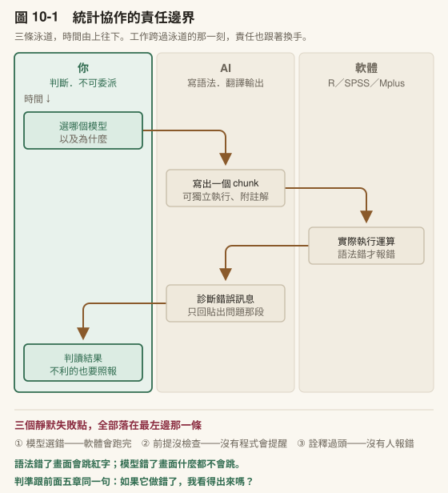
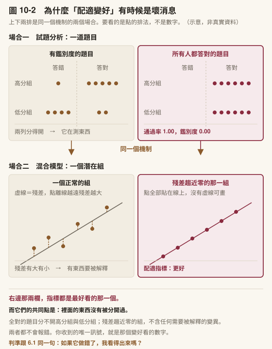
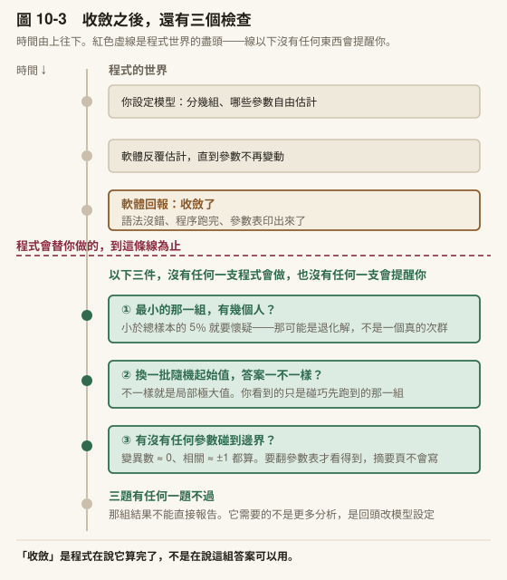
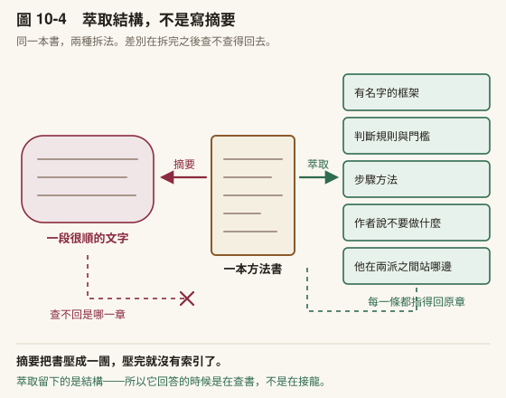

# 第 10 章　統計分析協作

> 書稿第 10 章＝課程第 10 週（3 小時）。2026-10-15 由原[第 6 章](../chapters/06-systematic-review.md)拆出（原 [6.1](../chapters/06-systematic-review.md#61-一般文獻回顧與系統性回顧差在哪裡)、[6.2](../chapters/06-systematic-review.md#62-先把問題和判準寫死再去搜)）。

---

## 本章導覽

**這一章回答三個問題**

1. 統計工作裡，哪些可以交出去，哪些交出去就會出事？
2. 它跑完了，你怎麼知道它跑對了？
3. 遇到一個你只知道名字的分析方法，怎麼辦？

**讀完你能夠**

- **畫出**統計輔助的責任界線，並說明為什麼這是全書風險最高的委派區
- **檢查**一份統計輸出的警告區，並說出哪些訊號代表結果不能用
- **建立**一個錨定在特定專書上的方法顧問，並驗證它的回答
- **建好**一個帶參考檔的方法顧問技能，並讓稿中每個數字指得出輸出檔與行號

**需要多久**

自學閱讀約 50 分鐘｜課堂 3 小時（概念 75 分、實作 105 分）

**進來之前，你要能**

- 拿出你要分析的資料，或[第 8 章](../chapters/08-finding-data.md)的資料可行性表；走計畫書路線的人，拿出你預計的分析方法
- 說出四步核實**抓不到**什麼（[第 7 章](../chapters/07-verification.md)）

**開始前請準備**：一份你自己的統計輸出（任何軟體、任何分析都行）；你常翻的一本方法論專書或其中一章。

---

## 章前導言

[第 8 章](../chapters/08-finding-data.md)你拿到了資料，或確定了要走計畫書路線；[第 9 章](../chapters/09-scale-development.md)需要自編工具的人做完了試題分析。這一章處理分析本身。

先講順序：**先讓資料說話，再把它寫成字。** 很多人其實是反過來做的。這跟懂不懂沒關係，問題在於寫作有一種假的進度感：你在文件裡打了兩千字，看得見、算得出來；而分析跑不出來的時候，螢幕上什麼都沒有。於是人會傾向先去寫看得見進度的部分，包括在分析還沒收斂的時候就開始寫討論。那樣寫出來的討論，寫的是「文獻預期會發生什麼」，不是「我的資料說了什麼」。所以分析在這一章，撰寫在[第 12 章](../chapters/12-writing.md)，中間隔著[第 11 章](../chapters/11-figures.md)的圖表。

**本章的邊界。** 本章不教統計方法。哪個方法適合你的資料、前提假設成不成立、效果量怎麼解讀，那是方法論課程與你的指導教授的事。本章教的是當你已經知道要用什麼方法時，工具能替你做到哪裡，以及界線畫在哪。10.2 處理另一種處境：你連方法都還不熟的時候，怎麼建一個問得下去的對象。

走計畫書路線的人，這一章照樣要做：用模擬資料把你預計的分析跑通一次，你會在交計畫書之前就發現方法配不配得上你的資料結構。

> **〔課堂〕開場 8 分鐘** 問全班：**「你上一次跑統計，有沒有哪一步是你照著做但說不出為什麼？」** 這個問題不是要抓人，是要建立本章的前提：說不出為什麼的那一步，就是你不能委派的那一步。因為**它做錯了你看不出來**。引用錯了還有原文可以對照，統計錯了往往沒有。

---

## 10.1 統計輔助的責任邊界

### 它算不動你的資料

先講一件容易誤解的事：AI 通常沒有在幫你「跑統計」。

當你在對話中請它做一個 t 檢定，它做的不是計算。它讀不到你的原始資料檔，它產出的是**語法**：一段你貼回自己的統計軟體裡才會執行的程式碼。真正跑統計的是 R、SPSS、Mplus，是你電腦上那個軟體，不是對話視窗。

**它比較像你委託人代抄一份編碼簿。** 對方把欄位名稱抄錯了，你一匯進 SPSS 就會發現讀不進去；但對方抄錯的如果是「這一題該正向計分還是反向計分」，資料照樣讀得進去，平均數照樣跑得出來，而且整份報表看起來完全正常。 **兩種錯的差別不在難度，在於軟體會不會報錯。**

（有些入口確實可以讀取你電腦上的檔案並執行程式碼。就算如此，執行的仍然是它寫的語法，判斷語法對不對的責任沒有轉移。差別只在於複製貼上這一步省掉了。）

這個區分之所以重要，是因為它決定了哪裡會出錯。語法有錯，軟體通常會報錯，你立刻知道。模型選錯了，軟體會安靜地跑完，給你一組漂亮的數字。

〔補充〕**「它現在寫程式幾乎不會錯了，還需要自己會嗎？」** 這個說法很常見，而且它的前半段大致是對的，語法層面它確實寫得比多數人快也比多數人穩。問題在於這句話**問錯了問題**。

語法錯誤本來就會當著你的面出聲，那不是風險所在。風險在上面那條界線的另一邊：反向計分的題目沒有反轉、遺漏值被當成 0 讀進來、類別變項被當成連續變項丟進模型、分組變項的水準順序跟你以為的相反。 **這幾種全部跑得完、全部不報錯、報表全部看起來正常。**

所以「幾乎不會錯」講的是會出聲的那一半，而那一半本來就不需要你太操心。不會出聲的那一半，正確率再高也不能讓你放心，**因為你沒有辦法知道這一次是不是那個例外。**

〔動手一下〕想一個你做過的分析。如果當初模型選錯了，你會從哪裡發現？如果答案是「我不確定」，那就是這一節要處理的地方。

### R 路線：一個 chunk 一個問題

如果你用 R，最順的協作方式是 R Markdown 的分區塊執行。

R Markdown 的檔案由多個 code chunk 組成。**一個 chunk 就是一段可以單獨按下去執行的程式碼，不必連前面的一起重跑。** 這個結構跟論文的分節是同一回事：你要改第四節的論證，不需要把前三節重打一次。

而它剛好對應了一個好的協作節奏：

```
前置設定 chunk（載入套件）
資料載入 chunk
資料清理 chunk          ← 出錯只重跑這裡
模型建立 chunk          ← 出錯只重跑這裡
結果輸出 chunk          ← 出錯只重跑這裡
```

協作的迴圈長這樣：

1. 你描述要做什麼分析，AI 產出一個可以獨立執行的 chunk
2. 你貼進 .Rmd，跑
3. 出錯 → 複製錯誤訊息和那一個 chunk（**不是整份檔案**）貼回去，讓它診斷
4. 修好 → 繼續下一個 chunk

第 3 步那個括號是重點。偵錯的時候只貼出問題的 chunk，理由有兩個：省脈絡（[第 3 章](../chapters/03-skills.md)講過的），以及讓它聚焦在真正的問題上。整份 .Rmd 貼進去，它會開始評論你其他部分的程式碼風格，那不是你現在需要的。

三種最常用的請求，各有固定的形狀：

**寫一個 chunk：** 說明你要做什麼分析、資料的欄位結構、要求 chunk 可以獨立執行並附註解。

**偵錯：** 貼錯誤訊息、貼出問題的 chunk、簡述資料長什麼樣子。三樣缺一不可，只貼錯誤訊息它只能猜。

**把輸出翻成論文語言：** 貼上 console 輸出，要求轉成 APA 格式的段落。這是整個統計協作裡風險相對低、CP 值高的一項，因為它處理的是表述，不是判斷；但它可能自己加料，輸出要逐句核對。

〔教你的 Claude 建這個〕把你的程式慣例寫成一份規格檔，這樣你就不必每次重講。統計協作最惱人的不是它寫不出來，是**它每次寫出來的風格都不一樣**：這次用一種寫法，下次用另一種，同一份分析檔看起來像三個人寫的。貼這段：

「請幫我建一個〈分析程式風格〉技能檔。先問我五件事，**一次問完**：（一）我用哪個語言與哪些套件？（二）**變數命名**要什麼形式？（三）數值報告的格式。小數幾位、p 值怎麼寫、要不要去前導零？（四）**顯著性標記**用哪一套？有沒有我明確不用的（例如邊際顯著）？（五）產出要交到哪裡去。螢幕看、貼進論文、還是輸出成表？問完之後把答案整理成一份規格，**每一條都要寫成可以檢查的形式**，不要寫『程式碼要清楚易讀』這種沒辦法判斷對錯的句子。」

⚠️ 規格檔裡不要寫「程式碼要清楚易讀」這種句子，它做不到也看不出來；「p 值三位小數、去前導零、下限寫 p < .001」它每次都做得到，你也每次都驗得出來。

**判準跟[第 3 章](../chapters/03-skills.md) [3.2](../chapters/03-skills.md#32-那個檔案裡該寫什麼) 一樣**：缺哪一條，會讓它必須用猜的？數值格式它一定會猜，而那正是投稿時被要求全篇改一遍的地方。

### SPSS 路線：先學會按 Paste

如果你的主力是 SPSS，運作邏輯不同但原則一樣：軟體負責算，AI 負責寫語法和翻譯結果。

有一個前提。多數 SPSS 使用者習慣點選單，這在協作上有兩個問題：分析過程無法重現，而且沒有任何東西可以貼給 AI 看。

解法很小：**選單操作到最後不要按 OK，改按 Paste。** SPSS 會把對應的語法貼進 Syntax 視窗。你不需要從零學語法，但你從此有了一份可重跑、可存檔、可貼給 AI 診斷的紀錄。

之後的協作跟 R 一樣：讓它寫語法（RECODE、COMPUTE、VARIABLE LABELS 之類），你貼回去跑；出錯貼錯誤訊息回來；跑出報表貼回去要 APA 段落。

〔補充〕**貼報表給 AI 的時候，貼的是統計結果，不是原始資料。** 平均數、係數、p 值、配適指標，這些沒有個資問題。含個案資料的原始資料列不要貼。如果你需要它看資料結構，貼變項清單，或去識別化的前三列就夠了。這一條在[第 16 章](../chapters/16-integrity.md) [16.1](../chapters/16-integrity.md#161-誠信的完整框架) 會再展開。

### 專業統計軟體：同一個模式

如果你的分析用的是 Mplus、HLM 這類專門軟體，協作模式跟上面兩條路線一樣，只是名稱換了：

AI 寫語法 → 你執行 → 輸出回流 → AI 幫你翻譯成論文語言。

這些軟體有自己的語法規則和輸出格式，而 AI 對它們的熟悉度通常不如 R。這帶出一條在專業軟體上特別要守的規則：

> **它對語法的任何宣稱，都要有證據。**

具體來說，當它告訴你「這個指令在這個版本會這樣運作」「這個選項可以這樣設定」，不要直接採信。跑一次看看，或者去查官方手冊。這不是不信任它，是因為冷門語法本來就是它最容易接龍出錯的地方，而錯誤的語法選項未必會報錯，可能只是安靜地做了另一件事。

〔補充〕**軟體越專門，你自己要懂得越多。** R 有龐大的社群討論可以支撐 AI 的訓練資料，專業軟體的資料量小得多。這不代表不能用它協作，而是代表你的驗收要更嚴。10.2 的做法在這裡特別有用。

### 界線畫在哪裡



〔圖 10-1〕把這一節講的協作攤成三條泳道：**你判斷、AI 寫、軟體算**。

第一，**你那一條在最上面，不是最下面。** 這不是排版順序，是時間順序：你那一條最前面的動作發生在別人動手**之前**：選模型在它寫語法之前，檢查前提在軟體跑之前。**這兩步留到最後才做就來不及了**，那時候你手上已經有一整套看起來很像回事的數字，而人很難推翻自己已經拿到的東西。

第二，圖下方那三個**靜默失敗點**全部落在你這條泳道上。「靜默」的意思很具體：沒有任何一支程式會為它們報錯。語法錯了畫面會跳紅字，模型選錯了畫面什麼都不會跳。它會跑完，然後給你結果。

把可以與不可以並排放，界線的位置就清楚了。

| AI 可以幫你 | AI 不能替你 |
|---|---|
| 寫出語法正確的程式碼 | 判斷哪個模型適合你的研究問題 |
| 偵錯並解釋錯誤原因 | 驗證資料品質與測量工具的效度 |
| 建議分析策略（你判斷適切性） | 解讀「為什麼」結果是這樣 |
| 把輸出轉成論文語言 | 保證分析邏輯與論文論點一致 |
| 提醒某方法的前提假設 | 決定違反假設時該怎麼辦 |

左欄跟右欄的差別不是難度，是**責任的性質**。左欄全部是形式層：語法對不對、格式對不對、表述通不通順。右欄全部是判斷層：這個模型能不能回答我的問題、這批資料撐不撐得住這個結論。

而這裡有一個[第 1 章](../chapters/01-setup.md)就出現過、到這一章變得最危險的性質：**它不會拒答。**

你問它「我的樣本 N=80，可以做結構方程模型嗎」，它不會說「這超出我能判斷的範圍」。它會給你一段有條件的、聽起來很專業的回答，可能還會引用某個經驗法則。那段回答可能是對的，也可能是把三個不同來源的建議混在一起接龍出來的。你無法從語氣分辨。

〔動手一下〕拿一個你自己的分析情境去問它一個方法選擇的問題，看它怎麼回答。特別注意它有沒有標明「這個建議的依據是什麼」。多數時候不會，而這正是 10.2 要解的問題。

> **〔課堂〕10.1 界線畫在哪裡，15 分鐘** 統計輸出轉 APA 段落現場演練。講師貼一份輸出（任何軟體），示範一次轉換，然後把 AI 產出的段落逐句檢查：哪些數字對？哪些詮釋是它自己加的？ **重點在最後那個檢查**，不在轉換有多方便。常見的自動加料：把相關講成影響、把顯著講成重要、把未檢定的差異寫成有差異。

### 帶走這一節

- 它產出的是**語法**，不是計算。真正跑統計的是你電腦上那個軟體
- 語法錯了通常會報錯，你立刻知道；**模型選錯會安靜跑完，給你一組漂亮的數字**
- 偵錯只貼出問題的那一段，不貼整份檔案
- SPSS 使用者最小的改變：選單操作到最後**按 Paste 不按 OK**
- 界線不是難度，是責任性質：左欄形式層可委派，右欄判斷層不可
- **它不會拒答。** 語氣分辨不出它的建議是整合來的還是接龍來的

---

### 它跑完了不代表跑對了

前面講了一條界線：語法錯通常會報錯，模型選錯不會。再往前一步：**模型選對了，跑完了，結果也出來了，但那組結果是假的。**

這叫**數值病態**：**程式順利收斂了，但它交給你的那組估計值在統計上站不住。**

**想像一道所有人都答對的題目。** 通過率 1.00，看起來漂亮；而它的鑑別度是零，它跟總分之間算不出任何關係，因為它根本沒有把任何人分開。你不會說這題很好，你會說這題沒在測東西。

**退化解裡那個殘差趨近零的組，就是模型裡那道所有人都答對的題目。** 它讓整體的配適看起來很好，正是因為它本身不含任何需要被解釋的東西。配適看起來好，是你唯一收到的訊號。



〔圖 10-2〕上下兩排是同一個機制的兩個場合。 **要看的是點的排法**：左邊散得開，右邊全部擠在同一格。擠在同一格的那一欄，指標都是最好看的那一個，而它們什麼都沒有分開。

數值病態常出現在混合模型（潛在類別、成長混合模型、潛在剖面分析），邊界解也會出現在因素分析與結構方程模型，它長這樣：

| 訊號 | 長什麼樣 | 為什麼危險 |
|---|---|---|
| **退化解** | 某一組的殘差趨近零，或人數只有個位數 | 程式跑完不報錯，配適指標甚至變好，因為一個幾乎沒有變異的組當然配適得好 |
| **邊界解** | 變異數估計碰到零的邊界（Heywood case），或相關矩陣不正定 | 有些軟體會印警告，有些不會。不印的那些就是 10.1 講的靜默失敗 |
| **局部極大值** | 每次跑出來的結果不一樣，換一組起始值就換一組答案 | 你永遠只看到你碰巧跑出來的那一組。你不會知道還有另一組，除非你主動用多組隨機起始值去測 |

退化解：某一組的殘差趨近零，配適指標顯示「最佳解」但在統計上根本不可解讀，因為一個幾乎沒有變異的組本身沒有需要被解釋的東西。邊界解：變異數估計卡在零上，表面上收斂了，要到你去查參數表才發現有一列不對。局部極大值：只跑一批起始值就定案，換一批之後類別結構完全不同，你先前報告的那個解，只是碰巧先到的那一個。

〔補充〕**上表出現的兩個名詞。**「Heywood case」是這類問題最早的專有名稱，指估出來的變異數是負的、或恰好等於零。變異數在定義上不可能為負，所以它一出現就代表模型設定與資料之間有地方不相容。「不正定」講的是相關矩陣本身：一組相關係數如果彼此矛盾（A 與 B 高相關、B 與 C 高相關、A 與 C 卻負相關到不合理的程度），在幾何上就找不到任何一組資料能同時滿足它們。**兩個名詞指的都不是「數字不好看」，是「這組數字不可能同時為真」。**



〔圖 10-3〕紅色虛線以上是軟體會做的，**線以下沒有任何東西會提醒你。** 三個檢查全部落在線以下。

**一個判準**：如果你用的是任何「把人分成幾組」的方法，跑完之後問自己三件事：

1. **最小那一組有幾個人？** 人數很少就要懷疑；要用數字門檻，先找到它的出處
2. **換一批隨機起始值，答案一不一樣？** 不一樣就是局部極大值
3. **有沒有任何一個參數估計碰到邊界？** 變異數 ≈ 0、相關 ≈ ±1 都是

三題有任何一題不過，那組結果**要先查清楚才能報告**。它需要的不是更多分析，是回頭重新檢查模型設定。

⚠️ **AI 不會替你做這三個檢查。** 你問它「這個結果合理嗎」，它會看配適指標，而配適指標恰好是退化解看起來最漂亮的地方。這就是 10.1 那張圖裡三個靜默失敗點全部落在你這條泳道上的原因：選模型、判資料品質、撐多強的主張，判斷層的三件事都在你手上。

### 做法本身是你們自己編的

上面三個檢查擋的是軟體交出一組站不住的數字。還有一種錯，軟體完全沒有參與：**分析的程序或報表的格式，是你跟 AI 討論出來的，而那個領域從來沒有人這樣做過。** 它不報錯，數字算得出來，排出來的步驟看起來還特別嚴謹。它唯一會被抓到的時候，是有人問「這個做法是參照哪一篇」。

一個實際的例子。一份後設分析要檢查十幾個研究特徵會不會改變結果，AI 排出的分析計畫裡有三件看起來很周到的事：跨十五個調節變項做多重比較校正；先把三個方法學變項固定成控制區塊，再逐一加入候選變項；一張表並列所有變項，用校正後的數值決定誰算數。三件都跑完了，結果寫進了報告。

回頭去讀同一種方法的 25 份已發表全文，多重比較校正出現的地方，全部是在**同一個分析之內**、跨那個分析自己的幾個參數；跨調節變項做校正的，0 處。另外兩件也查不到前例。改照該方法的方法學文獻的報法（先做一次綜合檢定，顯著才看個別參數，再用原本的單位講它實際代表什麼）之後，原本判為不顯著的結果有幾個變成顯著。例如「問卷是否搭配課程或介入」，在倫理那一個面向的負荷上，Δχ²(1) = 7.22，*p* = .007。

所以自編的做法不只是格式跟別人不一樣，**它會改變哪些結果算得上顯著**。校正放錯層級，門檻就整個訂錯了。

AI 特別容易產出這種錯，因為它熟悉很多領域的常規：迴歸的階層式控制、實驗設計的事後比較、機器學習的特徵篩選。每一個在原本的領域都是對的，搬到你的方法裡就成了另一種做法。

開跑之前問三件事：

1. **這個方法的方法學正本怎麼做？** 先讀。手上已經有同類實證研究，就先看它們的表怎麼排，不要憑印象排分析順序或表格欄位
2. **這個統計程序在這個領域用在哪一層？** 同一個多重比較校正，用在一個分析之內跟用在十幾個分析之間，是兩種做法
3. **查不到前例的時候還要不要做？** 要做就在方法段寫明這是自訂的、代價是什麼；每一張表註明格式依據哪一篇的哪一張表，自訂的就寫自訂

這三題可以寫進 10.1〈R 路線〉那份規格檔，當成開跑前的一條關卡。第一版只要一句：「設計任何分析程序、校正方式或報表格式之前，先告訴我它參照哪一篇已發表的文獻；指不出來就停下來跟我說查不到，不要先跑。」

---

## 10.2 當你遇到不會的方法

### 一個真實的處境

你的研究問題需要一個你沒學過的方法。可能是你的資料有巢狀結構、可能是你要處理縱貫追蹤、可能是審查者要求你補一個你只在論文裡讀過名字的分析。

傳統上你有三條路：找懂的人問、去修一門課、把那本厚厚的方法論專書搬出來自己啃。三條路都對，但都很慢。而現在多了一條看起來很快的路：問 AI。

10.1 已經說了這條路的問題：它會回答，但你無法分辨那個回答的依據是什麼。它可能整合了教科書的正確說法，也可能把不同學派的建議混成一段。

有一個做法可以解決這件事，也是從[第 3 章](../chapters/03-skills.md)開始建技能那條線的收束。

### 把一本書變成一個顧問



〔圖 10-4〕左邊那一團也是從同一本書來的。 **差別不在寫得好不好，在拆完之後還指不指得回原章**。

[第 3 章](../chapters/03-skills.md)教你建立自己的技能。[第 5 章](../chapters/05-literature-search.md)你用它跑文獻流程。[第 12 章](../chapters/12-writing.md)你會用它寫作。這些工具的內容都來自你自己的流程。

現在做一件不同的事：把你領域的權威教科書轉成你自己的技能。

一本方法論專書拆解之後，包含幾類東西：核心框架、判斷規則（樣本數要多少、配適指標的門檻在哪）、術語定義、以及各章的具體方法。把這些結構化地萃取出來，存成一個技能，你就得到一個**會引用書中規則回答問題的顧問**，而不是一個憑接龍生成建議的對話。

用一個專門做這件事的轉換技能（附錄 M-2.18 的 book-to-skill），實際的操作流程大致是：

1. 給它書的檔案，說明你要把它轉成技能
2. 它會問這是哪種內容（含公式表格的技術型 vs 以敘述為主的文字型），這決定萃取策略
3. **它會先給你一份成本估算**：這本書多少頁、大約要花多久。厚的書可以先要求它「只分析不生成」，看一份萃取報告（偵測到哪些框架、哪些章節、建議的技能名稱），確認方向對了再正式轉換
4. 它會問這個技能要幫你做什麼（套用作者框架？用作者的思考方式？純查閱？），這決定產出的深度
5. 生成。產物通常是一個主檔（核心框架與索引，永遠載入）加上分章檔案（用到才載入）

第 5 點的結構呼應[第 3 章](../chapters/03-skills.md)講的脈絡管理：不是把整本書塞進對話，而是切塊，需要哪一章才載入哪一章。

**這正是你用那本書的方式。** 目錄與索引你翻熟了，內文你只在需要的時候翻開那一章；沒有人是把整本書背下來才開始查表的。主檔就是那份目錄，分章檔就是你翻開的那一章。

然後你就可以直接問：

> 用這本書的框架，判斷我這個分析的樣本數夠不夠。

> 這本書建議的配適度指標門檻是多少？在什麼條件下可以放寬？

差別在哪裡？**它回答的時候有一本你選定的書當依據，而不是只憑接龍。** 你知道它的依據是什麼，你可以翻回去核對，你也知道當這本書的立場跟另一個學派不同時，它給你的是哪一邊。

〔教你的 Claude 建這個〕**萃取結構，不要摘要。** 這一點要寫進指令裡。貼這段：

「我要把〔書名〕轉成一份我自己的方法顧問技能。 **請萃取結構，不要寫摘要。** 我要的是五類東西：（一）有名字的框架。作者替它取的名字要原樣保留，**不要換成你覺得比較好懂的同義詞**；（二）**可行動的判斷規則**。門檻值、樣本數建議、什麼情況下可以放寬；（三）**步驟方法**；（四）反面樣式：作者說不要做什麼，以及為什麼；（五）作者的**判斷傾向**。他在兩派說法之間站哪一邊。先**只做分析不要生成檔案**：給我一份清單，列出你偵測到哪些框架、分佈在哪幾章、建議切成幾個檔案。我確認之後再生成。」

**「不要換同義詞」：**框架的名字是你回頭查書的索引：名字被改掉，你就查不回原文，這份技能也就失去它唯一勝過一般對話的地方。可核對。

**「先只做分析不要生成」：**厚的書轉一次要很久，而你多半到看見萃取清單才會發現方向不對。例如它把整本書的重點放在你不需要的那三章。

〔補充〕**這不會取代你讀書。** 你仍然需要理解那個方法在做什麼，否則你連問對問題都做不到。它取代的是「每次都要翻回去查那本書[第 8 章](../chapters/08-finding-data.md)第 3 節的那張表」這件事。判斷是你的，查表是它的。這正是本書從[第 1 章](../chapters/01-setup.md)講到現在的同一條界線。

### 這就是「工具會成長」的意思

回頭看你走過的路。

[第 3 章](../chapters/03-skills.md)你從一個摩擦點出發，建了一個五段的技能檔，只填了〈使用者背景〉一段。[第 3 章](../chapters/03-skills.md)你把文獻筆記的七欄規格加了進去，並發現有個欄位老是抓錯方向，你又改了一次。[第 12 章](../chapters/12-writing.md)你在寫作的時候發現某個格式要求每次都要重講，你也把它寫進去。

現在你把一本書變成了一個技能。

這四步是同一件事的四個階段：**你的工具正在往你的方向長。** 而它從第一天起就是你的，因為它的每一段都源自你自己遇到的摩擦，不是從別人那裡繼承來的。

如果[第 3 章](../chapters/03-skills.md)你抄了一個現成的技能來改，你現在擁有的會是一個「大致堪用但你說不清楚為什麼那樣設計」的東西。而你自己長出來的這個，每一行你都知道當初為什麼加。**能不能說出為什麼，決定你未來能不能判斷它該不該改。**

這個過程沒有終點，投入的時間之後都會回收。你今天花一小時把一本書轉成技能，未來三年每次遇到相關問題都省下翻書的時間。你今天花十分鐘把一個修改寫進技能，未來每一次呼叫都不用重講。

目標是讓每次產出只需要你調整兩成，而不是八成。

### 一套長大的工具長什麼樣

你可能會想問：長到最後是什麼樣子？

我自己那一套已經改過十幾輪。它處理引用查核、論文撰寫、審查回應、統計分析這幾件事。把它們攤開來看，有十二個反覆出現的設計，而這本書前面已經教過每一個的種子。

舉三個最有代表性的。

**第一個是角色分工。** [第 3 章](../chapters/03-skills.md)教你指定 AI 的表現（Performance），成熟版是三個利害衝突的角色接力：一個負責找出可用的來源，一個負責逐筆質疑並在打掉之後給替代方案，第三個只看全篇分布（作者是不是過度集中、一句是不是堆了太多引用、有沒有已撤稿的）。三者的動機是衝突的，正因為衝突才互相抓得到。 ⚠️ 最小可用版只要兩個角色，但**不要在同一次對話裡**：同一次對話裡它記得自己剛寫了什麼，於是質疑會客氣。

**第二個是人的關卡。** [第 4 章](../chapters/04-research-question.md) [4.2](../chapters/04-research-question.md#42-該不該交給它) 那張風險表（可偵測性 × 不可逆性）在成熟工作流裡變成流程中途的強制停點。我的審稿回應工具有三個關卡，全部落在同一種位置：這一步做下去就難回頭。其中一個關卡帶著一條硬規則。補跑的統計若結果不利於原結論，不得靜默不報。那條規則把誠信寫成了機制。

**第三個是迴圈上限。** 本書[第 13 章](../chapters/13-revision.md)的修稿三輪，其實就是這個模式：迴圈沒有上限就會一直改，而每一輪的邊際收益遞減、風險遞增。改久了你會把原本對的地方改壞。

其餘九個（模式路由、階段編號、逐項判準清單、前置存在查核、覆蓋範圍聲明、反面規則、技能間分工、規格化交接、版本與變更紀錄）連同**十二個模式的長出順序**與三份可以直接貼的範本，全部收在**[附錄 F](../appendix/F-skill-library.md)**。

那份附錄的長出順序表，第一列只有一件事：第一週只填〈使用者背景〉一段。原因不是那樣比較容易，是**其餘十一個模式都需要「你已經知道自己的摩擦在哪」這個前提**，而那個前提只能靠實際用出來。反過來做的後果很具體：你花一個下午設計了三種模式、七項判準、兩個關卡，然後發現你猜的摩擦點不是真的摩擦點，整套沒有一項用得上。

〔補充〕**為什麼這一段講的是「我的」工具而不是「正確的」工具。** 你長不出跟我一樣的十二個模式，你會長出你自己的那幾個。每一個模式都對應一次被自己的工具坑到的經驗：模式路由來自「它太慢我不想用」，反面規則來自「它又做了那件事」，覆蓋範圍聲明來自「我以為它檢查過了」。抄來的模式解決的是我的摩擦，不是你的。

> **〔課堂〕10.2 建技術顧問，30 分鐘實作** 學生現場把一本方法書（或一個章節）轉成技能，並實際提問。 **課前必做**：確認學生手上有電子檔，並先自己跑過一次確認流程與耗時。厚書可能要跑十分鐘以上，課堂時間不夠的話改用單一章節。提問環節比生成環節重要，留至少 10 分鐘讓學生問自己領域的真問題。

### 帶走這一節

- 把書轉成技能，差別在於**它回答時有一本你選定的書當依據，不是只憑接龍**
- 你知道依據是什麼、可以翻回去核對、也知道學派分歧時它站哪一邊
- 產物切塊：主檔常駐、分章按需載入，這是[第 3 章](../chapters/03-skills.md)脈絡管理的應用
- **它不取代你讀書。** 取代的是每次翻回去查那張表
- 建技能 → 改技能 → 寫進格式要求 → 把書變顧問，這四步是同一件事的四個階段
- 目標不是完美的工具，是**每次產出只需要你調整兩成**
- 一套長大的工具有十二個反覆出現的設計，**本書前面教過每一個的種子**（完整版見[附錄 F](../appendix/F-skill-library.md)）
- 那十二個有依賴順序，**第一週只填〈使用者背景〉一段**；其餘都需要你先知道自己的摩擦在哪

---
---

## 10.3 教育研究實例

### 讀一本方法論專書

有些東西不是一篇論文，是一整本書。你要學一個新的分析方法，手上是一本四百頁的專書。

讀完它需要兩週，而你下週就要決定用不用這個方法。

這裡的做法是：**不是把它讀完存起來，而是把它變成一個可以反覆提問的顧問。** 你把書的內容整理成一個結構化的知識來源，之後每次遇到這個方法的問題，就去問它，而它的回答錨定在那本書上，不是錨定在機率接龍上。

完整做法在 10.2。**本書不供應所有領域的方法細節，而是教你怎麼替自己建立細節的來源。** 你的領域跟我的不一樣，該由你來建。
---

## 本章建置：方法顧問，以及每個數字的出處

這一節建一個技能、加一條規則。技能把 10.2〈把一本書變成一個顧問〉的產物放進工作台，並示範一個技能怎麼帶著自己的參考檔。規則管的是稿子裡的每一個數字：它要指得出是從哪一份輸出、第幾行來的。

〔課堂〕約 35 分鐘。第 1 步只建骨架、放一章進去，整本書的轉換留作課後；第 2 步 10 分鐘。

### 這一節完成之後，工作台多了什麼

```text
研究工作台/
├── 專案_我的論文/
│   └── 分析/輸出/                       ← 新增：統計軟體的原始輸出放這裡
└── .claude/skills/
    └── method-advisor/                  ← 新增
        ├── SKILL.md
        └── chapters/
            └── ch08_樣本數與檢定力.md
```

### 第 1 步　方法顧問：一個帶參考檔的技能

10.2 那個「萃取結構，不要摘要」的轉換，產物是一個主檔加上分章檔。這一步建它在工作台裡的位置。

建資料夾 `.claude/skills/method-advisor/`，裡面放主檔 `SKILL.md`，和一個 `chapters/` 子資料夾。主檔只放目錄與規則：

```text
---
name: method-advisor
description: 依〔書名〕回答研究方法問題：樣本數、檢定力、配適指標門檻、模型選擇。使用者問「樣本數夠不夠」「這個門檻是多少」「該用哪個方法」時使用。
---

# 方法顧問：〔作者（年份）〕〔書名〕

## 怎麼回答
1. 先判斷問題落在哪一章，只讀那一章的檔案。
2. 回答時引那一章裡的規則原文，並寫出書的章節與頁碼。
3. 書裡沒有處理這個問題，直接說「這本書沒有處理」，不要用一般知識補。
4. 書裡的規則有適用條件（樣本大小、資料型態），一併寫出來。

## 章節索引
| 檔案 | 處理什麼 |
|---|---|
| chapters/ch08_樣本數與檢定力.md | 各種分析的最低樣本數、檢定力分析怎麼做 |
| chapters/ch12_配適指標.md | 各指標的門檻、什麼時候可以放寬 |

## 作者的判斷傾向
（兩派說法之間，作者站哪一邊。轉換時萃取的第五類寫在這裡。）
```

`chapters/` 底下的分章檔，就是 10.2 轉換時產出的那些。**主檔每次都會被讀，分章檔用到才讀**，這是 [3.3](../chapters/03-skills.md#33-為什麼你的對話會愈用愈鈍) 講的脈絡管理放進檔案結構裡：書再厚，佔的空間只有主檔那一頁加上你問到的那一章。

章節索引那張表是讓它找得到該讀哪一章的唯一依據。表裡沒列的檔案，它不知道要去讀。每加一個分章檔，就在表裡加一列。

〈怎麼回答〉第 3 條是這個技能跟一般對話的差別。10.2 說它的價值在「你知道它的依據是什麼」；書裡沒有的東西它用一般知識補上，你就分不出哪一句是書的、哪一句是接龍。

### 第 2 步　數字要指得出出處

在 `專案_我的論文/CLAUDE.md` 加兩條：

```text
- 統計軟體的原始輸出一律存進 `分析/輸出/`，檔名帶日期，跑一次存一份，不覆蓋舊的。
- 稿子裡的每一個統計數字，都要指得出它在 `分析/輸出/` 哪一個檔案的第幾行。指不出來的數字不准寫進稿子。
```

10.1〈它跑完了不代表跑對了〉講的是輸出本身的問題。這兩條管的是輸出跟稿子之間的那一段：一個數字從輸出抄到摘要、從摘要抄到對話、再從對話抄進稿子，每抄一次都可能抄錯，而且抄錯的數字格式完全正確。**只在對話裡出現過、或只在某份摘要裡出現過的數字，一律當成還沒核實。**

有了這兩條，交稿前你可以貼這段給它：

```text
列出 `專案_我的論文/稿件/` 裡的每一個統計數字，
每一個寫出它在 `分析/輸出/` 的哪個檔案、第幾行，以及那一行的原文。
找不到出處的，列在最後一張清單。不要改稿子。
```

最後那張清單就是你交稿前要處理的東西。

### 驗收

**驗收一：顧問知道自己不知道。** 問方法顧問一個那本書確定沒有處理的問題。做對了，它說書裡沒有。它給了答案，把答案裡引的頁碼翻開來看。

**驗收二：它只讀該讀的那一章。** 問一個落在某一章的問題，要它回報讀了哪幾個檔案。做對了，它只讀了主檔和那一章。

**驗收三：數字找得到家。** 跑一次上面那段數字溯源的提示詞。最後那張清單如果是空的，抽三個數字自己打開輸出檔對一次。

### 出事的時候

| 你看到的 | 多半是 | 怎麼辦 |
|---|---|---|
| 顧問的回答沒有頁碼 | 分章檔裡本來就沒有頁碼 | 回頭檢查轉換時有沒有保留頁碼；沒有的話，該章要重新萃取 |
| 它把每一章都讀進來 | 主檔的章節索引寫得太含糊 | 把每一列「處理什麼」寫成具體的問題類型 |
| 數字溯源找不到出處，但數字是對的 | 你在對話裡請它算過、沒存輸出 | 重跑一次，把輸出存進 `分析/輸出/`，再對一次 |

### 這一步留給下一章的

稿子裡的每一個數字現在都指得出輸出檔。[第 11 章](../chapters/11-figures.md)用同一個原則處理圖：圖上的每一個數字，也要從同一份輸出算出來。

### 帶走這一節

- 技能可以帶參考檔：**主檔每次讀，分章檔用到才讀**；主檔裡的索引表是它找得到分章檔的唯一依據
- 書裡沒有的，**要它說沒有**，不要用一般知識補
- 稿子裡的數字要指得出**輸出檔與行號**；只在對話裡出現過的數字，當作還沒核實


---

## 10.4 動手實作

### 實作一：統計輸出轉 APA 段落（20 分鐘）

拿出你準備的統計輸出（任何軟體、任何分析都可以）。

1. 貼進 Claude，要求轉成 APA 格式的中文論文段落（5 分鐘）
2. **逐句檢查它產出的段落**（10 分鐘）：
- 每個數字都對嗎？
- 有沒有它自己加上去的詮釋？（常見：把相關寫成影響、把顯著寫成重要）
- 有沒有你的輸出裡沒有的資訊出現在段落裡？
3. 記下你抓到的問題（5 分鐘）

**轉 APA 最常見的三種加料**，逐句檢查時盯這三個：

1. 把**相關**寫成**影響**（你的輸出裡沒有因果，它自己補上去的）
2. 把**顯著**寫成**重要**（統計顯著不等於實質重要，這是兩件事）
3. 把**未檢定的差異**寫成**有差異**（描述統計看起來有落差，它就替你下結論）

三種都有一個共同形狀：**它把你的輸出往「更有話可說」的方向推了一格。** 這正是它擅長的接龍在做的事，不是它想騙你。

### 實作二：建立你的技術顧問（30 分鐘）

拿出你常翻的那本方法論教科書（或其中一章）。

1. 轉成技能。厚書先要求「只分析不生成」，看萃取報告確認方向（15 分鐘）。跑錯方向再重跑，成本是雙倍的
2. 生成完成後，問它三個你自己領域的真問題（15 分鐘）
3. **挑一個回答，翻回書裡核對。** 它引的規則對嗎？有沒有漏掉條件？
### 跑通之後，把它寫下來

一個分析跑通的當下，你腦子裡有全部的脈絡：為什麼用這個參數、那個錯誤訊息是什麼意思、哪一步順序不能換。**三個月後這些你多半記不得了**，而你下次遇到同一個問題時，會從頭再debug 一次。

技術筆記處理的就是這件事。它跟概念筆記不同：概念筆記記你想通了什麼，技術筆記記**怎麼做**。

我自己那個產技術筆記的工具，模板有兩條硬規則值得抄：

**第一，程式碼要能直接複製貼上執行，說明文字放在程式碼外面，不要塞進註解裡。** 理由很實際。你未來是貼它，不是讀它。註解裡的說明會跟著被貼進去，還要手動刪。

**第二，每個步驟的程式碼區塊控制在十到二十五行，超過就拆成子步驟。** 這個限制不是排版潔癖：一個超過二十五行的區塊，代表那一步其實包含好幾件事，而你未來出錯時會不知道是哪一行壞了。

還有一條容易漏的：判斷標準要寫進去。「跑出來 fit 不好就調整」是沒有用的筆記，未來的你不知道多少算不好。要寫的是具體門檻，以及**那個門檻是誰訂的**。因為門檻會隨領域慣例變動，寫了出處你才知道要不要跟著改。

---

### 技能要點

| 實作 | 關鍵動作 | 做對了長什麼樣 | 常見卡點 |
|---|---|---|---|
| 一 · 轉 APA | **逐句比對**它加了什麼 | 你抓到至少一處它自己加上去的詮釋 | 讀起來很順就收下。**順不是你要檢查的維度** |
| 二 · 技術顧問 | 挑一個回答**翻回書裡核對** | 你確認它引的規則對，或抓到它漏了條件 | 只驗生成不驗回答。這個實作的價值全在核對那一步 |

兩個實作是同一個動作的兩種場景：它給了東西，你逐項回頭對。實作一對數字，實作二對書。它產出的東西通常是順的。順不是驗收標準，**對得上才是**。

### 當週小task

繳交三樣：

1. 統計輸出轉 APA 的比對紀錄（含你抓到的加料，至少一處）
2. 你建的技術顧問，以及一則「翻回書裡核對」的紀錄
3. 一則技術筆記：你這次跑通的分析步驟，程式碼能直接貼上執行

走計畫書路線的人，第 1 項用模擬資料的輸出。

---

## 10.5 常見迷思

**迷思一：「AI 給的統計建議可以直接用，反正它讀過所有方法論教科書。」**

*為什麼錯*：它讀過的是文字，不是理解。而且方法論本身存在學派分歧，同一個問題不同教科書給的門檻不一樣。它會給你一個平均值，而那個平均值在你的具體情境裡可能兩邊都不對。更麻煩的是它不會標明依據，你分辨不出這個建議來自哪裡。

*正確版本*：把判斷依據固定下來（10.2 的做法），或者去問一個真的懂的人。方法選擇是這整條工作流裡最不該省的一步。

**迷思二：「先把文獻回顧寫完，再開始跑分析。」**

*為什麼錯*：文獻回顧確實可以先動筆，但**你的結果與討論寫不出來，除非分析先跑過**。在分析還沒收斂的時候就開始寫討論，寫出來的是「文獻預期會發生什麼」，不是「我的資料說了什麼」。更麻煩的是一種順序造成的偏誤：先寫好討論，再回頭看結果，你會傾向找到支持你已經寫下的那段話的東西。

*正確版本*：**先讓資料說話，再把它寫成字。** 文獻回顧可以平行進行，結果與討論不行。

**迷思三：「腳本跑完沒有報錯，結果就可以用。」**

*為什麼錯*：模型沒有收斂、標準誤算不出來、估計值落在不合理的範圍，很多統計軟體都只在輸出的警告區寫一行，程式照樣正常結束、照樣產出表格。

*正確版本*：每跑一次，先讀警告區，再讀係數。10.1〈它跑完了不代表跑對了〉的檢查清單，每一次都要過。

---

> ### 〈責任落點〉 - 選擇統計模型、判斷資料品質、解讀結果：**你**。這是全書風險最高的委派區 - 決定哪些資料可以進入對話：**你**，並以資料的使用條款與機構規範為準 - 判斷一個方法顧問的回答對不對：**你**。它錨定在那本書上，但引對條文是另一回事 - 讀警告區：**你**。它跑完了不代表跑對了 - 工具負責的是：語法、偵錯、翻譯輸出、查它被餵過的書

---

## 10.6 章末整理

### 三句話帶走

1. **先讓資料說話，再把它寫成字。**
2. 統計是全書風險最高的委派區，因為**它的錯誤最不容易浮出水面**。
3. 方法顧問的價值在於**你知道它的依據是哪一本書**，可以翻回去核對。

### 回到開場

開場問你：上一次跑統計，有沒有哪一步是照著做但說不出為什麼。

如果有，那一步就是你這一章真正要處理的。10.2 給的做法不是替你學會它，是給你一個**問得下去的對象**：一個錨定在你選的那本書上、而不是錨定在機率接龍上的顧問。但它不會取代你讀書。你仍然要理解那個方法在做什麼，否則你連問對問題都做不到，也分辨不出它的回答有沒有漏掉條件。


〔圖 10-5〕亮起來的是這一章教的位置，淡掉的是你在別章會站上去的地方。

### 拿去跟人討論

找一個同學、同事或指導教授，挑一題聊十分鐘。

1. 各自說一個你照著做、但說不出為什麼的分析步驟。對方聽得懂那一步在幹嘛嗎？
2. 統計協作裡哪一步你們願意交出去、哪一步不願意？兩人的界線畫在同一個地方嗎？
3. 你們各自會挑哪一本書做方法顧問？那一本書在你們領域是會被拿來吵架的那一本嗎？

### 下章預告

數字有了，而且每一個都指得出輸出檔。[第 11 章](../chapters/11-figures.md)處理同一批數字的另一種樣子：圖與表。含真實數據的圖要從資料算出來，概念圖可以讓它畫，兩者的責任不一樣。

---

## 延伸資源

**外部資源**

- **統計方法論教科書**：10.2 把書轉成方法顧問，需要你自己選一本。挑你這個領域引用率高、而且你已經有電子檔的那一本。**這一本選錯不會壞掉，但它照樣答得頭頭是道，只是用你的審查者不使用的那一套術語與判準在答。**
- **Skills 官方文件**：[https://code.claude.com/docs/en/skills](https://code.claude.com/docs/en/skills) 10.2 把書轉成技能之後，你遲早會想自己改它。這一頁是改的依據。
- **Anthropic — Best practices for Claude Code**：[https://www.anthropic.com/engineering/claude-code-best-practices](https://www.anthropic.com/engineering/claude-code-best-practices) 兩點跟本書重疊：先研究再規劃、不要讓它直接動手；以及脈絡會很快填滿，填滿之後品質下降（[第 3 章](../chapters/03-skills.md) [3.3](../chapters/03-skills.md#33-為什麼你的對話會愈用愈鈍)）。

**本書其他章節**

- **[第 3 章](../chapters/03-skills.md) [3.3](../chapters/03-skills.md#33-為什麼你的對話會愈用愈鈍)**：脈絡管理。10.2 的「產物切塊、按需載入」是它的直接應用
- **[第 8 章](../chapters/08-finding-data.md)**：找資料。本章分析的資料從那裡來
- **[第 11 章](../chapters/11-figures.md)**：圖表。本章的輸出在那裡畫成圖
- **[附錄 F](../appendix/F-skill-library.md)**：一套技能庫怎麼運作

---
