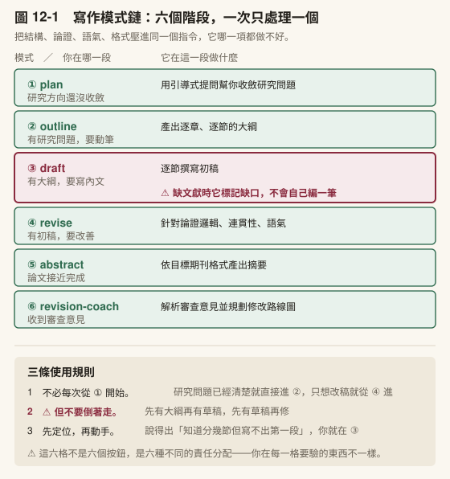
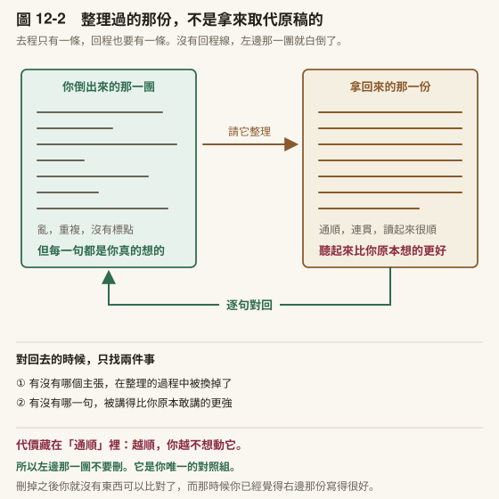
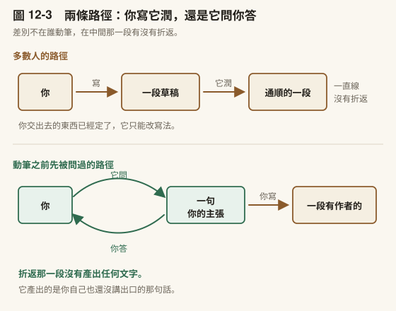
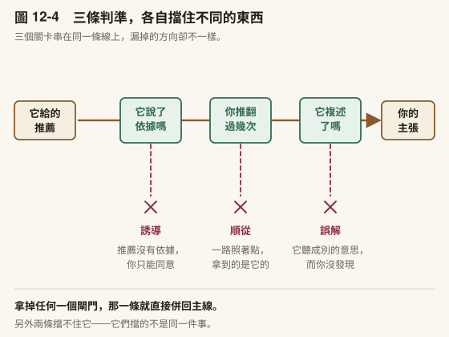
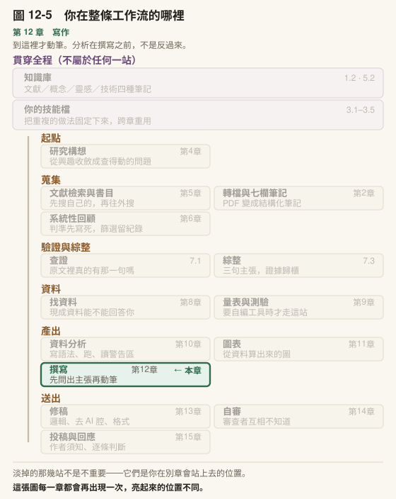

# 第 12 章　寫作：先問出主張

> 書稿第 12 章＝課程第 12 週（3 小時）。2026-10-15 由原[第 6 章](../chapters/06-systematic-review.md)拆出（原 [6.3](../chapters/06-systematic-review.md#63-檢索策略與檢索紀錄)、[6.4](../chapters/06-systematic-review.md#64-題摘篩選與全文篩選)）。

---

## 本章導覽

**這一章回答三個問題**

1. 三句主張怎麼變成論文段落？
2. 寫不出來的時候，差的是文字還是主張？
3. AI 寫出來的初稿，該用什麼標準驗收？

**讀完你能夠**

- **操作**寫作模式鏈，主動餵素材而不是等它自己找
- **完成**一次動筆前的訪談，說出一段文字要讀者接受的那一句
- **判斷**一句主張是你的，還是它推給你的
- **驗收**一段 AI 產出的初稿，逐句指出每句主張的證據來源
- **建好**先問主張再動筆的技能
- **對照**論文各節的傳統寫作要求（論證要素、回應他人、語步、文獻回顧、APA），並讓 AI 逐項檢查而不代寫

**需要多久**

自學閱讀約 60 分鐘｜課堂 3 小時（概念 80 分、實作 100 分）

**進來之前，你要能**

- 拿出[第 7 章](../chapters/07-verification.md)綜整四步驟歸好的容器內容
- 拿出[第 10 章](../chapters/10-statistics.md)的分析輸出與[第 11 章](../chapters/11-figures.md)的圖表（走計畫書路線的人，拿出預計的分析方法）

**開始前請準備**：一段你自己寫的、覺得「誰都寫得出來」的段落；[第 7 章](../chapters/07-verification.md)歸好的容器內容。

---

## 章前導言

[第 10 章](../chapters/10-statistics.md)結束時，你手上有一組指得出輸出檔的數字；[第 11 章](../chapters/11-figures.md)把其中幾個畫成了圖。這一章把它們寫成字。

先有分析結果、再動筆，這個順序有理由：分析還沒收斂就先寫討論，寫出來的是「文獻預期會發生什麼」，而你會傾向找到支持那段話的結果。

這一章處理四件事。12.1 是寫作模式鏈：大綱、草稿、修改各是一次對話，一次只想一件事。12.2 處理一種更常見的卡法：你打得出字，寫完卻覺得那一段誰都寫得出來。那時候你不缺文字，你缺的是主張，而主張要靠被問才講得出來。12.3 處理從大綱到意涵的幾個關卡：字數、術語、主動餵文獻、把結果寫成意涵。12.4 對照審查者與口試委員拿來檢查稿子的傳統寫作要求，讓它逐句標出，不讓它改。

> **〔課堂〕開場 6 分鐘** 請學生拿出那段「誰都寫得出來」的段落，只做一件事：用一句話寫下「這一段要讀者接受什麼」。寫不出來的人舉手。通常是多數。那個寫不出來的一句，就是 12.2 要問出來的東西。

---

## 12.1 寫作模式鏈

### 六種模式，一條流程

[第 7 章](../chapters/07-verification.md) [7.3](../chapters/07-verification.md#73-從二十篇筆記到一個論點) 處理的是寫作之前的事。現在你有了三句主張（或兩句，或被 AI 修正過的四句），下一步是把它們寫成論文段落。

一般人使用 AI 寫作的方式是這樣的：把所有要求寫在一個對話視窗裡，收到一段文字，改一改，再請它改另一段。這個做法的問題不在效率，在於你把論文的所有需求壓進同一個指令：結構、論證、語氣、格式全部一次要到位。AI 在接龍的時候要同時顧的維度一多，每一個都容易顧不好。

**分工的道理跟論文的章節一樣。** 你不會在方法章裡處理文獻爭論，也不會在結果章裡交代研究動機—— 不是因為那些內容不重要，是因為一節同時扛四件事，四件都會扛不好。

寫作工具把這件事拆開了，只是它切開的是**你跟它的每一次對話**，不是稿件的每一節。它定義了六種模式，每一種只處理論文生命週期的一個階段：

⚠️ **這六種模式不是我發明的。** 它們出自 Cheng-I Wu 的 [Academic Research Skills](https://github.com/Imbad0202/academic-research-skills)，本書這張表是依它的撰寫流程整理出的六種用法；本書作者改寫的版本有十一種模式（例如 plan、outline-only、intro-only、revision、revision-coach、abstract-only），名稱與這張表不一一對應，判準與範例改為教育研究取向。下面那個 `[MATERIAL GAP]` 標記也是它的設計。詳細的血緣與授權見書末〈出處〉。

| 模式 | 什麼時候用 | 做什麼 |
|---|---|---|
| plan | 研究方向還沒收斂 | 透過引導式提問幫你收斂研究問題 |
| outline | 有研究問題，要動筆 | 產出逐章、逐節的大綱 |
| draft | 有大綱，要寫內文 | 逐節撰寫初稿 |
| revise | 有初稿，要改善 | 針對論證邏輯、連貫性、語氣 |
| abstract | 論文接近完成 | 依目標期刊格式產出摘要 |
| revision-coach | 收到審查意見 | 解析意見並規劃修改路線圖 |



〔圖 12-1〕六個階段攤成一條流程，右下角三條是使用規則。 **draft 那一格用紅框標出來**，因為它是最容易「替你生出東西」的階段—— 12.2 講怎麼在動筆前先把主張問出來，擋的就是那件事。

從上到下是一條流程。你不需要每次都從 plan 開始。如果你的研究問題已經清楚，直接從 outline 進入；如果你有初稿只是想改好，從 revise 開始。但順序不要倒著來：先有大綱再有草稿，先有草稿再修。

〔動手一下〕想一下你現在手上的寫作任務，你在流程的哪一段？如果你說得出「我知道要分哪幾節，但就是寫不出第一段」，你在 draft 階段。如果你已經寫完初稿但覺得論證不夠有力，你在 revise 階段。先定位再動手。

### 在大綱之前：先把腦裡那團倒出來

模式鏈從 plan 或 outline 進入，但很多人卡的位置比那更前面：**空白的檔案**。你知道要寫什麼，第一句就是打不下去。



〔圖 12-2〕去程一條、回程一條。**沒有那條回程線，左邊那一團就白倒了**—— 而回程線之所以容易被省掉，正是因為右邊那份讀起來已經很好。

有一個做法可以繞過它。打開對話視窗，**不要組織，直接把腦裡那團倒出來**—— 想到什麼打什麼，不管標點、不管順序、不管重複，連「我現在不知道這段怎麼開頭」這種話都照打。倒個五分鐘，然後跟它說：把上面這段整理成一段連貫的敘述，不要加入我沒說的內容。

拿回來的東西不是初稿，是**一份可以改的東西**，而那正是空白頁給不了你的。

〔動手一下〕現在試三分鐘。挑你手上最卡的那一段，不要組織，直接倒。

⚠️ **這個做法的代價藏得很好**：你交出去的是混亂但真的想法，拿回來的是通順、而且聽起來比你原本想的更好的版本。**通順會讓你不想再動它。** 所以整理完要多做一件事：逐句對回你原本倒出來的那一團，看有沒有哪個主張在整理過程中被換掉，或者被講得比你原本敢講的更強。**那一團不要刪**，它是你唯一的對照組。

### 帶走這一節

- 模式鏈的價值是**一次只想一件事**：想結構時不擔心措辭，想措辭時不擔心格式
- 順序可以從中間進入，但不要倒著走：先大綱、再草稿、再修
- 腦裡那一團先倒出來，倒出來的東西是你唯一的對照組

---

## 12.2 讓它問你：先問出主張

### 倒不出來的時候：讓它問你

上一節的做法有一個前提：腦裡要有那一團。

還有另一種卡法，長得很像但不是同一件事。你打得出字，句子也通順，寫完卻覺得那一段誰都寫得出來——它講的是這個領域大家都同意的事，不是你的判斷。這種時候你不缺文字，你是還沒決定自己要主張什麼。

倒出來對這種卡法幫不上忙。你倒出來的會是你讀過的東西的平均值，整理完只會更像一份文獻回顧。

反過來做：不要它寫，要它問。

一次一題，答完再問下一題。每一題它都要先講「為什麼問這一題」，以及「我建議的答案是什麼、這個建議是從你的哪一句話推來的」，然後你答。答完它用自己的話把你的答案複述一遍，你確認或更正，才進下一題。

這樣看起來慢，實際上第一題就會有東西掉出來。

寫整篇稿子的時候，第一題是同一句：**如果全文只能放一句「我認為這個領域做錯了什麼」，你會寫哪一句？**

我自己寫某一篇投稿稿的時候，答完那一題的結果是：我給了兩句，說兩句都要。下一題於是變成「哪一句承重、哪一句是它的第二半」，那一題我才真的定案。再往後幾題，我提出一個「這是本地特有的現象」的框架，查證之後發現別的地方早有同樣的型態，那個框架不成立——但它有一半是對的，最終版本因此從一句變成兩層。

那份稿子一百零九段，其中四十四段進了訪談範圍，二十六題問完。最後改寫的是十九段，另外九十段一個字沒動。但那十九段裡有十二句是主張句，而在被問之前，我說不出它們是什麼。



〔圖 12-3〕上面那條是多數人的路徑，下面那條多了一段折返。 **折返那一段沒有產出任何文字**——它產出的是你自己也還沒講出口的那句話。

**你在被問之前，其實不知道自己要主張什麼。** 不是想不出來，是還沒被逼著把它講成一句話。

[第 7 章](../chapters/07-verification.md) [7.3](../chapters/07-verification.md#73-從二十篇筆記到一個論點) 那個「不看筆記，先寫下你目前相信什麼」，用的是同一個原理，只是那裡靠你自己動手。這裡是找一個會追問的對象，處理你自己表態不出來的那一段。

〔動手一下〕**5 分鐘。** 挑你手上最卡的那一段，把上面那個第一題原封不動貼進去，要它只問這一題、不要給你任何段落。答完先不要往下走——看看你的答案跟你原本打算寫的那一段，是不是同一件事。

### 怎麼知道那是你的想法

⚠️ **這個做法跟上一節那個一樣，代價不容易察覺**：**它會給你推薦答案，你一路照著點，最後拿到一份看起來是你的、實際上是它的主張。** 差別在於這一次連對照組都沒有——你沒有「原本倒出來的那一團」可以逐句對回去。

三條判準，第二條是主判準。

**第一條：它有沒有說出推薦答案的依據。** 「我建議選 A」跟「我建議選 A，因為你在第三節寫過某一句話」是兩種東西。沒有依據的推薦，你找不到地方反駁，只能整個接受或整個拒絕——那不是訪談，是問卷。所以提示詞裡要把「講依據」寫成硬規定，不是請求。

**第二條：數你推翻過它幾次。** 一路照單全收，代表你在填問卷。這一條不必判斷、不必內省，你自己數得出來—— 跟[第 16 章](../chapters/16-integrity.md) [16.2](../chapters/16-integrity.md#162-帶著什麼離開) 那個「你上一次不用它做同一件事是什麼時候」是同一種判準，問的都是行為不是感覺。

沒有一個放諸四海的比例。但如果一輪問下來你一次都沒推翻過，先回頭看第一條：是它的推薦真的都對，還是它根本沒給你依據可以反駁。

**第三條：它有沒有複述你的答案。** 複述是給你校對的機會：你以為你講清楚了，它複述出來卻是另一個意思，那表示你自己還沒講清楚。

你手上這兩個小節就是這樣寫出來的。二十一題訪談，八次我推翻了它的推薦—— 包括這兩節要拆成一節還是兩節、圖要畫幾張、這個做法該不該取一個名字。那八次不是它問錯了，是它的推薦有依據、而我手上有它看不到的理由。 **判準二說的就是這個：你要看得到自己在哪裡選了另一條路。**

#### 一段可以直接貼的提示詞

```text
我要寫〔某一節／某一段〕，動筆之前請先問我，不要先寫。
規則：
（一）一次只問一題，我答完再問下一題；
（二）每一題都要附：為什麼問這題、你建議的答案、
      以及這個建議是從我的哪一句話或哪一份材料推來的；
（三）我答完之後，先用你自己的話複述一遍我的答案，
      我確認或更正之後，才問下一題；
（四）我答不出來的時候標〔待補〕交回給我，
      不要替我填一個聽起來合理的答案。
第一題請問：如果這一段只能放一句我自己的主張，那句話是什麼？
```

少了第四條，你答不出來的地方會被補上一句通順的話，而那句話你事後看不出來不是你寫的。

〔教你的 Claude 建這個〕**把上面那四條規則固定成一個檔案。** 第一版就寫這四條，不要多。它會長大——用過幾次之後你會發現自己每次都要多交代同一件事（例如「提到我稿子裡的段落時要把原句列出來，不要只給我段號」），那時候再把它加進去。這個檔案怎麼隨著用長大，在[第 3 章](../chapters/03-skills.md) [3.5](../chapters/03-skills.md#35-讓它長大)。



〔圖 12-4〕三條判準擋的不是同一件事：第一條擋誘導，第二條擋順從，第三條擋誤解。**少了任何一條，另外兩條都還是會通過。**

三條判準管的是「這句話當下是不是我的」。它管不到另一件事：**幾週之後，那個主張還站不站得住。** 訪談問出來的立場，過一陣子回頭看常常會鬆動—— 不是因為你改變主意，是因為當初讓你點頭的那個理由，你已經想不起來了。投稿之前要再測一次，做法在 [第 14 章](../chapters/14-self-review.md)。

#### 它自己冒出來的想法，要標出來

訪談跑久了會出現第三種句子：不是你說的，也不是你答不出來的〔待補〕，是它在問的過程中自己提出、你還沒表態的想法。這種句子最容易混進你的立場句裡，因為它通常講得很有道理。

做法是給它一個專用標記：`〔Claude 提議〕`（本章建置的技能與[第 15 章](../chapters/15-submission.md)的關卡認的都是這個寫法）。凡是你還沒表態的想法，寫進稿子時一律帶著這個標記；你採納了就把標記拿掉，不採納就整句刪掉。帶標記的句子不准進成稿。

只回一句「好」「可以」不算表態。要說出你採納的是哪一句，標記才拿得掉。理由跟第二條判準一樣：你要看得到自己在哪裡做了選擇。

### 帶走這一節

- 打得出字卻寫不出主張的時候，**不要它寫，要它問**
- 一次一題，答完它複述，你確認或更正才進下一題
- 你在被問之前，往往不知道自己要主張什麼
- 它給推薦答案時，你一路照著點，最後拿到的是它的主張；**判準要逐條跑**

---

## 12.3 從大綱到意涵

### 大綱要標字數

有東西可以改之後，下一步才是 outline。這裡有一個來自寫作教學的做法值得一起用： **大綱不只列標題，每一節都標上預計字數。**

標了字數，大綱就不再只是結構圖，而是一張可以跳著填的工作清單。你不必從第一節開始寫，哪一節今天有材料就寫哪一節，寫到字數就停。對一次只有四十分鐘空檔的人，這個差別很實際。

〔補充〕**這個做法我是二手讀到的**，出自寫作教學學者 Rowena Murray，我沒有讀過她的原書。照[第 7 章](../chapters/07-verification.md)的規矩，這一句只能撐到「有這樣一個做法」為止；你要把它寫進論文或教案並引用她，得自己去讀原書。本書〈出處〉頁記了我從哪裡讀到它。

這一段跟[第 13 章](../chapters/13-revision.md)的**逆向大綱**是同一件事的兩端：這裡是動筆之前先訂結構，那裡是寫完之後把實際寫出來的結構重新抽出來對照。兩邊都做，你會很快看出自己是在哪一節寫著寫著跑掉的。

字數訂了之後，每一段動筆前還可以照順序問六題，停在第一個答「是」的地方：

| 順序 | 問題 | 答「是」就 |
|---|---|---|
| 1 | 刪掉這段，讀者對主張的理解會少什麼？說不出來嗎？ | 不寫，或併進隔壁段 |
| 2 | 同一節已經講過了嗎？ | 不重寫，指回那一處 |
| 3 | 講的是既有定義或領域已知的效果，引一篇文獻就能取代嗎？ | 寫一句加引用 |
| 4 | 要並列三個以上的數值，或多組比較嗎？ | 做成表，正文只說要看表中哪一項 |
| 5 | 一句寫得完嗎？ | 寫一句 |
| 6 | 以上都不是 | 寫成段落，句數能少就少 |

這張表會讓稿子變短，所以要配一張不准刪的清單：研究限制與限定語、未獲支持的假設與敏感度分析、方法段該交代而容易漏的項目（軟體與版本、每個模型的分析樣本數、類別變項的參照組、效果量、缺失值處理、選模規則）、讀者判斷可信度需要知道、但你還沒確認的前提。精簡的時候這幾類最先被砍，因為刪掉它們文章會變得更順，而審查者會直接問。

第 1 題答「是」會讓一整段消失，第 3 題會讓它縮成一句。這兩題要你自己答，不要交給它判斷。

### 寫中文術語前，先找得到誰這樣譯

用中文寫方法學時，英文術語的中譯要指得出一本中文教科書、期刊或官方詞彙表這樣用，寫到頁碼。指不出來，就保留英文原詞，旁邊寫暫用的中文說明並標「暫譯」。

最常出事的是字面對譯。reciprocal effects 譯成「互惠效果」、between-person 譯成「人際間」，字典上都對得上，但中文讀者讀到「互惠」想到的是互相得利，讀到「人際間」想到的是人與人的互動。國內的多層次與縱貫分析教科書用的是「相互影響」與「個體間／個體內」。

兩件要留意的事：

- **出處要證明的是中文譯名，不是英文概念。** 引兩本英文原典，只能證明這個概念存在，證明不了中文該怎麼譯
- **錯的譯名會沿著檔案擴散**：術語表、結果報告、筆記、說明檔一路帶過去。發現譯錯時，要整個專案搜一次，不能只改眼前那一份

AI 給的中譯尤其要查。上面的「互惠效果」就是 AI 在一份專案術語表裡給的，出處欄填的是兩本英文原典；「人際間」則寫在一份由 AI 起草的分析說明檔裡。

### 主動餵文獻，不是等它自己找

當 AI 在 draft 模式寫到一段需要引用文獻的地方，如果你沒有在對話中提供那篇文獻的筆記或內容，它不會自己去找一個「看起來合理」的引用（那正是[第 7 章](../chapters/07-verification.md)講的引用幻覺的產生方式）。正常設計的寫作工具會標記 `[MATERIAL GAP]`，告訴你「這裡需要文獻支持，但你沒給我素材」。

這不是工具的缺陷，是刻意的設計。它的邏輯是[第 1 章](../chapters/01-setup.md)就講過的：AI 擅長的是把你給它的東西重新組合，不擅長的是從零生成事實。所以正確的做法是**你主動餵文獻**，而不是期待它自己找。

但這個標記有一個限制，而且它直接來自[第 1 章](../chapters/01-setup.md) [1.5](../chapters/01-setup.md#15-在你往下走之前三件必須先知道的事) 的結論：**它無法可靠地區分自己知道與不知道。** 所以標記抓得到的，是它意識到「這裡需要引用而我沒有素材」的地方；抓不到的，是它以為手上的素材夠、實際上那段素材撐不起那個主張的地方。

判準因此是不對稱的：**標記出現，你一定要處理；標記沒出現，不代表沒問題。** 這跟[第 2 章](../chapters/02-first-note.md)的結論是同一件事，驗證那一步不會因為工具設計得好而省掉。

而你能餵它什麼？正是[第 5 章](../chapters/05-literature-search.md)建的那個知識庫。

流程是這樣的：你在 draft 模式寫到一段關於「同儕回饋的效果」的論述，你知道 [7.3](../chapters/07-verification.md#73-從二十篇筆記到一個論點) 步驟二的容器裡有哪些證據片段可以支持這段。你把那些片段（連同來源論文的筆記）貼進對話中，然後讓 AI 在這些素材的基礎上幫你組織段落。它能做的是調整表述、連接段落、處理引用格式；你做的是決定哪些證據用、用在哪裡、支持多強的主張。

這是[第 3 章](../chapters/03-skills.md)講的「把狀態寫進檔案」的實際應用。你的知識庫不是裝飾品，它是你餵給 AI 的原料。知識庫的品質直接決定了寫作輸出的品質。

〔補充〕**如果你用的是 Projects 或 Cowork 入口**，你的知識庫（Obsidian vault）可以直接作為 AI 可讀取的來源，不需要每次手動複製貼上筆記。具體設定方式見[附錄 A](../appendix/A-setup.md)。但即使技術上做得到自動讀取，你仍然要告訴它讀哪些筆記，而不是讓它自己挑。選材是你的工作。

### 六種模式不是六個按鈕

一個容易產生的誤解是：有了六種模式，寫論文就變成了按六次按鈕。plan 按一下、outline 按一下、draft 按一下，最後把結果貼在一起。

實際上，每一種模式都是一次**對話**。你跟 AI 來回好幾輪，逐步收斂出一個成果。plan 模式會問你問題（你的研究問題是什麼？為什麼值得研究？有沒有類似的研究？），你的回答決定了它下一步問什麼。draft 模式寫一段出來，你看了覺得某個論證不對，回頭要它改，這些往返才是真正的工作。

模式定義的是每一次對話的**焦點**，不是自動化的步驟。它的價值在於幫你一次只想一件事：想結構的時候不擔心措辭，想措辭的時候不擔心格式。

〔教你的 Claude 建這個〕把模式做成一個路由表，而不是六個檔案。六種模式各建一個檔案是很自然的想法，**但那會讓你每次都要先決定開哪一個**—— 而你多半是寫到一半才發現自己需要換模式。貼這段：

「請幫我建一個〈寫作模式〉技能檔，用**一個檔案裝六種模式**。開頭放一張路由表：**我說什麼、你就切到哪一種模式**，每種模式一行說明它的焦點。六種是：規劃、大綱、草稿、修訂、格式、審查回應。兩條硬規則要寫進去：（一）**切換模式之前先告訴我你要切了，並說一句為什麼**。不要安靜地換做法；（二）**草稿模式只能用我提供的材料**。需要引用但我沒給素材的地方，標記 `[材料缺口]`，**不要自己補一個看起來合理的**。最後問我：這六種裡，我最常在哪一種卡住？那一種要寫得比其他五種細。」

⚠️ **第一條防的是一個很難察覺的失敗**：你以為它還在幫你想結構，它其實已經在幫你潤詞了。於是你放過了一個結構問題，卻收到一段讀起來很順的文字。讀起來越順，你越不會回頭檢查結構。

〔補充〕**為什麼要它「說一句為什麼」。** 這一句的價值不在讓它解釋，在於**你會看到它對你當下處境的判讀**。它說「我切到修訂模式，因為你的大綱已經定了」，而你其實還沒定。這時候你就知道，你們兩個對進度的認知從剛才某一刻起就分岔了。

> **〔課堂〕本章 draft 模式現場示範，10 分鐘** 全班看一次完整的 draft 模式示範。講師挑一段已經有大綱的內容，示範： 1. 先貼大綱和相關的文獻筆記 2. 收到初稿後逐段閱讀，標出「這句不對」的地方 3. 來回兩輪修正重點不在看產出有多好，而是看「人的判斷介入了幾次」。

### 把結果寫成意涵

模式鏈走到最後，剩下一段最常被草草收掉的東西：**所以呢？**

研究意涵是整篇論文裡最容易寫得像有講、其實沒講的一節。它會長成三種形狀，三種都讀起來很順。

| 假意涵 | 長什麼樣 | 為什麼不算 |
|---|---|---|
| **重述型** | 「本研究發現同儕回饋提升寫作品質，顯示同儕回饋有其價值」 | 把結果換句話說了一次。沒有走到任何人身上 |
| **文獻型** | 「本研究結果呼應 Smith（2021）與 Lee（2023）的發現」 | 那是討論的工作。它說的是你跟誰一致，不是誰該改變什麼 |
| **通用型** | 「教師應提供適當的鷹架，並依學生程度調整回饋策略」 | 換一篇論文照樣成立。**這一種最危險，因為它讀起來最像意涵** |

真的意涵回答的是：**誰、在什麼情況下、該改變什麼做法，而這個建議是我的哪一個結果撐起來的。**

所以檢查的方法是一條可查的線：

> **挑一句意涵，問它指回哪一個結果。指不回去的是感想。**

指得回去還不夠，還要對得上強度。你跑的是相關分析，意涵就不能寫「應導入」；你的樣本是一所學校的兩個班，意涵就不能寫「建議全面實施」。這件事[第 7 章](../chapters/07-verification.md)講過一次（主張強度要匹配證據），在這裡它換一個位置又回來了。

〔動手一下〕**10 分鐘。** 找一篇你讀過的論文，只讀它的意涵那幾段。每一句問一次「指回哪個結果」，把指不回去的畫掉。不少論文畫完之後只剩一到兩句——**那一兩句就是它真正主張的東西**，其餘是襯墊。你自己的稿子遲早會被同樣這樣讀一次。

**AI 在這一步的位置要特別小心。** 它產出通用意涵的能力極強，因為那正是它最擅長的東西：把大量論文的意涵段落平均起來，得到一段哪裡都適用的話。

⚠️ **用全書的判準來問，這一步落在壞的那一邊。** 問「如果它做錯了，我看得出來嗎」，答案是**看不出來**——一段通用意涵沒有事實錯誤、沒有引用問題、文法漂亮、結構完整，它唯一的問題是它跟你的資料沒有關係。你不會在校稿的時候抓到它，你的審查者會。

它在這一步幫得上的是反方：把你寫好的意涵貼給它，要它逐句問「這一句是從哪個結果推出來的」。你答不出來的那幾句，就是要刪的那幾句。

### 帶走這一節

- **材料缺口標記不是缺陷，是設計**。它寧可告訴你少了素材，也不自己補一個看起來合理的引用；但標記沒出現，不代表沒問題
- 所以要**主動餵文獻**。你的知識庫不是裝飾品，它是餵給 AI 的原料
- 六種模式不是六個按鈕，每一種都是一次來回收斂的對話
- 三種假意涵：重述型、文獻型、**通用型**。第三種最危險，因為它讀起來最像真的
- 意涵的檢查是一條線：**每一句指回一個具體結果，而且強度要對得上**
- AI 在這一步當反方（逐句問「從哪個結果推出來」），不當撰寫者

---
---

## 12.4 傳統寫作要求，AI 怎麼幫你達到

12.1 到 12.3 處理的是你自己的主張怎麼長出來、怎麼寫成段落。這一節處理另一組要求：審查者、口試委員、指導教授拿來檢查你稿子的那些標準。它們不是誰臨時想出來的，大部分寫在幾本用了很多年的寫作書裡：論證要有哪些成分、怎麼回應別人的說法、各節通常依什麼順序做哪些事、文獻回顧怎樣才不是一串摘要、APA 管哪幾類事。

這些要求有一個共同點：**多半可以拆成「這一句在做什麼」的標記工作。** 標記是 AI 做得來的事，判斷這一句該不該在那裡、該做到多強，是你的事。這一節依論文的層次走一遍，每一層寫三件事：傳統要求是什麼、怎麼讓它幫你檢查、哪一部分仍然只有你能判斷。

| 層次 | 依據的書 | 這一層的要求在問什麼 |
|---|---|---|
| 研究問題與論證 | Booth et al.（2016） | 你主張什麼、憑什麼、讀者會怎麼反問 |
| 回應他人觀點 | Graff et al.（2021） | 你在回應誰、你跟他的差別在哪 |
| 各節的語步與文類 | Swales & Feak（2012） | 每一節依什麼順序做哪幾件事 |
| 文獻回顧 | Galvan & Galvan（2017） | 回顧是一個論證，不是一串摘要 |
| 格式 | 《APA 出版手冊》第七版 | 哪些是機械規則，哪些是報告與用語的判斷 |

這五本都是英文學術寫作的書，例子取自英文期刊。搬到中文稿時哪些成立、哪些不成立，句子層的部分在[第 13 章](../chapters/13-revision.md)另一節處理；結構層的部分，這一節在各項裡註明。

> **〔課堂〕約 35 分鐘** 這一節的內容多，課堂不必全講。建議只帶兩層：學生正在寫的那一節對應的語步，加上論證五要素。其餘讓學生回家照自己的稿子查。學生最常卡的點：把「標記」當成「評分」。要他們拿到 AI 的標記之後，先挑一處自己不同意的，說出理由。一處都不同意的人，多半還沒自己讀過那一段。

### 共同的做法：讓它標，不讓它改

每一層的檢查都用同一個形狀：**給它一個有名字的框架，要它逐句標出每一句在框架裡的位置，列出缺了什麼，不要改寫。**

這個形狀有兩個理由。第一個在 [13.2](../chapters/13-revision.md#132-第二輪去-ai-腔) 講過：讓它改，你拿回一段順的文字，看不見它動了哪裡。第二個是這一節特有的：框架要指名。只說「幫我看這段 Introduction 寫得好不好」，它用的是自己對「好的 Introduction」的平均印象，你無法核對那個印象出自哪裡。說「用 Swales 與 Feak 的語步模型標」，它的每一個標記你都翻得回那本書去對。這跟[第 10 章](../chapters/10-statistics.md) [10.2](../chapters/10-statistics.md#102-當你遇到不會的方法) 把一本書變成顧問是同一個道理：**它在查一本你選定的書，不是在接龍。**

### 研究問題與論證（Booth et al., 2016）

**(a) 傳統要求**

Booth 等人把研究的起點分成三層：一個主題、一個你想弄清楚的問題、以及這個問題對讀者的意義（Booth et al., 2016, ch. 3）。從第二層走到第三層，研究才從「我感興趣」變成「讀者需要知道」。第三層答不出來，問題還不算研究問題。

他們接著把「研究難題」拆成兩個成分：一個狀況，加上這個狀況造成的代價。實務難題（practical problem，暫譯）的代價是有形的後果，解法是去做某件事；概念難題（conceptual problem，暫譯）的狀況是「我們還不知道或不理解某件事」，代價是因此回答不了一個更重要的問題（Booth et al., 2016, ch. 4）。教育研究兩種都有，但很多學生的稿子把概念難題寫成實務難題，例如研究的是學生怎麼判斷，結論卻寫成學校該怎麼做。

論證的部分是全書的骨架。一個論證有五個成分，各自對應讀者心裡的一個反問（Booth et al., 2016, ch. 7）：

| 成分 | 讀者在問 |
|---|---|
| **主張**（claim，暫譯） | 你要我相信什麼？ |
| **理由**（reason，暫譯） | 你為什麼這樣說？ |
| **證據**（evidence，暫譯） | 你怎麼知道？ |
| **承認與回應**（acknowledgment and response，暫譯） | 那另一種可能呢？ |
| **保證**（warrant，暫譯） | 這個理由怎麼推得到那個主張？ |

其中兩個區分最常被寫壞。第一，**理由與證據不能互換**：理由是你想出來的，證據要從外面找來（Booth et al., 2016, ch. 7）。一段稿子只有理由沒有證據，讀起來很有道理，其實什麼都沒證明。第二，保證是連結理由與主張的一般原則，寫成「在某種情況下，通常會有某種後果」的形式；它不必每次寫出來，讀者在你領域之外、或你用的推理原則是新的或有爭議的時候才要明寫（Booth et al., 2016, ch. 11）。

書裡還給了幾組檢驗：證據要準確、精確、足夠、具代表性、來源可信（Booth et al., 2016, ch. 9）；保證要合理、範圍有限定、比競爭的原則更站得住、適合你的領域、真的涵蓋你的理由與主張（Booth et al., 2016, ch. 11）；要回應的反對意見，優先挑合理的弱點、領域內重要的替代解釋、讀者熟知的反例，太多會分散，太少顯得沒讀過（Booth et al., 2016, ch. 10）。

**(b) 讓它檢查**

```text
用 Booth 等人《The Craft of Research》第 7 章的論證五要素，
標這一段。只標，不要改寫任何句子。

1. 逐句標出它是：主張／理由／證據／承認與回應／保證／都不是。
2. 對每一個主張，列出它的理由與證據各在哪一句。
   只有理由、沒有證據的主張，單獨列一張表。
3. 對每一則證據，問準確、精確、足夠、具代表性、來源可信五項，
   只列它答不出來的那幾項，並說明你為什麼答不出來。
4. 列出讀者最可能提出的三個反問，標出段落裡有沒有回應。
5. 你判斷不了的地方標〔無法判斷〕，不要猜。

〔貼上段落〕
```

第 2 步那張表是這組提示詞最有用的產出。它把「讀起來有道理」跟「證明了什麼」分開來給你看。

以下是示範情境。一段討論稿寫著：「五年級學生多半直接採用 AI 的答案。這是因為他們把 AI 當成老師。因此，國小應及早實施 AI 素養課程。」它應該交回的標記形狀是：第一句是證據（指向訪談結果）、第二句是理由、第三句是主張；第三句是實務主張，前兩句屬概念層，中間缺一個保證（為什麼「把 AI 當老師」推得到「應及早實施課程」），也缺承認與回應（還有別的原因嗎？12 位學生能代表多少人？）。這幾個缺口不需要它改寫就看得出來。

**(c) 只有你能判斷**

- **主張值不值得論證。** Booth 等人的測法是把主張反過來寫，看反面有沒有人會認真主張；反面一看就錯、或者無關緊要，主張就不值得寫（Booth et al., 2016, ch. 8）。它能幫你寫出反面，反面在你的領域裡有沒有人會認真主張，要你讀過那些文獻才知道
- **保證在你的領域是否被接受。** 五項檢驗的第四項「適合這個領域」，答案在你的指導教授與你讀過的期刊裡，不在它的訓練資料裡
- **要回應哪幾個反對意見。** 它列得出十個，挑哪兩三個寫進去、承認到什麼程度，決定的是你的論證長什麼樣子
- **證據的代表性。** 12 位學生能撐多大範圍的主張，是你的研究設計決定的，[第 7 章](../chapters/07-verification.md)的主張強度要匹配證據在這裡又出現一次

### 回應他人觀點（Graff et al., 2021）

**(a) 傳統要求**

Graff 等人把學術論證定義成一種回應：先標出你在回應誰的什麼說法，再說你的立場（Graff et al., 2021, Introduction, ch. 1）。每一個主張都要有一個對照面，讀者才知道你在跟誰不一樣。

圍繞這個核心，他們整理出幾個動作：

- **摘要別人的說法**：先盡量站在原作者的立場把他講得公允，同時讓這段摘要朝向你接下來要講的事；最常見的失敗是把別人寫成你想反駁的樣子，或寫成一串條列（Graff et al., 2021, ch. 2）
- **引用時把引文包起來**：前面交代是誰說的、在什麼脈絡，後面說明這句話在你的論證裡是什麼意思，他們稱之為 quotation sandwich（暫譯：引文三明治）（Graff et al., 2021, ch. 3）
- **表態有三種**：同意、不同意、部分同意部分不同意。同意要帶出你多加了什麼，不同意要給理由（Graff et al., 2021, ch. 4）
- **讓讀者分得出誰在說話**：哪一句是文獻的、哪一句是你的，隨時標得出來（Graff et al., 2021, ch. 5）
- **寫進反方**：預想最強的反對意見，公平地寫出來，再回答或讓步（Graff et al., 2021, ch. 6）。naysayer 一詞中譯未定，本書暫稱「預想反方」（暫譯）
- **回答「那又如何？／誰在乎？」**：交代誰會因為你的發現改變看法或做法（Graff et al., 2021, ch. 7）

這本書的核心工具是一套句型範本（template），依上面的動作分類。範本是給剛開始寫的人當鷹架用的，作者鼓勵熟悉之後自己改寫。範本怎麼用才不會變成 AI 腔，在[第 13 章](../chapters/13-revision.md)〈句子層的傳統要求〉處理。

**(b) 讓它檢查**

```text
用 Graff 等人《They Say / I Say》的框架檢查這一段，不要改寫。

1. 逐句標出這一句是誰的聲音：文獻／我／分不出來。
   「分不出來」的句子全部列出來，附原句。
2. 我的主張是在回應誰的哪一個說法？指出那一句。
   段落裡找不到被回應的對象，就寫「找不到」。
3. 我對那個說法的表態是同意、不同意、還是部分同意？
   同意的地方，我多加了什麼？不同意的地方，理由在哪一句？
4. 列出一個最強的反方意見。不要寫我怎麼回應，那是我的事。

〔貼上段落〕
```

第 1 步對學位論文的文獻章特別有用。文獻章寫長了，作者自己也會分不清哪一句是轉述、哪一句是自己的推論，而口試委員常問的正是「這句是誰說的」。

**(c) 只有你能判斷**

- **摘要忠不忠實。** 它能檢查你的摘要有沒有朝向你的論點，查不了你有沒有把原作者講歪，除非原文就在它手上，而且是你給的。[第 7 章](../chapters/07-verification.md)的四步核實在這裡照樣要跑
- **你的立場。** 同意、不同意、部分同意，是你讀完那篇之後的判斷。它給的「最強反方」也只是候選，那個反方在你的領域裡有沒有人真的這樣主張，你要指得出是誰
- **那又如何。** 它寫得出一段「本研究對教師有重要啟示」，那是 12.3 講的通用型假意涵。誰在乎、在乎什麼，要指回你的結果

### 各節的語步與文類（Swales & Feak, 2012）

**(a) 傳統要求**

Swales 與 Feak 處理的是文類（genre）：同一種文章的作者群，在同一個位置通常做同樣的幾件事。他們把一段具有特定溝通功能的文字稱為一個語步（move，暫譯）。語步不是段落，一段可以包含兩個語步，一個語步也可以跨好幾段（Swales & Feak, 2012, Unit 7）。

**Introduction：建立研究空間模型**（CARS model，暫譯）。三個語步（Swales & Feak, 2012, Unit 8）：

| 語步 | 做什麼 | 必備或選配 |
|---|---|---|
| 語步一：建立領域 | 1a 說明這個領域重要或有問題；1b 回顧前人研究 | 1a 選配，**1b 必備** |
| 語步二：建立空位 | 指出前人研究的缺口，或說明要延伸什麼 | **必備** |
| 語步三：佔據空位 | 3a 說明本研究的目的；之後依領域可能接研究問題、主要發現、研究價值、全文結構 | **3a 必備**，其餘看領域 |

語步二有四種寫法，從強到弱：指出前人有錯、指出前人有缺漏、提出一個尚未釐清的問題、延續既有的研究傳統（Swales & Feak, 2012, Unit 8）。強度要跟你手上的證據對得上：說前人錯了，你得證明他錯在哪裡。書中引用的一份調查指出，教育研究者幾乎不在 Introduction 預告主要發現，這是學科慣例的例子（Swales & Feak, 2012, Unit 8）。

**Methods。** 書中引用 Peacock 對八個學科的調查，整理出七個語步：概述、研究目的或問題、研究對象與材料、場域、程序、限制、資料分析（Swales & Feak, 2012, Unit 7）。他們把方法段分成精簡型與詳述型：方法是領域標準做法時，引一篇文獻帶過即可；方法需要辯護時，要寫出每個選擇的理由。教育、心理、社會學偏向詳述型。把理由放在決定之前（「為了確認某件事，我們做了某件事」），讀者比較不會質疑。

**Results 與資料評論**（data commentary，暫譯）。資料是數字與事實，結果是你在正文裡對資料的概括；只給表、不寫結果句，是新手最常見的狀況（Swales & Feak, 2012, Unit 7）。對表圖的說明有三段：先用一句位置語（location statement，暫譯）告訴讀者看哪裡，再用重點語（highlighting statement，暫譯）指出最值得注意的趨勢，最後談含意、例外或後續（Swales & Feak, 2012, Unit 4）。兩種危險在兩端：把表格逐格念一遍，以及讀出資料撐不起的結論。不符預期的結果不能略過，要寫可能的原因。

**Discussion。** 五個語步：背景（選配）、摘述主要結果（必備）、評論結果（必備，含解釋、與前人比較、替代解釋）、限制（選配但常見）、建議（選配）（Swales & Feak, 2012, Unit 8）。摘述與評論常交替出現。只重述結果、沒有評論的 Discussion，就是 12.3 講的重述型假意涵擴大成一整節。

**標題與摘要。** 標題要指出主題、指出範圍（不誇大也不縮小）、讓該領域讀者一看就懂；摘要分成以結果為主與依全文結構概述兩種，時態與格式各有學科慣例（Swales & Feak, 2012, Unit 8）。

**中文稿的適用範圍。** 語步是從英文期刊歸納出來的，它描述的是「這個位置的讀者期待你做什麼」。中文教育期刊的稿件多數也是緒論、方法、結果、討論四段，語步大致對得上；各節順序、緒論要不要另立文獻探討章、討論與結論是否分開，以目標期刊的作者須知與近期文章為準。

**(b) 讓它檢查**

```text
用 Swales 與 Feak《Academic Writing for Graduate Students》第 8 單元的
建立研究空間模型（CARS），標這段 Introduction。只標，不要改寫。

1. 逐句標出它屬於哪個語步與步驟（1a／1b／2／3a／3b…／都不是）。
2. 必備的三項（1b、2、3a）各在哪一句？缺哪一項就寫「缺」。
3. 語步二用的是四種寫法裡的哪一種？
   列出支撐那個寫法的句子與引用。
   如果用的是「前人有缺漏」，列出它說了哪些研究不存在。
4. 標錯位置的句子（例如語步三的目的寫在語步一中間）列出來。

〔貼上段落〕
```

同一個形狀換一份框架就能用在其他節：Results 段要它標位置語、重點語、評論，列出只有數字沒有結果句的段落，以及評論超出數據的句子；Discussion 段要它標五個語步，看第三語步裡有沒有替代解釋。

> **〔動手一下〕10 分鐘** 拿你的 Introduction（走計畫書路線的人拿計畫書的研究背景），**先自己**逐句標語步，寫在每一句後面。標完再用上面那段提示詞讓它標一次。只看你們標得不一樣的句子。每一處問自己：是它看錯，還是你原本以為那一句在做的事，它其實沒做到？

**(c) 只有你能判斷**

- **缺口是真的還是寫出來的。** 它很會寫「目前少有研究探討」。那一句是不是真的，取決於你搜過哪裡、搜到什麼。Galvan 與 Galvan 把這件事列為一條準則：寫「沒有找到相關研究」之前，要交代你是怎麼找的（Galvan & Galvan, 2017, Guideline 10.10）。[第 5 章](../chapters/05-literature-search.md)的檢索紀錄就是那句話的依據
- **語步二要用多強的寫法。** 說前人錯了，還是說還沒人做過，是你對那批文獻的判斷
- **評論的內容。** 第三語步的解釋、與前人的比較、替代解釋，全部是詮釋。它能幫你列出幾種可能的解釋，哪一種你相信、哪一種你的資料能排除，是你的
- **目標期刊的慣例。** 要不要在 Introduction 預告發現、方法要寫多詳細，讀十篇目標期刊近兩年的文章比問它可靠

### 文獻回顧（Galvan & Galvan, 2017）

**(a) 傳統要求**

Galvan 與 Galvan 處理的是敘述性回顧（narrative review，暫譯）：學位論文的文獻章、期刊論文的前言裡那種，不是系統性回顧（[第 6 章](../chapters/06-systematic-review.md)）。他們的核心立場是**文獻回顧要寫成一個論證**，而且把很大的比重放在編輯階段：全書 115 條準則，搜尋階段一條也沒有，編輯階段有 37 條（Galvan & Galvan, 2017, Part IV）。

幾條最常被違反的：

- **區分主張與證據。** 把原作者的看法寫得像研究發現，是他們點名的常見錯誤；你自己的文字也要用動詞讓讀者分得出哪一句是研究結果、哪一句是推測或意見（Galvan & Galvan, 2017, Guidelines [5.7](../chapters/05-literature-search.md#57-常見迷思), [10.3](../chapters/10-statistics.md#103-教育研究實例)）
- **不要寫成逐篇摘要。** 回顧依主題組織，追蹤你的論證路線，而不是一篇一段（Galvan & Galvan, 2017, Guidelines [9.3](../chapters/09-scale-development.md#93-命題原則likert-題與選擇題各自常錯的地方), [11.4](../chapters/11-figures.md#114-apa-表格)）。Swales 與 Feak 對多來源綜整有同樣的要求（Swales & Feak, 2012, Unit 5）
- **不要堆一長串不分彼此的引用。** 括號裡五六筆文獻，卻沒說各篇差在哪裡（Galvan & Galvan, 2017, Guideline 10.11）
- **結果不一致的研究分開引，並推測不一致的原因**（Galvan & Galvan, 2017, Guidelines 10.12, 10.13）
- **早點說出你的觀點**，交代涵蓋與不涵蓋什麼，最後寫結論並帶出你的研究為什麼需要（Galvan & Galvan, 2017, Guidelines [11.2](../chapters/11-figures.md#112-含真實數據的圖一律由程式從資料算出來), [11.3](../chapters/11-figures.md#113-apa-第-7-版的圖圖號標題注以及不靠顏色), [11.8](../chapters/11-figures.md#118-對外的圖是另一層簡報與圖卡), 10.15）

**(b) 讓它檢查**

這一層最有力的檢查，是把它的標記跟你[第 7 章](../chapters/07-verification.md)的核實紀錄對起來：

```text
用 Galvan 與 Galvan《Writing Literature Reviews》的準則檢查這一節。
我附上這一節用到的文獻的核實紀錄（作者年份、驗證層級、我記下的發現）。
只標，不要改寫。

1. 每一段是以「一篇研究」為單位，還是以「一個主題」為單位？
   以研究為單位的段落列出來。
2. 每一個引用前面的動詞，把那篇寫成研究發現還是看法？
   對照核實紀錄：驗證層級是「摘要」或「僅書目」的，
   卻被寫成確定發現的，單獨列出。
3. 一組括號裡超過三筆引用、而正文沒說各篇差別的，列出來。
4. 「尚無研究」「少有研究」這類句子全部列出，
   每一句問我：這句的檢索依據是什麼？我答不出來的，標〔待補〕。

〔貼上段落與核實紀錄〕
```

第 2 步把 Galvan 的準則和[第 7 章](../chapters/07-verification.md)的驗證層級接在一起。動詞的強度要跟你讀到的層級對得上，這件事你單靠重讀很難抓到，因為你寫的時候已經相信那句話了。

**(c) 只有你能判斷**

- **哪一句是原作者的發現，哪一句是他的推測。** 這要讀過那篇才知道，它只看得到你的轉述
- **為什麼結果不一致。** 推測原因是 Galvan 要求的動作，推測的內容是你的學術判斷
- **涵蓋範圍。** 哪些議題不談、為什麼不談，是你為這篇論文劃的邊界

### APA 格式：哪幾類是機械規則，哪幾類不是

**(a) 傳統要求**

《APA 出版手冊》第七版有 12 章、337 個編號的小節。一般人講「APA 格式」，多半只想到引用與參考文獻，手冊實際管的事可以分成兩類：

| 類別 | 內容 | 性質 |
|---|---|---|
| 數字與統計的寫法 | 何時用阿拉伯數字、小數點前要不要加零（APA, §6.32–6.36） | 機械規則 |
| 文內引用與參考文獻 | 三位以上作者的縮寫、引文長度的分界、DOI 寫成網址（APA, §8.17, §8.26–8.27, §9.34–9.35） | 機械規則 |
| 標題層級 | 五層的格式、不編號（APA, §2.27） | 機械規則 |
| 表與圖 | 標題、註記、格式（APA, ch. 7） | 大半機械 |
| 報告標準（JARS） | 方法與結果**必須交代哪些項目**（APA, ch. 3） | **判斷** |
| 無偏見語言 | 怎麼稱呼研究對象與群體（APA, ch. 5） | **判斷** |
| 人稱 | 用第一人稱交代自己做的事（APA, §4.16） | 依期刊與語言 |

**(b) 讓它檢查**

機械那一類交給[第 13 章](../chapters/13-revision.md) [13.4](../chapters/13-revision.md#134-第三輪與分工) 第三輪的格式檢查，那裡有現成的提示詞，原則是只列問題不改稿，並回報它無法確認的那幾筆。報告標準可以多用一步：

```text
依 APA 第七版第 3 章的期刊論文報告標準（JARS），
列出我的方法段**還沒交代**的項目。只列項目名稱與它在標準裡的位置，
不要替我補任何內容，不要猜我的研究做了什麼。

〔貼上方法段〕
```

這一條跟 12.3「不准刪的清單」是同一件事的兩邊：那邊防你精簡時把它們刪掉，這邊防你一開始就沒寫。

**(c) 只有你能判斷**

- **報告標準列出的缺項怎麼補。** 抽樣方式、排除了誰、缺失值怎麼處理，答案只在你的研究紀錄裡。它補上的任何一項都是編的
- **怎麼稱呼你的研究對象。** 手冊給的是原則，具體用詞要看那個群體自己怎麼稱呼自己
- **參考文獻的欄位。** 它可以檢查格式，不可以補欄位。缺頁碼、缺卷期、缺 DOI 的那一筆，回到原文或書目庫查；它補上的 DOI 是[第 7 章](../chapters/07-verification.md)講的引用幻覺最常見的形狀
- **中文稿用不用 APA、用到什麼程度。** 中文期刊各有自己的格式規定，人稱、引用格式、中英文獻排序都可能不同，以投稿須知為準

### 作者的寫作技能怎麼接這些書

上面五本書，作者都依[第 10 章](../chapters/10-statistics.md) [10.2](../chapters/10-statistics.md#102-當你遇到不會的方法) 的做法轉成了知識庫技能：一個主檔放框架與章節索引，每章一個檔，用到才讀。轉完之後發生一件事：盤點各技能的使用紀錄，這批寫作參考技能幾乎沒有被讀過。原因在技能的觸發方式：技能靠 `description` 對上使用者的說法才會被叫起來，參考書沒有對應的請求類型，沒有人會說「幫我用 Swales」，所以它不會被叫起來。

解法是把讀書這件事寫進執行的步驟裡：在撰寫、審稿、去 AI 腔三個技能的特定步驟，指名要讀哪本書的哪一章，直接讀章節檔，不另外呼叫那個參考技能。

| 技能與步驟 | 讀哪本書的哪一類章節 |
|---|---|
| 撰寫：寫英文 Introduction | Swales & Feak 的 Introduction 語步、缺口的強弱、引用時態；Barros 依語步排列的句型；Booth 的引言結構 |
| 撰寫：建構論證 | Booth 的論證五要素，逐要素展開的各章；Graff 的反方與「那又如何」 |
| 撰寫：逐節寫作 | 文獻回顧讀 Galvan 的撰寫篇、Graff 的摘要與引用、Swales & Feak 的綜整；Methods 與 Results 讀 Swales & Feak 的研究論文篇與資料評論；Discussion 讀 Swales & Feak 的 Discussion 語步、Graff 的「那又如何」、Booth 的結論；段落銜接讀 Graff 的連貫與後設評論；句子層讀 Strunk 的段落與句子規則、Sword 的造句 |
| 撰寫：摘要與標題 | Swales & Feak 的摘要類型；Sword 的標題；APA 的摘要字數 |
| 審稿：結構完整性 | Swales & Feak 的四節語步；Booth 的論證五要素 |
| 審稿：段落 | Strunk 的段落與句子規則；Booth 的修訂文體；Sword 的造句 |
| 去 AI 腔：改寫英文句子 | Sword 的造句、具體性、術語三章；Strunk 的主動、正面、精簡。**明文排除** Sword 談修辭技巧的那一章（雙關、比喻、戲劇化開頭），理由見 [13.2](../chapters/13-revision.md#132-第二輪去-ai-腔)〔補充〕「注入人味的陷阱」 |
| 編修：段落清晰度 | Strunk 的段落與主題句、句尾強調；Booth 的修訂文體；Sword 的造句 |

這張表有三個設計可以拿走：

1. **指向寫在步驟上，不寫在技能的說明欄。** 說明欄決定技能會不會被叫起來；步驟上的指向決定被叫起來之後讀什麼。參考書屬於後者
2. **指到章，不指到書。** 寫「讀 Swales & Feak」，它要自己決定讀哪一章；寫到章，每一步讀進來的只有那一章
3. **寫出不採用的部分。** 一本書不是整本都適合你的工作流。Sword 談修辭技巧的那一章與去 AI 腔的方向相反，所以明文排除，否則它遲早會被讀進來

### 建你自己的寫作顧問

[第 10 章](../chapters/10-statistics.md) [10.2](../chapters/10-statistics.md#102-當你遇到不會的方法) 的流程照樣適用，只差在挑書與挑章。

1. **挑一本，對準你最弱的那一層。** 論證常被說「不知道你要講什麼」的人，從 Booth 開始；Introduction 常被說「看不出研究缺口」的人，從 Swales & Feak 開始；文獻章被說「像一串摘要」的人，從 Galvan 開始。不要一次轉五本
2. **萃取結構，不要摘要。** [10.2](../chapters/10-statistics.md#102-當你遇到不會的方法) 的五類東西放到寫作書上是：有名字的框架（語步、論證要素）、可行動的判斷規則（哪個語步必備）、步驟、作者說不要做的事、作者的判斷傾向（例如哪些學科偏好詳述型方法段）
3. **不要萃取範例句。** 寫作書的範例句與範本句是書的教學內容，轉進你的技能就是複製。框架用自己的話記，每一條記下章節，要看範例時翻回原書。轉出來的技能只給你自己用，不要放進公開的資料夾或分享出去
4. **把指向寫進你自己的步驟。** 12.2 的訪談技能、你的寫作技能，在對應的步驟加一行「這一步讀哪個章節檔」。沒有這一行，這個顧問會跟作者那批參考技能一樣，建好了沒人讀

〔教你的 Claude 建這個〕**一個只做標記的寫作檢核技能。** 貼這段：

「請幫我建一個〈寫作檢核〉技能，第一版只處理一層：〔論證五要素／Introduction 語步／文獻回顧／Results 資料評論，挑一個〕。依據是〔書名〕第〔N〕章，請用你自己的話寫出這一層的框架，每一項標章節，**不要轉載書中的範例句或範本句**。步驟：（一）逐句標出每一句在框架裡的位置；（二）列出必備而缺少的成分；（三）列出它判斷不了的地方，標〔無法判斷〕。 **不准改寫我的任何句子。**輸出一張表：原句｜標記｜缺什麼｜為什麼。 `description` 要寫『不用於改寫、潤稿、格式整理』。」

第一版就一層、一本書、一章。用過幾次，你會發現它每次都在同一類地方標錯，例如把你的研究問題標成目的，那時再把判準寫細；要加第二層，等第一層你不再需要逐句核對它的時候。

### 帶走這一節

- 傳統寫作要求多半可以拆成「這一句在做什麼」的標記工作：**讓它標，不讓它改**，框架要指名到書與章
- 論證五要素、回應他人的動作、各節語步、文獻回顧準則、APA，每一層它都能幫你找出**缺什麼**；缺口是真是假、主張值不值得、要回應誰、怎麼詮釋，是你的
- 「尚無研究」、報告標準的缺項、參考文獻的欄位，**它寫得出來，但寫出來的都是編的**，答案只在你的檢索紀錄與研究紀錄裡
- 參考書要寫進執行步驟、指到章，才會被讀；不適合的章節要明文排除
- 自己的寫作顧問從最弱的那一層、一本書、一章開始，**不萃取範例句**

---

---

## 12.5 教育研究實例：一份研究計畫的六週


一位博士生要在六週內完成研究計畫初稿。她的題目涉及一個她只在課堂上聽過的分析方法。

**第一週**，她把手邊二十幾篇論文跑完文獻筆記流程。過程中她發現有五篇其實跟她的題目關係不大，這件事在只看標題和摘要的時候看不出來。她刪掉那五篇，剩下的十八篇進了知識庫。

**第二週**，她跑綜整四步驟。三句主張寫出來之後，第三個容器只有一篇論文。她把那一句主張改寫成研究問題，這一段後來進了她的計畫書。

**第三週**，她卡在方法。她需要的分析方法，她只知道名字。她把該領域的方法論教科書轉成技能，花了一個下午。然後她開始問問題：這個方法的前提假設是什麼？我的資料結構符合嗎？樣本數的建議是多少？

她問到第四個問題的時候，發現一件事：**她的資料結構不符合那個方法的前提。** 這件事如果她沒有問，會在資料收集完之後才發現。

**第四週**，她改用另一個方法，並且請 AI 幫她寫了模擬資料的分析語法，先跑一次確認流程會通。她把跑通的流程存成技術筆記。

**第五週**，她用寫作模式鏈寫初稿，把綜整階段歸好的證據片段一個容器一個容器地餵進去。文獻回顧那一節，她看到三處材料缺口標記，其中兩處她補了文獻，一處她發現是自己的表述讓論證顯得比實際更強，她把主張改弱了。

**第六週**，她跑修稿三輪（[第 13 章](../chapters/13-revision.md)），然後把計畫書交給指導教授。她在附件裡放了一份 AI 使用聲明，四類資訊都寫齊了。教授回信問的第一個問題是關於第三週那個方法轉換，因為那是計畫書裡最關鍵的判斷。

她答得出來，因為那個判斷是她做的。
---

## 本章建置：先問再寫的技能

這一節把 12.2〈倒不出來的時候：讓它問你〉固定成一個技能，讓它在你要寫表達立場的段落時先問、後寫。

〔課堂〕約 20 分鐘。讓學生拿自己最卡的一段實際被問三題。

### 這一節完成之後，工作台多了什麼

```text
研究工作台/
└── .claude/skills/
    └── interview-first/SKILL.md         ← 新增
```

### 第 1 步　先問再寫的技能

建 `.claude/skills/interview-first/SKILL.md`：

```text
---
name: interview-first
description: 寫任何表達我立場的段落之前，先一次一題問出我的主張，再動筆。使用者說「幫我寫這一段」「寫討論」「寫研究動機」「這裡要引用文獻」時使用。不用於方法程序、結果數值、格式整理。
---

# 先問出主張，再動筆

## 步驟
1. 一次只問一題。等我回答完，才問下一題。
2. 第一題固定是：「這一段如果只能留一句，你要讀者接受哪一句？」
3. 我回答之後，用你的話複述一次，問我對不對。我說對了才往下。
4. 要引用文獻時，先問「你要這篇撐哪一句」，再去找文獻。順序不可顛倒。
5. 最多問六題。六題之後還有問不出來的地方，標 `〔待補〕` 交回給我。
6. 動筆時只用我回答過的主張。

## 不要做什麼
- 不要替我想主張。你自己冒出來、我還沒表態的想法，一律在句首標 `〔Claude 提議〕`，由我決定留或刪。
- 不要一次給我三個版本讓我挑。
- 不要在我回答之前先寫草稿。
```

它跟 12.2 那段做法的對應：第 1、3 步是「一次一題、答完複述」；第 5 步的六題上限是 [4.2](../chapters/04-research-question.md#42-該不該交給它) 講的追問上限；第 4 步的順序來自 12.3〈主動餵文獻〉。第 2 步的第一題跟 12.2 不同。12.2 那一題問「這個領域做錯了什麼」，那是寫投稿稿的人才答得出來的題目；這裡換成每一段都適用的版本。

〈不要做什麼〉第一條的兩個標記，[第 15 章](../chapters/15-submission.md)的建置會接上一道關卡：稿子裡還留著 `〔Claude 提議〕` 或 `〔待補〕`，放進「交出去」的資料夾時就會被擋下來。所以現在標記寫對，後面才擋得住。

`description` 最後一句「不用於方法程序、結果數值、格式整理」不能省。少了它，這個技能會在你要它整理一張表格時也開始問你主張。

### 驗收

**驗收一：它會先問。** 叫它「幫我寫研究動機的第一段」。做對了，它只問第一題，然後停下來等你。它直接給你一段文字，回去看 `description`。

**驗收二：標記有出現。** 回答三題之後讓它寫。檢查稿子裡有沒有你沒說過的主張；有的話，它應該在句首標了 `〔Claude 提議〕`。沒標，在〈不要做什麼〉第一條後面補一句「這一條沒有例外」。

**驗收三：表格它不問。** 叫它「把這張描述統計表整理成 APA 格式」。做對了，它直接做，不問你主張。

### 出事的時候

| 你看到的 | 多半是 | 怎麼辦 |
|---|---|---|
| 訪談技能一次問三題 | 第 1 步被當成建議 | 在第 1 步後面加「問第二題之前，必須已經收到我對第一題的回答」 |
| 它複述得跟你說的不一樣，你懶得更正 | 這是這個做法最大的漏洞 | 12.2〈怎麼知道那是你的想法〉的判準逐條跑一次；複述錯了卻沒更正的那一題，主張就是它的 |
| 整理表格時它也開始問主張 | `description` 最後一句被刪了 | 補回「不用於方法程序、結果數值、格式整理」 |

### 這一步留給下一章的

稿子裡現在會留下兩種標記：`〔Claude 提議〕` 與 `〔待補〕`。[第 13 章](../chapters/13-revision.md)修稿時處理它們；[第 15 章](../chapters/15-submission.md)的建置會掛一道關卡，稿子放進「交出去」的資料夾時還留著標記，當場被擋回來。

### 帶走這一節

- 訪談技能的第一題問「只能留一句，你要讀者接受哪一句」
- **它自己的想法一律標 `〔Claude 提議〕`**，由你決定留或刪
- `description` 要寫**不用於什麼**，否則它在不該問的地方也問


---

## 12.6 動手實作

### 實作一：用 draft 模式寫一段（40 分鐘）

用你在[第 7 章](../chapters/07-verification.md)歸好的容器，實際寫出一段。

**第一步：準備素材（5 分鐘）**

挑一句主張，把它的容器內容整理出來：三到五則證據片段，每一則附上來源筆記與驗證層級。

沒有做過[第 7 章](../chapters/07-verification.md)綜整的人，這一步會卡住。**卡在這裡，代表** 你手上有的是「讀過的論文」，不是「歸好隊的證據」。

**第二步：餵素材、要初稿（10 分鐘）**

```text
我要寫一段文獻回顧。

我的主張：〔一句話〕

我的素材（只用這些，不要引入任何我沒給的文獻）：
1. 〔證據片段〕｜來源：〔作者年份〕｜驗證層級：〔全文／摘要／僅書目〕
2. ...
3. ...

請寫成一段中文學術段落。規則：
- 只用上面的素材。**需要引用但我沒給素材的地方，標記 [材料缺口]，不要自己補**
- 驗證層級為「摘要」或「僅書目」的來源，措辭要相應保守
  （可以說「已有研究探討」，不能說「研究發現 X 導致 Y」）
- 不要用「綜上所述」「值得深入探討」這類過渡語
- 每一句主張後面標出它用的是第幾則素材
```

最後那一條**要它標出每句話用了第幾則素材**，有了標號你才驗得動。

**第三步：逐句驗收（15 分鐘）**

拿它標的編號，逐句回頭對：

- 這句話說的，第 N 則素材真的支持嗎？還是它推遠了一步？
- 有沒有哪一句**沒有標號**？那就是它自己長出來的
- `[材料缺口]` 出現在哪裡？那是你真的缺文獻，還是你的表述方式讓它以為需要引用？

**第四步：記錄（10 分鐘）**

寫 200 字：它推遠了幾句、你補了幾處材料缺口、以及有沒有哪一處是你原本沒發現自己缺依據的。

〔補充〕第三步如果你發現「每一句都有標號、每一則素材都對得上」，先別急著高興。再問自己一次：**那段話有沒有說出任何一句只有你會說的話？** 沒有的話，你得到的是一份正確的摘要，不是一段有立場的文獻回顧。那是 12.2 講的事。

### 實作二：動筆前訪談（30 分鐘）

挑你稿子裡最「誰都寫得出來」的那一段，用本章建置的技能跑一次。

1. 跑訪談，最多六題，它複述錯的地方當場更正（20 分鐘）
2. 用你說出的那一句主張，改寫那一段（7 分鐘）
3. 數一數改寫後有幾句是主張句、幾句是你被問之前就寫得出來的（3 分鐘）

做完回 12.2〈怎麼知道那是你的想法〉的判準跑一次。有一題它複述錯了而你沒更正，那一題的主張就是它的。

### 技能要點

| 實作 | 關鍵動作 | 做對了長什麼樣 | 常見卡點 |
|---|---|---|---|
| 一 · draft | 要它**標出每句話用了第幾則素材** | 每一句都指得出證據，指不出來的你自己抓得到 | 讀起來順就收下。**形狀正確會讓人低估要改的幅度** |
| 二 · 訪談 | 它複述錯了，**當場更正** | 你說得出那一段要讀者接受的一句 | 照它的推薦答案點下去 |

### 當週小task

繳交三樣：

1. 一段 draft 產出的文獻回顧或結果段，**逐句標註證據來源**
2. 一次動筆前訪談的紀錄：問了幾題、你說出的那一句主張、改寫了哪幾句
3. 稿子裡的 `〔Claude 提議〕` 與 `〔待補〕` 各有幾處，以及你打算怎麼處理

第 1 項若有任何一句標不出來源，**照實留著並標記**，不要刪掉湊完整。

---

## 12.7 常見迷思

**迷思一：「AI 改過的稿子比我自己寫的好。」**

*為什麼錯*：AI 改出來的稿子通常是「正確但無味」。語法正確、邏輯完整、術語到位，但讀起來像一段沒有立場的百科全書條目。好的學術寫作有觀點、有判斷、有「為什麼這樣想而不是那樣想」的痕跡。

*正確版本*：AI 改過的版本是素材，不是成品。你要做的是在它處理完邏輯和格式之後，把你的聲音放回去。

**迷思二：「draft 模式寫出來的初稿，改一改就能用。」**

*為什麼錯*：draft 產出的是**形狀正確的段落**。形狀正確會讓人低估要改的幅度，因為它讀起來不像草稿，讀起來像成品。真正要改的往往不在句子層，在哪些證據被放進來、放在哪個位置、撐了多強的主張。

*正確版本*：初稿的驗收標準不是「讀起來順不順」，是「**每一句主張，我指得出它的證據在哪一則筆記的第幾欄嗎**」。

**迷思三：「讓它問我，跟讓它寫，最後產出差不多。」**

*為什麼錯*：產出的文字可能差不多，差在那一句主張是誰的。讓它寫，它給你這個領域的平均值；讓它問，你被逼著把自己的判斷講成一句話。

*正確版本*：要表達立場的段落先被問，事實與程序的段落可以直接寫。

---

> ### 〈責任落點〉 - 每一段要讀者接受的那一句：**只有你** - 決定哪些證據進哪一段、撐多強的主張：**你**。這是選材，不是排版 - 初稿裡每一句主張的依據：**你**。它標不出來的地方，你要標得出來 - 稿子裡的 `〔Claude 提議〕` 留或刪：**你** - 工具負責的是：追問、複述、把你給的素材組織成段落、標出材料缺口

---

## 12.8 章末整理

### 三句話帶走

1. 寫不出來的時候，先問自己**缺的是文字還是主張**。
2. 要表達立場的段落，**先被問，再動筆**。
3. 初稿的驗收標準不是讀起來順，是**每一句指得出證據**。

### 回到開場

開場要你用一句話寫下那一段要讀者接受什麼。寫不出來的人，現在應該有一句了，而且是被問出來的，不是它寫給你的。

那句話寫進稿子之前，回 12.2〈怎麼知道那是你的想法〉再跑一次判準。



〔圖 12-5〕亮起來的是這一章教的位置，淡掉的是你在別章會站上去的地方。

### 拿去跟人討論

找一個同學、同事或指導教授，挑一題聊十分鐘。

1. 交換一段初稿，逐句問對方「這句主張的證據在哪」。幾句答得出來？
2. 互相當訪談者，用 12.2 的第一題問對方。對方的答案跟他稿子裡寫的是同一件事嗎？
3. 你們各自的稿子裡有幾處 `〔Claude 提議〕`？留下來的那幾處，理由是什麼？

### 下章預告

初稿寫出來了。[第 13 章](../chapters/13-revision.md)處理它離開你的手之前的第一關：**修稿三輪**，邏輯、去 AI 腔、格式，一輪只處理一件事。

---

## 延伸資源

**外部資源**

- **Academic Research Skills**（Cheng-I Wu）：[https://github.com/Imbad0202/academic-research-skills](https://github.com/Imbad0202/academic-research-skills) 12.1 的六種模式與 `[MATERIAL GAP]` 標記出自這裡。**授權 CC BY-NC 4.0**，非商業可自由使用與改編，請註明出處。驗證層級：讀過 README 與授權宣告，未逐一跑過它的四套技能。

**本書其他章節**

- **[第 4 章](../chapters/04-research-question.md) [4.3](../chapters/04-research-question.md#43-選題訪談讓它一次問一題問出你在乎什麼)**：選題訪談。本章 12.2 是它在動筆階段的版本
- **[第 7 章](../chapters/07-verification.md) [7.3](../chapters/07-verification.md#73-從二十篇筆記到一個論點)**：綜整四步驟。12.1 餵進去的容器就是那一節歸好的
- **[第 13 章](../chapters/13-revision.md)**：修稿。本章產出的初稿，下一章修
- **[附錄 C](../appendix/B-E-toolkit-policy.md)**：Prompt 範本

---
