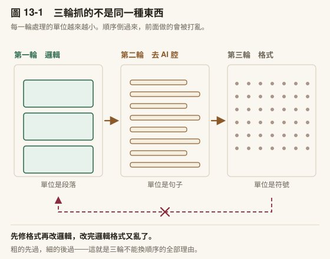

# 第 13 章　修稿與去 AI 腔

> 書稿第 13 章＝課程第 13 週（3 小時）。2026-10-15 由原[第 7 章](../chapters/07-verification.md)拆出（原 [7.1](../chapters/07-verification.md#71-引用幻覺與四步核實)、[7.6](../chapters/07-verification.md#76-常見迷思)）。

---

## 本章導覽

**這一章回答三個問題**

1. 一份初稿要怎麼改，才不會把自己的聲音改掉？
2. 潤稿跟去 AI 腔差在哪？
3. 讓它改寫之後，怎麼知道它沒有順手改掉數字和引用？

**讀完你能夠**

- **執行**修稿三輪（邏輯 → 去 AI 腔 → 格式），並逐條判斷而非全盤接受
- **區分**潤稿與去 AI 腔，並說出各自在改什麼
- **量出**自己的寫作基線，拿它當去 AI 腔的對照
- **建好**一支改寫前後比對數字、引用與標記的腳本

**需要多久**

自學閱讀約 45 分鐘｜課堂 3 小時（概念 70 分、實作 110 分）

**進來之前，你要能**

- 拿出一份**你自己寫的**草稿，哪怕只有一節（[第 12 章](../chapters/12-writing.md)）
- 說出你稿子裡還有幾處 `〔Claude 提議〕` 與 `〔待補〕`

**開始前請準備**：一段你自己寫的、覺得「講不清楚」的段落；[第 12 章](../chapters/12-writing.md)的初稿。

---

## 章前導言

你手上這份初稿是[第 12 章](../chapters/12-writing.md)的產物。從這一章到[第 15 章](../chapters/15-submission.md)，處理的是它離開你的手之前的幾件事。這一章是第一件：你自己看。

[第 12 章](../chapters/12-writing.md)講過：AI 產出的初稿讀起來像成品，不像草稿。那個「像成品」的錯覺，在稿件即將寄出去的時候最危險，因為那是最後一個能攔住錯誤的位置。過了這個點，發現問題的就不是你了，是審查者、是讀者、是引用你的人。

修稿分三輪，一輪只處理一件事：先邏輯，再去 AI 腔，最後格式。三輪併成一輪，它會同時改結構與措辭，你分不出哪個改動造成哪個結果。

讓它改寫還有一個看不見的代價：它改句子的時候，會順手把 67% 改成約 70%，把一筆引用改成「先前研究」，把你留的 `〔待補〕` 刪掉。改完的句子更通順，而那幾處改動你讀不出來。本章建置用一支腳本處理這件事。

> **〔課堂〕開場 6 分鐘** 問全班：**「你上一次收到修改意見，有沒有哪一條你其實不同意，但還是照改了？」** 多數人有，而且說得出是哪一條。那個「不同意但照改」的瞬間，就是這一章要處理的東西。不要把這個問題導向「要勇於反駁」。重點不是反駁，是**你有沒有做判斷**。全盤接受跟全盤拒絕一樣，都是把判斷讓出去。

---

## 13.1 修稿三輪與第一輪：邏輯




〔圖 13-1〕三格裡的單位一格比一格小。 **順序不能換的理由就在這裡**——粗的那一輪會把細的那一輪剛整理好的東西推翻。

草稿寫出來了。接下來是改。

改稿也可以一次到位，把初稿貼進去，說「幫我改好」。結果跟把所有需求壓進一個指令一樣：什麼都改了一點，什麼都沒改到位。

實務上比較有效的做法是分成三輪，每一輪只盯一件事。三輪在同一個對話裡完成，讓 AI 能看到前一輪改過的版本。

### 第一輪：邏輯

第一輪的唯一焦點是**論證結構**。不管措辭漂不漂亮、格式對不對，只看：

- 每一段的主題句有沒有在支持這一節的主張
- 段落之間的邏輯順序對不對（是否倒果為因、跳躍推理）
- 引用是在支持你的論點，還是在裝飾

你貼入你的段落，要求只針對邏輯做修改，不動語氣和格式。它回來的修改會逐條列出，每一條說明改了什麼、為什麼。

**重要：你不需要全部接受。** 逐條看，有道理的收，沒道理的駁回。AI 修改你的論文，不代表它的修改是對的。這在修稿的每一輪都成立，但第一輪最容易被忽略，因為邏輯層的修改看起來總是很有道理。

### 帶走這一節

- 修稿分三輪，**一輪只處理一件事**
- 第一輪處理邏輯：只要診斷，不要改寫，改哪幾條由你決定
- 邏輯輪放過去了，後面兩輪修的都是表面

---

## 13.2 第二輪：去 AI 腔

### 第二輪：去 AI 腔

第一輪改完邏輯之後，你的段落可能讀起來很流暢但缺少人味。這不只是風格問題。學術審查者和讀者對 AI 生成的文字越來越敏感，不是因為他們在抓你用 AI，而是因為那種文字確實比較空洞。

第二輪針對的是語氣和寫作品質。你要求它檢查：

- AI 慣用的空泛修飾詞（「具有重要意義」「提供了寶貴的啟示」「值得深入探討」）
- 句子長度完全一致、缺乏節奏變化
- 每一段都是「先講背景、再講發現、最後講意義」的三段式結構
- 學術空話：寫了很長一句但拿掉之後段落完全不受影響的句子

〔補充〕**中文學術稿的 AI 痕跡有一套專屬的清單**，跟英文不完全重疊。常見的包括：「里程碑式的進展」「不僅…更…」的排比套路、「綜上所述」收尾、以及把補充說明不斷用插入語塞進句子。如果你的稿件是中文，這一輪可以特別要求針對中文 AI 腔做掃描。本節下一段〈第二輪的三條硬規則〉會把這件事做對的方法拆開講，完整的清單（含台灣用語與標點校正）收在[附錄 H](../appendix/H-chinese-ai-tone.md)。

去 AI 腔的目的不是為了「騙過偵測器」。目的是讓你的文字讀起來像一個有觀點的人寫的，而不是一段沒有立場的接龍。

〔動手一下〕找一段你最近寫的學術段落（不管有沒有用 AI），數一下：六句話裡有沒有三句以上長度幾乎相同？有沒有任何一句拿掉之後段落毫無影響？如果有，那就是第二輪要處理的對象。

### 第二輪的三條硬規則

〔補充〕第二輪的篇幅比另外兩輪多很多，先講為什麼。 邏輯與格式那兩輪，你大致知道自己在找什麼；去 AI 腔不是。它做壞的方式比做對的方式多，而且做壞的那幾種都長得像做對了。所以接下來三個小節都還在第二輪裡：先講三條硬規則，再區分它跟一般潤稿的差別，最後講怎麼量出你自己的基線。**看到〈第三輪：格式〉才算離開第二輪。**

三條規則，每一條都對應一種常見的失敗。

**第一條：先劃保護片段，再動手。**

改寫之前，先把不能動的東西鎖起來：**數字與統計、構念與術語、引用與歸屬、引號內的原文、版本識別**。改完回頭逐類核對一次。

⚠️ 這一條擋的是最貴的錯誤，別因為它像贅步就跳過。潤稿的職掌正好是「換用字、刪冗詞、統一術語」。這三件事每一件都直接對著保護清單開火。把某個構念做了同義詞替換、把引用的年份順手改掉、把「某某的理論」重寫成「已被證實的理論」，每一個都是**編輯得很合理，但改壞了內容**。

**第二條：不換湯。**

刪掉一個空洞的詞，不可以補上另一個同族的空洞的詞。刪掉「標誌著」換成「象徵著」，你什麼也沒改善。改完要**回頭再掃一次**，因為換湯這件事幾乎都是在改寫的當下發生的。

第三條：分清楚「措辭問題」與「內容缺口」。

有些句子刪掉之後段落會塌，但它本身確實什麼也沒說。這種句子不是措辭爛，是**那個位置的內容你根本還沒寫**。正確處置是留著原句、標記起來，回頭補內容。洗它或刪它都解決不了。

〔補充〕**注入人味有一個陷阱。** 為了讓文字不那麼機械，很容易滑進另一種套路：說教式的深度腔（「說到底」「本質上」）、金句公式（「X 是 Y 的 Z」）、假坦白的鉤子（「老實說」）、硬造的立場轉折。⚠️ 這些同樣是可辨識的模式，只是換了一種。真正的人味只能來自你實際的經驗與立場。你沒有的東西，它生不出來，硬要它生，出來的是第二種 AI 腔。

⚠️ **還有一件事比上面三條都容易出事：誤殺。** 學術寫作有一批看起來像 AI 腔、實際上是規範寫法的東西。Methods 的步驟編號、Results 走向 Discussion 的「此結果顯示」、「本研究將 X 定義為」。掃的時候一律放行。⚠️ 最嚴重的一種誤殺是動到已獲授權的量表中文版題目：為了讓用語更「台灣」而改了題幹一個詞，該量表既有的效度證據就全部失效了。四條誤殺防護收在附錄 H-7。

〔動手一下〕**5 分鐘**。拿你上一輪改完的段落，只做第二條規則的檢查：把所有被改掉的詞列出來，逐個問「改完之後這句話多說了什麼」。答不出來的，就是換湯。

〔教你的 Claude 建這個〕**讓它診斷，不要讓它改寫。** 這是第二輪唯一真正重要的設計決定。貼這段：

「請幫我建一個〈中文稿診斷〉技能檔。**它只做診斷，不准直接改寫我的文字。** 輸出固定三欄：位置｜這是哪一類問題｜為什麼這一句有問題。第一件事一定要做：**先列出保護片段**。數字與統計、構念與術語、引用與歸屬、引號內原文、量表題目。列完之後這些一律不碰。接著問我三個問題：（一）我的目標讀者是誰？（二）這份稿子有沒有已獲授權的量表題目？（三）我的領域有哪些看起來像 AI 腔、實際上是規範寫法的句型？」

**「只診斷不改寫」為什麼是硬規則。** 讓它改，你會收到一段順的文字，然後**你不會知道它動了哪裡**。換湯、誤殺、被順手改掉的年份，全部藏在那段順裡面。讓它只標問題，判斷與下筆都留在你手上，你才看得見它認為哪裡有問題、以及**它判斷錯的地方**。

**第二個問題是為那位量表使用者問的。** 你不問，它不會知道那幾行不能碰。可貼的完整清單與四條誤殺防護在[附錄 H](../appendix/H-chinese-ai-tone.md)。

**真的要它改寫的時候，用兩個辦法看清楚它改了什麼。**

第一個是**要它附一張語意變動清單**。改寫沒有不損失意思的，改的人又不是作者，意思被改走了只有你看得出來。所以每次交回改寫稿，要它另外列出「原句 → 改句｜變了什麼」，只列四種：主張變強或變弱（「可能」被刪掉、或多加了一個「顯示」）、範圍變了（「部分學生」變成「學生」）、因果或先後方向變了、指的對象變了。只換詞、換語序、換標點的不必列。沒有就寫「無」，這一節不准省略。

第二個是**盲讀**。把原版與改後版並排，左右隨機放，不告訴你哪一邊是改過的，你一段一段選比較好的那一邊，或兩邊都不要，旁邊寫一句為什麼。全部選完才揭曉。

這樣做是讓你只看文字本身，不受「這一版是改過的」這件事影響。作者第一次這樣做的時候，四段裡有一段選了原版，那一段就不改了。

盲讀只適合措辭層的改動。**含有你主張的段落不要用兩版挑一的方式決定**，那等於讓它提主張、你來投票；那種段落回到[第 12 章](../chapters/12-writing.md)的訪談做法。

### 潤稿與去 AI 腔不是同一件事

這兩件事常被混在一起，但它們問的問題不同：

| | 在問什麼 | 標準的性質 |
|---|---|---|
| **掃 AI 腔** | 有沒有出現那些詞、那些句式 | **查表**，絕對標準 |
| **風格一致** | 讀起來像不像同一個人寫的 | **比對基線**，相對標準 |

一段文字可以**一個禁用詞都沒有，卻仍然明顯不是你寫的**。乾淨不等於一致。

這個區分對學位論文特別重要：你的口試委員不會拿禁用詞清單掃你，但他讀到第三章的時候會覺得「這一節怎麼跟前面不太一樣」。那個感覺來自基線比對，而基線就是你自己前面幾章。

### 基線可以真的量出來，而且量出來的東西會嚇你一跳

「像不像同一個人寫的」聽起來很主觀，其實可以量。這件事有一個既有的領域叫**文體計量學**，用可測量的語言特徵——句長、功能詞、標點習慣、緩和語密度——去辨識一份文本的作者。它原本用於作者歸屬爭議，現在多了一個每個研究者都會碰到的用途：你的稿子裡開始混進不是你寫的句子，而你自己看不出來。

方法本身不難，難的是**選對維度**。這一點值得在正文講，因為它會推翻你的直覺。

我自己用六篇論文做過一份英文基線，量了十五個維度，其中**能用來判定的不到一半**。最刺眼的一個例子是「我們」（we／our）：

> 直覺上，一個人用不用「我們」應該很穩定。實測是**三篇之間差了四倍**。

理由不難想——那取決於那篇有幾位作者、期刊偏好什麼人稱、那一段在講方法還是講詮釋。它其實跟著情境跑，不像一般以為的那麼個人。

所以真正的技術動作是：**先算每個維度在你自己稿子之間的變異，變異大的一律刪掉。** 剩下的才是你的常數。我那份基線篩完之後留下四個，其中最穩的一個（「本研究／the present study」的密度）跨了九年、連合著篇都收斂。

還有一類維度比上面那些都好用：你根本不寫的東西。

我幾乎不用強調副詞（clearly／明顯地／無疑），密度約 0.19/千字，有一篇整篇是零。這種「近乎為零」的特徵不能算變異係數（分母趨近零），但它給出一條非常實用的判準：

> **一段文字突然出現三個強調副詞，那段就值得重讀。**

這一條的實用價值高於整套量測。因為 AI 起草的文字最愛加強調副詞。你不需要建任何基線就用得上它。

**兩條界線要記住。**

第一，**這是量測基線，不是寫作目標**。拿它當目標，你的文字會朝著你三年前的樣子收斂—— 那不是保持聲音，是拒絕成長。它只能標記位置，判斷是你的。

第二，**中文目前只做得到偵測，做不到矯正**。我自己那份中文基線標著 beta，因為它缺一個東西：外部效標。英文那邊我手上有別人在稿子上的修訂紀錄，那是一份獨立的「什麼該改」的來源；中文只有自己的成稿—— 量到的同質性只能說「這幾篇像同一個人」，**不能說「這樣寫是對的」**。這個區別很容易滑掉：**基線量到的是你的習慣，而你的習慣不等於好的寫法。**

〔補充〕**這件事跟主張強度是同一件事的兩面。** 一份比對 2021 年人類書寫與 2025 年 AI 輔助書寫的研究指出（McKinley, 2026），學術寫作的立場標記會系統性偏移：第一人稱減少、緩和語減少、非人稱的斷言增加 ——「我認為」變成「研究證明」。緩和語減少、斷言增加，意思是 **你的主張強度被悄悄推高了**，而那正是[第 7 章](../chapters/07-verification.md) [7.2](../chapters/07-verification.md#72-照著做一次從一篇-pdf-到一句你敢寫進論文的引用) 第七步在防的事。所以「讀起來不像我」與「我講得比證據支撐的更滿」可能是同一個症狀。（出處與驗證層級見〈延伸資源〉。）

**完整的做法**——語料怎麼挑、三項合格性檢查、變異係數怎麼算、一段可以直接貼的提示詞。收在[附錄 G](../appendix/G-writing-fingerprint.md)。

如果你現在不想做這整套，最土的辦法仍然有效：**把全章連著讀一遍**，讀到哪裡卡一下，那裡就是離群段落。基線做的事跟這個一樣，只是它不會累。

### 帶走這一節

- 去 AI 腔是寫作品質的工作，跟有沒有用 AI 無關
- 潤稿讓句子更順，去 AI 腔讓句子**有你的立場**；兩者不是同一件事
- 你的寫作基線量得出來，拿它當對照，比憑感覺判斷「像不像 AI」可靠

---

## 13.3 第三輪與分工

### 第三輪：格式

回到三輪的主線。前兩輪不碰格式，第三輪才處理。針對的是你的目標期刊或學位論文的格式要求：

- 引用格式（APA 7、APA 6、Chicago，或依期刊規定）
- 標題層級、表格格式
- 數字呈現方式（小數位數、顯著性標記）

格式放最後是因為前兩輪可能會大幅改動內容。如果你先修格式再改邏輯，改完邏輯格式又亂了。

### 誰負責什麼

三輪改完之後，回頭看一件事：哪些是你決定的，哪些是 AI 做的。

| 你負責 | AI 輔助 |
|---|---|
| 研究問題 | 段落表述 |
| 方法論選擇 | 語氣統一 |
| 結果詮釋 | 引用格式 |
| 論點判斷 | 初稿起草 |
| 證據選材 | AI 腔掃描 |
| 決定接受或駁回修改 | 提出修改建議 |

右邊那一欄全部是可以委派的，但你注意到一件事：**右邊全是形式層的工作，左邊全是內容層的決定。** 研究問題不是它幫你定的；方法論不是它幫你選的；結論也不是它幫你下的。它做的是那些你原本會花三個下午做的排版、潤稿、格式工作。

這就是研究助理。它接手的是右邊那一欄；右邊空出來的時間要回到左邊，不是回到它手上。

### 帶走這一節

- 三輪各盯一件事：**邏輯 → 去 AI 腔 → 格式**，順序不能顛倒
- 格式放最後，因為前兩輪會大幅改動內容
- **逐條判斷，不要全盤接受。** 第一輪最容易失守，因為邏輯層的修改看起來總是很有道理
- 去 AI 腔是寫作品質的工作，不是為了規避偵測
- 可委派的全在形式層，不可委派的全在內容層。這條界線在 [16.1](../chapters/16-integrity.md#161-誠信的完整框架) 會收成一句話

---
---

## 13.4 教育研究實例：一篇碩士論文的寫作週


讓我們看一個完整的場景。

一位碩士生正在寫她的論文。她的題目關於某種教學策略對學習表現的影響。她手上有十五篇文獻筆記，每一篇都附上驗證層級。

**週一**，她跑了[第 7 章](../chapters/07-verification.md) [7.3](../chapters/07-verification.md#73-從二十篇筆記到一個論點) 的四步驟。她寫下三句主張，把筆記片段歸進三個容器。其中一個容器幾乎是空的。她原本以為有很多證據支持的一個假設，實際上只有一篇直接研究。她決定把這個假設改成研究問題，而不是文獻回顧中的已確立結論。她還請 AI 當反方挑了一遍，被指出容器二的六篇論文裡有兩篇的研究設計跟她的情境差很大，引用的時候要加上但書。

**週二**，她用 draft 模式寫文獻回顧。她不是把十五篇的筆記全部貼進去，而是根據 [7.3](../chapters/07-verification.md#73-從二十篇筆記到一個論點) 歸類的結果，一次只餵一個容器的證據片段。第一個容器寫完，她看到兩處 `[MATERIAL GAP]` 標記：有兩段論證需要引用支持，但她沒有提供素材。她回到 Obsidian 翻閱，發現其中一處確實需要再找一篇論文，另一處其實不需要引用，只是她的表述方式讓 AI 以為需要。

**週三**，她對整個文獻回顧跑修稿三輪。第一輪（邏輯）發現有一段的推理順序倒了，先講了結論再講證據。第二輪（去 AI 腔）標出了四處問題：兩處是「值得深入探討」之類的空話，一處是全段六句話長度完全一樣，一處是「綜上所述」開頭的結論段。她接受了前三個修改，第四個她保留了，她覺得那段確實是在綜合，但她把那段改短了。第三輪（格式）修正了三處引用格式。

**週四**，她把修改完的稿件交給指導教授。教授回了五條意見。她跑了 [第 15 章](../chapters/15-submission.md)的四步流程。在第二步，她決定四條接受、一條部分接受（教授要她擴充理論基礎，但她認為其中一個理論跟她的主題不直接相關，加進來反而模糊焦點）。她在回應信裡解釋了部分接受的理由。

**週五**，她把修改後的版本、回應信、以及新增引用的驗證紀錄一起交給教授。

整個過程中，AI 幫她做了什麼？起草段落、整理審查意見、標記格式錯誤、掃描 AI 腔。她做了什麼？決定主張、選材、判斷修改建議、回應指導教授。時間分配大約是：她花了 70% 的時間在判斷和決定，30% 的時間在操作和格式。以前這個比例是反過來的。
---

## 本章建置：改寫前後比對

這一節建一支腳本，處理 13.2 那一輪最難察覺的代價：讓它改寫一段之後，數字、引用與你留的標記有沒有被順手改掉。它不判斷改得好不好，只把改寫前後不一樣的地方列出來，判斷留給你。

〔課堂〕約 20 分鐘。先全班跑一次下方作者那兩份示範稿，再讓學生拿自己的稿子跑。學生最常卡在「差異全部改回去」：腳本列出的是差異，不是錯誤，有些差異是你自己要的。

### 這一節完成之後，工作台多了什麼

```text
研究工作台/
└── _工作流/腳本/check_rewrite.py     ← 新增
```

### 第 1 步　比對腳本

在 `_工作流/腳本/` 建 `check_rewrite.py`：

```python
"""改寫前後比對：數字、引用、標記有沒有在改寫時被改掉或消失。

用法：python check_rewrite.py 改寫前.md 改寫後.md
只列出差異，不判斷改得對不對。
"""
import re
import sys
from collections import Counter
from pathlib import Path

sys.stdout.reconfigure(encoding="utf-8", errors="replace")

PATTERNS = {
    "數字": r"(?<![\w.])[-−]?\d+(?:\.\d+)?%?",
    "引用": r"[A-Z][A-Za-z\-]+(?: et al\.| (?:&|and) [A-Z][A-Za-z\-]+)?,? \(?\d{4}[a-z]?\)?",
    "標記": r"〔[^〕]{1,12}〕",
}


def items(text: str, pattern: str) -> Counter:
    return Counter(m.strip() for m in re.findall(pattern, text))


before = Path(sys.argv[1]).read_text(encoding="utf-8")
after = Path(sys.argv[2]).read_text(encoding="utf-8")

changed = False
for name, pat in PATTERNS.items():
    b, a = items(before, pat), items(after, pat)
    lost = b - a
    added = a - b
    if lost or added:
        changed = True
        print(f"【{name}】")
        for k, n in lost.items():
            print(f"  改寫後少了：{k}（{n} 處）")
        for k, n in added.items():
            print(f"  改寫後多了：{k}（{n} 處）")

if not changed:
    print("數字、引用、標記三類完全一致。")
else:
    sys.exit(1)
```

`PATTERNS` 那三行定義它要比對的三類東西：阿拉伯數字（含小數與百分比）、英文作者加年份的引用、全形方括號的標記。你的稿子常用其他引用格式，在「引用」那一行旁邊再加一條規則。

### 第 2 步　跑一次示範

作者用兩份假稿實際跑過。改寫前：

```text
十二位學生中，有 8 位在看到 AI 的回答後直接採用，未查證任何來源（67%）。這與 Huisman et al. (2018) 的觀察方向一致，但該研究的對象是大學生。追問之下，3 位學生表示「AI 不會錯」。〔待補〕補上訪談題號。
```

請它「改得更通順」之後：

```text
在十二位受訪學生中，多數（8 位，約 70%）於閱讀 AI 回答後即直接採用，未進一步查證來源。此發現與先前研究的觀察方向相符。進一步追問時，有 3 位學生表示他們相信「AI 不會出錯」。
```

跑：

```bash
python _工作流/腳本/check_rewrite.py 結果_v1.md 結果_v2.md
```

```text
【數字】
  改寫後少了：67%（1 處）
  改寫後少了：2018（1 處）
  改寫後多了：70%（1 處）
【引用】
  改寫後少了：Huisman et al. (2018)（1 處）
【標記】
  改寫後少了：〔待補〕（1 處）
```

改寫後那一段讀起來比原本好。它也做了三件事：67% 變成「約 70%」，8/12 不是 70%；一筆具名的引用變成「先前研究」，讀者再也查不到是哪一篇；還沒補的 `〔待補〕` 被刪掉，那件沒做完的事從稿子上消失了。另外，原句「但該研究的對象是大學生」這個限定也被刪了。腳本抓不到這一類，因為它不是數字也不是引用，要靠你讀。

腳本只比對阿拉伯數字。「十二位」這種中文數字它看不到；你的稿子常用中文數字寫樣本數，改寫後要自己對一次。

### 驗收

**驗收一：抓得到。** 拿你自己的一段稿子，手動改掉一個數字、刪掉一筆引用，跑一次。做對了，兩處都被列出來。

**驗收二：沒改的不報。** 拿同一份檔案比對它自己。做對了，輸出「三類完全一致」。

### 出事的時候

| 你看到的 | 多半是 | 怎麼辦 |
|---|---|---|
| 一大串數字被列出來，其實都沒改 | 改寫後的段落順序變了，或比對了不同段落 | 只拿同一段的前後版本比 |
| 中文引用（王小明，2020）沒被抓到 | 「引用」規則只寫了英文格式 | 在 `PATTERNS` 加一條中文作者加年份的規則 |
| 頁碼、題號被當成數字差異 | 改寫時這些也被動了 | 一樣要判斷：頁碼被改掉，引文就對不回原文了 |

### 這一步留給下一章的

你自己看完了，也確認了改寫沒有把數字和引用改壞。[第 14 章](../chapters/14-self-review.md)換一副眼睛：一個看不到你修改理由的審查者。

### 帶走這一節

- 讓它改寫之後，**先比對數字、引用與標記**，再讀措辭
- 腳本列出的是差異，不是錯誤；**每一處你要寫一個處置**
- 限定語被刪掉，腳本抓不到，要靠你讀

---

## 13.5 動手實作

### 實作一：修稿三輪（30 分鐘）

拿出你準備好的那段「講不清楚」的段落，跑三輪。

**第一輪（邏輯，15 分鐘）**

在 Claude 中輸入：

```
只做診斷，不要改寫。我要自己決定改哪幾條。

先做逆向大綱：逐段抽出「這一段在主張什麼」，一段一句話。
抽不出來的段落直接標「無主張」——那通常代表那一段在鋪陳而不是在論證。

然後對每一個主張回答三件事：
1. 支撐它的證據在同一段裡嗎？還是在別段、或根本沒有？
2. 這個主張的強度，跟證據撐得住的強度差多少？（過度／相符／保守）
3. 拿掉這一段，後面還讀得通嗎？

輸出一張表：段落編號｜主張一句話｜證據位置｜強度落差｜可否刪除。
⛔ 不要建議措辭，不要重寫任何句子。

[貼上段落]
```

逐條判斷，接受或駁回每一條修改。

**第二輪（去 AI 腔，15 分鐘）**

在同一個對話中，對修改後的版本：

```
只診斷，不要動我的文字。逐項列出，附行號或原句。

掃四層：
1. 詞彙層——空洞強調（里程碑、深遠影響）、空洞商業術語、學術空話
2. 句式層——三段式排比、「不僅⋯⋯更⋯⋯」、金句公式（X 是 Y 的 Z）、
   說教深度腔（說到底、本質上）、假坦白鉤子（老實說、說真的）
3. 開場收尾——時代大帽子、預告式導言、勸誡反問收尾
4. 密度層——破折號超過每 300 字一個、連續三句同長

每一筆給我：原句 → 問題屬於哪一層 → 為什麼是問題（一句）。

⛔ 兩條不要碰：
- 學術規範寫法（Methods 的步驟編號、「本研究將 X 定義為」、signposting）
- 引號內的原文、量表題幹、統計數值

⛔ 也不要幫我換一個同族的空話（把「標誌著」換成「象徵著」不算改）。

[貼上段落]
```

**第三輪（格式，10 分鐘）**

```
檢查 APA 7 格式，只列問題不改稿。分四類回報：

1. 內文引用——作者數與 et al. 的使用時機、同作者同年的 a/b、
   括號式與敘述式的標點
2. 數值與統計——小數位數是否一致、p 值寫法、效果量有沒有附
3. 參考文獻——與內文是否一一對應（列出只出現在一邊的）、
   期刊名與卷期的斜體、DOI 寫成完整網址
4. 表格與圖——標題位置、註記格式

⚠️ 最後回報「我沒查到的」：哪幾筆你無法確認（例如缺 DOI、期刊名不熟），
不要猜。那幾筆我自己開來源核對。

[貼上段落與參考文獻清單]
```

三輪在同一個對話中完成。這是[第 3 章](../chapters/03-skills.md)講的上下文視窗的正確使用方式：一件事在一個對話裡做完，讓它看到完整的修改脈絡。

### 實作二：逆向大綱演練（15 分鐘）

> **〔課堂〕這一項不需要任何工具，學生用自己帶來的稿子做。** 時間短是刻意的。它的價值在「做過一次」，不在做得完整。

1. 拿你自己的一段稿子（至少五段），**只抄下每段的第一句**（5 分鐘）
2. 把抄下來的清單連著讀一遍，問一句話：**這串句子自己讀起來像不像一篇通順的摘要？**（3 分鐘）
3. 標出「首句沒有承擔它該承擔的工作」的段落（4 分鐘）
4. 挑其中一段，把真正的主題句找出來——它通常藏在第二或第三句（3 分鐘）

⚠️ **不要在這一項裡動手改**。這 15 分鐘只做定位。改是回家的事。

〔補充〕**卡住也是結果。** 如果你抄到一半發現「這一節的主張到底是什麼」自己也講不出來，那不是練習失敗，那正是這個練習要告訴你的事。那一節的結構有問題。

完整做法（含雙向對照與宣稱—證據對照表）見**[附錄 I](../appendix/I-self-review.md)**。

### 實作三：改寫比對（15 分鐘）

1. 挑一段含數字或引用的稿子，存一份「改寫前」（2 分鐘）
2. 請它把這一段改得更通順，存成「改寫後」（3 分鐘）
3. 跑本章建置的 `check_rewrite.py`，逐條判斷它列出的差異（10 分鐘）

腳本列出的每一處，你要寫一個處置：改回去，或保留並說明為什麼。一處都沒列出的話，換一段數字更多的再跑一次。

### 技能要點

| 實作 | 關鍵動作 | 做對了長什麼樣 | 常見卡點 |
|---|---|---|---|
| 一 · 修稿三輪 | 一輪只處理一件事，**逐條接受或駁回** | 你駁回了至少一條，而且說得出理由 | 三輪併成一輪 |
| 二 · 逆向大綱 | 只抄每段第一句，連著讀 | 你標出了首句沒有承擔主題的段落 | 一邊抄一邊改 |
| 三 · 改寫比對 | 每次讓它改寫完就跑一次腳本 | 你逐條判斷了腳本列出的每一處差異 | 看到差異就全部改回去，不判斷哪些是你自己要的 |

實作一最容易失守的是**第一輪**。一段邏輯有問題但措辭漂亮的文字，比一段邏輯正確但措辭粗糙的文字危險得多。

### 當週小task

繳交三樣：

1. 修稿三輪的紀錄：每一輪它提了幾條、你收了幾條、駁回的那幾條的理由
2. 一份逆向大綱：每段首句清單，標出有問題的段落
3. 一次改寫比對的輸出，逐條寫你的處置（改回／保留並說明為什麼）

---

## 13.6 常見迷思

**迷思一：「去 AI 腔是為了騙過偵測器。」**

*為什麼錯*：AI 偵測器的準確率本身就不可靠，而且不是你改稿的理由。你改掉 AI 腔，不是因為怕被抓，是因為那些空洞的修辭、千篇一律的句式、沒有立場的轉折，**本身就讓你的文章變差了**。

*正確版本*：去 AI 腔是寫作品質的工作，跟有沒有用 AI 無關。一個好的人類作者也不應該寫出「綜上所述，本研究具有重要的理論與實務意義」這種句子。

**迷思二：「它只改措辭，內容不會變。」**

*為什麼錯*：改寫的時候，數字會被「四捨五入」成好讀的版本，具體的引用會被改成「先前研究」，限定語會被刪掉或加上去。每一處單獨看都像在改措辭，合起來主張的強度已經變了。

*正確版本*：讓它改寫之後，**比對改寫前後的數字、引用與標記**，再讀措辭。

**迷思三：「改越多輪越好。」**

*為什麼錯*：改到第三輪之後，改動常常退化成同義詞替換與限定語堆疊，稿子沒有變好，只是變了。

*正確版本*：每一輪結束時問一句：這一輪改了什麼實質內容？說不出來就停。

---

> ### 〈責任落點〉 - 每一條修改建議收或不收：**你**。全盤接受跟全盤拒絕一樣，都是放棄判斷 - 改寫前後數字與引用的差異，哪些是你要的：**你** - 稿子裡 `〔Claude 提議〕` 與 `〔待補〕` 的處置：**你** - 工具負責的是：診斷邏輯、標出 AI 腔、修格式、列出改寫前後的差異

---

## 13.7 章末整理

### 三句話帶走

1. 修改建議要逐條判斷。**全盤接受跟全盤拒絕一樣，都是把判斷讓出去。**
2. 一輪只處理一件事，**邏輯在措辭之前**。
3. 讓它改寫之後，**先比對數字與引用，再讀措辭**。

### 回到開場

開場問你：有沒有哪一條意見你不同意但還是照改了。

修稿三輪的每一輪都會給你一串建議。你駁回的那幾條，理由寫下來，就是你這份稿子的立場。一條都沒駁回，不代表它全對，多半代表你沒判斷。

### 拿去跟人討論

找一個同學、同事或指導教授，挑一題聊十分鐘。

1. 交換一段稿子，各自只抄首句做逆向大綱。對方的首句清單讀起來像一篇摘要嗎？
2. 各自拿一段改寫前後的版本跑比對腳本。差異裡有幾處是你們自己要的？
3. 「AI 腔」在你們的領域長什麼樣子？各舉一句你們最常看到的。

### 下章預告

你自己看完了。[第 14 章](../chapters/14-self-review.md)換一副眼睛：投稿之前，讓一群互相不知道彼此意見的審查者看一次，再檢查你自己的判準前後一不一致。

---

## 延伸資源

**外部資源**

- **立場標記會怎麼偏移**：McKinley, J. (2026). Voice recovery in AI-mediated writing: Rethinking writer identity in the GenAI era. *Digital Studies in Language and Literature, 3*(2), 167–183. [https://doi.org/10.1515/dsll-2026-3014](https://doi.org/10.1515/dsll-2026-3014) 13.2〔補充〕框的出處：AI 輔助後第一人稱與緩和語減少、非人稱斷言增加。 **驗證層級：書目經 Crossref 核實，發現層僅檢索摘要**，本書未讀全文，故只寫方向不寫數值。
- **AI 對作者聲音的威脅（文獻回顧）**：Al Hosni, J. (2025). Preserving authorial voice in academic texts in the age of generative AI: A thematic literature review. *Arab World English Journal, 16*(3), 244–258. [https://doi.org/10.24093/awej/vol16no3.14](https://doi.org/10.24093/awej/vol16no3.14) 綜整 2023–2025 年十八篇研究。驗證層級：摘要層已核實，未讀全文；場域為 **ESL 大學寫作教學**。
- **Academic Research Skills**（Cheng-I Wu）：[https://github.com/Imbad0202/academic-research-skills](https://github.com/Imbad0202/academic-research-skills) 13.1 的修稿模式往上追到這裡。**授權 CC BY-NC 4.0。** 驗證層級：讀過 README 與授權宣告。

**本書其他章節**

- **[第 12 章](../chapters/12-writing.md)**：寫作。本章修的就是那一章產出的初稿
- **[附錄 G](../appendix/G-writing-fingerprint.md)**：寫作聲紋，怎麼量出你自己的基線
- **[附錄 H](../appendix/H-chinese-ai-tone.md)**：中文學術稿的 AI 腔清單與台灣用語校正

---
