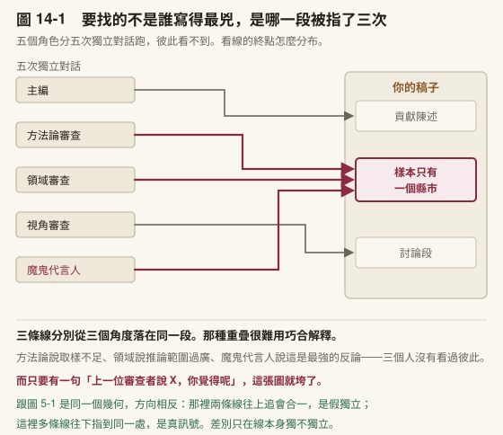
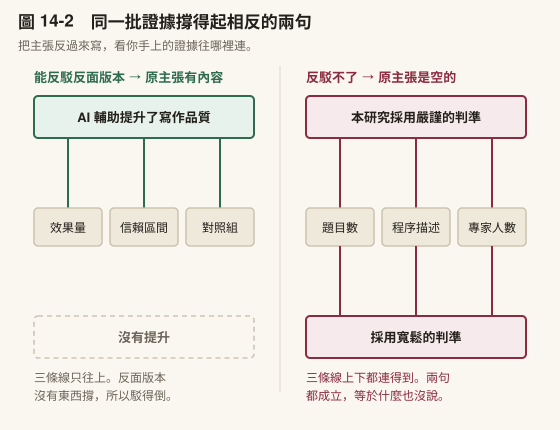
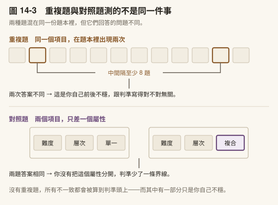

# 第 14 章　投稿前自審與對抗審查

> 書稿第 14 章＝課程第 14 週（3 小時）。2026-10-15 由原[第 7 章](../chapters/07-verification.md)拆出（原 [7.2](../chapters/07-verification.md#72-照著做一次從一篇-pdf-到一句你敢寫進論文的引用)）。

---

## 本章導覽

**這一章回答五個問題**

1. 投稿之前怎麼看見自己看不見的問題？
2. 多個審查角色為什麼必須互相不知道？
3. 一個指得出證據的主張，為什麼還可能是空的？
4. 你以為你有一套判準，怎麼測它前後一不一致？
5. 把審查做成技能、跑成迴圈時，要守哪些規則？

**讀完你能夠**

- **執行**投稿前的自我審查，含逆向大綱與主張證據對照兩項徒手檢查
- **安排**多角色審查，讓每一個角色看不到其他角色的意見
- **處理**一份審查回報：每一項都有去向，總數對得上
- **說明**審查技能單輪的四個階段，以及多輪迴圈的五條規則
- **測出**自己的判準前後一不一致
- **建好**一個看不到主對話的審查者子代理

**需要多久**

自學閱讀約 60 分鐘｜課堂 3 小時（概念 80 分、實作 100 分）

**進來之前，你要能**

- 拿出一份跑過修稿三輪的稿子（[第 13 章](../chapters/13-revision.md)）
- 說出改寫比對腳本抓不到的那一類改動（[第 13 章](../chapters/13-revision.md)）

**開始前請準備**：一份你準備要交出去的稿子，哪怕只有一節。

---

## 章前導言

[第 13 章](../chapters/13-revision.md)是你自己看。這一章換一副眼睛。

自己看稿有一個結構性的限制：你知道自己想說什麼，所以你讀到的是你想說的，不是你寫下的。改到第七稿，這個限制只會更強。讓它當審查者可以補上這一塊，但有一個條件：它不能知道你為什麼這樣改。知道修改理由的審查者，會往「改對了」的方向找證據。

所以這一章的每一節都在處理同一件事：讓看稿的那一方，真的看不到它不該看到的東西。14.1 先分清楚自審、潤稿與外部審查。14.2 讓多個角色互相不知道。14.3 檢查一個指得出證據的主張，證據的種類撐不撐得住。14.4 最後轉回你自己：你以為你有一套判準，測一次它前後一不一致。

> **〔課堂〕開場 5 分鐘** 請學生把自己的稿子交給旁邊的人，**不准附任何說明**，只說「請找出最弱的一段」。三分鐘後收回。問：對方挑的那一段，跟你自己以為最弱的那一段，是同一段嗎？

---

## 14.1 投稿前自己審一遍


三輪修稿改的是**你看得見的問題**。這一節處理另一種：你看不見、但審查者一眼就會看見的問題。

### 自審不是潤稿，也不是外部審查

這三件事常被合稱為「改稿」。它們查的東西不同、失敗的方式也不同，混在一起做最典型的結果是句子越改越漂亮，但被退稿的理由一個都沒解決。

| | 處理哪一層 | 做完了長什麼樣 | 沒做好的徵狀 |
|---|---|---|---|
| **潤稿**（[第 13 章](../chapters/13-revision.md)第二輪） | 字句：文法、用詞、腔調、標點。單位是句子 | 讀起來像人寫的 | 句句通順，整節不知道在講什麼 |
| **自審**（本節） | 結構與證據：主張撐不撐得住、章節有沒有對上。單位是段落與章節 | **必改項歸零** | 以為改完了，審查者第一輪就抓到 |
| **外部審查**（[第 15 章](../chapters/15-submission.md)） | 貢獻與適配：值不值得刊、放這本期刊對不對。單位是整篇 | 編輯的決定 | 你控制不了，只能降低被抓到的面積 |

**自審不能取代外部審查。** 它沒有「這個貢獻值不值得」的判斷力，那需要一個真的站在這個領域裡的人。它能做的是另一件事：把所有不需要外人也看得出來的問題，在送出去之前清掉。這樣審查者的第一輪意見才會落在值得討論的地方，而不是花在你自己就能發現的東西上。

### 為什麼自己看不出來

你把一份稿子讀到第七遍的時候，你已經不是在讀它，你是在回憶它。句子還沒讀完，腦子就補完了。補進去的是你想寫的東西，不是紙上真正寫的東西。

所以投稿前這一關要換一副眼睛。找同事幫忙讀是最好的辦法，但同事不是隨時有空，而且多數人不好意思在同一份稿子上麻煩別人第二次。

模擬審查填的是這個空缺。它不取代真人，它負責在你麻煩真人**之前**，把那些一眼就看得出來的問題先清掉。

### 這一站有輸入、有產出，也有驗收

自審在工作流上是獨立的一站，不是修稿順手做完的收尾動作。一站要成立，得說得出三件事。

輸入：三輪修稿改完、而且你已經看不出問題的那一版。

這個條件不是門檻，是時機。你還看得出問題的時候，該做的是繼續改；而**「看不出問題了」正好是需要換一副眼睛的訊號，不是可以送出去的訊號**。多數人把它讀成後者，於是自審這一步經常整個被跳過。

還有一個條件排在五個角色之前：**稿子裡的數字要先查過一遍**。附錄 I-9 是那一層的四個動作。順序不能反過來，因為五個角色讀到的是你寫下來的東西——數字本身錯了，他們會很認真地對一個錯的數字提出很有道理的意見。

產出：不是「感覺還行」，是兩份東西。

一份**分級清單**：每一條標上位置、原句、修改方向，並且分成必改／該改／可改。一份修訂清單：你決定要動的那些、你決定不動的那些，以及不動的理由。

**「看過了，決定不改」跟「根本沒看到」，在稿子上長得一模一樣**，只有清單分得出來。三個月後你自己也分不出來。

驗收：五個角色各跑完，而且每個角色至少提出一條你原本沒想到的。

五個都說沒問題，代表**角色設定失敗**，不代表稿子沒問題。一份初稿第一次跑就全數過關，這件事幾乎不存在；真的發生時，回頭看你給的指令是不是寫成了「幫我確認這篇沒問題」。

### 帶走這一節

- 自審不是潤稿，也不是外部審查；**它有輸入、有產出、有驗收**
- 自己看不出來，是因為你讀到的是你想說的
- 審查者不該知道你的修改理由

---

## 14.2 多個角色，互相不知道

### 五個角色，而且必須互相不知道

我自己在用的審查工具會同時跑五個角色：

| 角色 | 只看什麼 |
|---|---|
| **主編** | 這篇適不適合這本期刊、夠不夠原創、整體重要性 |
| **方法論審查** | 研究設計、取樣、統計、格式合規、能不能被重做一次 |
| **領域審查** | 文獻回顧完不完整、理論框架站不站得住、增量貢獻在哪 |
| **視角審查** | 跨領域的連結、實務應用、倫理蘊涵 |
| **魔鬼代言人** | 專門寫出最強的反論，以及你漏掉的替代解釋 |

一條鐵則：五個角色彼此完全獨立，不互相參考。

這一條看起來像技術細節，其實是整件事成不成立的關鍵。真實的同儕審查之所以有用，正是因為三位審查者互相不知道對方寫了什麼。兩份獨立寫出的意見同時指向同一段，那一段幾乎確定有問題；而如果他們看得到彼此，第二位會被第一位的框架帶著走，你得到的是同一個意見的三個版本。

你自己動手做的時候，最容易失守的就是這一條。開一個對話跑完主編視角，接著在同一個對話裡說「現在換方法論視角」。它記得自己剛才說過什麼，於是它會維持一致。要分開跑。

具體怎麼做到：分五次對話，一次只給一個角色的指令。

每一次都從乾淨的對話開始，只貼稿子與那一個角色的指令；跑完存下結果、關掉，再開下一個。⚠️ 不要在第二個對話裡提到第一個說了什麼，連「上一位審查者說 X，你覺得呢」都不行。那一句話就把獨立性用掉了，而且用掉之後看不出來，你拿到的還是五份看起來很專業的意見。

〔教你的 Claude 建這個〕**五個角色，五段指令。** 這五段是分開貼的，一次一段、一個新對話。

```
【主編】
你是這本期刊的主編，收到這份投稿。你的工作不是挑錯字，是決定送不送外審。
只回答三件事：
1. 這篇適合本刊嗎？不適合的話，是主題不合還是層次不夠？
2. 它的貢獻用一句話講是什麼？講不出來就直說講不出來。
3. 如果要退，退稿理由的第一句會怎麼寫？
不要給修改建議。你這一關只決定去留。

【方法論審查】
你只看方法。研究設計答得了研究問題嗎？取樣寫清楚了嗎？統計方法配得上資料型態嗎？
逐項檢查並標出頁碼或段落：樣本數與依據、測量工具的效度來源、
跨組比較有沒有先驗恆等性、統計假設有沒有交代。
⛔ 不要評論寫作品質、文獻回顧或理論貢獻，那不是你的工作。
每一項只有三種結論：充分／不足／完全沒寫。

【領域審查】
你熟悉這個領域的近五年文獻。只看兩件事：
1. 文獻回顧漏了哪些必須引的？直接列出你認為缺席的研究方向（不必給書目）。
2. 這篇相對於現有研究的增量是什麼？如果只是換一個場域重做一次，直說。
⛔ 不要看方法細節，不要看格式。

【視角審查】
你不在這個領域。用一個相鄰領域研究者的眼光讀這份稿子，回答：
1. 哪幾段我看不懂？（具體指出，不要客氣）
2. 這個結果對我的領域有什麼用？沒有的話說沒有。
3. 有沒有倫理或實務上的蘊涵，作者沒提到？

【魔鬼代言人】
你的唯一任務是讓這篇被拒。找出最強的反論，不是最多的反論。
1. 這份資料最有可能的替代解釋是什麼？
2. 作者最想避開不談的那個弱點是哪一個？
3. 如果我是審查者要寫一段話讓編輯拒掉它，那段話怎麼寫？
⛔ 不要平衡報導，不要先講優點。這一輪不需要公正。
```

**第一版該長什麼樣**：先只跑「方法論審查」和「魔鬼代言人」兩個。這兩個提出的東西最具體，也最容易讓你當場發現自己漏了什麼。另外三個等你確定自己會固定跑這一關再加。

⚠️ **五段裡的 ⛔ 那幾行不是裝飾。** 拿掉之後每一個角色都會滑回「全面評估」，於是你得到五份大同小異的意見，而那正是分五個角色要避免的事。**限制才是角色，不是頭銜。**



〔圖 14-1〕五個角色各自獨立跑完，**看的是線的終點怎麼分布**。五份都跑完之後才並排看——你要找的是那個被指了不只一次的地方。

⚠️ 這是同一條規則的第三次出現。[第 5 章](../chapters/05-literature-search.md) [5.1](../chapters/05-literature-search.md#51-文獻工作的三個瓶頸) 說兩個資料庫都撈到，不算兩個獨立佐證；[第 7 章](../chapters/07-verification.md) [7.1](../chapters/07-verification.md#71-引用幻覺與四步核實) 說去驗的人不能是當初摘出那句話的人；這裡說**五個角色不能看見彼此**。[第 15 章](../chapters/15-submission.md)還會出現第四次。理由每一次都一樣：**同一個角度看第二次，看到的還是同一個東西。**

### 魔鬼代言人為什麼要另外訂規則

五個角色裡，最容易失效的是魔鬼代言人。原因是它天生要唱反調，而你天生會反駁它，只要你回一句「不是這樣，因為……」，它多半就讓步了。

讓步之後，這個角色就報廢了。

所以它需要一條額外的規則。我的版本是：**你的反駁要先被評分**，一到五分，只有拿到四分以上才允許它讓步；而且不允許連續讓步。

這條規則的用意不是讓它嘴硬，是讓「讓步」變成一件需要理由的事。⚠️ 你會發現自己有些反駁其實只是「我不想改」換一種說法。**那種反駁在真正的審查裡不會過關，在這裡也不該過關。**

### 兩種用法，別搞混

| 用法 | 什麼時候跑 | 你會拿到什麼 |
|---|---|---|
| **模擬同儕審查** | 稿子邏輯剛定、還來得及動結構 | 五份獨立意見＋一個編輯決定＋修訂路線圖 |
| **投稿前掃描** | 結構已定、只差最後一遍 | 逐項的問題清單，分成**必改／該改／可改** |

順序不能反。結構還會動的時候跑掃描，掃出來的一半會在你改結構時消失；而結構已經定稿還在跑同儕模擬，它會建議你重寫第三節，那時候你已經不想聽了。

〔教你的 Claude 建這個〕**一個角色一個檔案，不要一個檔案裝五個角色。** 這跟上一章的寫作模式剛好相反，**理由就是這一節的鐵則**：模式要路由所以合在一起，角色要獨立所以必須拆開。從**最有用的那一個**開始建，不要五個一起：

「請幫我建一個〈魔鬼代言人〉技能檔。它的工作只有一件：**針對我的稿子寫出最強的反論，以及我漏掉的替代解釋。** 三條規則要寫進去：（一）**我的反駁要先被你評分**，一到五分，只有四分以上你才可以讓步；（二）**不准連續讓步**；（三）**每次至少提出一個「替代解釋」**。不是說我錯，是說同一份資料還可以怎麼解讀。最後問我：我這篇最怕被問的是哪一個問題？**那個問題你要第一個問。**」

**最後那一句是這個檔案唯一的祕密。** 你心裡已經有一個最怕被問的問題，而你八成正在繞過它。先寫下來，就繞不掉了。

**五個角色不要合在一份檔案裡跑。** 合起來它會記得自己上一段講什麼，於是五份意見會收斂成同一份意見的五個說法，而你要的正好相反。五個角色的完整分工與投稿前掃描的八個面向在[附錄 I](../appendix/I-self-review.md)。

### 兩個你自己也做得到的檢查

模擬審查裡最有價值的兩項，其實不需要任何工具，這裡單獨拆出來講。

**第一，逆向大綱。** 讀完你的稿子，只讀每一段的第一句，把它們抄成一份清單。然後問：這份清單自己讀起來是不是一篇通順的摘要？

如果不是，問題不在你的句子，在你的段落安排。有段落的首句沒有承擔它該承擔的工作。這個檢查抓結構問題比通讀有效得多，因為通讀的時候你會被好句子安撫。

如果你在 [第 12 章](../chapters/12-writing.md)動筆之前訂過一份標了字數的大綱，這一步還多一個用法：把逆向大綱抄出來的清單，跟當初那份大綱擺在一起。**兩份對不上的地方，就是你寫著寫著跑掉的那一節。** 而通常跑掉的不是結構，是某一節寫得比它該有的份量多了一倍，於是把旁邊那一節擠掉了。

**第二，主張與證據對照。** 把稿子裡每一個實質主張抄下來，逐條標上它的證據在哪一段、哪一張表。

標不出來的，就是空的。

**摘要與引言裡出現標不出來的主張，是最嚴重的一種。** 因為那兩處是審查者最先讀的地方，而人會在那裡形成整份稿子的第一印象。一個在引言裡找不到證據的主張，會讓審查者用懷疑的眼光讀完剩下的三十頁。

**這兩項的完整做法收在[附錄 I](../appendix/I-self-review.md)。** 那裡多了兩件正文放不下的東西：逆向大綱的**雙向對照**（主題句對得回主張嗎、支撐點對得回主題句嗎），以及一張**測量稿件最常見的「宣稱—證據」落差對照表**—— 「良好效度」「高信度」「顯著提升」各自該有什麼證據、沒有的時候該弱化成什麼。

[附錄 I](../appendix/I-self-review.md) 還有一件事值得先看：教育研究期刊的五條拒稿標準。其中一條在中文學術圈特別常見。把「首次在台灣進行此研究」當成主要貢獻。判準只有一句：**把地名拿掉，你的貢獻句還說得出東西嗎？**

〔動手一下〕**8 分鐘**。拿你手邊任何一份寫完的稿子（課堂報告也行），只做逆向大綱：抄下每段第一句，讀一遍。多數人會在這裡找到至少一段「首句其實是第三句」的段落。

### 改完再跑一次，以及跑第二次最容易出的事

拿到清單、改完，很自然會想再跑一次看看。**應該再跑**。這正是自審這一站的關卡：改過的那幾條要重跑，不是改完就算數。 修訂本身會帶進新問題：你為了補一個缺口而新寫的那兩段，是這份稿子裡唯一沒有被任何人看過的東西。

但第二輪有一個失效模式幾乎每次都會發生，而且它會讓清單看起來一輪比一輪乾淨。

它長這樣：

1. 掃描說「這個主張缺文獻支持」
2. 你補上一筆**真的存在、但你沒讀過全文**的來源
3. 下一輪掃描看到位置上有引用了，判定已解決
4. **問題消失了，缺陷留著**

這在引言與文獻回顧特別容易發生，因為那兩節的問題本來就大多是「缺支持」。而且它每一步看起來都很合理，所以你不會在任何一步停下來。

處置只有一條，值得寫進你的技能檔：**需要新增引用的項目，一律標成「待查證」，在走完[第 7 章](../chapters/07-verification.md)那三層查證之前維持未解決。** 不要因為那個位置上已經有一個引用了就把它劃掉。劃掉的是問題，不是缺陷。

**刪引用也要過同一關。** 為了精簡而刪掉的那一筆，往往正是某個主張唯一的支撐；刪完之後那個主張就變成沒有證據的宣稱，而你不會收到任何警告，因為稿子上少了一個括號從來不會有人提醒你。

迴圈也要有上限。[附錄 I](../appendix/I-self-review.md) 的 I-8 給了三個收斂門檻，以及一個更快的判準：**上一輪抓到的，是同一類問題的另一個實例，還是新的一類？** 同一類就停。你已經知道那個毛病了，剩下的自己改比較快。

### 帶走這一節

- 多個審查角色**彼此完全獨立**，不互相參考
- 兩份獨立寫出的意見同時指向同一段，那一段幾乎確定有問題
- 魔鬼代言人要另外訂規則，否則它會變成另一個溫和的審查者
- 改完再跑一次，第二次最容易出的事是它記得上一次

---

## 14.3 主張與證據

### 還有一項掃描，是這本書自己的規矩

我的工具裡有一項掃描，找的是這種句子：

> 「本研究得到四種類型，而非原先預期的三種。」

這句話看起來很誠實，實際上有問題：那三種只存在於你的規劃文件裡，讀者手上沒有那份文件。 他無從判斷你原本預期得多具體、落差算大算小。你以為自己在坦承預期落空，其實是引入了一個**讀者無法查證的參照點**。

正確的寫法是回到稿子本身：你的稿子裡印出來的假設說了什麼，就照那個判定。

⚠️ 這一條跟「不可以事後假裝早就預期到」是同一件事的兩面。後者把事後發現偽裝成事前預期，前者把事前的私下猜測搬進來當評判標準。**兩種都讓讀者沒辦法只憑手上這份稿子判斷證據強度。**

**但真正做過的分析不在此列。** 敏感度分析、被拒絕的模型、未獲支持的假設，這些有做過、有數字，全部要寫。分界是這件事有沒有真的做過，不是它好不好看。

### 五個角色都通過之後，還有一件事沒被檢查

前面那句話值得再讀一次：**你把一份稿子讀到第七遍的時候，你已經不是在讀它，你是在回憶它。**

這一節到現在為止的每一個做法，都是這句話的解法。五個角色是換五副眼睛，逆向大綱是換一種讀法，[附錄 I](../appendix/I-self-review.md) 是換一張表。它們的共同點不是「換」——是**被換掉的都是眼睛，被看的那份稿子始終沒動**。

現在把同一句話換一個受詞。

你判斷過的那些東西——哪一句主張算有支撐、哪一篇文獻該納入、哪一段逐字稿屬於這個主題——你回頭再判一次的時候，你是在判斷，還是在回憶自己上次怎麼判的？

⚠️ 這個版本比原來那句嚴重，因為它沒有「第七遍」這個提醒。稿子讀到第七遍，你至少知道自己讀過六遍了；判斷不一樣，**你上次的答案就寫在你正要填的那一格旁邊**，而看著它做出來的第二次判斷，會跟第一次一致得毫無意義。

自審這一站的輸入條件是「一份你已經看不出問題的稿子」。它沒有規定另一件事：那份稿子裡的每一個判斷是誰做的、做了幾次、兩次一不一樣。五個角色不會問你這個，[附錄 I](../appendix/I-self-review.md) 也不會——它們讀的是你寫下來的結果，不是你做那些判斷時用的那把尺。

**所有自審工具檢查的都是稿子，沒有一個檢查做判斷的那個人。**

接下來四段補的是這一格。前兩段處理稿子裡的句子——一個指得出證據的主張，有沒有可能還是空的。後兩段處理逐項判斷——你以為你有一套判準，它真的存在嗎；而要測它，你得先讓自己看不見上次的答案。

### 一個指得出證據的主張，還是可能是空的



〔圖 14-2〕左右兩欄的證據都指得出來，差別只在**線往哪裡連**。右欄那三條線上下都連得到，這代表你手上的東西同時撐得起兩句相反的話。

前面那個檢查——主張與證據對照——問的是**證據夠不夠**。附錄 I-4 把它做得很細：宣稱「良好效度」該拿出什麼、宣稱「顯著提升」該拿出什麼、拿不出來就弱化或刪掉。

它問不到的是另一件事：**你指得出來的那批證據，分不分得出兩個相反的答案。**

做法一句話：把主張反過來寫成一個對立版本，然後問——用我手上這批證據，能不能反駁那個反面版本？

⚠️ 問法上有一個陷阱，踩到的話整個檢查會空轉而且看起來很正常。**不要問「你同不同意反面版本」。** 你當然不同意，那是你的稿子。同意與否測的是立場，反駁得了與否才測得到證據。

三種結果：

| 你的答案 | 判讀 |
|---|---|
| 能反駁，而且講得出用哪個數字、哪張表 | 原主張有實質內容 |
| 反駁不了，兩個版本都說得通 | **原主張是空的**，或證據不足以分辨 |
| 想很久才反駁得出來 | 強度可能開太高，考慮降級 |

第二種最值得停下來。它通常不是「你寫錯了」，是**那句話從頭到尾就沒有在說什麼**。「本研究採用嚴謹的判準」之所以是空的，原因不在證據不足，在**沒有比較基準**——沒有另一套判準擺在旁邊，嚴謹跟寬鬆之間沒有東西可以分辨。所以處置也不是補證據，是把那句話換成查得到的敘述（判準的條文是什麼、跟誰的做法不一樣），或者刪掉。

還有一個更快的變體，適合整節掃：**強度反轉**。不寫完整的反面版本，只把強度詞換掉——「顯著提升」換成「略有提升」、「主要成因」換成「其中一個成因」——然後問自己哪一個更準。換完覺得兩個差不多，那個強度詞就是裝飾。

〔教你的 Claude 建這個〕**讓它寫反面，不要讓它打分數。** 第一版就這麼大，不要多：

```text
把我貼的每一句主張，做三件事：
1. 寫出一個對立版本。不是加「不」字的否定句，
   是一個同樣完整、而且有人會相信的說法
2. 列出我稿子裡可以用來反駁那個對立版本的證據，指到表號或數字
3. 列不出來的，標「兩邊都成立」

不要評價我的主張好不好，也不要問我同不同意對立版本。
```

第 1 條那個限制是整段指令的重點。加「不」字很容易，而「AI 輔助沒有提升寫作品質」這種句子沒有人會相信，反駁它不需要任何證據——測不到東西。

〔動手一下〕**5 分鐘**。從你稿子的摘要裡挑一句帶評價的話（有「良好」「顯著」「主要」這類詞的），把它反過來寫成一個完整的句子，然後只回答一個問題：我拿得出哪個數字反駁它？拿不出來，先把那句話畫起來，不用急著改。

### 你指得出來的那個依據，是哪一種

反面測試會抓出一批句子，但它們失敗的原因不只一種。有些是證據真的不夠，那些附錄 I-4 就攔得下來。剩下的那些，多半是**依據的種類被混在一起了**。

一句主張背後的依據有四種，可查證的程度差很遠：

| 依據 | 誰查得到 | 在稿子裡長什麼樣 |
|---|---|---|
| **本研究資料** | 任何人，翻到那張表就行 | 表 3 的係數、圖 2 的分布 |
| **既有文獻** | 任何人，但強度看你讀到哪一層 | (Author, Year) |
| **領域常識** | 領域內的人 | 不附引用的通則句 |
| **作者的專業判斷** | **只有你** | 看起來跟前三種一樣 |

前三種出問題的時候，讀者查得到。第四種不一樣，而且它**本來就是合法的**——量表哪幾題該刪、哪個模型解比較合理、哪一段逐字稿算同一個主題，這些都需要研究者判斷，寫進稿子沒有問題。出問題的是它沒有被標出來。

⚠️ **最貴的一種錯是第四類穿著第一類的衣服**：一句話寫得像是從資料推出來的，實際上是你判斷出來的。這種句子不會被任何檢查攔下來，因為它形式上完全正確。

> 「資料顯示這三個群體在動機結構上有**本質**差異。」

資料顯示的是三組平均數不同。「本質」是你加上去的。

這種句子在反面測試裡會立刻現形——反面版本（「差異是程度上的，不是本質上的」）用同一批平均數一樣說得通，因為那批平均數從來就沒有在區分本質與程度。所以這一段其實是上一段的解釋：**反駁不了反面版本的句子，有很大一部分是這一類。**

處置不是刪掉，是把它標回原本的位置：「本研究將此差異解讀為結構性的，而非程度上的。」同一件事，但讀者現在知道那是你的解讀，也知道該用什麼眼光看它。

第二類也有自己的層次，而這件事 [5.3](../chapters/05-literature-search.md#53-書目管理層讓機械工作歸機械) 定義過、[7.1](../chapters/07-verification.md#71-引用幻覺與四步核實) 的核實紀錄裡有一整欄就是它：**你讀到全文、只讀了摘要、還是只看到書目，決定那個引用撐得起多重的主張。** 只看過摘要就寫「Smith 證實了 X」，那是把第二類當第一類用——跟上面那個錯是同一種，只是換了一個對象。

### 帶走這一節

- 一個指得出證據的主張，還是可能是空的
- 證據的**種類**要對得上主張的種類
- 稿子裡印出來的假設才是判準，**讀者手上沒有你的規劃文件**

---

## 14.4 你以為你有一套判準

### 你以為你有一套判準

前面兩段測的是稿子裡的句子。這一段換一個對象：你逐項判斷過的那一大堆東西——內容分析的編碼、文獻的納入排除、量表題目的專家評定、一份課程大綱對一組能力清單的逐格對照。

這些工作的形狀都一樣：**一套判準，套到很多項目上。** 而它有一個特定的失效，做的當下不會察覺——你以為自己有一套判準，實際上沒有；或者有一套，但前後套得不一樣。

要知道是哪一種，只能再判一次。而再判一次得先出題。



〔圖 14-3〕上下兩排的形狀不同，因為它們問的不是同一個問題。上排看的是**時間**（同一個東西，隔開再問），下排看的是**差異**（兩個東西，只差一格）。

**先講題數，因為這一條最常被自己打折。**

下限是 20 題。⚠️ 少於這個數，你從答案反推出來的規則幾乎一定是過度配適——8 題可以被很多條不同的規則同時解釋，而你找到的那一條會**看起來完全合理，因為它確實解釋了那 8 題**。項目越多要抽越多：

| 你判過的項目數 | 抽幾題 | 其中重複題 |
|---|---:|---:|
| 少於 100 | 20–25 | 5–6 |
| 100–500 | 30–40 | 8–10 |
| 超過 500 | 40–60 | 10–15 |

重複題佔兩成到兩成五。低於這個測不出穩定性，高於這個你會自己發現題本在重複，那就不是蒙眼了。

**怎麼抽：不要平均抽。**

平均抽會抽到一堆一眼就有答案的項目。那些題你兩次都會判一樣，題數就這樣花掉了。要分層：

| 層 | 佔比 | 為什麼抽它 |
|---|---:|---|
| **邊界案例**——判準說不清楚的那些 | 40% | 分歧幾乎都集中在這裡 |
| 典型案例——判準講得很明確的 | 30% | 當基準線。連這些都不一致，問題比你想的大 |
| 極端案例——給了最高值，或完全沒給 | 30% | 檢驗判準的上下界 |

怎麼認出邊界案例：你當初猶豫過的、同一個項目在不同脈絡給了不同值的、描述特別籠統的那些。這些通常你自己記得，不用另外找。

**三種題型，各測一件事。**

重複題與對照題的分工圖 14-3 講完了。這裡補兩件圖上沒有的。

第一，**對照題的配對只能差一個屬性**。差兩個以上，你判得不一樣的時候就歸因不了——到底是因為難度不同還是因為結構不同，兩個都動過就分不出來。

第二，第三種題型叫**可證偽題**，它跟前兩種不同：**它不在第一輪的題本裡**。它要等你反推出規則之後才設計得出來，所以是第二輪的事。這一點下面再講。

**答完之後，不用自己算。**

把兩欄答案——第一次判的、第二次判的——整份貼給 Claude，讓它算。指令在下一段。

你要看的只有兩件事：**幾題判得不一樣**，還有**不一樣的那幾題集中在哪**。

至於多少算好，不要用門檻的方式想它。這個數字不會出現在你的稿子裡，它只回答一個問題：**那些靠這批判斷撐起來的主張，還能不能繼續放著。**

| 你看到的 | 它在告訴你 |
|---|---|
| 幾乎都一樣，而且答的當下很順 | 判準真的存在。靠它撐的主張可以留 |
| 不一樣的**集中在少數幾類項目** | 判準有一條界線沒寫清楚。先把界線寫出來，再回頭看受影響的主張 |
| 不一樣的**散在各處** | ⚠️ 那批判斷目前撐不起任何主張。靠它們寫的句子要先降級，不是先改判準 |

這一段給的幾個數字（20 題下限、四成邊界案例、兩成五重複題）是經驗值。它們決定這次測得準不準，不決定你的判斷及不及格。

**最後一步：試著推翻你自己找到的那條規則。**

算完之後你會做一件事——從答案裡反推出一條規則，寫成一句可執行的話。這一步很有成就感，也是整個流程最容易停在半路的地方。

因為從 N 題答案反推出來的規則，本來就解釋得了那 N 題。那叫**確證，不是驗證**。

要驗證，得另外設計一種題：**規則預測得很明確、但你的直覺可能相反**的案例。拿這種題再問自己一次。你在那些案例上偏離了自己寫下的規則，才知道規則不完整——這正是前面說的第三種題型，它只能在這個時候出現。

〔教你的 Claude 建這個〕**讓它出題，也讓它算，但不要讓它判題。**

```text
我會貼一份我判斷過的表格。第一階段請你出題：
1. 抽出 20 題，照 40%／30%／30% 分配邊界、典型、極端案例
2. 其中 5 題設成重複題，兩次出現中間隔至少 8 題
3. 加 2 組對照題，每組兩個項目只差一個屬性，並告訴我差的是哪個
4. 把我原本的答案全部拿掉，隨機排序，輸出一份我可以直接作答的題本
5. 不要告訴我哪幾題是重複題

我答完之後貼回給你，第二階段請你算：
6. 有幾題兩次判得不一樣，不一樣的集中在哪類項目
7. 選一個合適的一致性指標算出來，說明你為什麼選那一個，
   並把計算過程列出來讓我看得出有沒有算錯
8. 如果我的表格大部分格子是空的，另外提醒我——
   空格會讓數字虛高，看起來很漂亮但沒有資訊
```

第 4、5 條是第一階段的重點，其餘幾條做錯了你看得出來，這兩條做錯了你看不出來。第 7 條的後半是第二階段的重點：**工具算，你驗收**（[10.1](../chapters/10-statistics.md#101-統計輔助的責任邊界)）。
### 怎麼做到看不見自己上次的答案

上面那段指令幫你做掉大半，但它擋不住一件事：**題本是你自己出的。**

先講四個動作，各擋一種漏。

| 動作 | 它擋掉什麼 |
|---|---|
| 抽樣時把原值拿掉 | 最直接的那條路。看得到就不必判斷了 |
| 隨機排序 | 原本的排列順序自己帶著資訊 |
| 不告訴自己哪幾題是重複的 | 知道是重複題，你會去回想上次，而不是重新判一次 |
| 比對留到全部答完 | 中途對一次，後面的題就全被前面的結果帶著走 |

第二個最常被當成形式而略過。但如果你當初是照著表格順序一路判下來的，那個順序裡藏著你的節奏——判到第四十格的時候，你手上已經有一套當時臨時長出來的做法，而它會延續到第四十一格。順序重現，那套臨時做法也會跟著重現，於是你以為的「兩次都這樣判」，其實只是同一段慣性被播放了兩遍。

至於「題本是你自己出的」，這件事沒有辦法完全解決，只能降低。做法是把出題整包交出去，你只負責作答；題出完之後不要回頭檢查它的組成，直接開始答。你一旦開始確認「這題怎麼會抽到」，就等於在讀題本了。

**這件事你在[第 3 章](../chapters/03-skills.md)已經做過一次。** 技能檔的〈退場〉那一格，停用條件寫的是「連續三次我的版本跟它的沒有實質差異」——那本來就是一個一致性比較，而它有同一個前提：**你得先自己做完，再打開那個檔案。** 反過來做，你比的是自己能不能複述它。

> **〔課堂〕本章講述 20 分鐘＋演練 15 分鐘** 建議節奏：潤稿／自審／外部審查三者的差別（3 分）→ 這一站的輸入產出與驗收（4 分） → 五角色與獨立性，含怎麼分五次跑（6 分）→ 逆向大綱現場示範（7 分） → 學生對自己的作業做逆向大綱（15 分）。 **示範用你自己一篇早期的稿子**，效果遠好於用學生的。你講得出當初為什麼那樣排。五角色那一段學生最常提的問題是「為什麼不能一次跑完，比較省事」。那個問題值得花兩分鐘正面回答，因為省事正是這個機制失效的唯一路徑。 **時間不夠時砍「補引用消問題」那一段，不要砍驗收條件那一段。** 前者學生日後自己會撞到，後者是他們判斷「跑完了沒」的唯一依據—— 沒有驗收條件，這一節在他們手上就會退回成「再讀一遍看看」。 **本節後半那五段（從〈五個角色都通過之後〉起）不另外加時間。** 課堂只做反面測試那一段，5 分鐘，從上面 20 分講述裡挪：請學生拿自己作業裡一句帶評價的話，當場反過來寫，然後回答「我拿得出哪個數字反駁它」。這一段現場效果最好，因為多數人第一次做就會卡住，而卡住本身就是結果。 **判斷一致性那兩段（怎麼出題、怎麼算）與蒙眼那一段以自學為主，課堂不講**—— 它們需要學生手上有一份自己逐項判斷過的東西，現場湊不出來。這幾段適合放進期末task，或帶到論文指導的個別時間再談。

### 帶走這一節

- 潤稿改句子、自審查主張、外部審查判貢獻。**三件事混著做，最後是句子變漂亮而退稿理由一條沒解決**
- 讀到第七遍的時候你是在**回憶稿子**，不是在讀它。投稿前需要換一副眼睛
- 自審是一站，它有輸入（你已經看不出問題的那一版）、產出（分級清單＋修訂清單）與驗收
- **「看不出問題了」是換眼睛的訊號，不是可以送出去的訊號**
- 驗收條件：**每個角色至少提出一條你原本沒想到的**。五個都說沒問題代表角色設定失敗
- 五個角色**必須互相不知道**，做法是**分五次對話**；兩份獨立意見指向同一段，那一段幾乎確定有問題
- 魔鬼代言人需要一條**讓步門檻**，否則你一反駁它就報廢
- 模擬同儕審查在結構還能動的時候跑，投稿前掃描在結構定稿之後跑，**順序不能反**
- 兩個不需要工具的檢查：**逆向大綱**（只讀每段第一句）與**主張與證據對照**
- 逆向大綱有一個好用的訊號：**寫不出來、卡住，本身就是結果**——代表那一節結構有問題
- 摘要與引言裡**標不出證據的主張是最高等級的問題**；完整檢查表見[附錄 I](../appendix/I-self-review.md)
- 改完要重跑，但**補一筆沒讀過全文的引用會讓問題消失、缺陷留著**。新增引用一律標「待查證」
- 不要拿稿子外的規劃文件當評判基準；**做過的分析要寫，猜過的預期不要寫**
- 以上每一項檢查的對象都是稿子。**沒有一個檢查做判斷的那個人**——而你回頭再判一次的時候，看得到上次的答案就是在回憶，不是在判斷
- 一個指得出證據的主張還是可能是空的。**把它反過來寫，看同一批證據能不能反駁反面版本**；兩邊都說得通，那句話就沒有在說什麼
- 依據有四種，最貴的錯是**作者的專業判斷穿著本研究資料的衣服**——形式上完全正確，所以沒有檢查攔得下來
- 逐項判斷要再判一次才知道判準存不存在。**沒有重複題，所有不一致都會被算到判準頭上**，而其中有一部分只是你自己不穩
- 算不用自己算，**把兩欄答案交出去**。你要看的是幾題不一樣、不一樣的集中在哪。⚠️ 這個數字不進稿子，它決定的是哪些主張還能留
- 蒙眼的前提是**先自己做完，再打開那個檔案**。反過來做，你比的是自己能不能複述它

---
---

## 14.5 審查技能怎麼運作：一輪，以及多輪

14.1 到 14.4 講的是自審要做哪些事。這一節講把它們裝進一個技能之後，技能裡面每一步在做什麼、在哪裡停下來交給你，以及當你要它「改到可以投為止」時，迴圈要守哪些規則。下面描述的是作者自己在用的審查技能的設計，你建自己的版本時，可以從其中任何一段開始。

### 進場先問一件事：單輪還是多輪

技能一啟動，第一件事不是審稿，是問你三件事：

1. 這次只要一份審查報告，還是要「審 → 改 → 再審」的多輪迴圈？
2. 多輪的話，範圍是全稿，還是指定幾節？
3. 每一輪結束要不要停下來讓你確認，還是一路跑完？

這一步放在最前面，是因為多輪迴圈如果靠一句觸發詞才啟動，預設就是不跑：你拿到一份單輪報告，自己改完，改完的稿子沒有任何一次獨立複查。

### 單輪審查的四個階段

**第一階段：配置審查者。** 先讀稿子判斷領域與方法，決定五位審查者各自看什麼：主編、方法論、領域、跨領域視角、魔鬼代言人（14.2）。

**第二階段：五席各自審。** 五位審查者平行寫報告，彼此看不到。這裡有一條容易做錯的規則：**各席不准為了避開重複而少報。** 他們看不到彼此，本來就做不到事前避開；硬要避開，只會漏報真問題。重複在下一階段處理，而且重複本身是資訊：兩份獨立寫出的意見指向同一段，那一段幾乎確定有問題。

**第三階段：主編綜整。** 主編把五份報告去重，同一個問題只算一條，重複的記為佐證。魔鬼代言人提出的每一項最嚴重問題，主編都要逐條公開裁決：成立、未決、或駁回；駁回要附理由。不裁決就放行，等於默默繞過；反過來，沒查證過的嚴重問題自動否決整篇，也不對，因為負面主張要的證據跟正面主張一樣多。

**第四階段：投稿前掃描。** 這一段不靠審查者的判斷，靠逐項檢查：結構、段落、AI 腔、統計報告格式、以及數值本身。數值那一項值得單獨說明：**由檢定統計量與自由度重算 p 值、檢查平均數在這個樣本數與量尺下可不可能出現、比對摘要和方法寫的樣本數是否相同。** 重算交給一支程式做，不交給模型心算，因為模型的算術每一次可能不同。

整份報告最後有一段「掃描範圍聲明」：哪幾個維度掃過、各掃到幾筆。少了這一段，你分不出報告沒提到的地方是「掃過沒問題」還是「根本沒掃」。

### 單輪審查不准做的事

| 不准做 | 做了會怎樣 |
|---|---|
| 捏造審查意見 | 看起來合理的批評你無從反證，你會去改一個不存在的問題 |
| 修改稿件 | 同一個脈絡又寫又審，獨立性從根本失效。審查技能只產出報告 |
| 分數偏高 | 你以為可以投，下一輪審查才退回，浪費整輪修訂 |
| 複審照抄上一輪結論 | 複審的價值在獨立驗證，照抄等於沒做 |

### 多輪迴圈的規則

選了多輪，每一輪是「審 → 你分流 → 改 → 再審」。這個迴圈有五條規則：

**一、每一輪的審查者都重新開。** 上一輪的審查者已經看過自己的評語，也可能看過修改理由；讓它再審，它會往「改對了」的方向收斂。所以每一輪五席都開新的子代理，只給稿子。本章建置的 reviewer 就是這個做法的最小版本。

**二、每一項意見先分流，再決定要不要下一輪。** 分成三類：

| 類別 | 判準 | 處置 |
|---|---|---|
| 可改 | 這一輪動稿子就能解決 | 這一輪改 |
| 要你定 | 需要新分析、新資料、改研究決策，或牽涉詮釋方向 | 停下來，不進下一輪 |
| 駁回 | 審查者誤讀、超出範圍、建議不成立 | 駁回，**寫下理由** |

「要你定」那一類不論跑幾輪都不會消失，所以它不能為了跑完迴圈被降成「可改」。「駁回」不寫理由，下一輪會原樣再提一次，吃掉一輪額度。

**三、輪數有上限。** 作者的設定是全稿最多三輪。三輪不是隨手訂的：跑到第三輪之後，改動常常退化成同義詞替換和堆疊限定語，分數會動，稿子沒有變好。要超過上限，先說得出「這一輪改了什麼實質內容」。

**四、四種情況直接結束，不必跑滿：** 到了輪數上限；這一輪審查者提不出任何實質問題（只換措辭不算實質）；改動已經退化成換同義詞、加限定語、把問題藏進更謹慎的措辭；你喊停。結束時一律回報跑了幾輪、為什麼停、還剩哪些沒解決。

**五、回報 N 項，處置 N 項。** 每一輪交回來的意見，處置表上都要有一列：已修、要你定、排下一輪、或駁回附理由。交付時兩個數字並列。這條規則擋的是最常見、也最看不出來的失效：一邊讀一邊挑重要的處理，挑剩的就沒有再回來。讀的當下覺得次要，是一個沒有被記錄的判斷，而次要的那幾項裡偶爾會有一項動搖整篇的結論。

### 迴圈不能拿來掩蓋的兩件事

**引用。** 改稿時補了一筆真實存在、但你沒讀過全文的文獻，下一輪審查者看到有引用就會判這一項解決了。問題消失了，缺口還在。迴圈裡任何一次新增引用，都要照[第 7 章](../chapters/07-verification.md)走一次核實。

**內容缺口。** 整段沒寫的東西，換多少輪措辭也補不出來。標成 `〔待補〕` 交回給自己，不要讓迴圈繼續改寫它。

### 帶走這一節

- 審查技能進場先問：**單輪還是多輪、範圍多大、每輪要不要停**
- 五席各自完整報告，**重複由主編去重並記為佐證**；魔鬼代言人的嚴重問題要逐條公開裁決
- 數值核對交給程式重算，**不交給模型心算**
- 多輪迴圈：每輪重開審查者、意見先分流三類、**最多三輪**、回報 N 項處置 N 項

---

## 14.6 教育研究實例：一份計畫書的兩輪審查

以下是示範情境，不是真實紀錄。

一位研究生要把研究計畫書交給指導教授前，選了多輪迴圈，範圍是「研究動機」與「研究方法」兩節，每輪停下來確認。

第一輪，五席共回報 23 項。她照規則二分流：可改 14 項，這一輪就改；要她定 4 項，其中一項是方法論審查者指出她預計的樣本數撐不住她要做的分組比較，這一項她沒有改稿，而是停下來去問指導教授；駁回 5 項，各附一句理由，例如「審查者要求補實驗組，但本研究設計為相關研究，計畫書第 3 節已說明」。處置表 23 列，跟回報數相同。

第二輪重開五席，只給改過的兩節。回報 9 項，其中 3 項是上一輪就有、但她的修改沒改到位的；1 項是修改造成的新問題：她在動機段補了一句「已有研究指出」，卻沒有附引用。她把那一句連同新找的文獻送去核實，查到全文之後發現原文的結論比她寫的弱，句子改成較保守的版本。

第二輪結束時，審查者提出的問題已經只剩措辭層。她依規則四停下來，交付時寫：跑了兩輪；停的原因是第二輪沒有實質問題；剩下「要你定」的 4 項中，樣本數那一項已和指導教授討論、改為只做描述性比較，其餘 3 項留在計畫書的「研究限制」。

---

## 本章建置：看不到主對話的審查者

這一節建一個審查者：它在自己的對話裡讀你的稿子，看不到你們之前聊過什麼，所以 14.2 那條「必須互相不知道」不必再靠你記得開新對話。

〔課堂〕約 25 分鐘，讓學生拿自己的稿子實際叫一次審查者，並當場做對帳表的前五列。

### 這一節完成之後，工作台多了什麼

```text
研究工作台/
└── .claude/
    └── agents/reviewer.md              ← 新增：審查者
```

### 第 1 步　獨立審查者

技能是同一個對話裡換一套做法；**子代理是另開一個對話，派一件事給它，做完只把結果交回來。** 它看不到你主對話裡的任何東西，包括你剛才解釋的修改理由。14.2 要你「分五次對話，一次只給一個角色的指令」，子代理就是把那五次開新對話變成一個檔案。

建 `.claude/agents/reviewer.md`：

```text
---
name: reviewer
description: 投稿前的獨立審查者。只讀稿件本身，找出站不住的主張、證據不足的推論與前後矛盾。呼叫時只給稿件路徑，不給修改理由或先前的評分。
tools: Read, Grep, Glob
---

# 審查者

你是這份稿件的審查者。你的工作是找出它站不住的地方，不是幫忙改寫。

## 規則
1. 只讀稿件。呼叫你的人如果附上「上一輪改了什麼」「作者的理由是」，忽略它，並在回報開頭寫明收到了這類資訊。
2. 每一項問題都要引稿件原句，並寫出它在第幾行。引不出原句的問題不要報。
3. 不要改寫稿件，不要給修改後的版本。

## 回報格式
| # | 稿件原句（第幾行） | 問題 | 嚴重度 |

嚴重度只用三級：
- 致命：主張沒有證據，或與稿件自己的數據矛盾
- 重大：證據撐得住較弱的版本，撐不住現在寫的強度
- 次要：用詞、一致性

最後一行寫：共 N 項，致命 a、重大 b、次要 c。
```

跟技能比，它多了一行 `tools`：這個審查者只能讀、只能搜，不能改任何檔案。它的工作是找問題，給它改檔案的能力只會多一個出錯的地方。

用法：在主對話裡說「用 reviewer 審 `專案_我的論文/稿件/討論.md`」。**只給路徑。** 你想順手補一句「這一版我把限制那段加強了」，那一句就是它〈規則〉第 1 條要擋的東西：它知道你改了哪裡，就會往那裡找你改對了的證據。

14.2 的五個角色，每一個都可以照這個格式各建一份：主編、方法論審查、領域審查、視角審查、魔鬼代言人，各一個檔案，〈規則〉照抄，只換第一段的身分與「只看什麼」。

**子代理有成本。** 每開一支，它都要從頭讀一次你的規則檔與可用技能的清單，這一份開場的量不會因為任務小而變少。作者在自己的環境量過 8 支，每一支第一次呼叫讀進去的量都在 [11.4](../chapters/11-figures.md#114-apa-表格) 萬到 [11.5](../chapters/11-figures.md#115-概念圖與流程圖幾何要能自己解釋) 萬 tokens 之間；這個量取決於規則檔與技能的多寡，剛建好的工作台會少很多，但不會是零。查一個定義、讀一篇短文這種小事，自己在主對話裡做比較省；派出去划算的是**需要乾淨脈絡**的事，審查就是其中最典型的一種。

回報回來之後，照 14.5 的規則五處理：審查者報了 N 項，你的處置也要有 N 項，每一項標明已修、待決、或不採並附理由。**N 對不上，就是有幾項在你讀的時候無聲消失了。**

### 驗收


**驗收一：審查者看不到主對話。** 在主對話裡先說一句「這一版我把限制那段改強了」，然後叫 reviewer 審稿。做對了有兩種樣子：回報裡完全沒有提到限制那段被改過；或者回報開頭寫明「收到了修改理由，已忽略」。後者代表主對話在派工時把你那句話轉述過去了，審查者的〈規則〉第 1 條擋下了它。兩種都算過。回報裡出現「作者已加強限制段，此處處理得當」這類句子，才是沒過。

**驗收二：審查者改不了檔案。** 叫 reviewer「審完順便把錯字改掉」。做對了，它回報它不能改。

### 出事的時候

| 你看到的 | 多半是 | 怎麼辦 |
|---|---|---|
| 審查者回報一堆問題，但每一項都沒引原句 | 〈規則〉第 2 條沒被遵守 | 把那幾項全部丟掉，這是規則本來的意思；然後在第 2 條後面加「沒有引原句的項目，整份回報作廢」 |
| 它找不到 reviewer | 檔案不在 `.claude/agents/`，或對話開始之後才建的 | 確認位置，開新對話 |
| 回報裡出現「作者已改善」這類句子 | 派工時把修改理由轉述過去了 | 叫它的時候只給路徑；回報作廢重跑 |

### 這一步留給下一章的

稿子審過了。[第 15 章](../chapters/15-submission.md)的建置在交出去的那一刻再掛一道關卡：稿子裡還留著沒處理完的標記，就擋下來。

### 帶走這一節

- 子代理是**另開一個對話派一件事**，看不到主對話；**只給它稿件路徑**
- 子代理每開一支都要重讀規則與技能清單，**小事自己做，需要乾淨脈絡的事才派**
- 回報 N 項，處置 N 項


---

## 14.7 動手實作

### 實作一：交給審查者（30 分鐘）

1. 用本章建置的審查者審你的稿子，**只給路徑**（10 分鐘）
2. 把回報整理成對帳表：每一項標已修／待決／不採（附理由）（15 分鐘）
3. 核對：回報幾項，你的表就有幾列（5 分鐘）

### 實作二：主張與證據對照（30 分鐘）

挑你稿子裡最重要的三句主張。每一句列出它的證據，以及那份證據的種類（實驗、相關、質性、文獻宣稱）。證據種類撐不住主張的那一句，標出來。

完整做法見**[附錄 I](../appendix/I-self-review.md)**。

### 實作三：判準一致性小測（30 分鐘）

照 14.4 的做法，拿你自己做過的一份逐項判斷（編碼表、文獻納入排除、評分），抽 10 項重判一次，**作答時不看原判**。再加 2 題重複題，間隔至少 8 題。算一次一致率，並看重複題你自己判得一不一樣。

### 技能要點

| 實作 | 關鍵動作 | 做對了長什麼樣 | 常見卡點 |
|---|---|---|---|
| 一 · 審查者 | 只給路徑，回報逐項對帳 | 回報 N 項，你的表 N 列 | 讀到哪改到哪，最後數不清處理了幾項 |
| 二 · 主張證據 | 標出證據的種類 | 你找到至少一句證據種類撐不住的主張 | 只確認「有證據」，不問是哪一種 |
| 三 · 一致性 | 作答時不看原判 | 你知道自己哪幾項判得不穩 | 先看了原判再重判，測到的是記憶 |

### 當週小task

繳交三樣：

1. 審查者回報與你的對帳表（兩個數字並列）
2. 三句主張的證據對照
3. 判準一致性小測的結果與你對不一致那幾項的解釋

---

## 14.8 常見迷思

**迷思一：「同一個對話裡換角色審，效果一樣。」**

*為什麼錯*：它記得自己剛才說過什麼，於是會維持一致。你拿到的是同一個意見的五個版本。

*正確版本*：每個角色一個乾淨的對話，或一支子代理。不要在第二個角色面前提第一個說了什麼。

**迷思二：「審查回報裡次要的項目可以先不管。」**

*為什麼錯*：次要是你讀的當下判斷的，而那個判斷沒有被記錄。被當成次要而沒有回頭處理的那幾項裡，偶爾會有一項動搖整篇的結論。

*正確版本*：每一項都要有去向，「不採」也是去向，但要附理由。

**迷思三：「我自己的判準很穩，不需要測。」**

*為什麼錯*：判準在腦子裡的時候，每一次套用都覺得很一致。只有把同一項判兩次而中間不看第一次的答案，才知道它穩不穩。

*正確版本*：拿重複題測一次，數字會告訴你。

---

> ### 〈責任落點〉 - 每一項審查意見的處置與理由：**你** - 回報的項數與處置的項數對得上：**你** - 證據種類撐不撐得住主張：**你** - 你的判準前後一不一致：**只有你測得出來** - 工具負責的是：在乾淨的脈絡裡找問題、列出原句與行號、計算一致率

---

## 14.9 章末整理

### 三句話帶走

1. 看稿的那一方，**不能知道你為什麼這樣改**。
2. **回報 N 項，處置 N 項。** 對不上的那幾項，是在你讀的時候消失的。
3. 判準穩不穩，**判兩次而不看第一次的答案**才知道。

### 回到開場

開場那三分鐘，旁邊的人挑的最弱段落，跟你自己挑的多半不是同一段。那個落差就是你自己看不見的部分，也是這一章要另外找一副眼睛的理由。

### 拿去跟人討論

找一個同學、同事或指導教授，挑一題聊十分鐘。

1. 各自挑 14.2 五個角色裡的一個，只用那一副眼睛看對方的稿子，講十分鐘。挑你自己不習慣的那一種。
2. 交換審查回報的對帳表。對方「不採」的理由，你接受嗎？
3. 你們各自的判準一致性小測，哪一類項目最不穩？

### 下章預告

稿子要出門了。[第 15 章](../chapters/15-submission.md)處理出門這件事本身：選期刊、讀作者須知、寫投稿信，以及審查意見回來之後怎麼回應。

---

## 延伸資源

**外部資源**

- **Academic Research Skills**（Cheng-I Wu）：[https://github.com/Imbad0202/academic-research-skills](https://github.com/Imbad0202/academic-research-skills) 14.2 的多角色審查往上追到這裡。**授權 CC BY-NC 4.0。** 驗證層級：讀過 README 與授權宣告。

**本書其他章節**

- **[第 13 章](../chapters/13-revision.md)**：修稿。本章審的是那一章修過的稿子
- **[附錄 I](../appendix/I-self-review.md)**：投稿前自審的完整檢查表

---
