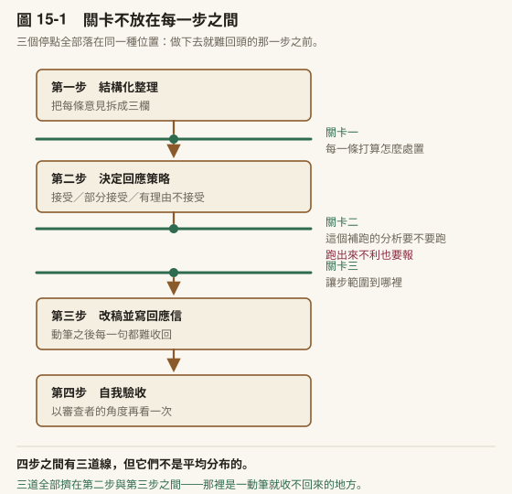
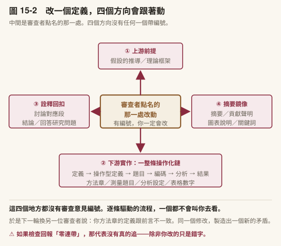
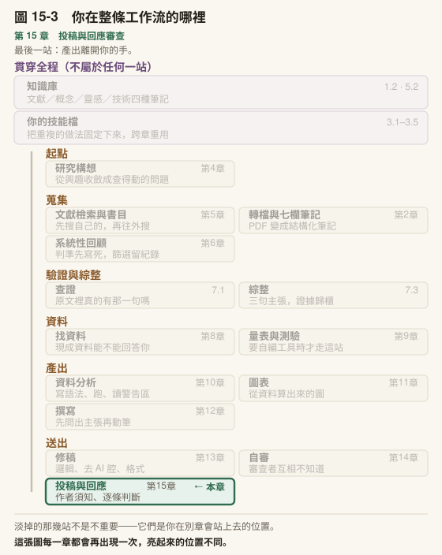

# 第 15 章　投稿實務與回應審查

> 書稿第 15 章＝課程第 15 週（3 小時）。2026-10-15 新增 15.1 投稿實務；15.2、15.3 由原[第 7 章](../chapters/07-verification.md)拆出（原 [7.3](../chapters/07-verification.md#73-從二十篇筆記到一個論點)）。

---

## 本章導覽

**這一章回答四個問題**

1. 一篇稿子該投哪一本期刊，怎麼判斷？
2. 作者須知裡哪些要求最容易漏？
3. 審查意見進來了，逐條照做為什麼是錯的？
4. 當你是審查者時，AI 可以幫到哪裡？

**讀完你能夠**

- **篩選**候選期刊，並說出每一本合不合適的理由
- **整理**一份作者須知核對表，逐條確認稿件符合
- **拆解**審查意見並決定接受／部分接受／拒絕的策略與理由
- **建好**交稿前的自動關卡，擋下還留著未完成標記的稿子

**需要多久**

自學閱讀約 60 分鐘｜課堂 3 小時（概念 75 分、實作 105 分）

**進來之前，你要能**

- 拿出一份跑過自審的稿子與審查回報的對帳表（[第 14 章](../chapters/14-self-review.md)）

**開始前請準備**：兩本你考慮投稿的期刊的作者須知；一份你收過的審查意見或指導教授回饋（沒有的話講師會提供模擬版）。走計畫書路線的人，帶你要送審的系所或計畫申請的格式規定。

---

## 章前導言

[第 14 章](../chapters/14-self-review.md)結束時，稿子已經被一個看不到你修改理由的審查者看過。這一章處理它出門這件事本身。

出門分兩段。第一段在你手上：選一本期刊、照它的規矩把稿子整理好、寫一封投稿信。這一段每一步都有一份別人寫好的規定可以照著核對，AI 很適合幫你逐條比對；但「這本期刊適不適合我的貢獻」是判斷，不是比對。第二段在別人手上：審查意見回來了，你要決定哪些接受、哪些部分接受、哪些拒絕，而每一個拒絕都要有理由。

走計畫書路線的人，第一段換成你的系所或計畫申請的格式規定，第二段換成口試委員或指導教授的意見，做法一樣。

> **〔課堂〕開場 6 分鐘** 請學生打開一本期刊的作者須知，計時三分鐘，數一數裡面有幾條「要求」。數完問：你上一次投稿或交作業之前，逐條核對過幾條？

---

## 15.1 投稿實務：選期刊、讀作者須知、寫投稿信

稿子在[第 14 章](../chapters/14-self-review.md)自審過、對抗審查也跑過之後，到收到審查意見之前，中間還有一段：選期刊、照那本期刊的作者須知改稿、準備匿名檔案、寫投稿信、在投稿系統裡填一長串欄位。

這一段大部分是機械工作，可以交給 Claude 做一大半。其中有兩件判斷留在你手上：**這本期刊適不適合你的貢獻**，以及**你要說自己的研究貢獻了什麼**。這一節講兩樣工具怎麼運作、它們在哪裡停下來讓你判斷：作者須知核對技能（`journal-checklist`）與匿名稿檢查腳本（`check_metadata.py`），以及這一段每個做法背後的規則。

### 選期刊：先問誰會讀，再問誰會收

選期刊常見的做法是看排名，挑一本分數高的試試看。排名是一個條件，不是第一個條件。順序是：

| 問題 | 去哪裡看 | 為什麼重要 |
|---|---|---|
| **它登什麼**（範圍） | 期刊首頁的 Aims and Scope | 範圍不合的稿子，常在編輯那一關就被退回，連審查都沒進 |
| **誰讀它**（讀者） | 近兩年的目錄，看作者與題目來自哪些領域 | 決定你的前言要從哪裡講起、哪些術語要解釋 |
| **它登過你這種方法嗎**（方法慣例） | 用你的方法名稱在該刊內搜尋 | 審查者會用該刊習慣的標準看你的方法 |
| **多久會有消息**（審查時程） | 期刊頁的統計，或近期文章標示的收稿與接受日期 | 學位有期限的人要算進去 |
| **要付多少錢**（費用） | 作者須知或出版社的費用頁 | 開放取用期刊多半收文章處理費（article processing charge，APC）；有的期刊另收審查費或排印費 |
| **篇幅與語言** | 作者須知 | 中文稿與英文稿的字數算法不同，有的期刊含參考文獻一起算 |

第三列最常被跳過，也最容易事先查。登過的同型研究一篇都沒有，不代表不能投，代表審查者可能沒看過這種寫法，方法段要多解釋一層。

這張表的分工是一條規則：**資料由它整理，合不合適由你判斷。** 它能讀期刊首頁、整理範圍、列出近期文章的方法。它判斷不了的是你的貢獻放在這本期刊的讀者面前，會不會被當成貢獻，這要你讀過那本期刊近幾期的文章。

〔動手一下〕**10 分鐘。** 挑一本你考慮投稿的期刊，打開它的 Aims and Scope，再看最近一期的目錄。只回答一題：最近一期裡，有沒有一篇你會引用？一篇都沒有，這本期刊的讀者可能不是你要說服的人。

### 先確認期刊是真的

[第 7 章](../chapters/07-verification.md)四步核實的第 3 步，是確認你要引用的期刊不是掠奪性期刊（收錢就登、缺乏品質把關的期刊）。投稿時同一件事要再做一次，而且代價更高：引用錯了改得回來，稿子投錯了，可能連同版權一起交出去。

這一次要多防一種：**被劫持期刊**（hijacked journal，暫譯）。它複製一本正牌期刊的刊名與 ISSN，架一個外觀幾乎相同的網站收稿收費。網站做得專業不是安全訊號，那正是它設計出來的樣子。

規則有三條，每一條都不靠「看起來像不像」：

1. **投稿連結從索引資料庫的期刊頁進去**，不從邀稿信、不從搜尋結果的第一個網址進去
2. **期刊宣稱被哪個資料庫收錄，就去那個資料庫查它目前的狀態**，不看期刊網站自己的宣稱。收錄狀態會變，一本期刊可能被資料庫停止收錄，期刊網站上的標誌卻還留著
3. **查編輯委員**：挑兩三位，看他們的機構網頁有沒有寫自己是這本期刊的編委

〔補充〕被劫持期刊有專門的查核工具，例如 Retraction Watch 維護的被劫持期刊清單（Hijacked Journal Checker），以及辨識可信出版者的檢核表 Think. Check. Submit.。本書作者只讀過這兩個工具頁面的搜尋摘要，沒有逐頁使用過；用之前請自己開頁確認它們目前的內容。

### 作者須知核對技能怎麼運作

選定期刊之後，要把那本期刊的作者須知（各刊也稱投稿須知、author guidelines）從頭讀到尾，比對你的稿子。這件事 Claude 做得好：它讀得快，不會漏看某一段。要防的是它把別本期刊的規定、或它記得的「一般慣例」混進來，而照錯的規定改稿不會有任何警告，要到編輯退件才知道。

作者須知核對技能（`journal-checklist`）跑一次分五步：

| 步驟 | 它做什麼 | 停不停 | 產出 |
|---|---|---|---|
| 1　收件 | 確認你給的是作者須知**全文**與稿件；你只給了網址或首頁摘要，它要求全文 | **停**：等你補 | 兩份文件 |
| 2　抽要求 | 從作者須知逐段抽出每一項要求，每一項附原句與所在段落 | 不停 | 要求清單 |
| 3　比對 | 逐項對照稿件，標「符合／不符合／無法判斷／須知未提」 | 不停 | 核對表 |
| 4　交給你抽查 | 隨機挑三項，請你打開作者須知原頁核對原句 | **停**：等你回報三項都對得上 | 抽查結果 |
| 5　差距清單 | 只列「不符合」與「無法判斷」，按改動大小排序；不動稿件 | **停**：你決定哪些要改 | 待改清單 |

步驟 4 是這個技能的關卡。原句附上了，不代表原句是真的：它可能把相近段落的句子接錯項目，或在原句裡補幾個字。抽三項都對得上，表格的其餘部分才可以用；有一項對不上，整張表重跑，並在規則裡加一句擋住那種錯。

步驟 5 停下來，是因為有些差距改起來會動到稿件結構，例如篇幅超過上限要刪一整節。為了一本期刊刪一節值不值得，是你的判斷。

各期刊會不同、而照錯了出事時看不出來的項目，大致有這些：

| 項目 | 各刊常見的差異 |
|---|---|
| 篇幅 | 上限多少；含不含參考文獻、表格、摘要；以字數或詞數計 |
| 摘要 | 字數上限；結構式（分目的、方法、結果等小標）或非結構式 |
| 章節標題 | 有的要求編號，有的禁止編號 |
| 匿名送審 | 標題頁與匿名稿是否分檔；檔名與檔案屬性能不能有作者名 |
| 圖表 | 放在正文中，或逐張另交檔案；黑白或彩色、印刷彩圖是否收費 |
| 倫理聲明 | 要寫委員會名稱、核准編號、同意方式到什麼程度；不適用時是否仍要寫標題 |
| 資料可得性聲明 | 必附、鼓勵，或未提 |
| 生成式 AI 使用聲明 | 寫在方法段、參考文獻前的專節，或依出版社政策；只用來潤飾文字要不要揭露 |
| 推薦審查者 | 要求填、可選填，或不接受 |

最後兩列放在一起看：同一份稿子用 AI 潤飾了英文，投某本期刊可能不必揭露，投另一本要專寫一節。[第 16 章](../chapters/16-integrity.md)〈使用聲明：空泛與具體的差別〉講的是聲明要寫到可查驗；這張表說的是另一件事：**寫在哪裡、哪些要寫，各刊不同**，所以要逐刊讀。

同時考慮好幾本期刊時，有一個省工的做法：把幾本的核對表並排，先照**交集**寫，例如摘要取最嚴的字數上限、篇幅以最短的那本為準。這樣一份稿子幾本都過得了內容門檻，轉投時只剩標題編號這一類機械調整。

**字數不讓它估。** 它對長文字數的估計不可靠，要用 Word 的字數統計或一支小腳本算。算之前先看清楚須知怎麼算：含不含參考文獻、表格與摘要。

〔動手一下〕**10 分鐘。** 打開你選的那本期刊的作者須知，只找三項：篇幅上限怎麼算、摘要格式、AI 使用聲明寫在哪裡。找不到的記「須知未提」，那是投稿前要寫信問編輯部、或去讀該刊近期文章的地方。

### 匿名送審：正文之外，檔案自己會說話

多數教育期刊採雙向匿名審查：審查者不知道作者是誰，作者也不知道審查者是誰。你把正文裡的姓名、單位、致謝拿掉了，匿名化只完成一半。

Word、PowerPoint、Excel 檔案在正文之外還存著幾樣東西，打開檔案看不到，另存新檔也不會清掉：

- **檔案屬性裡的作者與最後修改者**：建立檔案的帳號名稱
- **嵌入物件的連結**：從試算表貼進來的圖，會記著那份試算表在你電腦上的完整路徑，路徑裡常有你的使用者名稱、專案資料夾名
- **沒有清掉的註解與追蹤修訂**：共同作者的名字跟著每一則修訂留在檔案裡

規則：**匿名稿送出前查中繼資料，清完要用工具驗，不以「按過清除按鈕」為準。** Word 本身有清除功能（檔案 → 資訊 → 查看問題 → 檢查文件），送出前跑一次；清完之後再用下面這支腳本驗一次。

#### check_metadata.py 怎麼運作

Word、PowerPoint、Excel 檔其實是一個壓縮檔，裡面是一堆文字格式的設定檔。腳本把它拆開，看四個地方：

| 它看哪裡 | 找什麼 | 報告標籤 |
|---|---|---|
| `docProps/core.xml`、`docProps/app.xml` | 作者、最後修改者、公司、管理者欄位有沒有值 | 〔欄位〕 |
| 所有 `.rels` 與 `.xml` | 長得像本機路徑的字串（`file:///`、`C:\`、`/Users/`） | 〔路徑〕 |
| `word/comments.xml` | 註解檔還在不在 | 〔註解〕 |
| `word/document.xml` | 追蹤修訂的插入與刪除標記 | 〔修訂〕 |

它只列出找到什麼，不動檔案。清不清、怎麼清，是你的事：有些欄位要清空，有些路徑要把圖重新以圖片貼上才會消失。腳本放在 `_工作流/腳本/check_metadata.py`：

```python
# check_metadata.py：送出匿名稿之前，列出 Word／PowerPoint／Excel 檔裡藏著的身分線索
# 用法：python check_metadata.py 稿件.docx [其他檔案 ...]
import re
import sys
import zipfile

sys.stdout.reconfigure(encoding="utf-8", errors="replace")

FIELDS = {
    "docProps/core.xml": ["dc:creator", "cp:lastModifiedBy"],
    "docProps/app.xml": ["Company", "Manager"],
}
PATH_PATTERN = re.compile(r"file:///[^\"'<> ]+|[A-Za-z]:\\[^\"'<>]+|/Users/[^\"'<> ]+")


def check(path):
    print(f"== {path}")
    found = 0
    with zipfile.ZipFile(path) as z:
        names = z.namelist()
        for part, tags in FIELDS.items():
            if part not in names:
                continue
            xml = z.read(part).decode("utf-8", errors="replace")
            for tag in tags:
                m = re.search(rf"<{tag}>(.*?)</{tag}>", xml)
                if m and m.group(1).strip():
                    print(f"  [欄位] {tag} = {m.group(1)}")
                    found += 1
        for name in names:
            if not (name.endswith(".rels") or name.endswith(".xml")):
                continue
            xml = z.read(name).decode("utf-8", errors="replace")
            for hit in sorted(set(PATH_PATTERN.findall(xml))):
                print(f"  [路徑] {name}: {hit}")
                found += 1
        if "word/comments.xml" in names:
            print("  [註解] 檔內還有註解（word/comments.xml）")
            found += 1
        if "word/document.xml" in names:
            body = z.read("word/document.xml").decode("utf-8", errors="replace")
            n = len(re.findall(r"<w:(?:ins|del) ", body))
            if n:
                print(f"  [修訂] 還有 {n} 處追蹤修訂沒有接受或拒絕")
                found += 1
    print(f"  共 {found} 項要處理" if found else "  沒有找到")


for p in sys.argv[1:]:
    check(p)
```

以下是示範情境：兩份虛構的示範檔，一份沒清、一份清過。

```text
> python _工作流/腳本/check_metadata.py 匿名稿_未清理.docx 匿名稿_已清理.docx
== 匿名稿_未清理.docx
  [欄位] dc:creator = 王小明
  [欄位] cp:lastModifiedBy = 王小明
  [路徑] word/_rels/document.xml.rels: file:///C:/Users/wang/Desktop/論文資料/圖2_原始.xlsx
  [修訂] 還有 1 處追蹤修訂沒有接受或拒絕
  共 4 項要處理
== 匿名稿_已清理.docx
  沒有找到
```

「沒有找到」只代表這四類沒有。腳本看不到的要你自己讀：正文裡的自我引用（「如我們先前的研究（作者，2024）所示」）、致謝、倫理審查的核准編號（編號常帶著機構名稱）。這些內容不是刪掉，是移到標題頁（title page）：標題頁和匿名稿分檔上傳，編輯看得到，審查者看不到。

#### 驗收你的腳本

| 驗收項目 | 做對了會看到 |
|---|---|
| 抓得到作者欄 | 用自己平常的 Word 檔跑，〔欄位〕列出你的帳號名稱 |
| 抓得到路徑 | 從試算表複製一張圖、以連結方式貼進 Word，存檔後跑，出現〔路徑〕 |
| 抓得到修訂 | 開追蹤修訂改一個字、存檔後跑，出現〔修訂〕 |
| 清得掉 | 用 Word 的檢查文件清除後重跑，上面三項都消失 |

四項都要自己做一次。只拿乾淨的檔案跑出「沒有找到」，不能證明腳本會抓；要先看到它抓到，「沒有找到」才有意義。

| 你看到的 | 多半是 | 怎麼辦 |
|---|---|---|
| `BadZipFile` | 檔案是舊版 `.doc`，不是 `.docx` | 另存成 `.docx` 再跑 |
| 中文變亂碼 | 主控台編碼 | 腳本第一段的 `reconfigure` 不要刪 |
| 清除後〔路徑〕還在 | 圖仍是連結物件 | 把圖改以「圖片」貼上，或從原始軟體匯出成圖檔再插入 |

### 投稿信寫什麼，不寫什麼

投稿信（cover letter）是寫給編輯的。編輯讀它的目的是決定這份稿子要不要送審，所以它要短，一頁以內。

| 寫 | 不寫 |
|---|---|
| 題名、文章類型（研究論文、短篇報告等） | 把摘要再抄一次 |
| 一兩句：這篇回答了什麼問題、補了什麼缺口 | 「首創」「第一個」這類你沒辦法證明的宣稱 |
| 一句：為什麼適合這本期刊，對到它的 Aims and Scope | 稱讚期刊的套話 |
| 聲明：未一稿多投、全體作者同意投稿 | 對可能審查者的評論 |
| 利益衝突、經費（如須知要求） | 要求加快審查 |
| 生成式 AI 的使用揭露 | |

「首創」那一格背後的規則：**你沒有查證過的新穎性，不寫成事實。** 要寫，就寫「就我們所知」（to our knowledge），並在方法或限制段寫明查了哪些資料庫、用什麼關鍵詞、在哪一天查的。沒有查證範圍的「就我們所知」只是一句客氣話。

AI 使用的揭露，[第 16 章](../chapters/16-integrity.md)〈誠信的完整框架〉的延伸資源提過：國際醫學期刊編輯委員會（ICMJE）建議揭露同時寫在投稿信與稿件兩處。稿件裡寫在哪一節，照你的核對表。

投稿信的骨架：

```text
Dear Editor,

〔一句：投稿的題名與文章類型〕
〔兩句：研究問題、主要發現〕
〔一句：為什麼適合本刊——對到 Aims and Scope 的哪一部分〕
〔聲明：未一稿多投、全體作者同意、利益衝突〕
〔一句：生成式 AI 的使用範圍，與稿件中揭露的位置〕

Sincerely,
〔通訊作者姓名、單位、聯絡方式〕
```

骨架裡的格子 Claude 能幫你填語句。**「為什麼適合本刊」那一格要你先寫一句**，它再潤；你寫不出來，回到選刊表，你可能還沒讀過這本期刊的文章。

**推薦審查者不交給它。** 名單要你自己開：你得知道這個人做過什麼、有沒有跟你合著過、是不是同一個單位，這些是利益衝突的判斷。叫 Claude 推薦，它可能給你一位與你有合作關係的人，或一位不存在的學者、一個錯的電子郵件地址。

### 投稿系統要準備的欄位

各期刊的投稿系統長得不一樣，要準備的東西大致相同。先備齊再登入，不要邊填邊找：

| 類別 | 內容 |
|---|---|
| 作者資料 | 每位作者的姓名、單位、ORCID、電子郵件；通訊作者是誰 |
| 作者貢獻 | 有的期刊要求用 CRediT（一套標準化的作者貢獻分類）逐人勾選 |
| 稿件資訊 | 題名、摘要、關鍵字。系統的摘要欄常有字數上限，貼進去前先算 |
| 檔案 | 標題頁、匿名稿、圖檔、表格、附錄或補充資料 |
| 聲明 | 倫理、同意、利益衝突、經費、資料可得性、AI 使用，依核對表逐項 |
| 審查者 | 推薦或排除名單（期刊有要求才填） |

送出前，系統多半會把上傳的檔案合成一份 PDF 讓你確認。**下載下來，從頭翻到尾。** 圖有沒有掉、表格有沒有跑版、匿名稿裡有沒有混進標題頁，都是在這一步才看得到。

送出之後做兩件事：把送出的那一版檔案原樣存進 `專案_我的論文/稿件/交出去/`，檔名帶日期與期刊；在決策日誌寫一行，投了哪一本、為什麼是這一本。被拒之後要改投，或半年後審查意見回來，你需要知道當初送出去的是哪一版。

### 被拒之後改投

被拒有兩種：沒送審就被編輯退回（desk rejection），以及送審後被拒。前者多半是範圍不合或格式不符，回到選刊表；後者會附審查意見，先照本章後半處理審查意見的流程讀過一遍，決定哪些要改，再投下一本。

規則：**改投要重做核對表，不是換封面。** 新期刊的語言、篇幅算法、摘要格式、引用體例都可能不同；從英文期刊改投中文期刊，連稿件語言都要換。把 `journal-checklist` 對新期刊重跑一次，差距清單就是改投的工作量。

改投時要清掉的東西：投稿信裡前一本期刊的名字、檔名裡的期刊縮寫、照前一本期刊格式做的標題編號與參考文獻格式。投稿信裡留著前一本期刊的名字，是編輯一眼就看得到的錯。

**同一份稿子同時只投一本。** 前一本還沒正式退稿或你還沒正式撤稿之前，不能投下一本。

### 建你自己的作者須知核對技能

〔教你的 Claude 建這個〕把下面這段貼給 Claude，請它建 `.claude/skills/journal-checklist/SKILL.md`：

```text
請幫我建一個技能檔，名稱 journal-checklist。
用途：逐條比對期刊作者須知與我的稿件。
我平常會說：「這本期刊要什麼」「投稿前核對」「作者須知」。

步驟：
1. 確認我給的是作者須知全文與稿件；只有網址或摘要就要我補全文
2. 從作者須知逐段抽出每一項要求，每項附原句（逐字）與所在段落
3. 做核對表：項目／原句／所在段落／我的稿件現況／
   符合、不符合、無法判斷、須知未提
4. 隨機挑三項，請我打開原頁核對原句，等我回報
5. 只列不符合與無法判斷，按改動大小排序，等我決定

不要做什麼：
- 須知裡沒寫的項目標「須知未提」，不用一般慣例補
- 字數不目測，標「待用工具計算」
- 不改我的稿件
- 不評論這本期刊適不適合我
```

第一版就這五步。驗收時拿一本你讀過作者須知的期刊跑一次：

| 驗收項目 | 做對了會看到 |
|---|---|
| 不用慣例補 | 至少一項標「須知未提」（幾乎每本期刊都有沒寫到的項目） |
| 原句是真的 | 你抽查的三項，原句在原頁上找得到、一字不差 |
| 字數不目測 | 篇幅那一列寫「待用工具計算」，不是一個估計值 |
| 停下來 | 列完差距清單後它問你要改哪些，沒有自己動手改稿 |

用過兩本期刊之後，你可能會想加一欄「幾本期刊的交集怎麼寫」，那時候再加。

> **〔課堂〕投稿實務 40 分鐘** 建議節奏：選刊六個問題（5 分）→ 被劫持期刊與三條規則（5 分）→ `journal-checklist` 五步流程，示範步驟 4 的抽查（10 分）→ 學生為自己考慮的期刊跑一次，做到抽查為止（10 分）→ 匿名化示範：現場用一份含作者欄的 Word 檔跑腳本，清除後再跑一次（10 分）。走計畫書路線的學生，請他們挑一本將來可能投的期刊。學生最常卡的點是找不到作者須知的完整頁面：期刊首頁常只有摘要版，完整版在「Submission guidelines」「Instructions for authors」或出版社的另一個網域。匿名化示範前先問全班：誰的 Word 檔案屬性裡是自己的本名？多數人沒看過。

### 帶走這一節

- 選期刊先問**它登什麼、誰讀它、它登過你這種方法嗎**；資料由它整理，**合不合適由你判斷**
- 投稿連結從索引資料庫進去，收錄狀態到資料庫查；**被劫持期刊的網站和正牌一樣專業**
- `journal-checklist` 每項附原句與段落，**抽查三項對得上才用**，差距清單停下來讓你決定
- 匿名稿送出前查中繼資料：**作者欄、嵌入圖的本機路徑、追蹤修訂**；先確認腳本抓得到，「沒有找到」才有意義
- 投稿信一頁以內；新穎性沒查證不寫成事實，推薦審查者不交出去；改投**重做核對表**

---

---

## 15.2 回應審查意見


### 你是作者：收到審查意見之後

如果你投過稿，你知道收到審查意見的感覺。信打開、讀第一句，要是寫著 major revision 你就鬆一口氣（至少不是 reject），然後開始看那一長串意見，越看越不知道從哪裡下手。

審查意見處理困難的原因不是意見太多，通常也就十幾條。困難的是你必須同時處理三件事：

1. 理解每條意見的**實際訴求**（審查者寫的和他們要的常常不是同一件事）
2. 決定**接受、部分接受、或有理由拒絕**每一條
3. 修改稿件的同時確保**改了 A 沒有破壞 B**

第一件和第二件，AI 可以幫很大的忙。第三件，AI 能幫你檢查但不能幫你保證。

**四步流程：**

**第一步：結構化整理。** 把審查意見整段貼進來，要求它把每條意見拆成三欄：「原始意見」、「核心訴求」、「需要你回答的問題」。很多時候審查者一條意見裡其實包含兩三個不同的要求，混在一起你容易漏。

**第二步：決定你的回應策略。** 這一步是你做的，不是 AI 做的。對每一條意見，你標記：全部接受、部分接受（接受哪部分？）、有理由不接受（理由是什麼？）。

這一步的預設做法是**讓它一條一條問你**，不是你想不出來才找它幫忙：「這條意見的核心訴求是什麼？你同意嗎？為什麼？」一次一條，答完再問下一條。回應信裡最難寫的是讓步範圍——你打算讓到哪裡、哪裡不讓、不讓的理由是什麼——而那三件事被問出來的品質，比自己坐著想出來的高。最終的判斷仍然是你的（做法在[第 12 章](../chapters/12-writing.md)）。

**第三步：執行修改並撰寫回應信。** 你逐條修改稿件，AI 幫你起草 Response to Reviewers 的每一條回應。格式是學術界通用的：先引述原始意見，再寫你的回應，最後標註修改位置（「見修訂稿第 X 頁第 Y 段」）。

**第四步：自我驗收。** 改完之後，讓 AI 以審查者的角度重新檢查一次：「Reviewer 2 說要補文獻支持，你真的補了嗎？補的那篇是不是在說你以為它說的話？」這不能取代你自己的檢查，但它能抓到你忙了一下午之後漏掉的東西。



〔圖 15-1〕三道線沒有平均分布。**它們全部擠在同一個縫隙裡**，因為那裡是一動筆就收不回來的地方。

〔補充〕**新增引用的驗證**。在第三步修改稿件時，你可能會新增一些審查者要求的引用。這些新引用同樣要經過[第 7 章](../chapters/07-verification.md)的四步核實。AI 能幫你整理一份「本次修改中新增的所有引用」清單，讓你知道哪些需要去查。修稿的壓力和截止日期不是跳過核實的理由，恰好相反，趕時間的時候犯錯的機率更高。

〔補充〕這四步在成熟工作流裡會多三個關卡。 我自己的審稿回應工具在流程中途設了三個強制停點：意見分類之後問每條要怎麼處置、補跑統計**之前**問這個分析要不要跑、動筆之前問讓步範圍到哪裡。三個關卡落在同一種位置：這一步做下去就難回頭。其中第二個帶著一條硬規則。補跑的統計若結果不利於原結論，不得靜默不報。那條規則不是禮貌，是把誠信寫成機制。你的版本只需要一個關卡：找出流程裡「做錯了很難回頭」的那一步，在它前面插一個問句。第三個關卡（動筆之前問讓步範圍）其實就是 [第 12 章](../chapters/12-writing.md)那個做法落在審稿回應上的樣子——一次問一件，答完才准往下寫。關卡太多，你會養成整批略過的習慣，那時候等於一道都沒有。決策卡的四欄格式見[附錄 F](../appendix/F-skill-library.md) 的模式④。

### 修改後的文字，要像它本來就是這樣寫的

第三步有一條容易忽略的規矩：修訂稿是給未來的讀者看的，不是給審查者看的。

審查者會拿到你的回應信，那裡面才是對話。稿件本身不該留下這場對話的痕跡—— 因為一年後引用你這篇的人，手上只有稿件。

**四種語言不該出現在正文：**

| 不該寫 | 為什麼 |
|---|---|
| 比較版本：「原本」「先前的分析」「仍然顯著」 | 讀者不知道「原本」是什麼，這是一個他拿不到的參照點 |
| 提到審查者：「為回應審查者的意見，我們……」 | 對話屬於回應信 |
| 方法術語跑進結果與討論：校正方法的名稱、估計法的縮寫 | 那些屬於方法章。出現在結果裡，讀起來像在解釋自己 |
| 單獨挑一個變項說它「不顯著」 | 點名它，等於告訴讀者你去找過它（見下） |

**最後一條不是叫你藏。** 所有結果都留在表裡，一個都不刪。它防的是另一件事：在正文裡單獨點名某一個不顯著的結果，等於告訴讀者你去找過它。不顯著的東西讓表格說話，正文只講你原本就要講的那條線。

**因果語言的替換表**。這是審查意見裡最常出現、也最容易在改稿時又寫回去的一類。觀察性或相關性設計，以下一律換掉：

| 你寫的 | 改成 |
|---|---|
| X 造成／導致 Y | X 與 Y 有關聯 |
| X 提升／促進 Y | 與 Y 呈正向關聯 |
| X 限制／阻礙 Y | 與 Y 呈負向關聯 |
| 讓學生得以做 X | 反映了做 X 的機會 |
| 在提升成效上 | 在預測成效上 |

同時要在限制那一節寫明你的設計無法支持因果推論，並且列出具體的可能混淆變項。只寫「本研究無法推論因果」而不說是哪些東西可能混在裡面，等於沒說—— 那句話已經被寫過太多次，讀者會直接跳過。

### 四步之外還有三步，而且它們是最容易被跳過的

上面那四步是**逐條意見驅動**的：一條意見對應一處改動。這個結構很好用，但它有三個**結構性的盲點**。不是做得不夠仔細會漏，是流程本身不會問。

#### 盲點一：你的改動牽動了哪些「沒有人點名」的地方

假設審查者要求你把某個構念的定義改窄。你改了，改得很漂亮，回應信對得起來。

然後呢？



〔圖 15-2〕中間那一格有編號，你一定會改。**四個方向一個編號都沒有。**

於是下一輪換另一位審查者說：「你方法章的定義跟前言不一致。」同一個修改，製造出一個新的內部矛盾。

我自己那個審稿回應工具因此多了一個步驟，叫**爆炸半徑檢查**：每一處改動都沿四個方向追一次。

| 方向 | 問自己 | 通常會命中哪裡 |
|---|---|---|
| **① 上游前提** | 這個被改的東西，在別的地方被當成已成立的前提引用嗎？ | 後續假設的推導、理論框架、其他構念的對比定義 |
| **② 下游實作** | 它有沒有一條操作化鏈？**定義 → 操作型定義 → 題目 → 編碼 → 分析 → 結果** | 方法章、測量題目、分析設定、結果的數字與表格 |
| **③ 詮釋回扣** | 有沒有段落回頭詮釋或引用這個結果？ | 討論對應段、結論、對研究問題的回答 |
| **④ 摘要鏡像** | 這個東西在「濃縮層」有沒有分身？ | 摘要、貢獻聲明、圖表說明、關鍵詞 |

**數字型的改動幾乎必然命中②③④**。你補跑了一次統計、換了一個數字，那個數字同時活在正文、表格、討論引用處、摘要裡。四處任一沒同步，下一輪必被抓。

**兩條規矩讓這一步不會走偏：**

**第一，只定位，不自動改。** 產出的是一份「連帶待改清單」，每一項由你確認過才動。**不能擅自改掉審查者沒要求的段落**—— 那會讓你的修改幅度超出回應信宣稱的範圍，變成另一種問題。

**第二，也是最重要的一條：如果改動涉及定義、構念、假設或統計，而檢查回報「零連帶」，那代表沒有真的追。** 論文是高度互聯的文本，改一個核心元素幾乎不可能只影響它自己。 **唯一合理的零連帶，是純粹的局部措辭潤飾**。改錯字、修單句文法，不碰任何主張、數字或構念。

#### 盲點二：你讀的是自己腦中的那個版本

如果你**已經寫好回應信**才想到要檢查，那要跑的是另一個東西：唯讀稽核。

自己寫的回應信，最容易犯的錯不是寫得不好，而是這三種：

1. **漏掉某一條意見**
2. **誤讀審查者真正在問什麼**
3. **語氣上把審查者惹毛**

⚠️ 這三種錯，自己讀十遍也看不出來。因為你讀的是自己腦中的意見版本。（[第 14 章](../chapters/14-self-review.md)講過同一件事的另一個版本：讀到第七遍的時候，你是在回憶稿子，不是在讀它。）

**做法一：拆到最小可回應單位。**

一條意見裡包了三個要求，就要拆成**三列**，不是一列。

> **這是最常抓到問題的地方**：你回應了那條意見裡最顯眼的要求，漏掉夾在句子後半的第二個。

每一列標三級：**完整／部分／遺漏**。「部分」跟「遺漏」都要處理，而「部分」比「遺漏」危險。因為它看起來已經回應了。

**做法二：五個風險旗標。**

| 旗標 | 在偵測什麼 | 長什麼樣 |
|---|---|---|
| **語氣** | 防衛、居高臨下、暗示審查者沒讀懂 | 「如同我們在原稿中已經清楚說明的……」 |
| **證據** | 宣稱改了但沒指出位置；宣稱資料支持但沒給數字 | 「我們已加強論述」——加在哪？ |
| **誤讀** | 回應的問題不是審查者問的那個 | 他問構念效度，你談信度 |
| **過度承諾** | 回應信宣稱的幅度大於稿件實際改動 | 說「全面重寫討論」，實際只改兩段 |
| **不同意姿態** | 禮貌地不採納，卻沒給理由或替代方案 | 「我們認為原本的做法較合適」——為什麼？ |

⚠️ **誤讀是最貴的一種。** 它讓你在下一輪收到同一條意見，而且審查者這次會不耐煩。

它也有一個很機械的偵測方法：把審查者原句的動詞與受詞抽出來（「請說明**估計方法的選擇**」），比對你的回應實際談的是不是同一個對象。這個動作五分鐘做得完，而它抓到的東西是你重讀十遍都看不到的。

**這一步是唯讀的。** 它只告訴你缺口在哪，不替你改。理由跟 [第 14 章](../chapters/14-self-review.md)的五角色一樣： **稽核的人不能同時是動手的人**，否則它會傾向認為自己寫的沒問題。

〔動手一下〕**10 分鐘**。找一份你寫過的回應信（或指導教授回饋的回覆），只做一件事：把審查意見拆成最小單位，逐條標完整／部分／遺漏。多數人會在這裡發現至少一條「部分」。

#### 盲點三：哪裡讓太多

前兩個盲點問的都是「哪裡還不夠」。這一個問相反的問題：**哪裡讓過頭了。**

這是整條線上最少被檢查、卻最傷論文的一面。原因不難理解—— **作者在修改壓力下的預設反應是「全部照做」**，而全部照做感覺起來像是負責任。

但審查者不是永遠對的，而且他手上沒有你的資料。

我那個工具把這一步叫**讓步稽核**。它查五種讓步：

| 類型 | 徵狀 | 該怎麼辦 |
|---|---|---|
| **貢獻稀釋** | 主張弱化到引言那句貢獻聲明已經不成立了 | 守住主張，改為補證據或加限制條件 |
| **過度刪除** | 刪掉被質疑的分析或段落，而不是說明它為什麼站得住 | 先問一句：這個分析是**錯的**，還是**只是沒解釋清楚**？ |
| **方法投降** | 換成審查者建議的方法，但那個方法其實更不適合這批資料 | 用資料條件說明原方法的正當性：組數、樣本數、分布 |
| **限制通膨** | 限制那一節越寫越長，把真實的方法論優勢也寫成了缺陷 | 限制章節寫的是真限制，不是自我貶低 |
| **文獻塞入** | 審查者要求引用（有時是自引），照單全收但跟你的論證無關 | 不相關就禮貌說明；相關才引 |

**限制通膨跟[附錄 I](../appendix/I-self-review.md) 的 I-5 是同一個病的兩個階段。** I-5 講的是你自己寫稿時就先把結果打了折；這裡講的是被審查意見推著再打一次。**同一件事不必道歉兩次。**

**反向檢查兩問**（這兩問才是這個角色真正的產出）：

1. 有哪一條意見，你其實**有充分理由不採納**，卻因為怕得罪審查者而照做了？
2. 有哪一條意見是**基於審查者的誤讀**，你卻直接照改、沒有澄清？

⚠️ **第二種最危險。** 照著誤讀改，等於承認了一個不存在的錯誤，而那個「承認」會留在紀錄裡：下一輪的審查者、以後引用你的人，看到的是你認了。

這個檢查**只診斷，不改稿**。守或不守是你的決定—— **但你必須是在知道自己正在讓步的情況下讓步。**

#### 最後一步：稿件就緒不等於作者就緒

前面所有步驟確認的都是**稿件**。還有一件事沒被確認：你。

這一步叫**答辯測驗**。改完之後找個人問你四題，或者自己寫下答案：

```text
1. 統計上那個選擇為什麼是這一個而不是另一個？
2. 你刪掉的那一段，判準是什麼——為什麼刪這段不刪那段？
3. 限制那一節的邏輯是什麼？
4. 回應信的每一條，對應到稿件的哪一處改動？
```

答不出來就還沒好。這四題**不是為了考你**，是因為 **跑過統計校正、或三個以上章節有實質改動之後，你自己也記不清每個決定的理由了**—— 而編輯會問，口試委員也會問。

這一步跟[第 1 章](../chapters/01-setup.md)的決策日誌是同一件事：當下記下理由，比事後重建可靠。事後重建出來的理由永遠比較整齊，而整齊往往代表你已經忘了真正的原因。

### 帶走這一節

- 審查意見要**拆到最小可回應單位**，再逐條標策略
- 接受、部分接受、拒絕都可以，**每一條都要有理由**
- 修改後的文字，要像它本來就是這樣寫的
- 回應信寫完，逐條標「完整／部分／遺漏」，再掃一次風險旗標

---

## 15.3 你是審查者：幫期刊審稿


如果你被期刊邀請審稿（這在研究生涯越來越早發生），AI 可以幫你做初步的結構化評估。

用的就是 [第 14 章](../chapters/14-self-review.md)那五個角色，只是對象換成別人的稿子。不是要你真的打分數，而是確保你沒有漏看哪個面向。方法論上沒有問題不代表文獻上沒有缺口，你需要一種結構來提醒自己翻面檢查。

但有一件事跟 [第 14 章](../chapters/14-self-review.md)不同：**審別人的稿子時，獨立性那條鐵則要用在你自己身上。** 先自己讀完、先寫下你的判斷，再去跑那五個角色。順序反過來，你寫的就不是你的審查意見了。

但有一個前提要講清楚：**AI 的審稿報告是起點，不是結果。** 你對這個領域的熟悉度、你對方法論的判斷、你對這篇研究的直覺，這些是機器做不到的。AI 幫你的是把閱讀結構化、確保你沒有漏看哪個面向。最後送出去的審稿報告，每一句話都要經過你的判斷。

⚠️ **還有一件事，而且它是規範不是建議：有些期刊明文禁止審查者把稿件交給 AI。** 《Science》的編輯政策就寫著，基於稿件的機密性，審查者不得使用 AI 工具撰寫審稿意見。這條規則跟前面幾條的性質不同。前面講的是品質，這一條講的是別人託付給你的未發表稿件。一份還沒公開的手稿貼進對話，你就把它送出了你自己的電腦。

所以接受審稿邀請的時候，順序是：先讀那本期刊的審查者政策，再決定怎麼用工具。沒有明文的期刊也不代表可以。不確定就當作不行，這一項的下檔風險太大。

你可能會注意到，「幫期刊審稿」和「自我驗收」用的是同一種多角度評估。這不是巧合。好的自我檢查跟好的同儕審查是同一件事，只是主體不同。

〔教你的 Claude 建這個〕回應審查意見這件事，關卡要設在流程中間，不是最後。貼這段：

「請幫我建一個〈審查回應〉技能檔，分三個階段，**每個階段結束都要停下來等我確認**： **階段一**：把每一條意見拆成最小單位，逐條標「這一條實際上要求了幾件事」。階段二：我逐條決定接受／部分接受／拒絕。**這一步你不准替我決定**，只能列出各選項的代價。 **階段三**：我改完之後，你只讀我的回應信與修訂稿，逐條標完整／部分／遺漏。三條硬規則：（一）**若因為回應意見而補跑了統計，結果不利於原結論時，不得靜默不報**；（二）階段三你**不准修改任何東西**，只能標記；（三）**改到定義、構念、假設或統計時，要追四個方向的連帶**：上游前提、下游實作、詮釋回扣、摘要鏡像。」

⚠️ **第一條是把誠信寫成機制**，不是寫成期許。補跑的統計不利於原結論，是修稿階段最想略過的一件事，而略過它的方式通常不是說謊，是「忘了提」。寫進檔案，它每次都會提。

**第二條的理由跟 [第 14 章](../chapters/14-self-review.md)的獨立性是同一條**：稽核的人不能兼任執行的人。它剛才幫你改完，再讓它檢查，它看到的是它記得的版本，不是紙上的版本。

> **〔課堂〕15 分鐘** 審查意見回應演練。講師提供一段模擬的審查意見（三條，其中一條包含不合理的要求），學生跑第一步和第二步。重點觀察：有沒有人直覺性地全部接受？討論「拒絕一條意見」需要什麼樣的理由才站得住腳。 **這一節現在有三個盲點與一張因果語言替換表，講不完。** 建議只講盲點三（哪裡讓太多），因為那是唯一一個學生**直覺方向相反**的東西—— 前兩個他們聽完會點頭，這一個他們會反問「照做不是比較安全嗎」。那個反問就是這一節的入口。因果語言替換表與四種不該出現的語言請學生自己讀，但**在演練的講評裡點名一次**：多數人寫的回應會出現「為回應審查者的建議，我們……」，而那句話不該進稿件。

### 帶走這一節

- 困難不在意見多，在於要同時處理理解訴求、決定策略、確保改 A 沒破壞 B
- 第二步（決定接受／部分接受／拒絕）**是你做的**，AI 只能幫你想清楚
- 一條意見裡常包含兩三個要求，**拆開來才不會漏**
- 修稿新增的引用同樣要走四步核實。趕時間的時候犯錯機率更高
- 幫人審稿與自我驗收是同一件事，只是主體不同
- **逐條驅動的流程不會問「這處改動牽動了誰」**。改到定義、構念、假設或統計時，四個方向逐一追：上游前提、下游實作、詮釋回扣、摘要鏡像
- 這類改動若追出「零連帶」，**代表沒有真的追**
- 已寫好的回應信要跑**唯讀稽核**：拆到最小單位標完整／部分／遺漏，再掃五個風險旗標。**誤讀是最貴的一種**——下一輪你會收到同一條意見，而審查者這次會不耐煩
- 修訂稿不留這場對話的痕跡：**不比較版本、不提審查者、方法術語留在方法章**
- 觀察性設計的因果動詞要逐個換掉，⚠️ **並且列出具體的可能混淆變項**——只寫「無法推論因果」等於沒說
- 第三個盲點問的是相反的問題：**哪裡讓太多**。五種讓步（貢獻稀釋／過度刪除／方法投降／限制通膨／文獻塞入）
- ⚠️ **照著審查者的誤讀改，等於承認一個不存在的錯誤**，而那個承認會留在紀錄裡
- 稿件就緒不等於作者就緒。四題答不出來就還沒好——**編輯會問，口試委員也會問**

---
---

## 本章建置：交稿前的自動關卡

這一節掛一道自動關卡：稿子放進「交出去」的資料夾那一刻，裡面還留著 `〔Claude 提議〕`、`〔待補〕`、`〔未查證〕` 的話，它當場被擋回來。15.1 的作者須知核對表處理期刊的要求，這道關卡處理你自己留下的未完成標記。

〔課堂〕約 25 分鐘。路徑寫錯是最常見的卡點，先請學生在終端機手動跑一次腳本，跑得動再掛上去。

### 這一節完成之後，工作台多了什麼

```text
研究工作台/
├── _工作流/腳本/scan_draft.py          ← 新增
├── 專案_我的論文/稿件/交出去/          ← 新增：要交出去的版本才放這裡
└── .claude/settings.json               ← 加上自動關卡
```

### 第 1 步　交稿前的自動關卡

[第 12 章](../chapters/12-writing.md)的訪談技能會在稿子裡留兩種標記：`〔Claude 提議〕`（它的想法，你還沒表態）和 `〔待補〕`（問不出來的地方）。[第 1 章](../chapters/01-setup.md)的規則留第三種：`〔未查證〕`。草稿裡有這些標記是正常的，它們代表還沒做完的事。**交出去的版本裡還有，就是出事了。**

這一步分三段：一支掃描腳本、一個專門放交稿版本的資料夾、一個讓腳本自動執行的設定。

**一、掃描腳本。** 在 `_工作流/腳本/` 建 `scan_draft.py`：

```python
"""交稿前掃描：稿子裡還留著沒處理完的標記，就擋下來。

兩種用法：
  手動：python scan_draft.py 稿件.md
  掛成 hook：python scan_draft.py --hook（從標準輸入讀 Claude Code 傳來的 JSON）
"""
import json
import sys
from pathlib import Path

sys.stdout.reconfigure(encoding="utf-8", errors="replace")
sys.stderr.reconfigure(encoding="utf-8", errors="replace")

# 每一個標記代表一件「還沒做完」的事。自己用到新的標記，就加在這裡。
MARKS = ["〔Claude 提議〕", "〔未查證〕", "〔待補〕"]

if sys.argv[1] == "--hook":
    data = json.loads(sys.stdin.buffer.read().decode("utf-8"))
    path = data.get("tool_input", {}).get("file_path", "")
    if "交出去" not in path or not path.endswith(".md"):
        sys.exit(0)  # 只管「交出去」資料夾裡的 .md，草稿照常寫
else:
    path = sys.argv[1]

hits = []
for n, line in enumerate(Path(path).read_text(encoding="utf-8").splitlines(), 1):
    for m in MARKS:
        if m in line:
            hits.append(f"  第 {n} 行　{m}　{line.strip()[:60]}")

if hits:
    print(f"{Path(path).name} 還有 {len(hits)} 處沒處理完：", file=sys.stderr)
    print("\n".join(hits), file=sys.stderr)
    sys.exit(2)  # hook 的結束碼 2：把這段訊息交回給 Claude
print(f"{Path(path).name}：沒有未處理的標記")
```

先手動跑一次，確定它跑得動：

```bash
python _工作流/腳本/scan_draft.py 專案_我的論文/稿件/討論.md
```

作者拿一份留著一個 `〔Claude 提議〕` 的測試稿跑出來：

```text
討論.md 還有 1 處沒處理完：
  第 3 行　〔Claude 提議〕　學生多半直接採信。〔Claude 提議〕這可能與年齡有關。
```

**二、交稿資料夾。** 建 `專案_我的論文/稿件/交出去/`。草稿在 `稿件/` 裡怎麼寫都可以；要寄給指導教授、要投稿的那一版，複製一份進 `交出去/`。腳本裡 `"交出去" not in path` 那一行，就是讓它只管這個資料夾：關卡放在交出去的那一刻，而不是每一次存檔。每存一次草稿就被擋一次，你很快就會把它關掉，那比沒有關卡更糟。

**三、掛上去。** 打開 `.claude/settings.json`，在[第 3 章](../chapters/03-skills.md)那段 `permissions` 後面加上 `hooks`，整份變成：

```json
{
  "permissions": {
    "deny": [
      "Edit(./專案_*/原始資料/**)"
    ]
  },
  "hooks": {
    "PostToolUse": [
      {
        "matcher": "Edit|Write",
        "hooks": [
          {
            "type": "command",
            "command": "python",
            "args": ["C:/Users/你的帳號/研究工作台/_工作流/腳本/scan_draft.py", "--hook"]
          }
        ]
      }
    ]
  }
}
```

逐段看：`PostToolUse` 是「它每用完一個工具之後」；`"matcher": "Edit|Write"` 是「如果那個工具是改檔案或寫檔案」；`command` 加 `args` 是「就執行這支腳本」。`args` 裡的路徑要換成你電腦上的完整路徑，用斜線 `/` 不用反斜線。

腳本最後的 `sys.exit(2)` 是它跟 Claude 溝通的方式：結束碼 2，代表剛才那個動作有問題，腳本印出的那幾行會交回給它，它會看到哪一行留著什麼標記。**檔案已經寫下去了**，這道關卡不是讓檔案寫不進去，是讓它當場知道、當場處理，而不是等你寄出去之後才發現。

改完 `settings.json`，把程式完全關掉再開。

### 驗收

**驗收一：關卡擋得住。** 在 `稿件/` 裡寫一份含 `〔待補〕` 的檔案，叫它「把這份複製到 `交出去/`」。做對了，複製完它馬上回報第幾行有 `〔待補〕`。再請它把同一份存在 `稿件/` 底下別的檔名，這次不應該有任何回報。

**驗收二：沒有標記的稿子通得過。** 把標記都處理掉，再複製一次。做對了，沒有任何回報。

### 出事的時候

| 你看到的 | 多半是 | 怎麼辦 |
|---|---|---|
| 關卡完全沒反應 | `args` 的路徑錯、`settings.json` 格式錯，或改完沒重開程式 | 先在終端機用同一條路徑手動跑腳本；跑得動再檢查 JSON 的逗號 |
| 每存一次草稿都被擋 | 腳本判斷資料夾那一行被改掉了 | 確認 `"交出去" not in path` 還在 |
| 掃描結果是一片亂碼 | 中文路徑在讀取時被錯誤解碼 | 確認腳本用的是 `sys.stdin.buffer.read().decode("utf-8")`。作者第一版寫成 `json.load(sys.stdin)`，在 Windows 上讀到的中文路徑全部變成亂碼，比對不到「交出去」三個字，於是**每一次都靜默放行** |

最後一列值得多看一眼。那支腳本沒有報錯，看起來一切正常，只是它從來沒有擋下過任何東西。**一道從來沒擋過東西的關卡，你沒辦法分辨它是因為稿子都乾淨，還是因為它壞了。** 驗收一那一步故意餵它一份髒的稿子，就是為了分辨這兩種情況。

### 這一步留給下一章的

稿子交出去之前的最後一道關卡掛好了。[第 16 章](../chapters/16-integrity.md)把十六章建出來的東西列成一張表，每一樣都附一個驗它還在運作的動作。

### 帶走這一節

- hook 把關卡放在**交出去的那一刻**，不是每一次存檔
- **一道從來沒擋過東西的關卡，要故意餵它一次髒的，才知道它有沒有壞**


---

## 15.4 動手實作

### 實作一：作者須知核對表（30 分鐘）

1. 把一本期刊的作者須知交給它，要它逐條列成核對表，**每一條附原文位置**（10 分鐘）
2. 拿你的稿子逐條核對，標符合／不符合／不適用（15 分鐘）
3. 抽三條回作者須知原文對一次，確認它沒有漏列或改寫要求（5 分鐘）

### 實作二：審查意見回應演練（30 分鐘）

> **〔課堂〕講師提供一段模擬審查意見（三到五條），其中至少包含一條不太合理的意見。**

1. 把審查意見貼進來，讓 AI 做結構化整理，**拆到最小可回應單位**（8 分鐘）
2. 對每條意見標記你的回應策略：接受 / 部分接受 / 拒絕（8 分鐘）
3. 針對最難的一條，起草回應（8 分鐘）
4. 逐條標「完整／部分／遺漏」，並掃一次五個風險旗標（6 分鐘）

### 技能要點

| 實作 | 關鍵動作 | 做對了長什麼樣 | 常見卡點 |
|---|---|---|---|
| 一 · 作者須知 | 每一條附原文位置，**抽查三條** | 你找到至少一條稿子不符合的要求 | 相信它列的清單是完整的 |
| 二 · 審查回應 | 對每條意見**先標策略再動筆** | 你有一條標「部分接受」，並寫得出為什麼只接受一半 | 逐條照做。那不是回應，是服從 |

### 當週小task

繳交三樣：

1. 一本目標期刊的作者須知核對表，含你的核對結果
2. 一封投稿信草稿
3. 一份模擬審查意見的回應表（策略＋理由）

---

## 15.5 常見迷思

**迷思一：「回應審查意見就是逐條照做。」**

*為什麼錯*：審查者不一定是對的。他們的意見基於他們的專業判斷，但他們可能不熟悉你的特定方法、你的研究脈絡、或你選擇某個做法的理由。全盤接受意味著你放棄了作者的判斷權。

*正確版本*：每條意見你都要認真考慮，但最終決定是你的。拒絕一條意見不需要對方是錯的，只需要你有充分的理由，而且你把理由寫出來。

**迷思二：「各期刊的格式要求大同小異，照上一篇的格式改就好。」**

*為什麼錯*：摘要字數、匿名化方式、AI 使用聲明、資料可得性聲明，各期刊的規定差很多，而且更新得很快。照上一篇改，漏掉的就是這一本特有的那幾條。

*正確版本*：每一次投稿都從這一本的作者須知重新做核對表。

---

> ### 〈責任落點〉 - 這本期刊適不適合你的貢獻：**你** - 作者須知核對表的每一條是否符合：**你確認**，它負責逐條列出與比對 - 回應審查的策略（接受／部分接受／拒絕）與理由：**你** - 擔任審查者時對稿件的判斷：**只有你**。投稿稿件不得貼進任何你沒有確認過資料政策的工具 - 工具負責的是：抽出要求、核對字數與格式、整理意見結構、把你的判斷寫成通順的回應

---

## 15.6 章末整理

### 三句話帶走

1. 作者須知是一份可以逐條核對的規定，**抽查它列的清單**。
2. 期刊合不合適是判斷，**不是比對**。
3. 審查意見要逐條判斷。**全盤接受跟全盤拒絕一樣，都是把判斷讓出去。**

### 回到開場

開場要你數作者須知裡有幾條要求。數字通常比你預期的多。那些你沒核對過的，就是投稿系統退件或編輯直接退稿最常見的理由。



〔圖 15-3〕亮起來的是這一章教的位置，淡掉的是你在別章會站上去的地方。

### 拿去跟人討論

找一個同學、同事或指導教授，挑一題聊十分鐘。

1. 各自說一本你考慮投的期刊，以及你判斷它合適的理由。對方被說服了嗎？
2. 交換一份審查意見回應表。對方「拒絕」的那一條，理由夠嗎？
3. 你們各自的領域，AI 使用聲明的規定差在哪裡？

### 下章預告

最後一章把全書收攏：十六章的〈責任落點〉合起來是哪幾件事、學期結束之後這套工具怎麼不變成一疊沒人用的筆記，以及期末匯報的兩種終點。

---

## 延伸資源

**外部資源**

- **COPE — Authorship and AI tools**：[https://publicationethics.org/guidance/cope-position/authorship-and-ai-tools](https://publicationethics.org/guidance/cope-position/authorship-and-ai-tools)
- **ICMJE — Use of AI by Authors**：[https://www.icmje.org/recommendations/browse/artificial-intelligence/ai-use-by-authors.html](https://www.icmje.org/recommendations/browse/artificial-intelligence/ai-use-by-authors.html) 揭露要寫在**投稿信與稿件兩處**。
- **目標期刊的作者須知與 AI 使用政策**：差異很大且更新頻繁，投稿前逐一確認

**本書其他章節**

- **[第 14 章](../chapters/14-self-review.md)**：自審。本章交出去的是那一章審過的稿子
- **[第 16 章](../chapters/16-integrity.md) [16.1](../chapters/16-integrity.md#161-誠信的完整框架)**：誠信框架與使用聲明
- **[附錄 D](../appendix/B-E-toolkit-policy.md)**：AI 使用聲明範本

---
