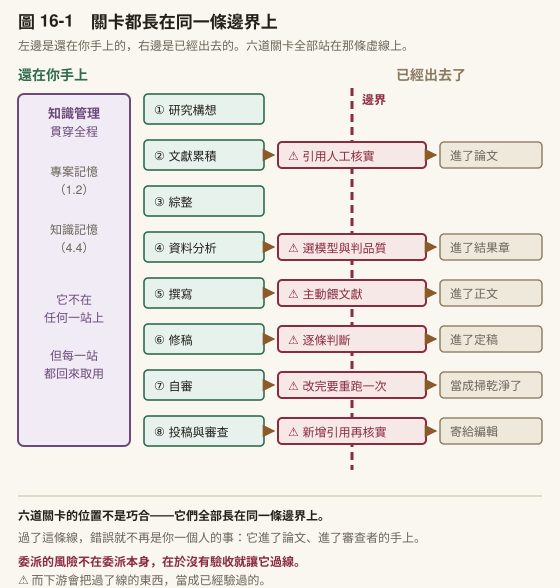
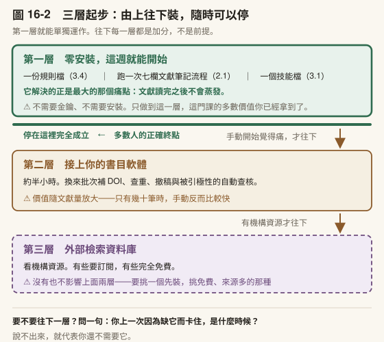
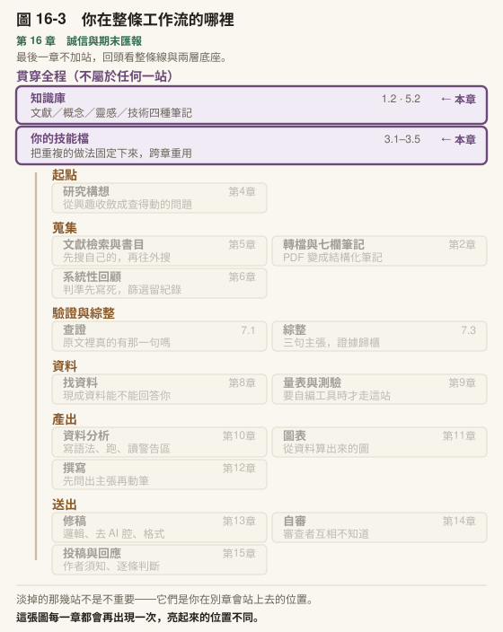

# 第 16 章　誠信框架、成果發表與期末匯報

> 書稿第 16 章＝課程第 16 週（3 小時）。

---

## 本章導覽

**這一章回答四個問題**

1. 十六章講的誠信，合起來到底是幾件事？
2. 一份 AI 使用聲明要寫到什麼程度才有用？
3. 課程結束之後，你該帶走什麼？
4. 期末的兩種終點，用什麼標準檢核？

**讀完你能夠**

- **說明**全書十六章的〈責任落點〉如何收束為同一個判準
- **寫出**一份可被查證的 AI 使用聲明，含四類必要資訊
- **設計**一份課堂 AI 使用政策，每條界線都說得出理由
- **完成**期末交付：一篇論文或一份研究計畫書，附同一套檢核
- **驗過**整套研究工作台，每一樣都知道怎麼確認它還在運作

**需要多久**

自學閱讀約 60 分鐘｜課堂 3 小時（含期末匯報）

**進來之前，你要能**

- 拿出你要交的論文或研究計畫書，以及它的決策日誌與核實紀錄

**開始前請準備**：期末交付物與匯報材料；你的研究工作台。

---

## 章前導言

這是最後一章。前十五章各自處理研究的一段，這一章把它們並排放，看它們是不是同一件事。

16.1 把十六章的〈責任落點〉合成一張表，並處理三件跟誠信直接相關的實務：資料保護、使用聲明、以及你要證明的東西會消失。16.2 處理課程結束之後的事：這一整套東西怎麼不變成一疊沒人用的筆記，以及定期把它拿掉一次。16.3 是期末匯報：走到資料的人交論文，走不到的人交研究計畫書，兩種用同一套檢核。

> **〔課堂〕開場 5 分鐘** 問全班：**「這學期你交給它做、而你現在說不出它怎麼做的事，有幾件？」** 不要收答案。期末匯報的提問，會從這幾件開始。

---

## 16.1 誠信的完整框架

### 十六章講的是同一件事

每一章結尾都有一個〈責任落點〉小框。分開看是十六個提醒，並排看是一張表。

| 章 | 場景 | 不能委派的核心 |
|---|---|---|
| 1 | 搭現場、理解工具 | 判斷它能做什麼、查證它產出的每一筆事實、決定它進不進你的研究 |
| 2 | 第一份筆記 | 第 5 欄「與我研究的關聯」、判斷它哪一欄是編的 |
| 3 | 技能與規則 | 技能裡寫什麼品質標準、規則檔留哪幾條 |
| 4 | 研究構想 | **研究問題長什麼樣**、決策日誌的理由欄、一件事該不該交出去 |
| 5 | 文獻檢索 | 讀什麼、不讀什麼；概念筆記；標定驗證層級 |
| 6 | 系統性回顧 | 納入排除判準、最後的篩選裁決 |
| 7 | 查證與引用 | 比對結果、**三句主張是什麼**、空容器要當缺口還是放棄 |
| 8 | 找資料 | 資料裡的變項是不是真的測到你的構念、資料能不能用、要不要改題 |
| 9 | 量表與測驗 | 題目測不測得到構念、正解鍵、刪不刪題 |
| 10 | 統計分析 | 選模型、判資料品質、讀警告區、解讀結果 |
| 11 | 圖表 | 圖要回答什麼問題、圖上的數字對不對得回輸出 |
| 12 | 寫作 | 每一段要讀者接受的那一句、哪些證據撐多強的主張 |
| 13 | 修稿 | 每一條修改建議收不收、改寫前後的差異哪些是你要的 |
| 14 | 自審 | 每一項審查意見的處置、你的判準一不一致 |
| 15 | 投稿與回應 | 期刊合不合適、回應審查的策略與理由 |
| 16 | 誠信與收束 | 寫出可查驗的使用聲明、課堂政策每一條界線的理由 |

把不能委派的那一欄讀一遍，它們可以收成一句話：

> **凡是需要你的學科判斷的，都不能委派；凡是機械的、形式的、重複的，都可以。**

這句話的操作意義在於：當你不確定某件事該不該交出去，問自己一個問題：**如果它做錯了，我看得出來嗎？**

看得出來的（語法錯誤、格式不符、錯字），交出去很安全，因為錯誤會浮出水面。看不出來的（模型選錯、引用的詮釋偏了、論證的隱含前提），不能交，因為錯誤會安靜地留在你的論文裡，直到有人發現。

這也解釋了為什麼統計（[第 10 章](../chapters/10-statistics.md)）是全書風險最高的一章：**它的錯誤最不容易浮出水面。**

### 資料保護：三條實用的線

誠信不只是引用和揭露。你手上如果有學生資料、訪談逐字稿、田野筆記，還有一層資料保護的責任。

**第一條：給的資料只到任務需要的程度。** 分析學生作文的結構，不需要學生的姓名和學號。要 AI 幫你寫語法，不需要給它整份資料檔，變項清單就夠了。

**第二條：先去識別化再上傳。** 姓名、學號、班級、可辨識的個人細節，在資料進入任何對話之前處理掉。這件事本身可以請 AI 幫你寫語法批次處理（在你自己的電腦上跑），但不要為了讓它幫你去識別化而先把含個資的原始檔給它。

**第三條：公開之前逐項檢查。** 專案分享連結、產出的成品頁面、外部工具連接，這些都有資料外洩的可能。公開前檢查兩件事：裡面有沒有學生或受訪者的資料，以及有沒有未授權的教材內容。

還有第四條，而且它跟前三條的形狀不一樣。

前三條防的是**你主動貼進去的東西**。這一條防的是你沒注意到自己貼出去的東西：

> **錯誤訊息裡可能夾著你的憑證。**

這件事我自己踩過。當時在命令列呼叫一個需要授權碼的服務，指令被系統換成了另一個不吃那種寫法的工具，於是它報錯，而報錯的方式是把它看不懂的參數原樣印出來，授權碼就整條夾在錯誤訊息中間。

如果我當時把那整段錯誤貼給別人問「這是什麼意思」，那個授權碼就跟著出去了。

⚠️ 這一類外洩的討厭之處在於**它不長得像個人資料**。你會很自然地把一整段紅字複製貼上，因為你只想知道哪裡錯了。研究情境裡最常見的三種：

- 呼叫**資料庫或期刊 API** 時的授權碼
- 連**遠端伺服器或雲端硬碟**時的路徑與帳號
- 錯誤訊息裡的**完整檔案路徑**——它常常包含你的姓名、機構、專案代號

規矩是：貼任何錯誤訊息或執行紀錄之前，先自己掃一遍。而且這一條對**貼給同事**跟對貼給 AI 一樣成立。

〔補充〕**機構規範優先於本書的任何建議。** 各校的研究倫理審查、資料管理規定、以及個人資料保護法規的適用範圍各不相同，而且會更新。涉及人類受試者的研究，先問你的 IRB，不要先問 AI。

**而在臺灣，規範是三層的。** 由遠而近：政府層（國科會的生成式 AI 參考指引）、主管機關層（教育部的學術倫理教育資源中心）、以及你的學校。第三層才是真正管到你的那一層，各校規定不一致而且仍在修訂。

這三層跟本節後面講的國際規範不是替代關係，是疊加的。國際規範管的是你投稿之後，在地規範管的是你的學位、你的計畫、你的職位。**兩邊都要看，而且衝突時以在地為準**，因為那一層有實際的處分權。連結見附錄 D-5。

中間那一層有一份手冊，裡面有兩處值得你自己開一次。

第一處是教育部臺灣學術倫理教育資源中心的《AI 世代的學術寫作指南：給研究生的參考手冊》（2026）的整體框架。它把運用生成式 AI 於研究活動的注意事項整理成六項： **開放與包容、資訊驗證能力、學術研究的課責性、學術研究的創新性、學術研究的透明性、以及可能衍生的法律問題**。六項裡跟本書最直接對上的是**課責性**—— 它明白寫著研究者要對自己的研究行為與產出負**全部**責任。

第二處是這份手冊引述的一個判準，而**這一條本書前面沒有給過**：

> **文字雷同的容忍度，隨章節不同。** 前言、文獻探討、理論基礎、方法這幾章，容忍度比較大； **研究問題、假設、結果，以及對結果的討論，不應與他人有大段文字雷同。**

這一條很值得記住，因為它給了你一個比「不要抄襲」更可操作的東西。方法章寫得像別人的方法章，那是領域慣例；討論章寫得像別人的討論章，那是你沒有自己的論點。但各領域的容忍度仍有差異，這是原則不是刻度。

〔補充〕還有兩個區分，同一份手冊講得比本書前面清楚。第一，**學術倫理的抄襲，範圍比《著作權法》的侵權更廣**。著作權法保護的是「表達」，不保護抽象的觀念與構想；但別人的研究構想即使經你重新表達而不違反著作權法， **未適當引註仍有違反學術倫理之虞**。兩者構成要件不同，不是同一件事。第二，**自我抄襲的問題核心有三個**：低原創性、低透明度、以及故意性。中間那一個最常被忽略。沒有告訴別人這是重複發表，本身就是問題，不必等到有人證明你想騙誰。

〔補充〕**臺灣的期刊已經有明文政策了，不是只有國外。** 三個實例：台灣內科醫學會的醫學倫理委員會訂有使用生成式 AI 產生科學性著作的規範及共識（2023）；台灣護理學會《護理雜誌》明訂 AI 書寫工具不得列為作者，若有使用應**於致謝欄、研究方法或其他合適處主動披露軟體名稱與使用方式**；中華民國體育學會亦有相關規定。**投稿前直接去看你那本期刊的作者須知**，不要用別本的政策推測。這一層變動很快，而且各刊寬嚴不一。

### 使用聲明：空泛與具體的差別

附錄 D-1 給了你一個三行版的最小聲明。現在講完整的。

一份聲明的價值在於**能不能被查證**。看兩個對照：

❌ 「本研究使用 AI 輔助撰寫。」

✅ 「AI（Claude）協助本文之文獻摘要整理與初步分類（步驟：上傳 18 篇論文之全文 PDF，請 AI 逐篇產出結構化筆記；主題分類由作者完成）、論文段落之語句修飾與 APA 格式檢查。研究問題、理論框架、資料分析方法之選擇、結果詮釋與結論均由作者完成。所有引用文獻經作者逐筆核實（DOI 解析與全文比對）。」

第二個之所以有價值，不是因為它比較長，是因為**每一句都指向一個可以被檢查的動作**。讀的人知道要往哪裡查，你自己也知道當初做了什麼。

一份可查驗的聲明包含四類資訊：

1. **用了什麼工具**（名稱，必要時含版本或時間）
2. **在哪些環節用了**（具體到步驟，不是「輔助撰寫」這種籠統說法）
3. **哪些是你做的**（尤其是判斷層的工作）
4. **怎麼查證的**（引用怎麼核實、產出怎麼檢查）

### 一個時間問題：你要證明的東西會消失

上面那份聲明有一個前提沒有講出來。你得證明得出來。

而這裡有個麻煩：**AI 生成的內容無法回溯**。同一段提示詞，你今天問和三個月後問，拿到的東西不一樣；模型會改版，對話紀錄會被清掉，工具本身可能停止服務。等到有人問起「你當初是怎麼用的」，你手上通常什麼都沒有。

昆士蘭大學圖書館對這件事的建議只有三個動作，而且都很便宜：

1. **標示使用日期**
2. **截圖備份**
3. **另存新檔**

**這三件事要在當下做，不能事後補。** 這正是[第 1 章](../chapters/01-setup.md)那本決策日誌的用途之一—— 它本來就是「當下寫一行，未來的你才知道為什麼」。**把 AI 的使用歷程當成研究決策來記，就對了。**

而且這一層目前是**你自己的責任，不是出版社的**。出版社說要揭露，但多半沒說清楚要揭露到什麼程度、什麼算「大幅使用」，也不會告訴你他們用哪個工具檢測。 **在規則模糊的時候，能保護你的只有紀錄。**

〔補充〕**投稿的話，還有兩件事要知道。** 第一，**揭露與引用是兩件事**。揭露是說明你怎麼用；引用是把某次對話當成來源寫進參考文獻。前者幾乎一定要做，後者只在「那段對話本身是你的證據」時才需要。你只是用它潤稿的話，在方法段揭露即可，不必逐次引用。第二，國際規範要求揭露寫在**投稿信與稿件兩個地方**，而且未揭露在某些情況下可能被認定為不當行為。這不是建議事項。兩件事的完整對照與格式骨架見附錄 D-[3.5](../chapters/03-skills.md#35-讓它長大)，規範原文連結見本章〈延伸資源〉。

〔動手一下〕翻出你最近一份交出去的作業或稿件（如果有寫 AI 使用聲明的話）。它符合上面四點嗎？如果那份聲明拿掉之後，別人完全看不出你做了什麼，那它就是裝飾品。

### 你會需要設計一份政策

如果你是教師，或未來會是，你遲早要面對這個問題：你的課堂允許學生用 AI 做什麼？

有兩種常見但都不太行的做法。**全面禁止**：執行不了，而且教出的學生離開學校之後照樣要用，只是沒學過怎麼用。完全放任：學生無從判斷界線在哪，用得越多的人越容易出事。

第三條路是把界線寫清楚。一份可用的政策至少要回答四個問題：

1. **允許什麼**（例：查文獻、改語句、產生練習題）
2. **禁止什麼**（例：代寫論證、生成未經核實的引用、上傳含個資的資料）
3. **需要揭露什麼**（用什麼格式、附在哪裡）
4. **界線的理由是什麼**（這一條最重要）

第 4 點決定了政策是不是活的。如果你禁止某件事只因為「怕學生作弊」，學生會找漏洞。如果你能說清楚「這一題禁止用 AI，是因為這門課的目標就是練這個能力，用了 AI 你就沒練到」，那是一個學生可以理解、也可以自己延伸應用的判準。

而你會發現，這個判準跟前面那句「如果它做錯了我看得出來嗎」是同一個邏輯的教學版：在還沒有能力判斷輸出對不對之前，你需要自己先做過一次。

> **〔課堂〕16.1 使用聲明與政策，30 分鐘實作** 使用聲明設計工作坊。每人為一個自己設計的學生任務草擬 AI 使用政策，包含允許事項、禁止事項、學生需提交的紀錄格式、以及每條界線的理由。小組交換檢查：**專挑理由那一欄**。理由寫「避免抄襲」的一律退回重寫，因為那不是理由，是結果。

### 帶走這一節

- 十六章的〈責任落點〉是**同一條線的十六個位置**，不是十六個獨立提醒
- 單一判準：**如果它做錯了，我看得出來嗎？** 看不出來的不能交
- 統計（[第 10 章](../chapters/10-statistics.md)）是全書風險最高的一章，因為它的錯誤最不容易浮出水面
- 資料保護三條：只給任務需要的、先去識別化、公開前逐項檢查
- **第四條：錯誤訊息裡可能夾著憑證或含個資的檔案路徑。**貼任何紅字之前先自己掃一遍——貼給同事跟貼給 AI 一樣成立
- 聲明的價值在**可查證**，不在長度。寫不出細節代表過程沒留痕跡
- **AI 生成的內容無法回溯**：標日期、截圖、另存新檔，**當下做，不能事後補**
- 在地規範層的一條實用判準：**文字雷同的容忍度隨章節不同**——方法章寬，討論章不寬
- **學術倫理的抄襲範圍比著作權法更廣**；自我抄襲的核心是低原創性、**低透明度**、故意性
- 政策的理由欄決定它是不是活的。**寫「避免作弊」不是理由，是結果**

---
---

## 16.2 帶著什麼離開


### 完整工作流

十六章走完，這是全貌：

```
研究構想
    └── 引導式規劃，收斂研究問題

文獻累積
    └── 讀 → 結構化筆記 → 知識庫
    └── ⚠️ 所有引用人工核實

系統性回顧（文獻回顧本身就是研究時）
    └── 判準先寫死 → 檢索紀錄 → 雙人篩選 → 一致性 → PRISMA 數字從紀錄算

綜整
    └── 三句主張 → 證據歸櫃 → 空櫃 = 缺口
    └── AI 當反方，不當綜整者

找資料
    └── 編碼簿 → 變項對照表 → 資料可行性
    └── ⚠️ 每一個變項名都要確認真的存在

量表與測驗（需要自編工具時）
    └── 雙向細目表 → 命題 → 審查 → 預試 → 試題分析
    └── ⚠️ 計分前核對正解鍵

資料分析
    └── R 路線：分區塊寫 → 跑 → 偵錯 → 回流
    └── SPSS 路線：Paste 出語法 → 跑 → 報表轉 APA
    └── 跑通後 → 存成技術筆記
    └── ⚠️ 選模型與判品質是研究者的責任

圖表
    └── 資料圖由程式從輸出算出來
    └── ⚠️ 圖上的數字回對輸出

撰寫
    └── plan → outline → draft → revise → abstract
    └── ⚠️ 主動餵文獻，不期待它自己找

修稿
    └── 三輪：邏輯 → 去 AI 腔 → 格式
    └── ⚠️ 逐條判斷，不全盤接受

自審
    └── 五個角色分開跑 → 分級清單 → 修訂清單
    └── ⚠️ 改完的那幾條要重跑一次

投稿實務
    └── 選期刊 → 作者須知核對表 → 匿名化檢查 → 投稿信

投稿與審查
    └── 意見結構化 → 決定策略 → 修改與回應 → 自我驗收
    └── ⚠️ 新增引用再次核實

知識管理（貫穿全程）
    └── 專案記憶：說明檔＋決策日誌
    └── 知識記憶：文獻／概念／靈感／技術四種筆記
```



〔圖 16-1〕**六道關卡全部長在同一條線上**。那條線就是「還在你手上」與「已經出去了」的分界。左邊那一欄從頭貫穿到尾：它不在任何一站上，但每一站都回來取用它。 16.1 那張表說判準是一條線；這張圖說那條線的實體位置在哪裡。

注意到那些關卡的位置。它們全部落在**產出離開你的手、進入外部世界**的前一步：引用進論文、模型進分析、修改進稿件、回應寄給編輯。委派的風險出在沒有驗收就往下游送。

自審那一道關卡（**改完的那幾條要重跑一次**）看起來跟其他五道不太一樣，因為它右邊那格不是「進了論文」而是「當成掃乾淨了」。它防的東西也確實不同：其他五道防的是壞東西過線，這一道防的是「我以為我已經檢查過了」過線。 後者更難察覺，因為它不留痕跡。稿子上看不出你少跑了哪一輪。

### 第一週：一個習慣

課程結束之後最常見的結局是什麼都沒發生。要改的事情太多，於是一件都沒改。

所以下週只做一件事。挑一個你**這一週本來就要做**的任務，用這門課的方式做一次：

- 有論文要改 → 跑修稿三輪
- 有文獻要讀 → 跑一次文獻筆記流程
- 有分析卡住 → 用 chunk 迴圈偵錯一次
- 有審稿要交 → 用多角度檢查跑一次

一件。做完之後，如果它省下了時間，你自然會做第二件。如果它沒省下時間，你會知道原因，而那個原因通常比「我應該更常用 AI」有價值得多。

### 裝到什麼程度就夠了

還有一個問題會擋住很多人：這一整套，我到底要裝多少東西？

答案是三層，而且**每一層都單獨成立**。沒有上面那層，下面這層照樣運作。



**第一層：零安裝，這週就能開始**

- 在專案資料夾放一份**規則檔**（[3.4](../chapters/03-skills.md#34-提示詞技能代理)）：研究問題、變項定義、不可違反的規矩
- 把手上的 PDF 轉成純文字，跑一次**七欄文獻筆記流程**（[2.1](../chapters/02-first-note.md#21-把一篇-pdf-變成一份筆記)）
- 把你重複講第三次的那段話，存成**一個技能檔**（[3.1](../chapters/03-skills.md#31-最小的技能一個檔案五段)）

這一層沒有任何安裝步驟，也不需要任何金鑰。**而它解決的正是最大的那個痛點：文獻讀完之後不會蒸發。**

第二層：接上你的書目軟體（約半小時）

裝一個連接器（[3.4](../chapters/03-skills.md#34-提示詞技能代理)），讓它直接讀寫你的書目庫。換來的是 [5.3](../chapters/05-literature-search.md#53-書目管理層讓機械工作歸機械) 那七步從手動變成批次，以及撤稿與被引極性的自動查核。

這一層的價值隨你的文獻量放大。**只有幾十筆的時候，手動反而比較快**—— 先累積到「手動已經明顯痛」再裝，不要為了裝而裝。

第三層：外部檢索資料庫（看你的機構資源）

有些要機構訂閱，有些完全免費。**沒有也不影響前兩層。** 真的要挑一個先裝，挑免費、來源多的那種。投入最低，覆蓋面最大。

> **一個判準，決定你現在該不該往上一層：** **你上一次因為缺這一層而卡住，是什麼時候？** 說不出來，就代表你還不需要它。（這句話你在[附錄 F](../appendix/F-skill-library.md) 的模式增減判準見過，它是同一句。）

### 讓工具跟著研究長

[第 10 章](../chapters/10-statistics.md) [10.2](../chapters/10-statistics.md#102-當你遇到不會的方法) 講的那條「工具會成長」的線，落實下來是一個很小的習慣：

每次你發現自己在重複解釋同一件事，就把它寫進工具裡。

第三次跟它說「我的研究對象是某某族群」的時候，把這句話寫進你的技能。第二次修正同一種格式錯誤的時候，把規則寫進去。解決了一個花你兩小時的技術問題之後，存成技術筆記。

這些動作單次都只花五分鐘，而且單次都感覺不出價值。它們的回報在半年後：那時候你的工具已經知道你的領域、你的格式、你的品質標準，而你早就忘記自己教過它這些。

### 把它拿掉之後

〈裝到什麼程度就夠了〉問的是往上加。這一節問相反的方向：

> **如果它今天不能用，你手上還剩什麼？**

這不是假設題。斷網、服務中斷、額度用完、出國、學校的電腦裝不了東西、口試現場——這幾件事你在論文寫完之前多半會遇到至少一次。

**先看整條流程的實況。**

| 這件事 | 把它拿掉之後 |
|---|---|
| 知識庫本身（純文字、連結、標籤） | **不受影響。** 那是你硬碟上的一堆文字檔，斷網照開 |
| 專案說明檔與決策日誌 | **不受影響。** 它本來就是寫給三個月後的你看的，不是寫給它看的 |
| 七欄文獻筆記 | **成立，但變慢。** 那七個欄位是一份閱讀提綱，你自己照著填一樣填得出來 |
| 五個問題拆解研究設計（[5.4](../chapters/05-literature-search.md#54-這篇論文為什麼這樣做)） | **不受影響。** 書裡本來就寫著這一節不能交出去 |
| 四步核實與核實紀錄（[7.1](../chapters/07-verification.md#71-引用幻覺與四步核實)） | **不受影響。** 查資料庫、逐欄比對書目，本來就是你在做 |
| 綜整四步驟（[7.3](../chapters/07-verification.md#73-從二十篇筆記到一個論點)） | **成立。** 它在那一節的位置是反方，不是綜整者 |
| 修稿第一輪：邏輯 | **成立。** 逆向大綱是紙筆做得到的事 |
| 修稿第二輪：去 AI 腔 | **不需要。** 你沒有用它寫，就不會有 AI 腔 |
| 轉檔、補 DOI、查重、格式掃描、批次作業 | **這一格才是真的會停** |

看最後一格。**會停的東西全部是機械工作**——而那正好是判準線的右邊。

這是這本書的兩條主線合起來的地方：

> **不能交出去的那些事，也正是拿掉它之後你自己做得起來的事。**

反過來，拿掉它之後會停下來的，是可以交出去的機械工作。你最不能委派的那幾件（決定主張、選模型、判斷替代解釋、拆解別人的設計），**恰好也是它不在的時候你照樣做得下去的那幾件**。兩者是同一個性質的兩種說法：**需要你的學科判斷，所以交不出去，也所以不會因為它不在而消失。**

〔動手一下〕**5 分鐘。** 回想你這一週用它做過的三件事。每一件問一次：「如果今天它壞了，這件事我還做不做得成？」把答案分成兩堆。**右邊那堆（做不成的）如果有任何一件需要你的學科判斷，那一件就是你該回頭檢查的。**

### 今天就是不能用的時候

處境不同，做法不同。

| 處境 | 怎麼辦 |
|---|---|
| **斷網或服務中斷**（幾小時到一天） | 往下做不需要它的那一層：讀你已經轉好的全文、填七欄、寫概念筆記、拆解設計、跑綜整四步驟。⚠️ **這些本來就該佔掉你多數的時間** |
| **額度用完**（等到下個週期） | 同上。另外開一份清單，記下你本來要它做什麼——那份清單就是額度回來那天的批次工作，而且批次比零星問更省 |
| **學校電腦不能裝、機構有限制** | 知識庫可以整個放在隨身碟裡。純文字檔沒有相依，換一台電腦打開就是了 |
| **口試、考試、現場報告** | 這一格不是應急，是設計問題。見下一小節 |

⚠️ **如果斷網半天你就完全做不下去，那不是網路的問題。** 那代表你的流程裡沒有一段是留在你自己手上的，而這件事不會等到斷網才有代價—— 它會在口試現場、在審查者追問「你為什麼這樣設計」的時候現形。

### 定期把它拿掉一次

上面講的是被動遇到，這一小節講主動安排。

判準用的是同一句（完整討論在書末〈帶學生的時候〉第三節）：

> **你上一次不用它做同一件事，是什麼時候？**

答不出來，或答案是「沒有過」，那就該排一次。

做法很小：**同一種任務，每隔一段時間裸做一次。** 讀一篇論文自己填七欄、自己寫一段文獻回顧、自己查十筆引用。不是為了證明什麼，是為了知道**差距在哪一格**。

兩種結果都有用：

- **做得出來，只是慢** → 那個支撐是鷹架。慢是它該有的樣子，不是問題
- **做不出來** → 你找到了一件要練的事，而且是在論文送出去之前找到的

⚠️ **裸做那一次要事先排進行事曆，不要等「有空的時候」。** 理由跟[第 3 章](../chapters/03-skills.md)講技能檔一樣：靠意志力執行的東西不會被執行。一個現成的掛點是每章的實作——**你已經跑過一次的那個練習，三個月後不用它再跑一次**，材料現成，對照也現成。

**還有一個更好的掛點：你自己的技能檔。** [3.5](../chapters/03-skills.md#35-讓它長大) 的〈也要寫退場〉要求每個檔案最下面留四行，其中一行是「上次裸做：____」。你每次打開檔案都會看到那個空格。⚠️ **如果你當時跳過了那一節，現在是回去補的時候**—— 你手上的檔案已經比那時候多了。

〔補充〕**退場為什麼要寫進檔案，而不是記在心裡。** 因為責任移轉不會自己發生。鷹架研究把它列為三個關鍵成分之一（見 [3.5](../chapters/03-skills.md#35-讓它長大)），而工具這一端**沒有任何機制**會把責任交還給你—— 它不會有一天告訴你「這件事你可以自己做了」。**要嘛你寫下條件，要嘛它永遠不發生。**

### 有些場合本來就該拿掉

最後一類跟前面三類不同：它不是不能用，是不該用。

書裡已經標出來的有這些——

- **拆解別人的研究設計**（[5.4](../chapters/05-literature-search.md#54-這篇論文為什麼這樣做)）。明文寫著不能交出去
- **決定你的三句主張**（[7.3](../chapters/07-verification.md#73-從二十篇筆記到一個論點)）。它可以當反方，不能當作者
- **選模型、判資料品質**（[10.1](../chapters/10-statistics.md#101-統計輔助的責任邊界)）。它的錯誤在這裡最不容易浮出水面
- **課堂上要求學生先自己做一次的那些**（[附錄 E](../appendix/B-E-toolkit-policy.md)）

它們有同一個形狀：**你還不知道正確答案。**

在你知道答案的地方用它，出錯你看得見；在你不知道答案的地方用它，你拿到的是一份你沒有經歷過的理解，而且沒有任何對照組告訴你它錯了。

這就是[第 1 章](../chapters/01-setup.md)那句話在這裡的樣子：**如果它做錯了，我看得出來嗎？**

而在口試現場，這句話會換一個問法：**這句主張是我的嗎？**

口試沒有辦法作弊，因為沒有人能替你答辯。你寫進論文的每一句主張，那天都可能被指著問「你為什麼這樣說」。被問出來的主張你答得出來——你早就答過一次了，只是那次問你的不是口試委員。代編給你的那些，你會在當場第一次發現自己講不出理由。

這也是 [第 12 章](../chapters/12-writing.md)那個做法真正的收益：口試那一天，你答得出每一句主張的理由。

### 帶走這一節

- 驗收關卡全部落在**產出離開你的手**的前一步
- 委派的風險不在委派本身，在於沒有驗收就往下游送
- 下週**只做一件事**。要改的太多，結果會是一件都沒改
- 沒省下時間的那次比省下時間的那次更有價值，因為你會知道原因
- 工具**三層起步，每層單獨成立**；第一層零安裝，而它就解決了最大的痛點
- 要不要往上一層，判準是：**你上一次因為缺它而卡住，是什麼時候**
- 迭代的最小習慣：**發現自己在重複解釋同一件事，就把它寫進工具裡**
- 把它拿掉之後，**會停的那一格全部是機械工作**——這條線跟判準線是同一條
- **不能交出去的事，也正是拿掉它之後你自己做得起來的事**
- 定期**裸做一次**，而且要事先排進行事曆。做得出來只是慢，那是鷹架；做不出來，你找到了要練的東西
---

## 16.3 期末匯報：兩種終點，同一套檢核

學期走到這裡，班上會有兩種學生。一種在[第 8 章](../chapters/08-finding-data.md)找到了能回答自己問題的次級資料，跑完分析，手上是一篇論文。另一種的題目找不到對應的現成資料，手上是一份研究計畫書：寫得出要問什麼、要怎麼蒐集、要怎麼分析，寫不出結果。

兩種都是這門課的正式終點。這一節定兩件事：兩種交付物各自要交什麼，以及用同一套檢核看兩種交付物。檢核相同，是因為這門課評的不是你產出了多少，是你在每一個判斷點上留下了什麼。

### 兩種交付物

| | 論文路線 | 計畫書路線 |
|---|---|---|
| 前言與文獻 | 研究問題、缺口、文獻回顧 | 同左 |
| 資料 | 資料來源、取得條件、變項對照（[第 8 章](../chapters/08-finding-data.md)） | **找資料的紀錄**：查過哪些資料庫、為什麼都不合用 |
| 方法 | 實際做了什麼分析 | **打算**怎麼蒐集、怎麼測量、怎麼分析 |
| 結果 | 結果與表格 | 預期結果的寫法：「若結果為 X，代表 Y；若為 Z，代表 W」 |
| 討論 | 結果的意涵、限制 | 可行性、風險、限制、時程 |
| 附件 | 六項檢核（見下） | 六項檢核（見下） |

計畫書路線的第二列不是補充。[第 8 章](../chapters/08-finding-data.md)教的那件事，判斷一份現成資料能不能回答你的問題，在計畫書裡要留下完整的紀錄：查了哪幾個資料庫、每一個看了編碼簿的哪些變項、卡在哪裡（變項測不到你要的構念、對象年齡不合、取得條件做不到）。這份紀錄證明「找不到資料」是查過之後的結論，不是沒去找。

計畫書路線的第四列，寫法有一條要守：每一個預期結果都要寫成**條件句**，並且兩個方向都寫。只寫你希望出現的那一個方向，那是假設，不是分析計畫。兩個方向都寫，讀的人才看得出你的研究設計是不是真的能區分它們。

⚠️ 計畫書最常出的錯，是寫著寫著把預期寫成了結果：前言說「本研究將檢驗」，到了討論變成「本研究發現」。這種句子讀起來很順，Claude 潤飾時也常把條件句改成肯定句，因為肯定句比較通順。交出去之前，搜一次「發現」「顯示」「證實」這類詞，逐處確認它們在講的是文獻，還是你還沒做的研究。

論文路線也有它常出的錯：只寫自己做了的分析，不寫做過但結果不支持的那幾個。[第 14 章](../chapters/14-self-review.md)講過，**未獲支持的分析屬於要報的範圍**，期末交付物照同一條規矩。

### 匯報的形式

每人報告 10 分鐘，提問 5 分鐘。修課人數多時分兩週或分組進行。報告的內容有固定的三段：

1. **研究問題，以及它怎麼改過**（約 3 分鐘）：從開學[第 4 章](../chapters/04-research-question.md)的選題訪談到現在，題目改了幾次，每一次因為看到了什麼。內容從決策日誌摘出來
2. **你最有把握的一個主張，和它的證據**（約 4 分鐘）：論文路線是一個結果；計畫書路線是一個「為什麼這個問題值得做」的論證，或你的設計為什麼能回答它
3. **你最依賴工具的一個環節**（約 3 分鐘）：那個環節你交出去了什麼、怎麼驗收的、如果工具不能用，那一段你做得出來嗎

第 3 段接的是本章〈把它拿掉之後〉那一小節。那裡問的是一般情況，這裡要你指出自己這學期的那一個環節。

提問那 5 分鐘有一條規則：**回答時不使用任何工具。** 提問的方式也有一條：至少一個問題是抽查。教師或同學從交付物裡指一個數字或一筆引用，報告者當場說出它的來源，打開對應的檔案指給大家看。

抽查的用意不在考倒誰。論文送審之後、口試現場，都會有人指著一句話問「這是哪裡來的」。這是那一天的預演，而且是在分數還能改的時候。

〔動手一下〕**5 分鐘。** 從你目前的稿子裡隨手挑三個數字（論文路線挑結果段的，計畫書路線挑文獻或樣本數的），計時，找出每一個的原始來源：哪個輸出檔、哪一行，或哪篇文獻、哪一頁。五分鐘內找不到的那一個，記下來，那是期末前要補的地方。

### 同一套檢核：六項附件

兩種交付物都附同樣六項。每一項都是前面某一章已經建過的東西，期末做的是把它們整理成別人看得懂的樣子。

| 檢核 | 論文路線看什麼 | 計畫書路線看什麼 | 前面在哪裡建的 |
|---|---|---|---|
| **一、主張與證據對照** | 每一個主要主張，指向哪個結果或哪一筆引用 | 每一個「為什麼值得做」的主張指向哪筆文獻；每一個預期結果指向哪一個分析 | [第 14 章](../chapters/14-self-review.md) |
| **二、引用核實紀錄** | `docs/核實紀錄.md`，稿內每一筆引用都在裡面，且標驗證層級 | 同左 | [第 7 章](../chapters/07-verification.md) |
| **三、數字溯源** | 結果段每一個數字，指得出輸出檔與行號 | 樣本數、效果量估計、資料集描述的每一個數字，指得出文獻頁碼或資料集文件 | [第 10 章](../chapters/10-statistics.md) |
| **四、AI 使用聲明** | 四類資訊：工具、環節、你做的部分、怎麼查證 | 同左 | 本章〈使用聲明：空泛與具體的差別〉 |
| **五、決策日誌摘要** | 從日誌挑出改變方向的那幾則，每則一行：日期、決定、理由 | 同左，**加上找資料過程中的決定** | [第 1 章](../chapters/01-setup.md)起 |
| **六、拿掉工具之後還剩什麼** | 一段話：交付物裡哪些部分你不靠工具做得出來、哪些做不出來 | 同左 | 本章〈把它拿掉之後〉 |

第三項對計畫書路線一樣適用。計畫書沒有結果，但它有數字：你估的樣本數從哪個效果量算出來、那個效果量來自哪篇研究、你說某個資料庫「只有六年級資料」是看了哪一份文件。這些數字沒有出處，計畫書的可行性論證就沒有依據。

第五項交摘要，不交整份日誌。挑的判準是：**這一則如果當時決定相反，交付物會長得不一樣嗎？** 會的才挑。一學期下來通常是五到十則。題目改過三次的學生，三次都要在裡面；計畫書路線的學生，「決定不走次級資料」那一則一定在裡面。

第六項不要寫成表態。「我認為我都做得出來」不是答案。要寫的是具體的環節：「文獻筆記的七欄我自己填得出來，只是慢；統計語法的偵錯我做不出來，這學期每一次都靠它」。後面那一句不扣分，它是你下學期要練的東西，寫得出來代表你知道自己在哪裡。

#### 用貫穿例子走一次

拿本書的例子「國小高年級學生怎麼判斷 AI 給的答案可不可信」看兩種路線的附件各長什麼樣。下面兩位學生與他們的數字都是示範，不是真實紀錄。

**論文路線**：這位學生訪談了 12 位五年級學生（S01–S12），做質性分析。質性研究也有數字，而且數字溯源一樣要做。稿子裡寫「12 位學生中有 8 位會拿課本對照 AI 的答案」，這個 8 要指得出來源：編碼表的哪一個代碼、哪幾位學生、各在逐字稿的哪一段。主張與證據對照的一列長這樣：

| 主張 | 證據 | 證據撐到哪裡 |
|---|---|---|
| 學生判斷 AI 答案時，最常用的方法是拿熟悉的來源對照 | 編碼表「對照既有來源」代碼：8 位學生、21 個段落 | 撐得住「這 12 位學生裡最常見」，撐不住「國小學生最常用」 |

第三欄寫的是：同一個證據撐得起哪一句、撐不起哪一句，寫下來之後，稿件裡哪一句寫過頭就看得出來。

**計畫書路線**：另一位學生想用問卷大規模調查同一件事，在[第 8 章](../chapters/08-finding-data.md)找了幾個公開資料庫，找到的資料都只問學生「多常使用 AI」，沒有問「怎麼判斷 AI 的答案」，於是走計畫書。他的預期結果寫成條件句：

> 若「會拿課本對照」的學生，在 AI 答案正誤判斷題的得分高於不會對照的學生，代表對照是一個有效的判斷策略；若兩組得分沒有差異，代表學生回報自己會對照，但這個習慣沒有反映在判斷的準確度上。

兩個方向都寫了，讀的人看得出這個設計能區分「學生說他會對照」和「對照真的有用」。他的數字溯源表裡，第一筆是「公開資料庫裡沒有判斷相關的題目」這個結論所依據的那份問卷題本，以及他查的是哪一年的版本。

兩人的決策日誌摘要各挑出幾則。論文路線那位的其中一則：

```text
| 第 7 週 | 研究問題從「學生信不信 AI」改成「學生怎麼判斷 AI 的答案」 | 前三位受訪者都說「要看情況」，信不信問不出東西，怎麼判斷才問得出 |
```

計畫書路線那位一定有的一則：

```text
| 第 8 週 | 不走次級資料，改寫計畫書 | 查過的三個資料庫都只有使用頻率題，沒有判斷題；改用使用頻率會變成另一個研究問題 |
```

兩則的理由欄都寫著當時看到的事實。匯報現場被問「為什麼改」，答的就是這一欄。

六項附件放在專案資料夾裡，繳交時用一份清單把它們串起來：

```text
期末繳交清單
─────────────────────────────
路線：論文／計畫書（擇一）
主交付物：稿件/交出去/〔日期〕_〔題名〕.docx

一、主張與證據對照：docs/主張與證據對照.md
二、引用核實紀錄：docs/核實紀錄.md（共 __ 筆）
三、數字溯源：docs/數字溯源.md（共 __ 個數字，未找到出處 __ 個）
四、AI 使用聲明：稿件末，或 docs/AI使用聲明.md
五、決策日誌摘要：docs/決策日誌_摘要.md（__ 則）
六、拿掉工具之後：docs/拿掉工具之後.md

自我抽查：我隨機抽了 __ 個數字、__ 筆引用，找不到出處的：____
```

最後一行是自己先做一次匯報現場的抽查。找不到出處的那幾個照實填，填零而現場被抽中找不到，比填三個更難解釋。

### 評量重點：不評產出量，評判斷的痕跡

兩種路線用同一張評量表，計畫書路線沒有分數上限。下面幾樣**不評**：

- 字數、頁數、文獻篇數
- 統計方法的複雜程度
- 結果顯不顯著
- 走到論文還是計畫書

第三條和第四條要特別說明。結果不顯著的論文，和結果顯著的論文評同一件事：主張的強度有沒有對上證據。走計畫書路線的學生，評的是他判斷「現有資料回答不了我的問題」這件事做得好不好，那正是[第 8 章](../chapters/08-finding-data.md)要教的判斷。

評的是下面五件事：

| 評什麼 | 看哪裡 | 做得好的樣子 |
|---|---|---|
| **判斷有痕跡** | 決策日誌摘要 | 每一次方向改變都寫得出當時看到了什麼 |
| **主張強度對上證據** | 主張與證據對照、稿件本身 | 相關研究不寫「影響」，一所學校的資料不寫「臺灣學生」，條件句沒有變成肯定句 |
| **可溯源** | 數字溯源、核實紀錄、現場抽查 | 抽到的數字與引用都找得到，找不到的自己先標出來了 |
| **揭露可查驗** | AI 使用聲明 | 讀的人知道要往哪裡查 |
| **答得出來** | 匯報提問 | 被問「為什麼這樣做」時，答的是當時的理由，不是現場想出來的理由 |

最後一項，判準是答案跟決策日誌對不對得上。日誌寫的是「因為資料裡沒有家長教育程度，所以改用學校層級的指標」，現場答的也是這個，那是你的判斷。現場答出一個日誌裡沒有的理由，未必是錯的，但它說明那個決定當時沒有被記下來。

這張表沒有一項在評工具用得多熟練。這條分界線在評量上的樣子是：機械的部分交出去了，評量就只看留下來的那部分。

### 匯報之後，兩條路各往哪裡走

學期結束不是研究結束。兩種交付物接下來的路不同，期末時就該寫進交付物的最後一段。

**論文路線**接[第 15 章](../chapters/15-submission.md)：選期刊、照作者須知改稿、投稿。期末交的版本離投稿通常還差兩件事，一是[第 14 章](../chapters/14-self-review.md)的對抗審查要再跑一輪（期末前多半只跑過一次），二是作者須知的核對表。決策日誌和核實紀錄不必重做，期末整理過的那一份就是投稿時寫 AI 使用聲明和回應審查意見的底稿。

**計畫書路線**的下一步是把計畫變成可以執行的研究。要蒐集新資料的研究，特別是對象是學生的，下一步多半是你學校的研究倫理審查。計畫書裡的方法段、知情同意的做法、資料保存方式，就是送審文件的底稿。本書不教倫理審查的送件程序，那是你學校的規定，本章前面〈資料保護：三條實用的線〉的〔補充〕講過：涉及人類受試者的研究，先問你的 IRB。

不管哪一條路，期末交付物最後都寫三行：下一步是什麼、預計什麼時候做、卡在哪裡。這三行是給三個月後的你看的。

〔教你的 Claude 建這個〕**一個交付前檢核技能。** 存在 `.claude/skills/final-check/SKILL.md`，description 寫「期末繳交前，檢查六項附件齊不齊、數字有沒有出處」。第一版只做兩件事：

```text
步驟：
1. 對照〈期末繳交清單〉，列出六項附件哪些檔案存在、哪些不存在
2. 讀主交付物，把每一個數字列成一張表：數字／所在段落／
   數字溯源檔裡有沒有這一筆。沒有的標「未登錄」

不要做什麼：
- 不替我補出處，不猜數字是從哪裡來的
- 不評論稿件內容
```

它不判斷出處對不對，只告訴你哪些數字還沒有出處。對不對要你打開輸出檔看。用過一次之後，你可能會想讓它順便抓「發現」「證實」這類詞給計畫書路線用，那時候再加一步。

> **〔課堂〕期末匯報日** 開場先講清楚抽查規則與「回答不用工具」，讓學生知道現場會發生什麼（5 分）。每人 10＋5 分鐘。抽查題由教師準備一題、台下同學出一題；同學出題時給 1 分鐘翻對方的交付物。學生最常卡在第 1 段：把題目演變講成一路順利。請他直接打開決策日誌摘要念其中一則。計畫書路線的學生常在開頭先道歉「我沒有結果」。開場時就告訴全班兩種路線評同一件事，可以省掉這段道歉。抽查找不到出處時，不當場扣分，請他記下來，匯報後一週內補交，評量看補交的內容與日誌是否一致。

### 帶走這一節

- 兩種終點都是正式終點：**論文**交結果，**計畫書**交找資料的紀錄與條件句寫成的預期結果
- 計畫書最常見的錯是**把預期寫成結果**；交出去前搜一次「發現」「證實」逐處確認
- 兩種交付物附**同樣六項檢核**：主張與證據對照、引用核實紀錄、數字溯源、AI 使用聲明、決策日誌摘要、拿掉工具之後還剩什麼
- 匯報的提問環節**不用工具**，至少一題是**當場指出數字或引用的來源**
- 評量**不評**字數、方法複雜度、顯不顯著、走到哪一種終點；**評判斷的痕跡**

---

---

## 本章建置：驗一次整套工作台

十六章的建置到這裡接齊了。這一節不建新東西，做兩件事：把十六章建出來的東西列成一張表，每一樣附一個驗它還在運作的動作；然後照表從上到下驗一次。

〔課堂〕約 20 分鐘，放在期末匯報之前。每個人對照表格勾自己缺了哪幾樣；缺的不扣分，但匯報時要說得出為什麼沒建。

### 整套工作台

| 章 | 檔案 | 它做什麼 | 你怎麼驗它在運作 |
|---|---|---|---|
| 1 | `CLAUDE.md`（兩份） | 每次對話都生效的規則 | 要它逐字貼出第 1 條 |
| 1 | `專案_我的論文/docs/決策日誌.md` | 每個決定與理由 | 理由欄沒有空的 |
| 2 | `_工作流/腳本/pdf_to_md.py` | 轉檔並報字數 | 餵一份掃描檔，它會擋 |
| 2 | `_工作流/提示詞/文獻筆記.md` | 七欄規格 | 第 7 欄搜得到原句 |
| 3 | `.claude/skills/literature-note/` | 文獻筆記技能 | 不提名字，它會自己用 |
| 3 | `.claude/settings.json` 的 `deny` | 原始資料改不了 | 叫它改，它改不了 |
| 3 | `.git/`、`.gitignore` | 每一次修改的紀錄 | `git log` 看得到 |
| 4 | `.claude/skills/ask-before-run/` | 費工的事先問 | 它列完問題會停 |
| 5 | `.mcp.json` | 讀得到書目庫 | Zotero 開著時問得到書目，關掉後它說連不上 |
| 6 | `專案_文獻回顧/`（判準、檢索紀錄、篩選紀錄） | 系統性回顧的程序留得下來 | 判準檔被鎖住，它改不了 |
| 6 | `_工作流/腳本/screening_agreement.py`、`prisma_counts.py` | 篩選一致性與 PRISMA 數字 | 拿一份故意弄壞的篩選紀錄，它會報缺漏 |
| 7 | `_工作流/腳本/check_quote.py` | 引文在不在原文裡 | 改一個字，它找不到 |
| 7 | `.claude/skills/verify-citation/`、`docs/核實紀錄.md` | 每一筆查證落進同一張表 | 沒全文時它會停 |
| 8 | `_工作流/腳本/codebook_scout.py`、`.claude/skills/codebook-scout/` | 從編碼簿找候選變項 | 給一個編出來的變項名，它說找不到 |
| 8 | `docs/資料可行性表.md`、`docs/變項對照表.md` | 資料能不能回答你的問題 | 每一列都寫得出原題目逐字 |
| 9 | `量表/` 題庫檔與試題分析腳本 | 試題分析與正解鍵核對 | 故意登錄錯一題正解，它會抓到 |
| 10 | `.claude/skills/method-advisor/` | 依你選定的書回答方法問題 | 問書裡沒有的，它說沒有 |
| 10 | `分析/輸出/` 與數字溯源規則 | 稿子裡的數字找得到出處 | 抽三個數字，指得出檔案與行號 |
| 11 | `分析/make_figure.py`、`docs/圖表規格.md`、`.claude/skills/figure-audit/` | 圖由資料算出來，圖上數值回對資料 | 改一列資料後跑 `--check`，它報不符 |
| 12 | `.claude/skills/interview-first/` | 先問主張再寫 | 它只問一題就停 |
| 13 | `_工作流/腳本/check_rewrite.py` | 改寫前後數字、引用、標記的差異 | 手動改一個數字，它列出來 |
| 14 | `.claude/agents/reviewer.md` | 看不到主對話的審查者 | 它不知道你改了哪裡 |
| 15 | `_工作流/腳本/scan_draft.py` 與 `hooks` | 交出去的稿子不留標記 | 餵一份髒的，它會擋 |
| 15 | `_工作流/腳本/check_metadata.py` | 匿名稿的作者欄、嵌入圖路徑、追蹤修訂 | 拿一份沒清乾淨的 .docx，它會列出來 |

最右邊那一欄是驗收動作。每一樣東西都可能在某一天悄悄失效：規則檔被移到子資料夾、技能的名字被改掉、關卡的路徑因為你換了電腦而對不上。**它們失效的時候都不會通知你。** 每學期開始時，或換電腦之後，照最右欄從上到下驗一次，約三十分鐘。

把[第 3 章](../chapters/03-skills.md)那個 `git add` 再跑一次，這次加上所有新的檔案，再用 `git commit` 提交，訊息寫「工作台十六章建置完成」。

### 帶走這一節

- 每一樣東西都附一個驗它的動作；**它們失效的時候不會通知你**
- 每學期開始、換電腦之後，照表驗一次
- 你沒建的那幾樣，說得出為什麼沒建

---

## 16.4 動手實作

### 實作一：AI 使用政策設計（30 分鐘）

為一個你設計的（或你正在修的）課程任務草擬 AI 使用政策。

四欄：允許什麼｜禁止什麼｜需要揭露什麼｜**每條界線的理由**

1. 個人草擬（15 分鐘）
2. 小組交換檢查（10 分鐘），專挑理由欄
3. 全班分享最難決定的一條界線（5 分鐘）

### 實作二：期末匯報（課堂其餘時間）

照 16.3 的規格進行。

### 技能要點

| 實作 | 關鍵動作 | 做對了長什麼樣 | 常見卡點 |
|---|---|---|---|
| 一 · 政策 | 理由欄寫得出「為什麼這門課劃這條線」 | 學生看得懂，而且能自己延伸到你沒規定到的情況 | 理由寫「避免抄襲」。**那不是理由，是結果** |
| 二 · 匯報 | 說得出每一個判斷是你做的、依據在哪 | 被問到任何一個數字，你指得出輸出檔 | 只報產出，不報判斷 |

### 期末task

照 16.3 的規格繳交。兩種終點擇一：

- **走到資料的人**：一篇論文，附 16.3 的六項檢核
- **走計畫書路線的人**：一份研究計畫書，附同樣六項（數字溯源指向文獻頁碼與資料集文件，見 16.3）

另附一份課堂 AI 使用政策（實作一的完成版）。

---

## 16.5 常見迷思

迷思一：「只要不是成績資料，就沒有個資風險。」

*為什麼錯*：可辨識性不等於敏感性。一份訪談逐字稿裡沒有姓名，但如果受訪者提到自己的職位、學校規模、任教年資，在小樣本的教育場域裡這些組合起來足以指認出一個人。田野筆記的問題更大，因為它本來就是為了保留脈絡細節而寫的。

*正確版本*：判準是「這段內容能不能反推到特定的人」，不是「這算不算敏感資料」。

迷思二：「交了 AI 使用聲明就盡到責任了。」

*為什麼錯*：一份寫著「本研究使用 AI 輔助」的聲明沒有傳遞任何資訊。讀的人不知道你用在哪、不知道哪些是你的判斷、不知道你查證了沒有。它滿足了形式要求，沒有滿足揭露的目的。

*正確版本*：聲明的功能是讓別人（和未來的你）知道要往哪裡查。寫不出可查驗的細節，通常代表當初的協作過程本身沒有留下痕跡，那才是真正要修的地方。

**迷思三：「工作流建好就固定了。」**

*為什麼錯*：你的研究會變，方法會變，工具本身也會變。一套六個月不修改的工作流通常不是完美，是沒在用。

*正確版本*：把「發現摩擦點就改一次」變成習慣。每次改動很小，累積起來就是一套只屬於你的工具。

---

> ### 〈責任落點〉 - 寫出可查驗的使用聲明：**你**。寫不出細節，代表過程本來就沒留痕跡 - 決定哪些資料可以進入對話：**你**，並以機構規範與資料使用條款為準 - 設計課堂政策的每一條界線與**理由**：**你** - 期末交付物裡每一個判斷：**只有你** - 工具負責的是：整理、比對、格式、掃描，以及這學期你交給它的每一件機械的事

---

## 16.6 章末整理

### 三句話帶走

1. 「如果它做錯了我看得出來嗎」是全書所有委派決定的同一個判準。
2. 工具跟著研究長，靠的是每次五分鐘的小修改，不是一次到位的大設計。
3. 工作台的每一樣東西都會悄悄失效，**定期驗一次**。

### 回到研究助理

這本書的書名說 AI 是研究助理。走到這裡，這句話可以說得更精確一點。

研究助理的價值不在於它做得出來。它做得出來，但你也做得出來，多一個會做的人不會讓論文更可信。它的價值在於它讓你騰出注意力去處理只有你能處理的事，而那件事最後會掛你的名字。

如果你用這套工作流省下了每週五小時的格式、排版、查表、重複解釋，然後那五小時你拿去多讀十篇論文、把主張想得更透，那這門課有價值。如果那五小時你拿去讓它幫你生成更多沒有經過你判斷的內容，那你只是把同樣的工作量換了一種形式，而且風險更高。

### 回到那位碩士生

[第 1 章](../chapters/01-setup.md)開場、[第 2 章](../chapters/02-first-note.md)交出兩筆假引用的那位碩士生。

如果他走完這十六章，他會在哪一步被攔下來？

- **[第 1 章](../chapters/01-setup.md)**：[1.5](../chapters/01-setup.md#15-在你往下走之前三件必須先知道的事) 那三件事已經告訴他，它會編造而且無法區分自己知道與不知道。
- **[第 2 章](../chapters/02-first-note.md)**：他親手抓過一次，所以「六篇裡有四篇我查得到」這件事本身對他就是一個訊號。[2.5](../chapters/02-first-note.md#25-最小查證三步) 那三步只花三十秒，那兩筆過不了第一步。
- **[第 3 章](../chapters/03-skills.md)**：他會發現自己從來沒把那兩篇的**內容**放進脈絡。
- **[第 4 章](../chapters/04-research-question.md)**：[4.2](../chapters/04-research-question.md#42-該不該交給它) 的判讀要他逐一檢查成品、過程、表現三樣。過程那一欄一問就破：他說不出那兩筆是怎麼被找出來的。
- **[第 5 章](../chapters/05-literature-search.md)**：先搜自己的再往外搜。那兩筆在他的知識庫裡找不到任何一則筆記。
- **[第 7 章](../chapters/07-verification.md)**：四步核實，第一步 DOI 就解析不開；就算僥倖通過，綜整的時候那兩筆沒有筆記可拆，進不了任何容器。
- **[第 12 章](../chapters/12-writing.md)**：draft 模式要他主動餵素材。那兩筆沒有素材可餵，段落會標出材料缺口。
- **第 16 章**：他的使用聲明要寫「引用如何核實」，寫的時候他會發現有兩筆他沒有核實過。

這八章裡有好幾道關卡，各自都可能攔下同一個錯誤。**一個可靠的工作流本來就會有冗餘**。你不必每一步都做對，只要別每一步都跳過。

他當初缺的不是謹慎。[第 1 章](../chapters/01-setup.md)就說了，那是知識問題不是態度問題。他缺的是一個正確的心智模型，加上一套會替他把關的流程。



〔圖 16-3〕亮起來的是這一章教的位置，淡掉的是你在別章會站上去的地方。

### 拿去跟人討論

找一個同學、同事或指導教授，挑一題聊十分鐘。

1. 各自寫一份 AI 使用聲明再交換。對方那一份，有沒有哪一句你覺得寫得太滿，或太保守？
2. 「省下來的時間拿去做了什麼」：各自誠實回答一次。兩個答案放在一起，你們會給對方什麼建議？
3. 十六章的責任落點表裡，哪一列你們最常讓出去？

### 最後

這十六章教的每一個工具都會過期。介面會改、功能會變、模型會換代。

不會過期的是那條界線：**哪些事需要你的判斷，哪些事不需要。** 這條線不隨工具版本移動，因為它關乎的是你的研究要不要站得住腳，工具只是載體。


---

## 延伸資源

**外部資源**

- **COPE — Authorship and AI tools**：[https://publicationethics.org/guidance/cope-position/authorship-and-ai-tools](https://publicationethics.org/guidance/cope-position/authorship-and-ai-tools) 16.1 使用聲明的國際依據。核心三條：AI 不能列為作者、用了必須揭露、作者對全文負完全責任（包含 AI 產出的部分）。
- **ICMJE — Use of AI by Authors**：[https://www.icmje.org/recommendations/browse/artificial-intelligence/ai-use-by-authors.html](https://www.icmje.org/recommendations/browse/artificial-intelligence/ai-use-by-authors.html) 比 COPE 更具操作性的五條要求。揭露要寫在**投稿信與稿件兩處**；AI 引用到的材料，確認出處是你的責任。
- **APA Style — Citing generative AI**：[https://apastyle.apa.org/blog/cite-generative-ai-references](https://apastyle.apa.org/blog/cite-generative-ai-references) 區分「引用某一次對話」與「揭露工具使用」兩種情況。附錄 D-[3.5](../chapters/03-skills.md#35-讓它長大) 有完整對照。
- **Wiley — AI guidelines for researchers**：[https://www.wiley.com/en-us/publish/article/ai-guidelines/](https://www.wiley.com/en-us/publish/article/ai-guidelines/)
- **臺灣在地規範三層**（附錄 D-5 有完整連結）：國科會〈行政院及所屬機關使用生成式 AI 參考指引〉／教育部臺灣學術倫理教育資源中心〈生成式 AI 應用於教學與研究〉／**你的學校自訂指引**。與國際規範**疊加而非替代**，衝突時以在地為準
- **你的機構研究倫理規範與 IRB 送審流程**：16.1 資料保護的實際依據，**優先於本書與上列任何一份外部資源**

**揭露與引用是兩件事，規則不同、後果也不同。** 引用格式錯了是編輯層的問題，改得回來；揭露不足是誠信層的問題，不一定。

**本書其他章節**

- **[附錄 D](../appendix/B-E-toolkit-policy.md)**：AI 使用聲明範本（三行版與完整版）
- **[附錄 E](../appendix/B-E-toolkit-policy.md)**：課堂 AI 政策範本
- **原始教材出處註記**：本章誠信框架的概念參考自公開教材，內容全部重寫。詳細出處見書末

---
